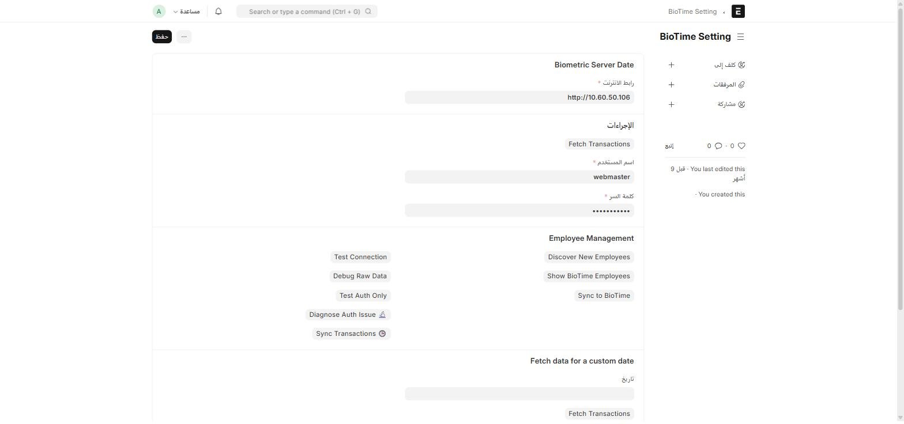

**BioTime** هو تكامل مع جهاز/خادم بصمة حضور خارجي (ZKTeco BioTime) — يسحب بصمات الدخول والخروج تلقائياً ويحوّلها إلى سجلات **Employee Checkin** في النظام.

## أين أجده؟

القائمة الجانبية ← مساحة عمل **BioTime Integration** ← **BioTime Setting**، أو اكتب في شريط البحث: `BioTime Setting`

هذه شاشة **إعداد واحدة (Single)** — لا توجد قائمة سجلات، بل صفحة تحكّم واحدة لكل النظام، **مقصورة على مدير النظام**.

## إعداد الاتصال

| الحقل | إجباري | ماذا تكتب |
| --- | :---: | --- |
| **رابط الانترنت** (URL) | ✅ | عنوان خادم BioTime |
| **اسم المستخدم** | ✅ | بيانات اعتماد الدخول لواجهة برمجة BioTime |
| **كلمة السر** | ✅ | |

## المزامنة التلقائية — تعمل دون تدخّل

:::note[لا تحتاج للضغط على "جلب المعاملات" يومياً]
بمجرد ضبط بيانات الاتصال، يعمل النظام تلقائياً في الخلفية بجدولين:

- **كل 5 دقائق**: مزامنة شبه فورية للبصمات الجديدة (Sync Transactions).
- **يومياً الساعة 11 مساءً**: سحب شامل لبصمات اليوم كاملة (Fetch Transactions)، لضمان عدم فوات أي بصمة.

كل بصمة تُطابَق بمعرِّف المعاملة الخاص بها على الجهاز (حقل `transaction_id` المضاف على **Employee Checkin**) لمنع تكرار نفس البصمة مرتين.
:::

## أزرار الإدارة والتشخيص

| الزر | متى تستخدمه |
| --- | --- |
| **Fetch Transactions** | سحب فوري يدوي، دون انتظار الجدولة التلقائية |
| **Fetch Transactions** (مع حقل تاريخ) | سحب بصمات **يوم محدَّد بالذات** — مفيد لتعويض انقطاع سابق |
| **Discover New Employees** | فحص الجهاز عن مستخدمين غير موجودين بعد كموظفين في النظام — راجع [مراجعة موظفي الجهاز الجدد](/biotime/employee-discovery/) |
| **Show BioTime Employees** | عرض كل موظفي الجهاز كما يراهم BioTime |
| **Sync to BioTime** | الاتجاه المعاكس: دفع موظفي ERPNext الجدد إلى الجهاز نفسه |
| **Test Connection** | فحص سريع: هل الاتصال بالخادم يعمل |
| **Debug Raw Data** | عرض البيانات الخام القادمة من الجهاز، لتشخيص مشاكل التنسيق |
| **Test Auth Only** / **🔬 Diagnose Auth Issue** | تشخيص مشاكل تسجيل الدخول تحديداً (بيانات اعتماد خاطئة، صلاحيات، ...) |
| **🕒 Sync Transactions** | تشغيل يدوي لنفس مهمة المزامنة كل 5 دقائق |

:::tip[إذا توقّفت البصمات عن الظهور]
ابدأ دائماً بزر **Test Connection**. إذا نجح لكن لا تصل بصمات جديدة، جرّب **🔬 Diagnose Auth Issue** ثم **Debug Raw Data** لمعرفة إن كانت المشكلة في الاتصال، الصلاحيات، أم في تنسيق البيانات القادمة من الجهاز.
:::
