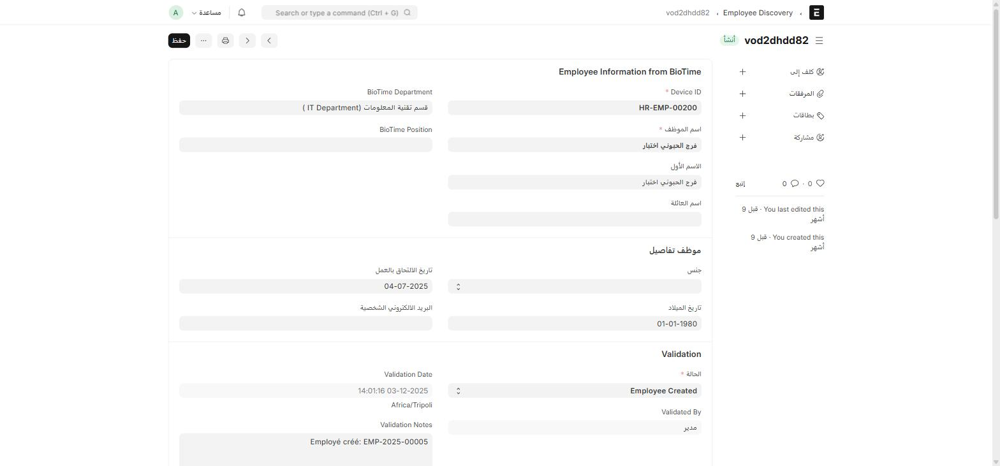

عندما يُسجَّل موظف جديد على جهاز البصمة قبل أن يكون له سجل **موظف (Employee)** في هذا النظام، يعالج ION الأمر بخطوتين: **تعيين القسم** أولاً، ثم **قائمة انتظار للمراجعة**.

## الخطوة 1: تعيين أقسام الجهاز (Department Mapping)

اكتب في شريط البحث: `Department Mapping`

جهاز BioTime يسمّي الأقسام بنص حر خاص به، لا يطابق بالضرورة أسماء الأقسام (Department) في هذا النظام. هذا الإعداد يربط بينهما **مرة واحدة لكل قسم**:

| الحقل | إجباري | ماذا يعني |
| --- | :---: | --- |
| **biotime_department** | ✅ | اسم القسم كما يُبلَّغ عنه من الجهاز (نص حر) |
| **erpnext_department** | ✅ | القسم الفعلي المطابق له في النظام |
| **default_designation** | — | المسمّى الوظيفي الافتراضي لأي موظف يُكتشَف تحت هذا القسم |
| **default_shift_type** | — | نوع التحوّل الافتراضي لهم |

:::tip[أعِدّ هذا مرة واحدة فقط]
بمجرد ربط كل أقسام الجهاز الفعلية بنظيراتها هنا، ستُملأ هذه القيم **تلقائياً** لأي موظف جديد يُكتشَف تحت هذا القسم لاحقاً — لا حاجة لتكرار الربط لكل موظف.
:::

## الخطوة 2: قائمة انتظار المراجعة (Employee Discovery)

بعد الضغط على **Discover New Employees** من [شاشة إعداد BioTime](/biotime/biotime-setup/)، يقارن النظام موظفي الجهاز بموظفي ERPNext، ويضع من لا يوجد له سجل مطابق في هذه القائمة.

اكتب في شريط البحث: `Employee Discovery`

| الحقل | ماذا يعني |
| --- | --- |
| **Employee Information from BioTime** (قسم) | البيانات الخام من الجهاز: القسم، المسمّى الوظيفي، الاسم — **للقراءة فقط، لا تُعدَّل يدوياً** |
| **status** | Pending Validation → Validated / Rejected → **Employee Created** |
| **mapped_department / mapped_designation / default_shift_type / employment_type** | القيم **المستخدَمة فعلياً** عند إنشاء الموظف — تُملأ مبدئياً من [Department Mapping](#الخطوة-1-تعيين-أقسام-الجهاز-department-mapping) لكن يمكن تعديلها هنا قبل الإنشاء |
| **validated_by / validation_date / notes** | من راجع هذا السجل، ومتى، وملاحظاته |

## زرا الإجراء

| الزر | ماذا يفعل |
| --- | --- |
| **Create Employee** | ينشئ سجل **موظف (Employee)** فعلياً بالبيانات المُراجَعة، وتتحوّل الحالة إلى **Employee Created** |
| **Reject** | يرفض هذا الاكتشاف (موظف جهاز لا يستحق سجلاً في هذا النظام، أو بيانات مكررة) |

:::note[ملاحظة تلقائية عند الإنشاء]
عند الضغط على **Create Employee**، يسجّل النظام تلقائياً ملاحظة في **Validation Notes** تؤكّد رقم سجل الموظف الجديد (مثال فعلي من هذا النظام: `Employé créé: EMP-2025-00005`) — سجل تدقيق يوضّح متى وكيف أُنشئ هذا الموظف تحديداً.
:::
