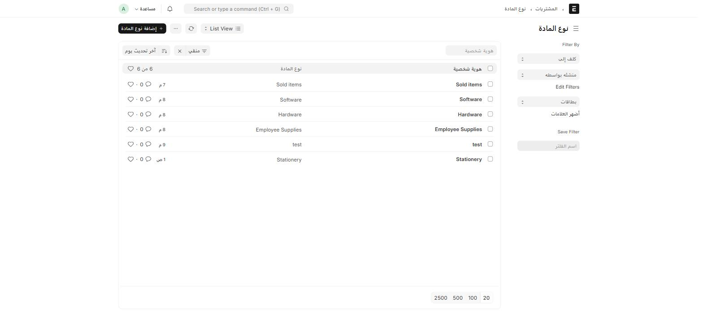
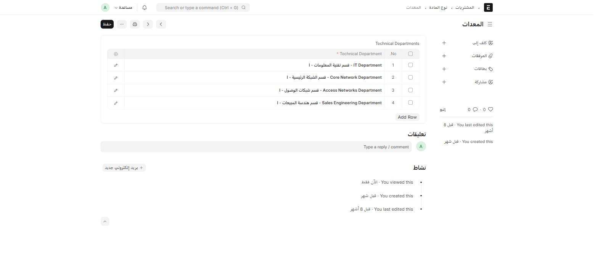
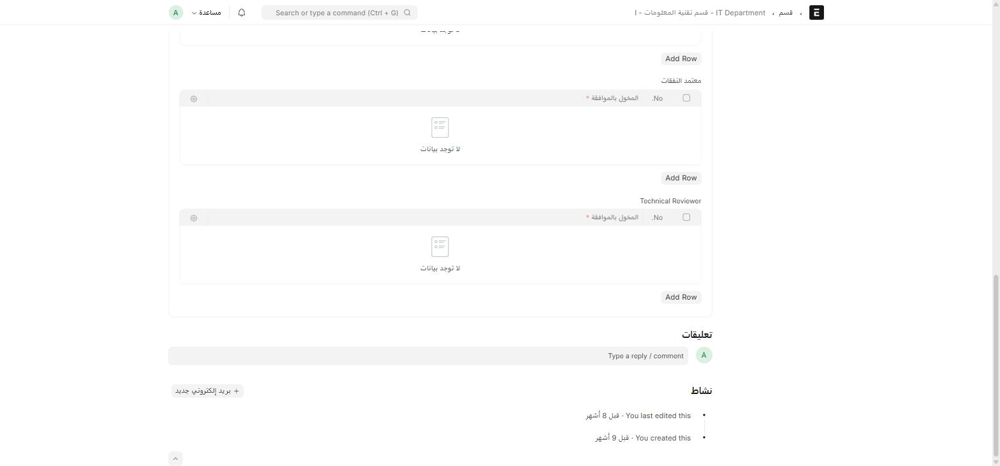
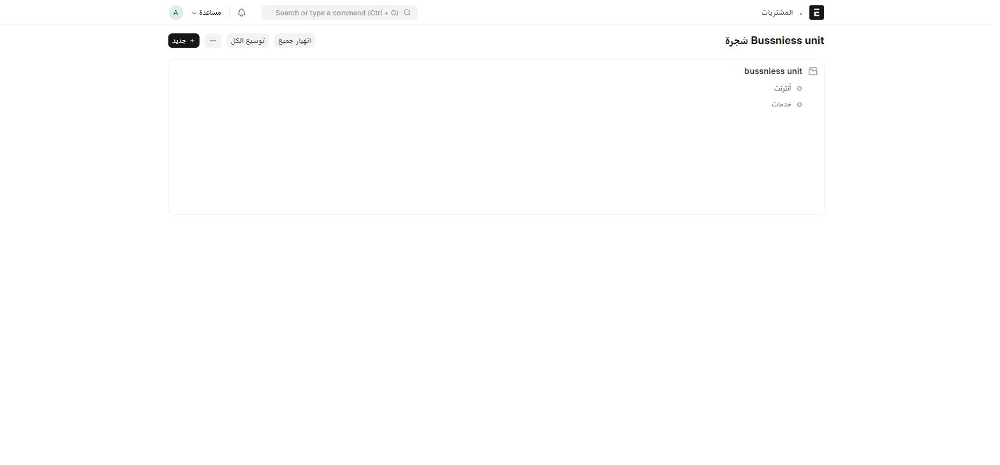
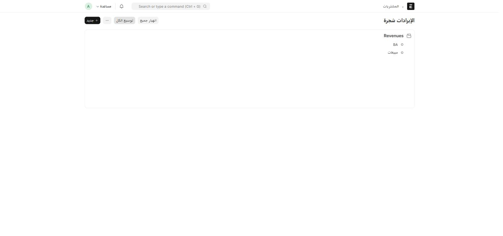

هذه بيانات إعداد أساسية تُدخل مرة، ثم يستخدمها [طلب المواد](/buying/material-request/) في كل مرة تُنشئ فيها طلباً.

## نوع المادة (Material Type)

أين أجده؟ اكتب في شريط البحث: `نوع المادة` أو `Material Type`

كل سجل نوع مادة له:

| الحقل | إجباري | ماذا يفعل |
| --- | :---: | --- |
| **نوع المادة** | ✅ | اسم النوع (Hardware، Software، Stationery، Sold items، Employee Supplies، ...) — هذا الاسم هو اسم السجل نفسه |
| **Technical Departments** | — | جدول فرعي يحدّد **أي الأقسام** مسؤولة عن المراجعة الفنية لهذا النوع |

مثال — نوع المادة **Hardware** مربوط بأربعة أقسام فنية:

:::tip[لماذا هذا مهم؟]
جدول **Technical Departments** هنا هو ما يحدّد أي الأقسام تظهر لاحقاً في حقل **Technical Department** على طلب المواد، عندما يختار مقدّم الطلب نوع مادة **Hardware** أو **Software**. أضِف نوع مادة جديداً واربطه بقسم فني، وسيظهر تلقائياً كخيار عند إنشاء طلبات المواد.
:::

كل نوع مادة له **حالة الصنف** المرافقة في جدول Item Review (راجع [طلب مواد](/buying/material-request/#تبويب-technical-review)): **Meets specifications** أو **Does not meet specifications**.

## القسم الفني والمراجع (Technical Reviewer)

في نموذج **القسم** (Department) القياسي، يضيف ION قسماً جديداً باسم **Technical Reviewer** بجانب أقسام الموافقين القياسية (Expense Approver، Leave Approver، ...):

أضف صفاً في هذا الجدول لكل مستخدم مخوَّل بمراجعة طلبات المواد الفنية الموجَّهة لهذا القسم.

## الوحدة التجارية (Bussniess unit) والإيرادات (Revenue)

هذان **بُعدان محاسبيان (Accounting Dimensions)** إضافيان من ION، على شكل شجرتين هرميتين (Nested Set) — تماماً مثل شجرة مراكز التكلفة القياسية.

اكتب في شريط البحث `Bussniess unit` (لاحظ التهجئة — هكذا أُنشئ اسم الحقل في النظام ولم يُصحَّح) أو `Revenue`.

تُستخدَم هاتان الشجرتان لتصنيف مستندات **المبيعات** (أمر البيع، فاتورة المبيعات) حسب وحدة العمل ونوع الإيراد — راجع [سلسلة مستندات البيع](/sales-crm/sales-document-chain/) لكيفية ظهورهما هناك.

:::note[إدارة الشجرة]
كما في أي حقل شجري في Frappe: زر **جديد** لإضافة عقدة، وأزرار **توسيع الكل** / **انهيار الكل** للتنقّل. لإضافة عقدة فرعية، افتح العقدة الأب أولاً ثم أضِف تحتها.
:::
