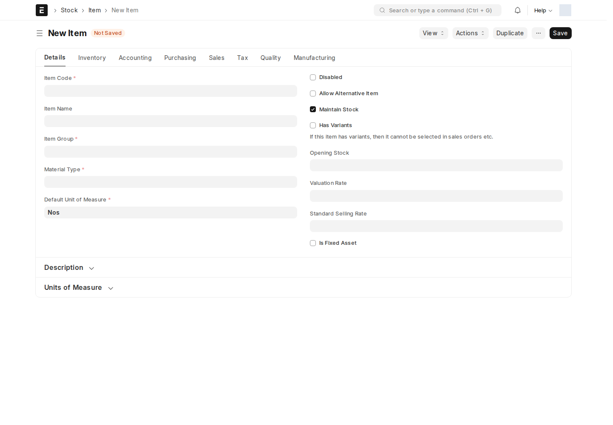
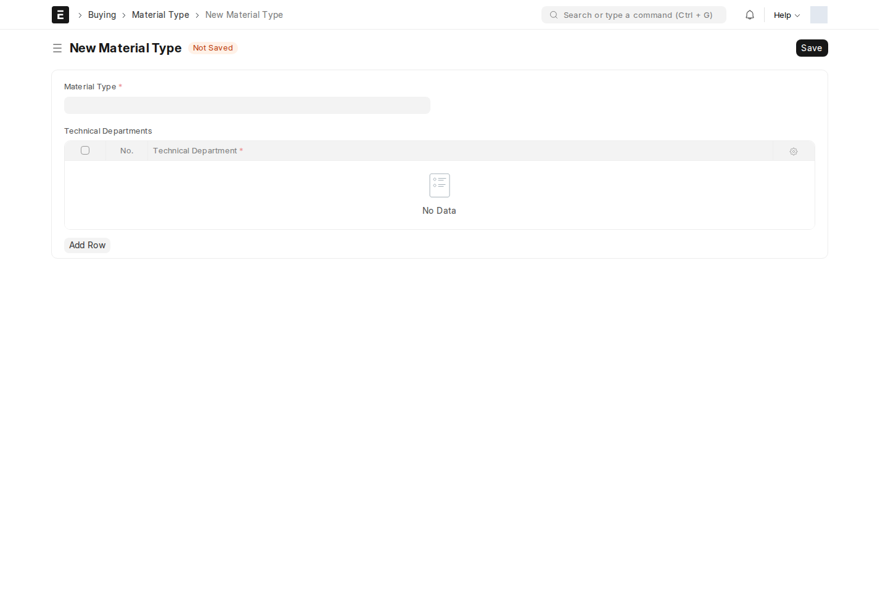

## الصنف (Item)

**Item** يعرّف السلعة أو الخدمة ووحدة القياس وخصائص المخزون. يتولى مسؤول الأصناف إعداد البيانات، ويختارها طالب المواد أو مسؤول المبيعات في المعاملات؛ لا ينشئ كل موظف صنفاً جديداً عند الطلب.

تحقّق من **Material Type** على الصنف. يستخدم طلب المواد هذه القيمة لتصفية الأصناف؛ إذا لم تجد صنفاً معروفاً، راجع تصنيفه مع مسؤول الأصناف أولاً.

## نوع المادة (Material Type)

**Material Type** قائمة تصنيف للأصناف والطلبات. يُدير **System Manager** التعريفات، وتستخدمها الأدوار المخولة بالقراءة عند اختيار المواد.

لا تستخدم جدول **Technical Departments** القديم لتوجيه طلب المواد: ربط القسم الفني لم يعد جزءاً من إجراء الطلب الحالي. اختيار نوع المادة لا ينشئ مرحلة اعتماد فني.

## القسم (Department)

**Department** يحدد الانتماء التنظيمي للموظف ومعلومات الموافقين التنظيمية. يديره مسؤولو الموارد البشرية وفق الصلاحيات. يعرض طلب المواد قسم الموظف في **Department**؛ لا تخلط هذا الحقل مع حقل القسم الفني القديم.

## الوحدة التجارية (Bussniess unit) والإيرادات (Revenue)

**Bussniess unit** و**Revenue** شجرتان لتصنيف المعاملات حسب وحدة العمل ونوع الإيراد. هذه هي التهجئة الفعلية لاسم المستند الأول.

يتولى المسؤول المالي اختيار التصنيف الصحيح في مستندات البيع؛ وتُدار عقد الشجرة وفق صلاحيات الإنشاء والتعديل الموضحة أدناه. قبل إضافة عقدة، حدّد الأب الصحيح وما إذا كانت العقدة مجموعة أو قيمة تستخدم في المعاملات.

اكتب اسم DocType في البحث لفتحه، ثم راجع [سلسلة مستندات البيع](/sales-crm/sales-document-chain/) لاستخدام الأبعاد. لا يوجد سير موافقة نشط لهذه البيانات الرئيسية وقت المراجعة.

<!-- BEGIN VERIFIED SITE REFERENCE -->

## مرجع الأدوار وسير العمل والإشعارات

تمت المراجعة من إعدادات **testsite.local — 12 سبتمبر 2026**. مستوى 0 هو الحقوق الأساسية؛ المستويات الأعلى تخص مجموعات حقول محددة. علامة — تعني أن صف الدور لا يمنح الحق. لا تجمع الصور كل أدوار المستخدمين؛ الصور التقطت بحساب الإدارة.

**تنبيه البريد:** [سكربت موقع الاختبار يضع البريد في Sent دون إرساله](/users/active-scripts/). تابع المستند والتنبيهات المتاحة داخل النظام.

### Item

**الدور:** تعريف السلعة أو الخدمة ووحدتها وتصنيفها قبل استخدامها في المعاملات.

**صلاحيات الأدوار الفعلية** (تظل قيود السجلات والحالة والشروط سارية):

| الدور/الأدوار | مستوى الحقول | قراءة | إنشاء | تعديل | اعتماد | إلغاء | القيد |
| --- | --- | --- | --- | --- | --- | --- | --- |
| Sales User، Maintenance User، Manufacturing User، Purchase User، Stock User، Accounts User، Stock Manager، Dedicated Account Manager، Surveyor Manager، Sales Engineer، Surveyor، Hotels Account Manager، SM Account Manager، ISP Account Manager، Tenders Account Manager | 0 | نعم | — | — | — | — | بحسب النطاق المسموح |
| Desk User | 0 | — | — | — | — | — | بحسب النطاق المسموح |
| Item Manager | 0 | نعم | نعم | نعم | — | — | بحسب النطاق المسموح |

**سير العمل:** لا يوجد Workflow نشط لهذا النوع وقت المراجعة. المستند يُحفظ دون Submit؛ حقل الحالة إن وجد لا يعني Workflow مستقلاً.

**الإشعارات:** لا توجد قاعدة Notification مستقلة مفعلة لهذا النوع في لقطة المراجعة. قد تنطبق معالجات التطبيق المذكورة في الشرح أو معالج ION العام عند وجود workflow_state؛ غياب القاعدة ليس دليلاً على غياب كل تنبيه.

### Material Type

**الدور:** تصنيف الأصناف والطلبات وتصفية الأصناف المتاحة.

**صلاحيات الأدوار الفعلية** (تظل قيود السجلات والحالة والشروط سارية):

| الدور/الأدوار | مستوى الحقول | قراءة | إنشاء | تعديل | اعتماد | إلغاء | القيد |
| --- | --- | --- | --- | --- | --- | --- | --- |
| Employee، Dedicated Account Manager، Surveyor Manager، Sales Engineer، Surveyor | 0 | نعم | — | — | — | — | بحسب النطاق المسموح |
| Technical Team، System Manager | 0 | نعم | نعم | نعم | — | — | بحسب النطاق المسموح |
| Stock User | 0 | نعم | — | نعم | — | — | بحسب النطاق المسموح |

**سير العمل:** لا يوجد Workflow نشط لهذا النوع وقت المراجعة. المستند يُحفظ دون Submit؛ حقل الحالة إن وجد لا يعني Workflow مستقلاً.

**الإشعارات:** لا توجد قاعدة Notification مستقلة مفعلة لهذا النوع في لقطة المراجعة. قد تنطبق معالجات التطبيق المذكورة في الشرح أو معالج ION العام عند وجود workflow_state؛ غياب القاعدة ليس دليلاً على غياب كل تنبيه.

### Department

**الدور:** تعريف الانتماء التنظيمي للموظفين ومعلومات القسم.

**صلاحيات الأدوار الفعلية** (تظل قيود السجلات والحالة والشروط سارية):

| الدور/الأدوار | مستوى الحقول | قراءة | إنشاء | تعديل | اعتماد | إلغاء | القيد |
| --- | --- | --- | --- | --- | --- | --- | --- |
| Employee، Employee Self Service | 0 | — | — | — | — | — | بحسب النطاق المسموح |
| Academics User، HR Manager، HR User | 0 | نعم | نعم | نعم | — | — | بحسب النطاق المسموح |
| Hotels Account Manager، SM Account Manager، ISP Account Manager، Tenders Account Manager، Sales Engineer، Surveyor Manager | 0 | نعم | — | — | — | — | بحسب النطاق المسموح |

**سير العمل:** لا يوجد Workflow نشط لهذا النوع وقت المراجعة. المستند يُحفظ دون Submit؛ حقل الحالة إن وجد لا يعني Workflow مستقلاً.

**الإشعارات:** لا توجد قاعدة Notification مستقلة مفعلة لهذا النوع في لقطة المراجعة. قد تنطبق معالجات التطبيق المذكورة في الشرح أو معالج ION العام عند وجود workflow_state؛ غياب القاعدة ليس دليلاً على غياب كل تنبيه.

### Bussniess unit

**الدور:** تصنيف المعاملات حسب وحدة العمل في شجرة محاسبية.

**صلاحيات الأدوار الفعلية** (تظل قيود السجلات والحالة والشروط سارية):

| الدور/الأدوار | مستوى الحقول | قراءة | إنشاء | تعديل | اعتماد | إلغاء | القيد |
| --- | --- | --- | --- | --- | --- | --- | --- |
| System Manager | 0 | نعم | نعم | نعم | — | — | بحسب النطاق المسموح |
| Accounts User، Accounts Manager، Dedicated Account Manager | 0 | نعم | — | — | — | — | بحسب النطاق المسموح |

**سير العمل:** لا يوجد Workflow نشط لهذا النوع وقت المراجعة. المستند يُحفظ دون Submit؛ حقل الحالة إن وجد لا يعني Workflow مستقلاً.

**الإشعارات:** لا توجد قاعدة Notification مستقلة مفعلة لهذا النوع في لقطة المراجعة. قد تنطبق معالجات التطبيق المذكورة في الشرح أو معالج ION العام عند وجود workflow_state؛ غياب القاعدة ليس دليلاً على غياب كل تنبيه.

### Revenue

**الدور:** تصنيف المعاملات حسب نوع الإيراد.

**صلاحيات الأدوار الفعلية** (تظل قيود السجلات والحالة والشروط سارية):

| الدور/الأدوار | مستوى الحقول | قراءة | إنشاء | تعديل | اعتماد | إلغاء | القيد |
| --- | --- | --- | --- | --- | --- | --- | --- |
| System Manager | 0 | نعم | نعم | نعم | — | — | بحسب النطاق المسموح |
| Accounts User، Accounts Manager، Dedicated Account Manager | 0 | نعم | — | — | — | — | بحسب النطاق المسموح |

**سير العمل:** لا يوجد Workflow نشط لهذا النوع وقت المراجعة. المستند يُحفظ دون Submit؛ حقل الحالة إن وجد لا يعني Workflow مستقلاً.

**الإشعارات:** لا توجد قاعدة Notification مستقلة مفعلة لهذا النوع في لقطة المراجعة. قد تنطبق معالجات التطبيق المذكورة في الشرح أو معالج ION العام عند وجود workflow_state؛ غياب القاعدة ليس دليلاً على غياب كل تنبيه.

<!-- END VERIFIED SITE REFERENCE -->
