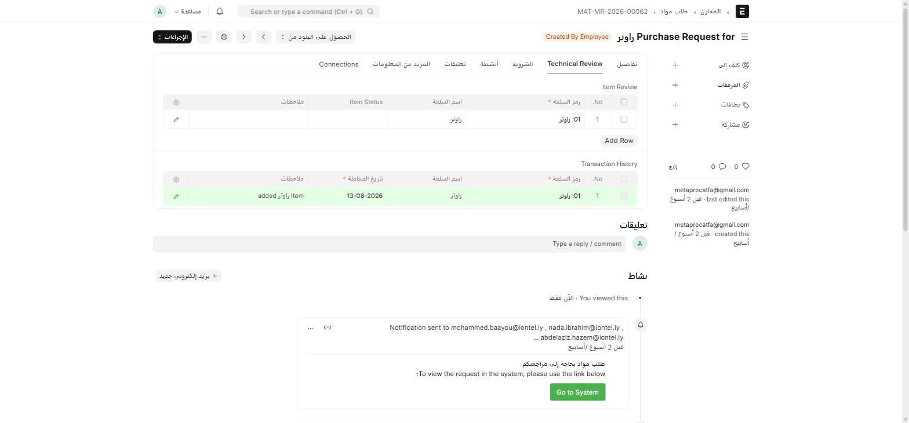
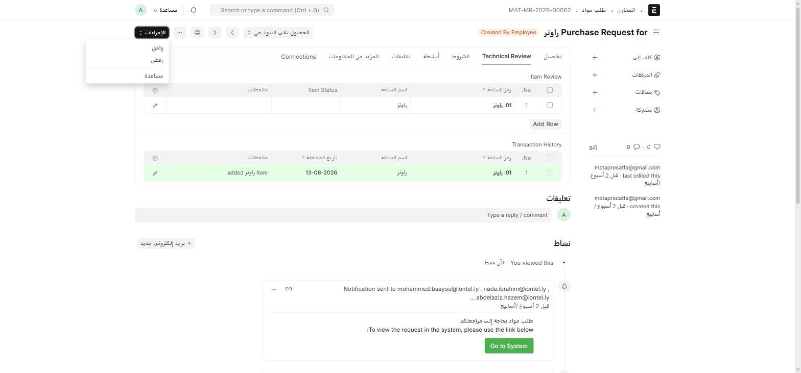

**طلب مواد** (Material Request) هو مستند ERPNext القياسي، لكن ION يضيف عليه طبقة **مراجعة فنية** كاملة: تصنيف الطلب حسب نوع المادة، توجيهه تلقائياً للقسم الفني المسؤول، وسجلّ مراجعة لكل صنف.

## أين أجده؟

القائمة الجانبية ← **المشتريات** ← بطاقة **المشتريات** ← **طلب مواد**
أو اكتب في شريط البحث: `طلب مواد` أو `Material Request`

## إنشاء طلب مواد

1. اضغط **+ إضافة طلب مواد**.
2. في تبويب **تفاصيل** عبّئ:

| الحقل | إجباري | ماذا تكتب فيه |
| --- | :---: | --- |
| **الموظف** | ✅ | الموظف صاحب الطلب (Link → Employee) |
| **تاريخ المعاملة** | ✅ | تاريخ إنشاء الطلب |
| **المطلوبة من قبل** | — | التاريخ المطلوب استلام الأصناف فيه |
| **غرض** | ✅ | الشراء / صرف مواد / نقل المواد / طلب للحصول على اقتباس / ... |
| **نوع المادة** | ✅ | **تخصيص ION** — راجع القسم التالي |
| **شركة** | ✅ | الشركة صاحبة الطلب |
| **مشروع** | — | المشروع المرتبط، إن وُجد |

3. في قسم **الاصناف**، حدّد **المخزن الوجهة** ثم أضف صفوف الأصناف (رمز السلعة، الكمية، المخزن المستهدف).
4. اضغط **حفظ** (Ctrl + S).

## نوع المادة يحدّد مسار المراجعة

حقل **نوع المادة** (custom field على الصنف والطلب) إجباري على كل من **الصنف** نفسه وعلى **طلب المواد**. قيمته تتحكّم فيما يظهر لك بعد ذلك:

- إذا كان نوع المادة **Hardware** أو **Software** (تظهران بالعربية أحياناً كـ«المعدات»/«برمجيات» حسب الترجمة المتاحة)، يظهر لك حقلان إضافيان:
  - **Technical Department** — القسم الفني المسؤول عن مراجعة هذا النوع من المواد.
  - **Technical User** — الشخص المكلّف بالمراجعة الفنية.
- لأي نوع مادة آخر (Stationery، Sold items، Employee Supplies، ...)، لا تظهر هذه الحقول لأن لا حاجة لمراجعة فنية.

راجع [أنواع المواد والأقسام الفنية](/buying/masters/) لمعرفة كيف تُعرَّف أنواع المواد وربطها بالأقسام.

## تبويب Technical Review

بعد إضافة الأصناف، افتح تبويب **Technical Review** أعلى النموذج:

| الجدول | ماذا يحتوي | من يملأه |
| --- | --- | --- |
| **Item Review** | رمز واسم كل صنف، وحالته (**Meets specifications** / **Does not meet specifications**)، وملاحظات المراجِع | القسم الفني المسؤول، أثناء المراجعة |
| **Transaction History** | سجلّ تلقائي لكل صنف أُضيف للطلب، بتاريخ الإضافة | النظام تلقائياً — لا تُعدَّل يدوياً |

:::note[إشعار المراجعين تلقائياً]
عند حفظ الطلب، يرسل النظام تلقائياً بريداً إلكترونياً لكل المستخدمين المعنيين بعنوان **"طلب مواد بحاجة إلى مراجعتكم"** مع رابط مباشر للمستند. لا حاجة لإخبار المراجع الفني يدوياً.
:::

## سير الموافقة

بدل زر **Submit** القياسي، يستخدم طلب المواد **سير عمل بالأدوار (Workflow)** — شارة الحالة بجانب العنوان (مثل `Created By Employee`) وزر **الإجراءات** بدل Submit:

الانتقالات المتاحة لك (**وافق** / **رفض** / غيرها) تعتمد على **دورك الحالي وحالة المستند**. راجع [المفاهيم الأساسية](/start/concepts/) لفهم آلية سير العمل بشكل عام.

:::caution[التحقّق من الميزانية عند كل انتقال]
عند كل تغيير في حالة سير العمل، يتحقّق ION تلقائياً من **الميزانية** المتاحة قبل السماح بالانتقال. إذا تجاوز الطلب الميزانية المخصّصة، يرفض النظام الانتقال برسالة خطأ توضّح السبب.
:::

:::note[إشعار مقدّم الطلب عند رفض صنف]
إذا سجّل المراجع الفني حالة **"Does not meet specifications"** على أي صنف في جدول **Item Review**، يُرسَل إشعار تلقائي لمقدّم الطلب الأصلي (الموظف) بذلك.
:::

## بعد الاعتماد: تحويل الطلب إلى أمر شراء

بعد اكتمال سير الموافقة، يمكن تحويل طلب المواد إلى **أمر شراء** مباشرة من نفس الشاشة (زر **إنشاء** ← **أمر الشراء**). راجع [أمر الشراء وفاتورة الشراء](/buying/purchase-cycle/) لما يحدث بعد ذلك.
