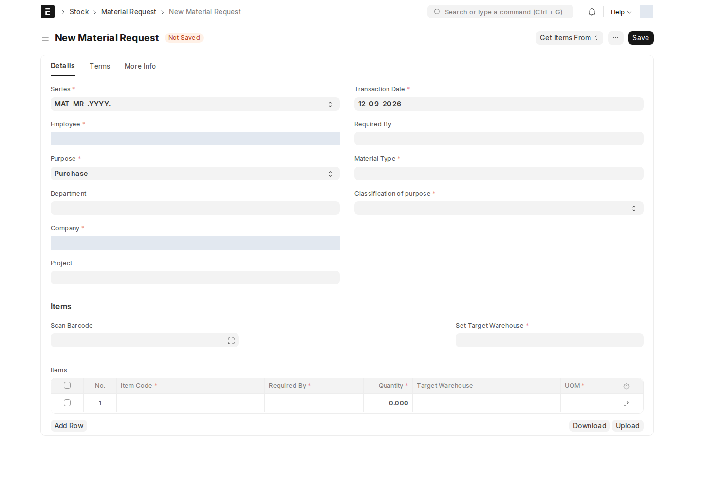

**Material Request — طلب مواد** يسجّل احتياج الموظف إلى شراء أصناف أو صرفها أو نقلها أو طلب عروض لها. يبدأ الموظف الطلب، ويراجعه مسؤول المشتريات أو المخازن حسب الغرض، ثم تُنشأ منه مستندات التنفيذ بعد الاعتماد.

## أين أجده؟

ابحث عن `Material Request` في شريط البحث. اختر **New** لإنشاء طلب.

*نموذج جديد غير محفوظ؛ الحقول ذات البيانات الشخصية محجوبة في الصورة. قد تختلف الترجمة والأزرار حسب دور المستخدم.*

## إنشاء الطلب

1. تحقّق من **Employee**؛ يحاول السكربت تعبئته من الموظف المرتبط بحسابك. يعبّئ **Department** بقسم الموظف. هذا قسم الموظف، وليس قسماً للمراجعة الفنية.
2. اختر الشركة وتاريخ الطلب و**Purpose**، ثم **Material Type** و**Classification of purpose**؛ الحقول الثلاثة الأخيرة إلزامية.
3. حدّد المشروع إن كان الطلب يخص مشروعاً، ثم تاريخ الاحتياج والمخازن المناسبة.
4. أضف الأصناف والكميات ووحداتها. قائمة الأصناف مفلترة بنوع المادة المختار.
5. احفظ، ثم تابع شارة الحالة وقائمة إجراءات سير العمل.

:::caution[اختر نوع المادة قبل إدخال الأصناف]
تغيير **Material Type** يمسح جدول الأصناف في النموذج. اختره أولاً، أو راجع الأصناف وأعد إدخالها بعد تغييره. ينسخ السكربت المشروع المختار إلى صفوف الأصناف قبل الحفظ.
:::

## الأدوار والقيود أثناء الإدخال

| الدور | مسؤوليته في الطلب |
| --- | --- |
| Employee | إعداد الاحتياج والكميات والمواعيد وإرساله للمراجعة |
| Purchase Manager | مراجعة طلب الشراء أو طلب عروض الأسعار والموافقة أو الرفض |
| Accounts Manager | المراجعة المالية بعد موافقة مسؤول المشتريات في مسار الشراء |
| Stock Manager | اعتماد الصرف والنقل مباشرة، أو الاعتماد النهائي لمسار الشراء |
| Department Manager | يسمح له مرشح نوع المادة بعرض الأنواع الأخرى؛ هذا الدور وحده لا يمنح حق اعتماد الطلب |
| Technical Administration Staff | يقيد الغرض إلى **Material Issue**؛ يفرض Server Script القيد قبل الحفظ أيضاً |

المستخدم الذي لا يحمل **Department Manager** يرى في مرشح نوع المادة **Hardware** و**Software** فقط. هذا مرشح في الواجهة. أما قيد **Technical Administration Staff** فهو تحقق على الخادم أيضاً، وقائمة أدوار الاستثناء في السكربت فارغة.

## ما الذي لم يعد جزءاً من الإجراء؟

**Technical Department** و**Technical User** ليسا من حقول نموذج طلب المواد الفعّالة التي أعادها الموقع في هذه المراجعة؛ لا تختَر قسماً فنياً ولا تعيّن مراجعاً تقنياً لإنجاز الطلب.

قد يبقى تبويب **Technical Review** مشروطاً باختيار Hardware أو Software، ومعه جداول قديمة للمراجعة والسجل. وجودها لا يعني وجود مرحلة اعتماد فني: **سير العمل النشط لا يتضمن انتقالاً إلى Technical Team ولا حالة Review By Applicant**. لا تستخدم تعليمات أو صور المراجعة الفنية القديمة كخطوات واجبة.

## سير الموافقة الفعلي

السير النشط اسمه **Material Issue Or Transfer Request WF03**، ويبدأ من **Created By Employee**.

| الغرض | تسلسل الموافقة | متى يصبح الطلب معتمداً؟ |
| --- | --- | --- |
| Material Issue / Material Transfer | الموظف ← Stock Manager | Approved By Stock Manager |
| Purchase | الموظف ← Purchase Manager ← Accounts Manager ← Stock Manager | Approved By Stock Manager، بعد المراحل الثلاث |
| Request for Quotation | الموظف ← Purchase Manager | Approved By Purchase Department Manager |

في مسار الشراء، **Approved By Purchase Manager** و**Approved By Accounts Manager** حالتان وسيطتان؛ يبقى المستند مسودة إلى الاعتماد النهائي.

**قيد صلاحيات حالي:** انتقال طلب عروض الأسعار النهائي مسند إلى Purchase Manager، لكن صف هذا الدور لا يمنح Submit. قد يفشل الاعتماد لمن لا يحمل حقاً إضافياً مناسباً؛ راجع مسؤول النظام عند ظهور منع صلاحية ولا تعتبر اسم الانتقال وحده كافياً.

الرفض ليس مسار إعادة تلقائية: توجد حالات رفض للمخازن والمشتريات والحسابات، ولا يعرّف السير النشط انتقال إعادة تقديم منها. أبلغ المسؤول عند الحاجة للتصحيح. تظهر كل الانتقالات وشروطها في مرجع هذا المستند أدناه.

الغرضان **Manufacture** و**Customer Provided** موجودان ضمن خيارات الواجهة العامة، لكن لا يوجد لهما انتقال **Approve** من الحالة الأولى في هذا السير؛ لا تبدأ بهما عملية اعتماد قبل الرجوع لمسؤول النظام.

## الميزانية والتنفيذ بعد الاعتماد

فحص الميزانية المخصص يعمل لطلب **Purchase** المعتمد، عندما توجد ميزانية معتمدة مطبقة على طلبات المواد. لا يعمل هذا الفحص المخصص عند كل مرحلة موافقة وسيطة.

بعد اعتماد طلب شراء، استخدم **Create → Purchase Order** للكميات المتبقية المؤهلة. طلب الصرف أو النقل ينتقل إلى تنفيذ مخزني مناسب؛ وطلب عروض الأسعار ينتقل إلى جمع عروض الموردين. راجع [دورة الشراء](/buying/purchase-cycle/).

## الإشعارات وما يجب متابعته

توجد إشعارات لمدير المشتريات عند إنشاء الطلب/تغير حالته، وإشعار لطلب عروض الأسعار، إضافة إلى قواعد قديمة ما زالت مفعلة تشير إلى مراجع فني أو حالات لم تعد في السير. **تلقي إشعار لا يمنح حق اعتماد ولا يضيف مرحلة جديدة**.

على هذا الموقع، سكربت البريد التجريبي يضع الرسائل في حالة Sent دون إرسال فعلي؛ تابع المستند وإشعارات الجرس المتاحة، ولا تعتمد على وصول البريد. يشرح [مرجع الإشعارات والسكربتات](/users/active-scripts/) أيضاً اختلاف قواعد الإشعار القديمة عن سير الموافقة الحالي.

<!-- BEGIN VERIFIED SITE REFERENCE -->

## مرجع الأدوار وسير العمل والإشعارات

تمت المراجعة من إعدادات **testsite.local — 12 سبتمبر 2026**. مستوى 0 هو الحقوق الأساسية؛ المستويات الأعلى تخص مجموعات حقول محددة. علامة — تعني أن صف الدور لا يمنح الحق. لا تجمع الصور كل أدوار المستخدمين؛ الصور التقطت بحساب الإدارة.

**تنبيه البريد:** [سكربت موقع الاختبار يضع البريد في Sent دون إرساله](/users/active-scripts/). تابع المستند والتنبيهات المتاحة داخل النظام.

### Material Request

**الدور:** تسجيل احتياج الموظف إلى الشراء أو الصرف أو النقل أو طلب عروض.

**صلاحيات الأدوار الفعلية** (تظل قيود السجلات والحالة والشروط سارية):

| الدور/الأدوار | مستوى الحقول | قراءة | إنشاء | تعديل | اعتماد | إلغاء | القيد |
| --- | --- | --- | --- | --- | --- | --- | --- |
| Purchase Manager، IT Administrator، Employee، Projects Manager، Technical Team، HR User | 0 | نعم | نعم | نعم | — | — | بحسب النطاق المسموح |
| Stock Manager، Accounts Manager، System Manager | 0 | نعم | نعم | نعم | نعم | نعم | بحسب النطاق المسموح |

**سير العمل النشط:** `Material Issue Or Transfer Request WF03`. استخدم قائمة الإجراءات؛ لا تعدل حقل الحالة يدوياً. دور الانتقال لا يمنح حقوق القراءة/الكتابة/الاعتماد الناقصة.

| من الحالة | الإجراء | إلى الحالة | الدور المنفّذ | الشرط | حالة المستند بعده |
| --- | --- | --- | --- | --- | --- |
| Created By Employee | Approve | Approved By Stock Manager | Stock Manager | Purpose = Material Issue أو Material Transfer | معتمد (1) |
| Created By Employee | Approve | Approved By Purchase Manager | Purchase Manager | Purpose = Purchase | مسودة (0) |
| Created By Employee | Approve | Approved By Purchase Department Manager | Purchase Manager | Purpose = Request for Quotation | معتمد (1) |
| Created By Employee | Reject | Rejected By Stock Manager | Stock Manager | Purpose = Material Issue أو Material Transfer | مسودة (0) |
| Created By Employee | Reject | Rejected By Purchase Manager | Purchase Manager | لا شرط إضافي في الانتقال | مسودة (0) |
| Approved By Purchase Manager | Approve | Approved By Accounts Manager | Accounts Manager | لا شرط إضافي في الانتقال | مسودة (0) |
| Approved By Accounts Manager | Approve | Approved By Stock Manager | Stock Manager | لا شرط إضافي في الانتقال | معتمد (1) |
| Rejected By Purchase Manager | Reject | Rejected By Accounts Manager | Accounts Manager | لا شرط إضافي في الانتقال | مسودة (0) |
| Created By Employee | Reject | Rejected By Purchase Department Manager | Purchase Manager | Purpose = Request for Quotation | مسودة (0) |
| Rejected By Accounts Manager | Reject | Rejected By Stock Manager | Stock Manager | لا شرط إضافي في الانتقال | مسودة (0) |

من يحرر المستند في كل حالة؟

الدور أدناه هو Allow Edit في إعداد الحالة، ويضاف إلى حقوق الحقول ونطاق السجل.

| الحالة | دور تحرير الحالة | حالة المستند |
| --- | --- | --- |
| Created By Employee | Employee | مسودة (0) |
| Approved By Stock Manager | Stock Manager | معتمد (1) |
| Rejected By Stock Manager | Stock Manager | مسودة (0) |
| Approved By Purchase Manager | Purchase Manager | مسودة (0) |
| Approved By Accounts Manager | Accounts Manager | مسودة (0) |
| Rejected By Purchase Manager | Purchase Manager | مسودة (0) |
| Rejected By Accounts Manager | Accounts Manager | مسودة (0) |
| Approved By Purchase Department Manager | Purchase Manager | معتمد (1) |
| Rejected By Purchase Department Manager | Purchase Manager | مسودة (0) |

بريد Workflow القياسي **غير مفعّل** لهذا السير. يمكن أن تعمل قواعد Notification ومعالجات التطبيق بشكل مستقل عنه.

**قواعد الإشعارات المفعّلة:** البريد يخضع لقيد الإرسال التجريبي المذكور أعلاه؛ تنبيه الجرس مبين منفصلاً.

| القاعدة | متى؟ | الشرط/حدود الاستخدام | المستلم | القناة |
| --- | --- | --- | --- | --- |
| RFQ MR Notify | الإنشاء | Created By Employee وغرض Request for Quotation | Purchase Manager | Email + جرس النظام |
| Technical Team Approval | الحفظ | قاعدة قديمة: Hardware/Software لغير الصرف والنقل بعد موافقة الشراء/المشاريع، أو عندما يكون المشروع فارغاً؛ ليست مرحلة موافقة حالية | Technical Team | Email فقط |
| Accounts Manager Approval | الحفظ | تعتمد Approved By Technical Team غير الموجودة في السير الحالي؛ وتستثني الصرف والنقل وتشترط Hardware/Software | Accounts Manager | Email فقط |
| Purchase Manager Approval | الحفظ | Created By Employee أو حالات IT/HR القديمة، مع استبعاد الصرف والنقل | Purchase Manager | Email فقط |
| Project Manager Approval | الحفظ | مسودة Hardware/Software مرتبطة بمشروع، بعد Approved By Purchase Manager، باستثناء الصرف والنقل | Project Manager User | Email فقط |
| Accounts Manager | تغير Workflow State | Workflow State = Approved By Technical Team؛ حالة قديمة خارج السير الحالي | Accounts Manager | Email فقط |
| Purchase Manager mr | تغير Workflow State | Workflow State = Created By Employee | Purchase Manager | Email فقط |
| Technical User | تغير Workflow State | Workflow State = Approved By Purchase Manager | Technical User القديم (غير موجود بالنموذج الحالي) | Email فقط |
| mr1 | الحفظ | تفحص Status = Created By Employee لمسودة صرف/نقل؛ لا تفحص Workflow State، لذلك لا تفترض تحققها | Stock Manager | Email فقط |
| Material Request Receipt Notification | تغير Status | Status = Received أو Partially Received | مستلم مخصص؛ يراجعه المسؤول في القاعدة | Email فقط |
| Accounts Manager1 | تغير Workflow State | Workflow State = Approved By Technical Team؛ حالة قديمة خارج السير الحالي | Accounts Manager | جرس النظام |
| Purchase Manager mr 1 | تغير Workflow State | Workflow State = Created By Employee | Purchase Manager | جرس النظام |
| طلب مواد موافقة التقني من النظام | تغير Workflow State | Workflow State = Approved By Purchase Manager | Technical User القديم (غير موجود بالنموذج الحالي) | جرس النظام |

<!-- END VERIFIED SITE REFERENCE -->
