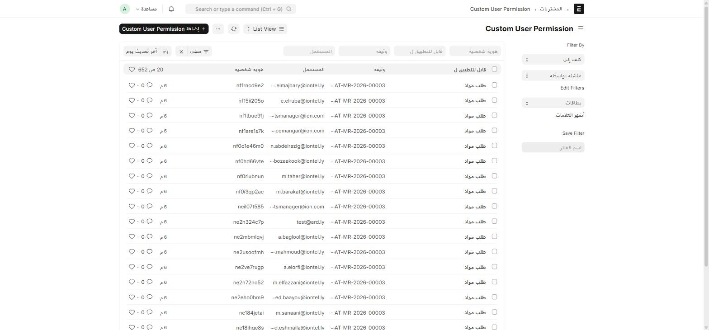
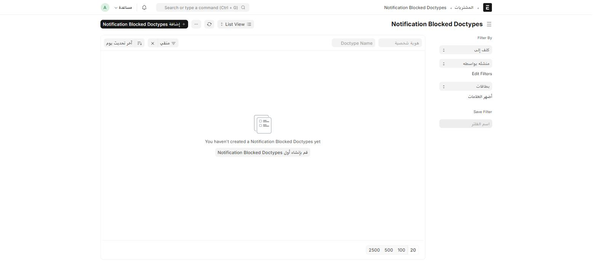

هذه الصفحة لمديري النظام (System Manager) فقط — تشرح آليتين عامتين يستخدمهما ION في كل الوحدات، وليس المشتريات وحدها.

## Custom User Permission — صلاحية تُنشأ تلقائياً

كل مرة يحفظ فيها أي مستخدم أي مستند في النظام، يُنشئ ION تلقائياً سجلّ **Custom User Permission** يربط ذلك المستخدم بذلك المستند تحديداً:

اكتب في شريط البحث: `Custom User Permission`

| العمود | يعني |
| --- | --- |
| **قابل للتطبيق ل** (Applicable For) | نوع المستند (مثلاً "طلب مواد") |
| **وثيقة** (Document) | اسم السجل المحدَّد |
| **المستعمل** (User) | من أنشأ/عدّل هذا السجل |

:::note[لا تُعدَّل هذه السجلات يدوياً]
هذا الجدول **سجلّ تدقيق تلقائي**، وليس أداة لإدارة الصلاحيات بشكل مباشر — تُنشأ الصفوف تلقائياً عند تعديل أي مستند، وتُحذف تلقائياً عند حذفه. إذا احتجت لمنح صلاحية وصول فعلية لمستخدم على مستند معيّن، استخدم شاشة **User Permission** القياسية في Frappe بدل هذا الجدول.
:::

بحجم مئات السجلات في نظام نشط، هذا الجدول مفيد بشكل أساسي **للتدقيق** — "من فتح/عدّل هذا المستند؟" — أكثر من كونه أداة إدارة يومية.

## Notification Blocked Doctypes — إيقاف الإشعارات لنوع مستند

اكتب في شريط البحث: `Notification Blocked Doctypes`

أضف صفاً هنا لأي **نوع مستند** (DocType) تريد **إيقاف إشعاراته التلقائية** بالكامل — سواء إشعارات النظام القياسية أو إشعارات ION المخصّصة (مثل إشعار مراجعة طلب المواد). القائمة فارغة في هذا النظام حالياً، أي أن **كل** الإشعارات مفعّلة لكل أنواع المستندات.

:::caution[استخدمها بحذر]
حجب الإشعارات عن نوع مستند يؤثر على **كل المستخدمين وكل السجلات** من ذلك النوع، وليس على مستند واحد. لا تستخدمها إلا لسبب واضح (مثلاً نوع مستند يُستورَد بكميات كبيرة ويُغرق البريد الإلكتروني بإشعارات غير مفيدة).
:::
