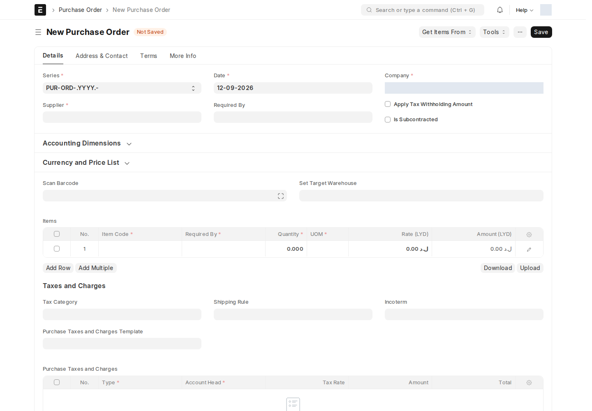
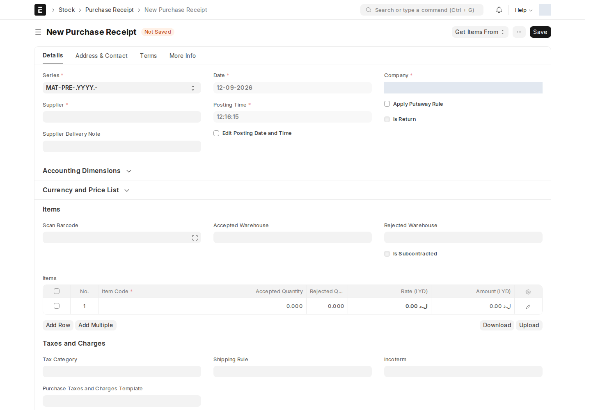
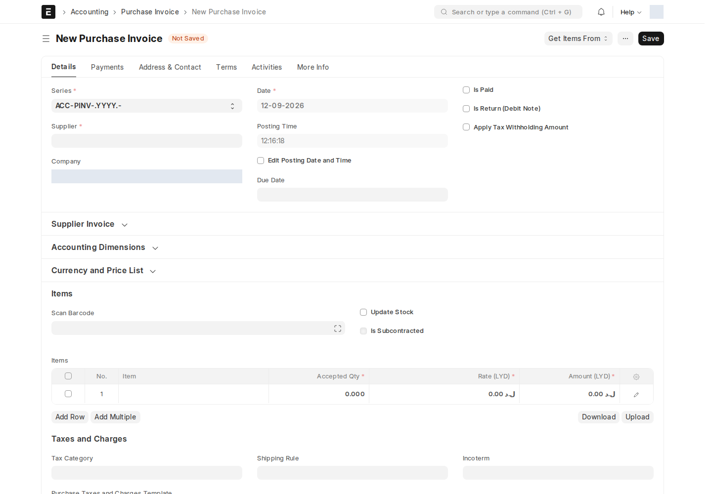

دورة **أمر الشراء → إذن الاستلام → فاتورة الشراء** تعمل بالطريقة القياسية لـ ERPNext، مع إضافات بسيطة من ION على الشاشات الثلاث.

## أين أجدها؟

القائمة الجانبية ← **المشتريات** ← بطاقة **المشتريات**: **أمر الشراء** · **فاتورة شراء** · **طلب للحصول على الاقتباس** · **التسعيرة من المورد**

## تبويبات Activities و Notes

تُضاف تبويبات **أنشطة** (Activities) و**تعليقات** (يحتوي جدول **Notes**) إلى **أمر الشراء**، **فاتورة الشراء**، و**إذن الاستلام** الثلاثة. هذه ميزة عامة من Frappe (تشبه ما تراه في CRM) — تتيح لك:

- تسجيل **نشاط** (اتصال، اجتماع، مهمة) مرتبط بالمستند مباشرة من داخله.
- كتابة **ملاحظات** (Notes) حرة بدون التأثير على بيانات المستند نفسه.

استخدمها لتوثيق متابعتك مع المورد دون الحاجة لأداة خارجية.

## ملف الترخيص على أصناف إذن الاستلام

في **إذن الاستلام** (Purchase Receipt)، يضيف ION حقل **License file** إلى كل صنف مستلَم (بجانب اسم الصنف). استخدمه لإرفاق شهادة أو ترخيص الصنف (مثلاً ترخيص برمجية أو شهادة مطابقة لمعدّة) وقت الاستلام، بدل إرفاقه على مستند منفصل.

## إشعار يومي عند اعتماد إذن الاستلام

:::note[إشعار تلقائي]
الدالة المخصصة تستهدف دور Accounts Manager، لكنها مسجلة كمهمة يومية رغم أنها تتطلب مستنداً وحدثاً كوسيطين. لا تثبت هذه الجدولة وجود ملخص يومي ناجح. راجع أذون الاستلام داخل النظام؛ البريد أيضاً خاضع للسكربت التجريبي.
:::

## الصلاحيات على المستندات

إنشاء Custom User Permission التلقائي معطل في التطبيق الحالي. استخدم حقوق DocType ونطاق المستخدم والمشاركة وفق [مرجع الصلاحيات](/buying/permissions/)، ولا تتوقع منح وصول بمجرد الحفظ.

## تحويل المستندات عبر السلسلة

عند إنشاء **إذن استلام** أو **فاتورة شراء** من **أمر شراء** (أو أي تحويل مماثل في السلسلة)، تنقل خرائط التحويل الحقول المحددة فيها، وقد تنقل الملاحظات. راجع المورد والكميات والمخزن والأبعاد في المستند الناتج؛ لا تفترض أن كل حقل مخصص ينتقل تلقائياً في كل تحويل.

<!-- BEGIN VERIFIED SITE REFERENCE -->

## مرجع الأدوار وسير العمل والإشعارات

تمت المراجعة من إعدادات **testsite.local — 12 سبتمبر 2026**. مستوى 0 هو الحقوق الأساسية؛ المستويات الأعلى تخص مجموعات حقول محددة. علامة — تعني أن صف الدور لا يمنح الحق. لا تجمع الصور كل أدوار المستخدمين؛ الصور التقطت بحساب الإدارة.

**تنبيه البريد:** [سكربت موقع الاختبار يضع البريد في Sent دون إرساله](/users/active-scripts/). تابع المستند والتنبيهات المتاحة داخل النظام.

### Supplier

**الدور:** بيانات المورد الذي تُطلب منه عروض أو تُصدر له أوامر الشراء.

**صلاحيات الأدوار الفعلية** (تظل قيود السجلات والحالة والشروط سارية):

| الدور/الأدوار | مستوى الحقول | قراءة | إنشاء | تعديل | اعتماد | إلغاء | القيد |
| --- | --- | --- | --- | --- | --- | --- | --- |
| Purchase Manager | 0 | نعم | — | نعم | — | — | بحسب النطاق المسموح |
| Purchase Master Manager | 0 | نعم | نعم | نعم | — | — | بحسب النطاق المسموح |
| Accounts User، Accounts Manager، Stock User، Purchase User، Stock Manager، Dedicated Account Manager، Surveyor Manager، Sales Engineer، Surveyor، Hotels Account Manager، SM Account Manager، ISP Account Manager، Tenders Account Manager | 0 | نعم | — | — | — | — | بحسب النطاق المسموح |
| Employee Self Service | 0 | — | — | — | — | — | بحسب النطاق المسموح |

**سير العمل:** لا يوجد Workflow نشط لهذا النوع وقت المراجعة. المستند يُحفظ دون Submit؛ حقل الحالة إن وجد لا يعني Workflow مستقلاً.

**الإشعارات:** لا توجد قاعدة Notification مستقلة مفعلة لهذا النوع في لقطة المراجعة. قد تنطبق معالجات التطبيق المذكورة في الشرح أو معالج ION العام عند وجود workflow_state؛ غياب القاعدة ليس دليلاً على غياب كل تنبيه.

### Request for Quotation

**الدور:** طلب عروض من الموردين لتسعير الاحتياج؛ ليس عرض المورد نفسه.

**صلاحيات الأدوار الفعلية** (تظل قيود السجلات والحالة والشروط سارية):

| الدور/الأدوار | مستوى الحقول | قراءة | إنشاء | تعديل | اعتماد | إلغاء | القيد |
| --- | --- | --- | --- | --- | --- | --- | --- |
| Manufacturing Manager، Purchase Manager | 0 | نعم | نعم | نعم | نعم | نعم | بحسب النطاق المسموح |
| Purchase User | 0 | نعم | نعم | نعم | — | — | بحسب النطاق المسموح |
| Stock User | 0 | نعم | — | — | — | — | بحسب النطاق المسموح |
| Purchase Manager | 1 | نعم | — | نعم | — | — | بحسب النطاق المسموح |
| All | 1 | نعم | — | — | — | — | بحسب النطاق المسموح |

**سير العمل:** لا يوجد Workflow نشط لهذا النوع وقت المراجعة. المستند قابل للاعتماد القياسي؛ Save ثم Submit حسب الصلاحية والتحقق، وأي حقل Status وصفي لا يعرّف سلسلة موافقات بالأدوار.

**الإشعارات:** لا توجد قاعدة Notification مستقلة مفعلة لهذا النوع في لقطة المراجعة. قد تنطبق معالجات التطبيق المذكورة في الشرح أو معالج ION العام عند وجود workflow_state؛ غياب القاعدة ليس دليلاً على غياب كل تنبيه.

### Supplier Quotation

**الدور:** تسجيل سعر وشروط المورد للمقارنة قبل إصدار أمر الشراء.

**صلاحيات الأدوار الفعلية** (تظل قيود السجلات والحالة والشروط سارية):

| الدور/الأدوار | مستوى الحقول | قراءة | إنشاء | تعديل | اعتماد | إلغاء | القيد |
| --- | --- | --- | --- | --- | --- | --- | --- |
| Stock User، Dedicated Account Manager، Surveyor Manager، Sales Engineer، Surveyor، Hotels Account Manager، SM Account Manager، ISP Account Manager، Tenders Account Manager | 0 | نعم | — | — | — | — | بحسب النطاق المسموح |
| Purchase Manager | 1 | نعم | — | نعم | — | — | بحسب النطاق المسموح |
| Manufacturing Manager، Purchase Manager | 0 | نعم | نعم | نعم | نعم | نعم | بحسب النطاق المسموح |
| Purchase User | 0 | نعم | نعم | نعم | نعم | — | بحسب النطاق المسموح |

**سير العمل:** لا يوجد Workflow نشط لهذا النوع وقت المراجعة. المستند قابل للاعتماد القياسي؛ Save ثم Submit حسب الصلاحية والتحقق، وأي حقل Status وصفي لا يعرّف سلسلة موافقات بالأدوار.

**الإشعارات:** لا توجد قاعدة Notification مستقلة مفعلة لهذا النوع في لقطة المراجعة. قد تنطبق معالجات التطبيق المذكورة في الشرح أو معالج ION العام عند وجود workflow_state؛ غياب القاعدة ليس دليلاً على غياب كل تنبيه.

### Purchase Order

**الدور:** تحديد التزام الشراء من المورد بالأصناف والكميات والأسعار والمواعيد.

**صلاحيات الأدوار الفعلية** (تظل قيود السجلات والحالة والشروط سارية):

| الدور/الأدوار | مستوى الحقول | قراءة | إنشاء | تعديل | اعتماد | إلغاء | القيد |
| --- | --- | --- | --- | --- | --- | --- | --- |
| Purchase User، Purchase Manager، Accounts Manager | 0 | نعم | نعم | نعم | نعم | نعم | بحسب النطاق المسموح |
| Purchase Manager | 1 | نعم | — | نعم | — | — | بحسب النطاق المسموح |
| Stock User | 0 | نعم | — | — | — | — | بحسب النطاق المسموح |

**سير العمل:** لا يوجد Workflow نشط لهذا النوع وقت المراجعة. المستند قابل للاعتماد القياسي؛ Save ثم Submit حسب الصلاحية والتحقق، وأي حقل Status وصفي لا يعرّف سلسلة موافقات بالأدوار.

**الإشعارات:** لا توجد قاعدة Notification مستقلة مفعلة لهذا النوع في لقطة المراجعة. قد تنطبق معالجات التطبيق المذكورة في الشرح أو معالج ION العام عند وجود workflow_state؛ غياب القاعدة ليس دليلاً على غياب كل تنبيه.

### Purchase Receipt

**الدور:** تسجيل الاستلام الفعلي والكميات والمخازن ومرفقات الأصناف.

**صلاحيات الأدوار الفعلية** (تظل قيود السجلات والحالة والشروط سارية):

| الدور/الأدوار | مستوى الحقول | قراءة | إنشاء | تعديل | اعتماد | إلغاء | القيد |
| --- | --- | --- | --- | --- | --- | --- | --- |
| Stock Manager، Purchase Manager | 1 | نعم | — | نعم | — | — | بحسب النطاق المسموح |
| Purchase User، Stock Manager، Stock User، Purchase Manager | 0 | نعم | نعم | نعم | نعم | نعم | بحسب النطاق المسموح |
| Accounts User | 0 | نعم | — | — | — | — | بحسب النطاق المسموح |

**سير العمل:** لا يوجد Workflow نشط لهذا النوع وقت المراجعة. المستند قابل للاعتماد القياسي؛ Save ثم Submit حسب الصلاحية والتحقق، وأي حقل Status وصفي لا يعرّف سلسلة موافقات بالأدوار.

**الإشعارات:** لا توجد قاعدة Notification مستقلة مفعلة لهذا النوع في لقطة المراجعة. قد تنطبق معالجات التطبيق المذكورة في الشرح أو معالج ION العام عند وجود workflow_state؛ غياب القاعدة ليس دليلاً على غياب كل تنبيه.

### Purchase Invoice

**الدور:** تسجيل مديونية المورد والضرائب والمبالغ المستحقة.

**صلاحيات الأدوار الفعلية** (تظل قيود السجلات والحالة والشروط سارية):

| الدور/الأدوار | مستوى الحقول | قراءة | إنشاء | تعديل | اعتماد | إلغاء | القيد |
| --- | --- | --- | --- | --- | --- | --- | --- |
| Purchase User، Auditor، Dedicated Account Manager | 0 | نعم | — | — | — | — | بحسب النطاق المسموح |
| Accounts Manager، Accounts User | 0 | نعم | نعم | نعم | نعم | نعم | بحسب النطاق المسموح |
| Accounts Manager | 1 | نعم | — | نعم | — | — | بحسب النطاق المسموح |

**سير العمل:** لا يوجد Workflow نشط لهذا النوع وقت المراجعة. المستند قابل للاعتماد القياسي؛ Save ثم Submit حسب الصلاحية والتحقق، وأي حقل Status وصفي لا يعرّف سلسلة موافقات بالأدوار.

**الإشعارات:** لا توجد قاعدة Notification مستقلة مفعلة لهذا النوع في لقطة المراجعة. قد تنطبق معالجات التطبيق المذكورة في الشرح أو معالج ION العام عند وجود workflow_state؛ غياب القاعدة ليس دليلاً على غياب كل تنبيه.

### Warehouse

**الدور:** تعريف مكان حفظ المخزون وربطه بالشركة.

**صلاحيات الأدوار الفعلية** (تظل قيود السجلات والحالة والشروط سارية):

| الدور/الأدوار | مستوى الحقول | قراءة | إنشاء | تعديل | اعتماد | إلغاء | القيد |
| --- | --- | --- | --- | --- | --- | --- | --- |
| Accounts User، Sales User، Manufacturing User، Purchase User، Stock User، Dedicated Account Manager، Surveyor Manager، Sales Engineer، Surveyor، Hotels Account Manager، SM Account Manager، ISP Account Manager، Tenders Account Manager | 0 | نعم | — | — | — | — | بحسب النطاق المسموح |
| Item Manager | 0 | نعم | نعم | نعم | — | — | بحسب النطاق المسموح |
| Employee Self Service | 0 | — | — | — | — | — | بحسب النطاق المسموح |

**سير العمل:** لا يوجد Workflow نشط لهذا النوع وقت المراجعة. المستند يُحفظ دون Submit؛ حقل الحالة إن وجد لا يعني Workflow مستقلاً.

**الإشعارات:** لا توجد قاعدة Notification مستقلة مفعلة لهذا النوع في لقطة المراجعة. قد تنطبق معالجات التطبيق المذكورة في الشرح أو معالج ION العام عند وجود workflow_state؛ غياب القاعدة ليس دليلاً على غياب كل تنبيه.

### Stock Entry

**الدور:** تنفيذ حركات الصرف والاستلام والنقل المخزني حسب النوع.

**صلاحيات الأدوار الفعلية** (تظل قيود السجلات والحالة والشروط سارية):

| الدور/الأدوار | مستوى الحقول | قراءة | إنشاء | تعديل | اعتماد | إلغاء | القيد |
| --- | --- | --- | --- | --- | --- | --- | --- |
| Stock User، Manufacturing User، Manufacturing Manager، Stock Manager | 0 | نعم | نعم | نعم | نعم | نعم | بحسب النطاق المسموح |

**سير العمل:** لا يوجد Workflow نشط لهذا النوع وقت المراجعة. المستند قابل للاعتماد القياسي؛ Save ثم Submit حسب الصلاحية والتحقق، وأي حقل Status وصفي لا يعرّف سلسلة موافقات بالأدوار.

**الإشعارات:** لا توجد قاعدة Notification مستقلة مفعلة لهذا النوع في لقطة المراجعة. قد تنطبق معالجات التطبيق المذكورة في الشرح أو معالج ION العام عند وجود workflow_state؛ غياب القاعدة ليس دليلاً على غياب كل تنبيه.

<!-- END VERIFIED SITE REFERENCE -->
