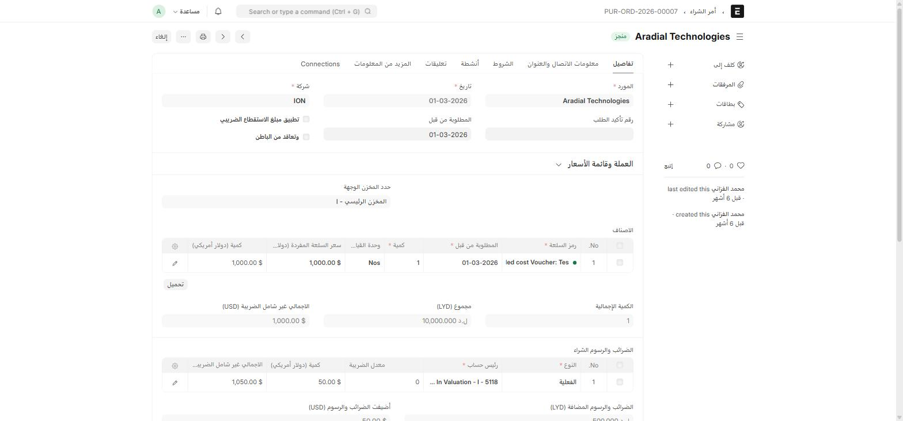

دورة **أمر الشراء → إذن الاستلام → فاتورة الشراء** تعمل بالطريقة القياسية لـ ERPNext، مع إضافات بسيطة من ION على الشاشات الثلاث.

## أين أجدها؟

القائمة الجانبية ← **المشتريات** ← بطاقة **المشتريات**: **أمر الشراء** · **فاتورة شراء** · **طلب للحصول على الاقتباس** · **التسعيرة من المورد**

## تبويبات Activities و Notes

تُضاف تبويبات **أنشطة** (Activities) و**تعليقات** (يحتوي جدول **Notes**) إلى **أمر الشراء**، **فاتورة الشراء**، و**إذن الاستلام** الثلاثة. هذه ميزة عامة من Frappe (تشبه ما تراه في CRM) — تتيح لك:

- تسجيل **نشاط** (اتصال، اجتماع، مهمة) مرتبط بالمستند مباشرة من داخله.
- كتابة **ملاحظات** (Notes) حرة بدون التأثير على بيانات المستند نفسه.

استخدمها لتوثيق متابعتك مع المورد دون الحاجة لأداة خارجية.

## ملف الترخيص على أصناف إذن الاستلام

في **إذن الاستلام** (Purchase Receipt)، يضيف ION حقل **License file** إلى كل صنف مستلَم (بجانب اسم الصنف). استخدمه لإرفاق شهادة أو ترخيص الصنف (مثلاً ترخيص برمجية أو شهادة مطابقة لمعدّة) وقت الاستلام، بدل إرفاقه على مستند منفصل.

## إشعار يومي عند اعتماد إذن الاستلام

:::note[إشعار تلقائي]
كل يوم، يرسل النظام إشعاراً يلخّص **أذون الاستلام المعتمدة** في ذلك اليوم إلى المعنيين. لا حاجة لمراجعة قائمة أذون الاستلام يدوياً للتأكد من وصولها.
:::

## صلاحية تلقائية على كل مستند تعدّله

:::note[Custom User Permission]
كل مرة تحفظ فيها أي مستند في النظام — وليس فقط في المشتريات — يُنشئ ION تلقائياً سجلّ **Custom User Permission** يربط اسمك بذلك المستند. هذا السجلّ **للتتبّع الداخلي فقط** ولا يحتاج أي إجراء منك؛ يُحذف تلقائياً إذا حُذف المستند الأصلي. راجع [الصلاحيات والإشعارات](/buying/permissions/) لتفاصيل أكثر إن كنت مدير نظام.
:::

## تحويل المستندات عبر السلسلة

عند إنشاء **إذن استلام** أو **فاتورة شراء** من **أمر شراء** (أو أي تحويل مماثل في السلسلة)، يحرص ION على نقل الحقول المخصّصة (نوع المادة، الوحدة التجارية، الإيراد، ...) تلقائياً من المستند المصدر — فلا تحتاج لإعادة تعبئتها يدوياً.
