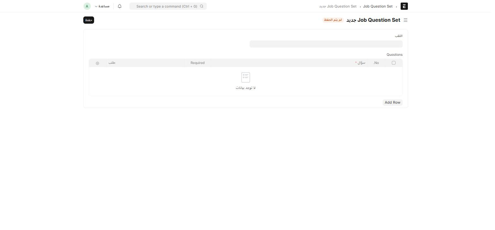

يضيف **ion_career** طبقة **فرز أوّلي تلقائي** فوق التوظيف القياسي في HRMS: أسئلة نعم/لا تُربَط بإعلان وظيفي، وتتحوّل إجابات كل مرشّح إلى **درجة من 10** تظهر مباشرة على ملفه.

## إنشاء مجموعة أسئلة (Job Question Set)

اكتب في شريط البحث: `Job Question Set` — هذه الشاشة **مقصورة على مدير النظام (System Manager)** فقط.



| الحقل | إجباري | ماذا تكتب |
| --- | :---: | --- |
| **اللقب** | ✅ | اسم فريد للمجموعة — يُستخدَم كاسم للسجل نفسه |
| **Questions** (جدول) | — | كل صف: نص السؤال*، هل إجباري (Required)، وترتيبه |

كل سؤال في الجدول له نوع إجابة (Checkbox أو Select) يُحدَّد تلقائياً، ومعرِّف داخلي (fieldname) يُستخدَم لاحقاً لمطابقة إجابة المرشّح بسؤاله.

## ربط المجموعة بإعلان وظيفي

افتح **إعلان وظيفي (Job Opening)** القياسي في HRMS، واختر مجموعة الأسئلة في الحقل المضاف **Job Question Set**. كل مرشّح يتقدّم لهذا الإعلان سيرى أسئلة هذه المجموعة تحديداً.

## الدرجة التلقائية على ملف المرشّح

:::note[لا تُحسَب الدرجة يدوياً]
بمجرد وصول طلب توظيف جديد (**Job Applicant**)، يقرأ النظام تلقائياً إجابات المرشّح، ويحسب **الدرجة (custom_score)** بالمعادلة: `10 ÷ عدد الأسئلة × عدد إجابات "نعم"`. تظهر هذه الدرجة مباشرة على ملف المرشّح دون أي إجراء من فريق التوظيف.
:::

استخدم هذه الدرجة **كأداة فرز أوّلي سريع** لترتيب المرشّحين قبل المراجعة اليدوية للسِيَر الذاتية — وليست بديلاً عن مقابلة أو تقييم فعلي.

## صفحة التقديم العامة

المرشّحون الخارجيون **لا يصلون لهذه الشاشات من لوحة النظام إطلاقاً** — بل عبر صفحة عامة منفصلة لا تتطلّب تسجيل دخول:

```
/ion-job-application
```

هذه الصفحة تعرض للمرشّح: اسمه، بريده، هاتفه، بلده، رسالة تقديم، **أسئلة الفرز** (تُحمَّل تلقائياً حسب الإعلان المختار)، ومرفق السيرة الذاتية. لا يوجد رابط جاهز لها من داخل لوحة النظام — شاركها مباشرة مع المتقدّمين أو انشرها على موقع التوظيف الخاص بالشركة.

:::tip[الفرق بين هذه الصفحة والموظفين المرشَّحين داخلياً]
إذا كنت تبحث عن مرشّح **داخلي** (موظف حالي يُرشَّح لوظيفة أخرى)، فالنظام يستخدم لذلك **Job Applicant Internal** من فصل [الموارد البشرية](/hr/tasks-training/) — شاشة مختلفة تماماً عن هذه الصفحة العامة، مقصورة على دور HR User.
:::
