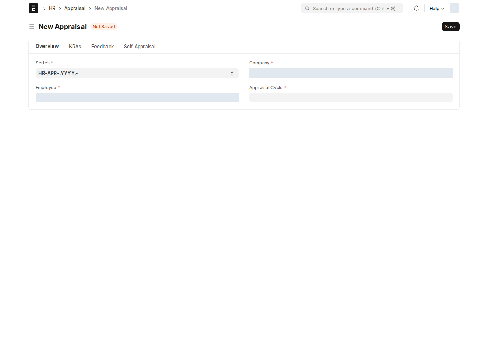

## دورة التقييم الشهرية — تُنشأ تلقائياً

اكتب في شريط البحث: `تقييم` أو `Appraisal` لرؤية القائمة.

:::note[لا تُنشئ دورة تقييم يدوياً كل شهر]
في اليوم **20 من كل شهر**، يُنشئ النظام تلقائياً دورة تقييم جديدة (**Appraisal Cycle**) للموظفين المؤهلين، تغطّي الفترة من **21 الشهر السابق إلى 20 الشهر الحالي**. يُنشأ سجل دورة لكل شركة، وتُجهز تقييمات مسودة للموظفين النشطين الذين لديهم شركة وقالب تقييم؛ يُتجاوز من تنقصه هذه البيانات. هذا يظهر في عمود **Appraisal Cycle** كـ"شهر 4"، "شهر 6"، إلخ.
:::

## كيف تُحتسَب الدرجة النهائية

كل تقييم يحتوي:

| الحقل | ماذا يعني |
| --- | --- |
| **Appraisal Goal Score / Total Goal Score of 100** | درجة الأهداف، مطبَّعة من 100 (تخصيص ION) |
| **Manager Score** | درجة تقييم المدير المباشر |
| **Final Score** | الدرجة النهائية المُعتمَدة |

:::caution[صفوف الأهداف تُقفَل بعد التقييم]
بمجرد رصد درجة على تقييم، تُقفَل صفوف الأهداف المرتبطة تلقائياً — لا يمكن تعديل الأهداف بأثر رجعي بعد التسجيل.
:::

## من التقييم إلى مكافأة الراتب

هذا الربط هو أهم ما يميّز نظام التقييم هنا: **درجة التقييم تتحوّل تلقائياً لمبلغ مكافأة في الراتب**، عبر ثلاث خطوات:

1. **Score Percentage Settings** (إعداد لمرة واحدة، مدير النظام فقط) — جدول شرائح: نطاق درجة (من % إلى %) ← نسبة مئوية من المكافأة الكاملة. مثال: درجة 80–100% ← 100% من مبلغ المكافأة.
2. عند اعتماد التقييم، تُحدَّث **درجة التقييم الشهرية** و**درجة تقييم المدير** على سجل **الموظف** نفسه.
3. **Employee Annual Appraisal Score** يجمع الدرجات على مدار السنة، ويحسب **مبلغ المكافأة السنوية (Annual Appraisal Bonus Amount)** بالعملة مباشرة — والذي ينعكس تلقائياً على حقلَي `annual_appraisal_score` و`monthly_appraisal_score` في **Salary Slip** و**Salary Structure Assignment**.

أين أجد ملخص موظف معيّن؟ اكتب في شريط البحث: `Employee Annual Appraisal Score` أو افتح **Employee services** ← **Employee Annual Appraisal Score**.

| الحقل | ماذا يعرض |
| --- | --- |
| **anchor_source** | أساس دورة السنة: تاريخ التعيين أم تاريخ تقييم سنوي مخصَّص |
| **period_start/end** و**previous_period_start/end** | الفترة الحالية والسابقة للمقارنة |
| **current/previous_period_score** | متوسط الدرجة في كل فترة |
| **annual_appraisal_score** | **مبلغ المكافأة السنوية** الناتج، بالعملة |

:::tip[أين أضبط قالب التقييم نفسه؟]
حقل **custom_appraisal_template** على سجل **الموظف** يربطه بقالب تقييم افتراضي — فلا تحتاج لاختيار القالب يدوياً كل مرة تنشئ فيها تقييماً جديداً لنفس الموظف.
:::

<!-- BEGIN VERIFIED SITE REFERENCE -->

## مرجع الأدوار وسير العمل والإشعارات

تمت المراجعة من إعدادات **testsite.local — 12 سبتمبر 2026**. مستوى 0 هو الحقوق الأساسية؛ المستويات الأعلى تخص مجموعات حقول محددة. علامة — تعني أن صف الدور لا يمنح الحق. لا تجمع الصور كل أدوار المستخدمين؛ الصور التقطت بحساب الإدارة.

**تنبيه البريد:** [سكربت موقع الاختبار يضع البريد في Sent دون إرساله](/users/active-scripts/). تابع المستند والتنبيهات المتاحة داخل النظام.

### Appraisal

**الدور:** تسجيل تقييم الموظف ودرجاته واعتماد النتيجة.

**صلاحيات الأدوار الفعلية** (تظل قيود السجلات والحالة والشروط سارية):

| الدور/الأدوار | مستوى الحقول | قراءة | إنشاء | تعديل | اعتماد | إلغاء | القيد |
| --- | --- | --- | --- | --- | --- | --- | --- |
| Employee | 0 | نعم | — | — | — | — | بحسب النطاق المسموح |
| System Manager | 0 | نعم | نعم | نعم | نعم | نعم | بحسب النطاق المسموح |
| HR User | 0 | نعم | — | نعم | نعم | نعم | بحسب النطاق المسموح |
| HR Manager | 0 | نعم | نعم | نعم | نعم | — | بحسب النطاق المسموح |

**سير العمل:** لا يوجد Workflow نشط لهذا النوع وقت المراجعة. المستند قابل للاعتماد القياسي؛ Save ثم Submit حسب الصلاحية والتحقق، وأي حقل Status وصفي لا يعرّف سلسلة موافقات بالأدوار.

**الإشعارات:** لا توجد قاعدة Notification مستقلة مفعلة لهذا النوع في لقطة المراجعة. قد تنطبق معالجات التطبيق المذكورة في الشرح أو معالج ION العام عند وجود workflow_state؛ غياب القاعدة ليس دليلاً على غياب كل تنبيه.

### Appraisal Cycle

**الدور:** تنظيم فترة التقييم ومجموعة الموظفين المشمولين.

**صلاحيات الأدوار الفعلية** (تظل قيود السجلات والحالة والشروط سارية):

| الدور/الأدوار | مستوى الحقول | قراءة | إنشاء | تعديل | اعتماد | إلغاء | القيد |
| --- | --- | --- | --- | --- | --- | --- | --- |
| System Manager، HR Manager، HR User | 0 | نعم | نعم | نعم | — | — | بحسب النطاق المسموح |
| Employee | 0 | نعم | — | — | — | — | بحسب النطاق المسموح |

**سير العمل:** لا يوجد Workflow نشط لهذا النوع وقت المراجعة. المستند يُحفظ دون Submit؛ حقل الحالة إن وجد لا يعني Workflow مستقلاً.

**الإشعارات:** لا توجد قاعدة Notification مستقلة مفعلة لهذا النوع في لقطة المراجعة. قد تنطبق معالجات التطبيق المذكورة في الشرح أو معالج ION العام عند وجود workflow_state؛ غياب القاعدة ليس دليلاً على غياب كل تنبيه.

### Appraisal Template

**الدور:** تعريف أهداف ومعايير التقييم الافتراضية.

**صلاحيات الأدوار الفعلية** (تظل قيود السجلات والحالة والشروط سارية):

| الدور/الأدوار | مستوى الحقول | قراءة | إنشاء | تعديل | اعتماد | إلغاء | القيد |
| --- | --- | --- | --- | --- | --- | --- | --- |
| HR User، HR Manager | 0 | نعم | نعم | نعم | — | — | بحسب النطاق المسموح |
| Employee | 0 | نعم | — | — | — | — | بحسب النطاق المسموح |

**سير العمل:** لا يوجد Workflow نشط لهذا النوع وقت المراجعة. المستند يُحفظ دون Submit؛ حقل الحالة إن وجد لا يعني Workflow مستقلاً.

**الإشعارات:** لا توجد قاعدة Notification مستقلة مفعلة لهذا النوع في لقطة المراجعة. قد تنطبق معالجات التطبيق المذكورة في الشرح أو معالج ION العام عند وجود workflow_state؛ غياب القاعدة ليس دليلاً على غياب كل تنبيه.

### Employee Annual Appraisal Score

**الدور:** تجميع تاريخ درجات الموظف وحساب نتائج الفترات والمكافأة.

**صلاحيات الأدوار الفعلية** (تظل قيود السجلات والحالة والشروط سارية):

| الدور/الأدوار | مستوى الحقول | قراءة | إنشاء | تعديل | اعتماد | إلغاء | القيد |
| --- | --- | --- | --- | --- | --- | --- | --- |
| System Manager، HR Manager | 0 | نعم | نعم | نعم | — | — | بحسب النطاق المسموح |
| HR User | 0 | نعم | — | — | — | — | بحسب النطاق المسموح |

**سير العمل:** لا يوجد Workflow نشط لهذا النوع وقت المراجعة. المستند يُحفظ دون Submit؛ حقل الحالة إن وجد لا يعني Workflow مستقلاً.

**الإشعارات:** لا توجد قاعدة Notification مستقلة مفعلة لهذا النوع في لقطة المراجعة. قد تنطبق معالجات التطبيق المذكورة في الشرح أو معالج ION العام عند وجود workflow_state؛ غياب القاعدة ليس دليلاً على غياب كل تنبيه.

<!-- END VERIFIED SITE REFERENCE -->
