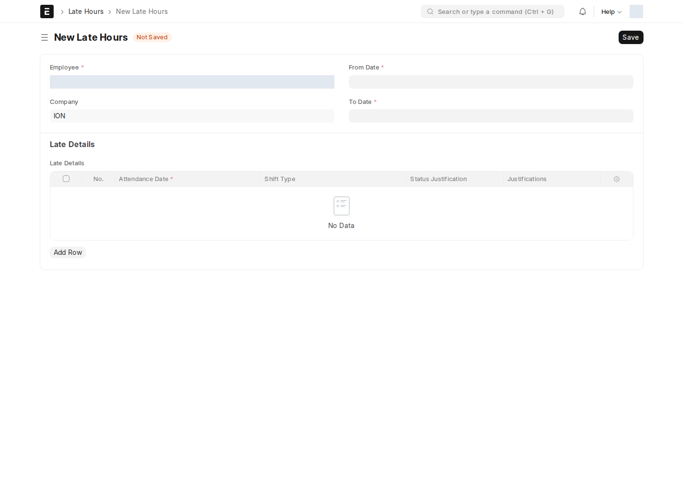
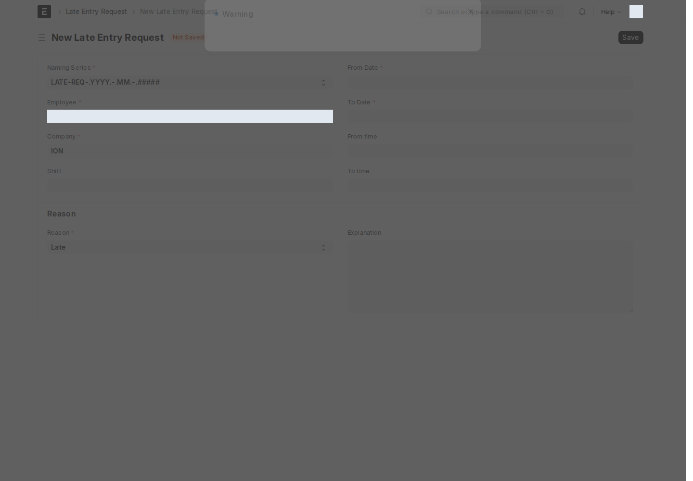

نظام الحضور في aion_custom_hr يحتسب **دقائق التأخير والخروج المبكر تلقائياً** من بصمة الحضور (أو من اعتماد كشف الحضور، حسب الإعداد)، ويحوّلها إلى **جزاء بالدقائق** حسب جدول شرائح مضبوط على كل نوع تحوّل (Shift Type). راجع [إعداد جزاءات التأخير على نوع التحوّل](/hr/settings/#شرائح-جزاء-التأخير-على-نوع-التحوّل) لضبط الشرائح، وهذه الصفحة لفهم كيف يظهر ذلك للموظف والمسؤول يومياً.

## من أين يبدأ الاحتساب؟

اكتب في شريط البحث: `Late Hours Settings` (مدير النظام فقط)

سجل إعداد واحد بخيار وحيد **مصدر تفعيل التأخير**:

- **Employee Checkin** — يُحتسَب التأخير فور تسجيل بصمة الحضور، لحظياً.
- **Attendance Submission** — يُحتسَب فقط بعد اعتماد كشف الحضور اليومي.

## سجل التأخير التلقائي (Late Hours)

اكتب في شريط البحث: `ساعات التاخير` أو `Late Hours` — **لا تُنشئ سجلاً هنا يدوياً**، فهو يتولّد تلقائياً لكل موظف كلما تحققت شروط الاحتساب.

| الحقل | ماذا يعرض |
| --- | --- |
| **Total Late Minutes/Hours** | إجمالي دقائق/ساعات التأخير الخام في الفترة |
| **Total Late Penalty (Min/Hrs)** | الجزاء المحتسَب حسب شرائح نوع التحوّل |
| **Total Corrected Penalty (Min/Hrs)** | الجزاء بعد أي تصحيح يدوي من HR |
| **Late Details** | جدول يومي — تاريخ الحضور، نوع التحوّل، الحالة، دقائق التأخير، حالة التبرير |

زر **تطبيق مبررات التأخير** أعلى النموذج يطبّق أي تبرير مُعتمَد على الحساب النهائي.

## طلب تبرير التأخير (Late Entry Request)

إذا تأخر موظف لعذر مقبول، يقدّم **طلب ساعات التأخير** لتبرير التأخير أو الخروج المبكر قبل أن يُطبَّق عليه جزاء.

أين أجده؟ القائمة الجانبية ← **Employee services** ← **طلب ساعات التاخير**

| الحقل | إجباري | ماذا تكتب |
| --- | :---: | --- |
| **من تاريخ / إلى تاريخ** | ✅ | فترة التأخير المطلوب تبريرها |
| From time / To time | — | وقت التأخير بالضبط |
| **الموظف** | ✅ | يُملأ تلقائياً من حسابك |
| **شركة** | ✅ | |
| **الوردية** | — | |
| **سبب** | ✅ | Late / Early Exit / Authorized Leave |
| **explanation** | — | شرح تفصيلي للعذر |

:::note[الإشعار والموافقة ليسا الشيء نفسه]
قد يحاول معالج التطبيق إخطار المدير/الموظف، لكن سير LATE REQ WF الحالي يحدد Approve بدور All وReject بدور Report Manager، بلا شرط مدير مباشر في الانتقالين. صلاحيات DocType تظل مطلوبة. تابع الحالة داخل النظام لأن البريد في موقع الاختبار لا يثبت التسليم.
:::

:::caution["No Employee record is linked to your user account"]
إذا ظهرت لك هذه الرسالة عند فتح طلب جديد، فهذا يعني أن **حسابك في النظام غير مربوط بسجل موظف**. تواصل مع الموارد البشرية لربط حسابك بسجل الموظف الخاص بك قبل المتابعة.
:::

## الخروج المبكر (Early Exit Hours / Early Exit Detail)

تعمل بنفس آلية التأخير تماماً، لكن للخروج قبل نهاية الدوام. **تُنشأ سجلات "ساعات الخروج المبكر" تلقائياً من بصمة انصراف الموظف — وليست شيئاً تُنشئه يدوياً.**

<!-- BEGIN VERIFIED SITE REFERENCE -->

## مرجع الأدوار وسير العمل والإشعارات

تمت المراجعة من إعدادات **testsite.local — 12 سبتمبر 2026**. مستوى 0 هو الحقوق الأساسية؛ المستويات الأعلى تخص مجموعات حقول محددة. علامة — تعني أن صف الدور لا يمنح الحق. لا تجمع الصور كل أدوار المستخدمين؛ الصور التقطت بحساب الإدارة.

**تنبيه البريد:** [سكربت موقع الاختبار يضع البريد في Sent دون إرساله](/users/active-scripts/). تابع المستند والتنبيهات المتاحة داخل النظام.

### Employee Checkin

**الدور:** تسجيل بصمة دخول أو خروج؛ مصدر لحسابات الحضور.

**صلاحيات الأدوار الفعلية** (تظل قيود السجلات والحالة والشروط سارية):

| الدور/الأدوار | مستوى الحقول | قراءة | إنشاء | تعديل | اعتماد | إلغاء | القيد |
| --- | --- | --- | --- | --- | --- | --- | --- |
| HR Manager، HR User | 1 | نعم | — | نعم | — | — | بحسب النطاق المسموح |
| Employee، HR User، HR Manager، System Manager | 0 | نعم | نعم | نعم | — | — | بحسب النطاق المسموح |
| Employee Self Service | 0 | نعم | — | — | — | — | بحسب النطاق المسموح |
| Employee | 1 | نعم | — | — | — | — | بحسب النطاق المسموح |

**سير العمل:** لا يوجد Workflow نشط لهذا النوع وقت المراجعة. المستند يُحفظ دون Submit؛ حقل الحالة إن وجد لا يعني Workflow مستقلاً.

**الإشعارات:** لا توجد قاعدة Notification مستقلة مفعلة لهذا النوع في لقطة المراجعة. قد تنطبق معالجات التطبيق المذكورة في الشرح أو معالج ION العام عند وجود workflow_state؛ غياب القاعدة ليس دليلاً على غياب كل تنبيه.

### Attendance

**الدور:** إثبات حضور الموظف اليومي ومخرجات الوردية.

**صلاحيات الأدوار الفعلية** (تظل قيود السجلات والحالة والشروط سارية):

| الدور/الأدوار | مستوى الحقول | قراءة | إنشاء | تعديل | اعتماد | إلغاء | القيد |
| --- | --- | --- | --- | --- | --- | --- | --- |
| System Manager، HR User، HR Manager | 0 | نعم | نعم | نعم | نعم | نعم | بحسب النطاق المسموح |
| Employee | 0 | نعم | — | — | — | — | بحسب النطاق المسموح |
| Employee Self Service | 0 | — | — | — | — | — | بحسب النطاق المسموح |

**سير العمل:** لا يوجد Workflow نشط لهذا النوع وقت المراجعة. المستند قابل للاعتماد القياسي؛ Save ثم Submit حسب الصلاحية والتحقق، وأي حقل Status وصفي لا يعرّف سلسلة موافقات بالأدوار.

**قواعد الإشعارات المفعّلة:** البريد يخضع لقيد الإرسال التجريبي المذكور أعلاه؛ تنبيه الجرس مبين منفصلاً.

| القاعدة | متى؟ | الشرط/حدود الاستخدام | المستلم | القناة |
| --- | --- | --- | --- | --- |
| Late Attendance Notify | الإنشاء | وجود وقت الدخول والخروج وعلامة Late Entry ودقائق تأخير أكبر من صفر | بريد الموظف | Email + جرس النظام |

### Late Hours

**الدور:** تجميع التأخير والجزاء المحسوب للموظف.

**صلاحيات الأدوار الفعلية** (تظل قيود السجلات والحالة والشروط سارية):

| الدور/الأدوار | مستوى الحقول | قراءة | إنشاء | تعديل | اعتماد | إلغاء | القيد |
| --- | --- | --- | --- | --- | --- | --- | --- |
| System Manager، HR Manager | 0 | نعم | نعم | نعم | — | — | بحسب النطاق المسموح |
| HR User | 0 | نعم | — | — | — | — | بحسب النطاق المسموح |
| Employee | 0 | نعم | — | نعم | — | — | بحسب النطاق المسموح |

**سير العمل:** لا يوجد Workflow نشط لهذا النوع وقت المراجعة. المستند يُحفظ دون Submit؛ حقل الحالة إن وجد لا يعني Workflow مستقلاً.

**الإشعارات:** لا توجد قاعدة Notification مستقلة مفعلة لهذا النوع في لقطة المراجعة. قد تنطبق معالجات التطبيق المذكورة في الشرح أو معالج ION العام عند وجود workflow_state؛ غياب القاعدة ليس دليلاً على غياب كل تنبيه.

### Late Entry Request

**الدور:** طلب تبرير تأخير أو خروج مبكر أو إذن للفترة المحددة.

**صلاحيات الأدوار الفعلية** (تظل قيود السجلات والحالة والشروط سارية):

| الدور/الأدوار | مستوى الحقول | قراءة | إنشاء | تعديل | اعتماد | إلغاء | القيد |
| --- | --- | --- | --- | --- | --- | --- | --- |
| Employee | 0 | نعم | نعم | نعم | — | — | سجلات يملكها المستخدم فقط |
| System Manager | 0 | نعم | نعم | نعم | نعم | — | بحسب النطاق المسموح |

**سير العمل النشط:** `LATE REQ WF`. استخدم قائمة الإجراءات؛ لا تعدل حقل الحالة يدوياً. دور الانتقال لا يمنح حقوق القراءة/الكتابة/الاعتماد الناقصة.

| من الحالة | الإجراء | إلى الحالة | الدور المنفّذ | الشرط | حالة المستند بعده |
| --- | --- | --- | --- | --- | --- |
| Pending | Approve | Approved | All | لا شرط إضافي في الانتقال | مسودة (0) |
| Pending | Reject | Rejected | Report Manager | لا شرط إضافي في الانتقال | مسودة (0) |

من يحرر المستند في كل حالة؟

الدور أدناه هو Allow Edit في إعداد الحالة، ويضاف إلى حقوق الحقول ونطاق السجل.

| الحالة | دور تحرير الحالة | حالة المستند |
| --- | --- | --- |
| Pending | All | مسودة (0) |
| Approved | All | مسودة (0) |
| Rejected | All | مسودة (0) |

بريد Workflow القياسي **غير مفعّل** لهذا السير. يمكن أن تعمل قواعد Notification ومعالجات التطبيق بشكل مستقل عنه.

**الإشعارات:** لا توجد قاعدة Notification مستقلة مفعلة لهذا النوع في لقطة المراجعة. قد تنطبق معالجات التطبيق المذكورة في الشرح أو معالج ION العام عند وجود workflow_state؛ غياب القاعدة ليس دليلاً على غياب كل تنبيه.

### Early Exit Hours

**الدور:** تجميع الخروج المبكر والجزاء الناتج.

**صلاحيات الأدوار الفعلية** (تظل قيود السجلات والحالة والشروط سارية):

| الدور/الأدوار | مستوى الحقول | قراءة | إنشاء | تعديل | اعتماد | إلغاء | القيد |
| --- | --- | --- | --- | --- | --- | --- | --- |
| System Manager، HR Manager | 0 | نعم | نعم | نعم | — | — | بحسب النطاق المسموح |
| Employee | 0 | نعم | — | نعم | — | — | بحسب النطاق المسموح |

**سير العمل:** لا يوجد Workflow نشط لهذا النوع وقت المراجعة. المستند يُحفظ دون Submit؛ حقل الحالة إن وجد لا يعني Workflow مستقلاً.

**الإشعارات:** لا توجد قاعدة Notification مستقلة مفعلة لهذا النوع في لقطة المراجعة. قد تنطبق معالجات التطبيق المذكورة في الشرح أو معالج ION العام عند وجود workflow_state؛ غياب القاعدة ليس دليلاً على غياب كل تنبيه.

<!-- END VERIFIED SITE REFERENCE -->
