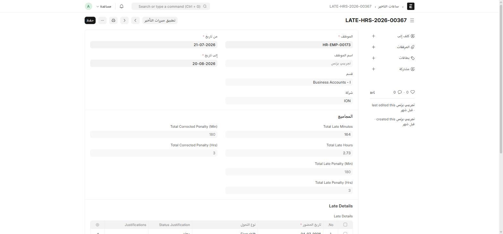
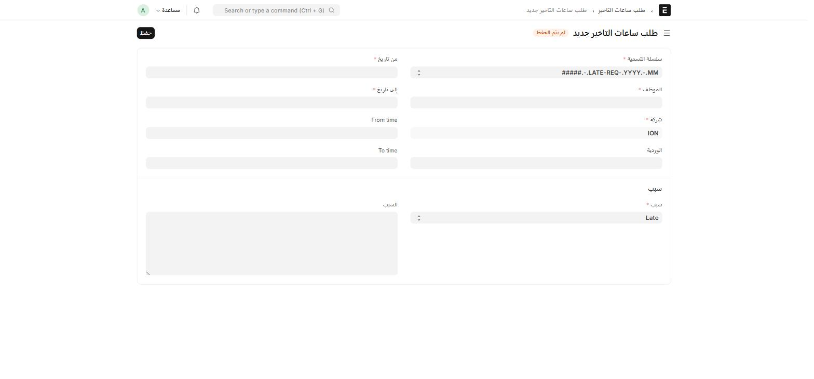

نظام الحضور في aion_custom_hr يحتسب **دقائق التأخير والخروج المبكر تلقائياً** من بصمة الحضور (أو من اعتماد كشف الحضور، حسب الإعداد)، ويحوّلها إلى **جزاء بالدقائق** حسب جدول شرائح مضبوط على كل نوع تحوّل (Shift Type). راجع [إعداد جزاءات التأخير على نوع التحوّل](/hr/settings/#شرائح-جزاء-التأخير-على-نوع-التحوّل) لضبط الشرائح، وهذه الصفحة لفهم كيف يظهر ذلك للموظف والمسؤول يومياً.

## من أين يبدأ الاحتساب؟

اكتب في شريط البحث: `Late Hours Settings` (مدير النظام فقط)

سجل إعداد واحد بخيار وحيد **مصدر تفعيل التأخير**:

- **Employee Checkin** — يُحتسَب التأخير فور تسجيل بصمة الحضور، لحظياً.
- **Attendance Submission** — يُحتسَب فقط بعد اعتماد كشف الحضور اليومي.

## سجل التأخير التلقائي (Late Hours)

اكتب في شريط البحث: `ساعات التاخير` أو `Late Hours` — **لا تُنشئ سجلاً هنا يدوياً**، فهو يتولّد تلقائياً لكل موظف كلما تحققت شروط الاحتساب.

| الحقل | ماذا يعرض |
| --- | --- |
| **Total Late Minutes/Hours** | إجمالي دقائق/ساعات التأخير الخام في الفترة |
| **Total Late Penalty (Min/Hrs)** | الجزاء المحتسَب حسب شرائح نوع التحوّل |
| **Total Corrected Penalty (Min/Hrs)** | الجزاء بعد أي تصحيح يدوي من HR |
| **Late Details** | جدول يومي — تاريخ الحضور، نوع التحوّل، الحالة، دقائق التأخير، حالة التبرير |

زر **تطبيق مبررات التأخير** أعلى النموذج يطبّق أي تبرير مُعتمَد على الحساب النهائي.

## طلب تبرير التأخير (Late Entry Request)

إذا تأخر موظف لعذر مقبول، يقدّم **طلب ساعات التأخير** لتبرير التأخير أو الخروج المبكر قبل أن يُطبَّق عليه جزاء.

أين أجده؟ القائمة الجانبية ← **Employee services** ← **طلب ساعات التاخير**

| الحقل | إجباري | ماذا تكتب |
| --- | :---: | --- |
| **من تاريخ / إلى تاريخ** | ✅ | فترة التأخير المطلوب تبريرها |
| From time / To time | — | وقت التأخير بالضبط |
| **الموظف** | ✅ | يُملأ تلقائياً من حسابك |
| **شركة** | ✅ | |
| **الوردية** | — | |
| **سبب** | ✅ | Late / Early Exit / Authorized Leave |
| **explanation** | — | شرح تفصيلي للعذر |

:::note[إشعار المدير عند تقديم الطلب]
عند تقديم طلب تبرير التأخير، يُرسَل إشعار تلقائي لمديرك المباشر ليراجعه. وعند تغيير حالة الطلب لاحقاً (قبول/رفض)، يصلك أنت إشعار بالنتيجة تلقائياً.
:::

:::caution["No Employee record is linked to your user account"]
إذا ظهرت لك هذه الرسالة عند فتح طلب جديد، فهذا يعني أن **حسابك في النظام غير مربوط بسجل موظف**. تواصل مع الموارد البشرية لربط حسابك بسجل الموظف الخاص بك قبل المتابعة.
:::

## الخروج المبكر (Early Exit Hours / Early Exit Detail)

تعمل بنفس آلية التأخير تماماً، لكن للخروج قبل نهاية الدوام. **تُنشأ سجلات "ساعات الخروج المبكر" تلقائياً من بصمة انصراف الموظف — وليست شيئاً تُنشئه يدوياً.**
