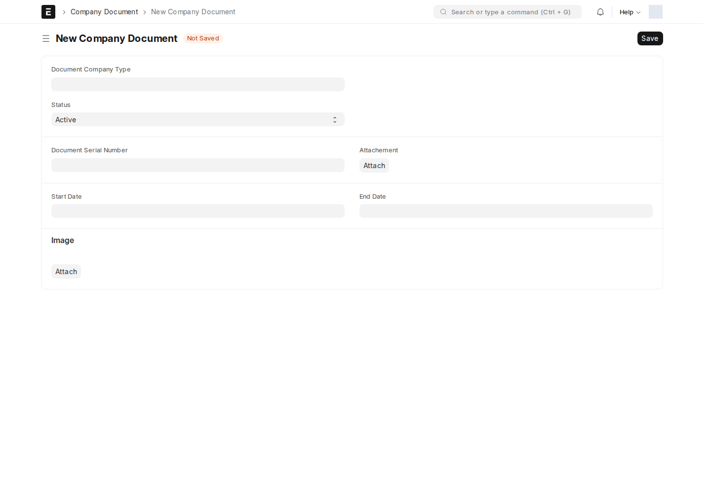

هذه المجموعة تدير **الوثائق القانونية الرسمية للشركة نفسها** (تراخيص، عقود إيجار، ...) — وليست وثائق الموظفين الشخصية.

## نوع الوثيقة (Company Document Type)

قائمة تصنيف بسيطة (اسم + وصف) — أنشئ نوعاً لكل صنف وثيقة تتابعه الشركة (رخصة تجارية، عقد إيجار مقر، ...).

## وثيقة الشركة (Company Document)

سجل قابل للاعتماد يتتبّع **نسخة واحدة** من وثيقة رسمية وتاريخ صلاحيتها.

أين أجدها؟ اكتب في شريط البحث: `وثيقة الشركة` أو `Company Document`

| الحقل | ماذا يعني |
| --- | --- |
| **نوع الوثيقة** | Link → Company Document Type — واسم السجل نفسه مأخوذ من هذا الحقل |
| **id** (Document Serial Number) | الرقم التسلسلي للوثيقة نفسها |
| **attachement** | الملف المرفق (صورة/PDF للوثيقة) |
| **تاريخ البدء / نهاية التاريخ** | فترة صلاحية الوثيقة |
| **Status** | Active / Inactive / Under Renewal |

:::note[مواعيد تذكير التجديد]
القواعد المفعلة تستهدف منشئ الوثيقة ودور HR Manager قبل End Date بـ **60 يوماً، ويومين، ويوم واحد**، مع خيار تنبيه النظام. لا تعتمد على حالة Sent في البريد لإثبات وصول التذكير؛ راجع الوثائق وتواريخها داخل النظام.
:::

## طلب تجديد (Document Renewal Request)

مستند قابل للاعتماد يبدأ **متابعة تجديد** لوثيقة معيّنة — له حقل حالة وصفي: **مسودة → مُقدَّم → قيد التجديد → مكتمل / مرفوض**.

## إرسال التجديد لمحامٍ خارجي (Request Lawyer Renewal)

عندما يتطلّب التجديد إجراءً قانونياً خارجياً، يُنشأ سجل يربط الوثيقة بـ**مورد** (Supplier) من نوع "محامٍ" (حقل `supplier` معنون فعلياً "Lawyer")، ويتضمّن:

| الحقل | ماذا يعني |
| --- | --- |
| **email** | بريد التواصل مع المحامي |
| **status** | Draft / Sent to Lawyer / In Progress / Completed |
| **fulfilment_checklist** | جدول فرعي لتوثيق خطوات التجديد المطلوبة من المحامي — كل بند: هل أُنجز (Check)، متطلَّب، ملاحظات، مرفق، تاريخ التقديم |
| **final_document** | الوثيقة المجدَّدة النهائية، تُرفَق بعد اكتمال العملية |

استخدم جدول **fulfilment_checklist** كقائمة تحقّق حية تتابع بها ما أنجزه المحامي وما تبقّى، بدل تبادل رسائل متفرقة.

## قوالب وثائق الموظف الشخصية

هذه منفصلة تماماً عن وثائق الشركة أعلاه — **Personal Documents template** هو قالب قابل لإعادة الاستخدام (مثل "مستندات موظف جديد") يحدّد قائمة الوثائق الشخصية المطلوبة من كل موظف (بطاقة هوية، سيرة ذاتية، ...)، تُستخدَم عند التأهيل (Onboarding).

<!-- BEGIN VERIFIED SITE REFERENCE -->

## مرجع الأدوار وسير العمل والإشعارات

تمت المراجعة من إعدادات **testsite.local — 12 سبتمبر 2026**. مستوى 0 هو الحقوق الأساسية؛ المستويات الأعلى تخص مجموعات حقول محددة. علامة — تعني أن صف الدور لا يمنح الحق. لا تجمع الصور كل أدوار المستخدمين؛ الصور التقطت بحساب الإدارة.

**تنبيه البريد:** [سكربت موقع الاختبار يضع البريد في Sent دون إرساله](/users/active-scripts/). تابع المستند والتنبيهات المتاحة داخل النظام.

### Company Document Type

**الدور:** تصنيف الوثيقة القانونية للشركة.

**صلاحيات الأدوار الفعلية** (تظل قيود السجلات والحالة والشروط سارية):

| الدور/الأدوار | مستوى الحقول | قراءة | إنشاء | تعديل | اعتماد | إلغاء | القيد |
| --- | --- | --- | --- | --- | --- | --- | --- |
| System Manager | 0 | نعم | نعم | نعم | — | — | بحسب النطاق المسموح |

**سير العمل:** لا يوجد Workflow نشط لهذا النوع وقت المراجعة. المستند يُحفظ دون Submit؛ حقل الحالة إن وجد لا يعني Workflow مستقلاً.

**الإشعارات:** لا توجد قاعدة Notification مستقلة مفعلة لهذا النوع في لقطة المراجعة. قد تنطبق معالجات التطبيق المذكورة في الشرح أو معالج ION العام عند وجود workflow_state؛ غياب القاعدة ليس دليلاً على غياب كل تنبيه.

### Company Document

**الدور:** تسجيل نسخة الوثيقة ومرفقها ومدة صلاحيتها.

**صلاحيات الأدوار الفعلية** (تظل قيود السجلات والحالة والشروط سارية):

| الدور/الأدوار | مستوى الحقول | قراءة | إنشاء | تعديل | اعتماد | إلغاء | القيد |
| --- | --- | --- | --- | --- | --- | --- | --- |
| System Manager | 0 | نعم | نعم | نعم | نعم | — | بحسب النطاق المسموح |

**سير العمل:** لا يوجد Workflow نشط لهذا النوع وقت المراجعة. المستند قابل للاعتماد القياسي؛ Save ثم Submit حسب الصلاحية والتحقق، وأي حقل Status وصفي لا يعرّف سلسلة موافقات بالأدوار.

**قواعد الإشعارات المفعّلة:** البريد يخضع لقيد الإرسال التجريبي المذكور أعلاه؛ تنبيه الجرس مبين منفصلاً.

| القاعدة | متى؟ | الشرط/حدود الاستخدام | المستلم | القناة |
| --- | --- | --- | --- | --- |
| تنبيه: انتهاء صلاحية الوثيقة | 60 يوم قبل End Date | دون شرط عام إضافي | HR Manager + منشئ المستند | Email + جرس النظام |
| تنبيه: انتهاء صلاحية الوثيقة 2 days | 2 يوم قبل End Date | دون شرط عام إضافي | HR Manager + منشئ المستند | Email + جرس النظام |
| تنبيه: انتهاء صلاحية الوثيق1z 2days | 1 يوم قبل End Date | دون شرط عام إضافي | HR Manager + منشئ المستند | Email + جرس النظام |

### Document Renewal Request

**الدور:** تتبع طلب تجديد وثيقة وحالته.

*الشاشة متاحة في الإعداد، لكن لم توجد لها سجلات محفوظة وقت المراجعة؛ لا يُفترض أنها خطوة يومية مستخدمة أو مطلوبة لمجرد وجودها.*

**صلاحيات الأدوار الفعلية** (تظل قيود السجلات والحالة والشروط سارية):

| الدور/الأدوار | مستوى الحقول | قراءة | إنشاء | تعديل | اعتماد | إلغاء | القيد |
| --- | --- | --- | --- | --- | --- | --- | --- |
| System Manager | 0 | نعم | نعم | نعم | نعم | نعم | بحسب النطاق المسموح |
| HR Manager، HR User | 0 | نعم | نعم | نعم | نعم | — | بحسب النطاق المسموح |

**سير العمل:** لا يوجد Workflow نشط لهذا النوع وقت المراجعة. المستند قابل للاعتماد القياسي؛ Save ثم Submit حسب الصلاحية والتحقق، وأي حقل Status وصفي لا يعرّف سلسلة موافقات بالأدوار.

**الإشعارات:** لا توجد قاعدة Notification مستقلة مفعلة لهذا النوع في لقطة المراجعة. قد تنطبق معالجات التطبيق المذكورة في الشرح أو معالج ION العام عند وجود workflow_state؛ غياب القاعدة ليس دليلاً على غياب كل تنبيه.

### Request Lawyer Renewal

**الدور:** متابعة متطلبات التجديد المسند إلى محامٍ والوثيقة النهائية.

**صلاحيات الأدوار الفعلية** (تظل قيود السجلات والحالة والشروط سارية):

| الدور/الأدوار | مستوى الحقول | قراءة | إنشاء | تعديل | اعتماد | إلغاء | القيد |
| --- | --- | --- | --- | --- | --- | --- | --- |
| System Manager، HR Manager، HR User | 0 | نعم | نعم | نعم | — | — | بحسب النطاق المسموح |

**سير العمل:** لا يوجد Workflow نشط لهذا النوع وقت المراجعة. المستند يُحفظ دون Submit؛ حقل الحالة إن وجد لا يعني Workflow مستقلاً.

**قواعد الإشعارات المفعّلة:** البريد يخضع لقيد الإرسال التجريبي المذكور أعلاه؛ تنبيه الجرس مبين منفصلاً.

| القاعدة | متى؟ | الشرط/حدود الاستخدام | المستلم | القناة |
| --- | --- | --- | --- | --- |
| mail fulfilment filled1 | تغير fulfilment status | Fulfilment Status مفعّل | HR Manager + منشئ المستند؛ HR User + منشئ المستند | Email فقط |
| mail fulfilment filled | تغير fulfilment status | Fulfilment Status مفعّل | HR Manager + منشئ المستند؛ HR User + منشئ المستند | Email فقط |
| الوثيقة النهائية | تغير Final Document | Fulfilment Status مفعّل | HR Manager + منشئ المستند؛ HR User + منشئ المستند | Email فقط |
| fulfilment status | تغير fulfilment status | Fulfilment Status مفعّل | HR Manager + منشئ المستند؛ HR User + منشئ المستند | جرس النظام |

### Personal Documents template

**الدور:** قائمة مرجعية لمستندات الموظف الشخصية المطلوبة.

*الشاشة متاحة في الإعداد، لكن لم توجد لها سجلات محفوظة وقت المراجعة؛ لا يُفترض أنها خطوة يومية مستخدمة أو مطلوبة لمجرد وجودها.*

**صلاحيات الأدوار الفعلية** (تظل قيود السجلات والحالة والشروط سارية):

| الدور/الأدوار | مستوى الحقول | قراءة | إنشاء | تعديل | اعتماد | إلغاء | القيد |
| --- | --- | --- | --- | --- | --- | --- | --- |
| System Manager، HR Manager | 0 | نعم | نعم | نعم | — | — | بحسب النطاق المسموح |

**سير العمل:** لا يوجد Workflow نشط لهذا النوع وقت المراجعة. المستند يُحفظ دون Submit؛ حقل الحالة إن وجد لا يعني Workflow مستقلاً.

**الإشعارات:** لا توجد قاعدة Notification مستقلة مفعلة لهذا النوع في لقطة المراجعة. قد تنطبق معالجات التطبيق المذكورة في الشرح أو معالج ION العام عند وجود workflow_state؛ غياب القاعدة ليس دليلاً على غياب كل تنبيه.

<!-- END VERIFIED SITE REFERENCE -->
