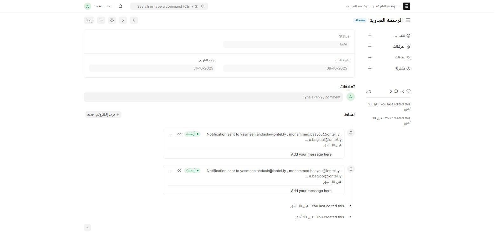

هذه المجموعة تدير **الوثائق القانونية الرسمية للشركة نفسها** (تراخيص، عقود إيجار، ...) — وليست وثائق الموظفين الشخصية.

## نوع الوثيقة (Company Document Type)

قائمة تصنيف بسيطة (اسم + وصف) — أنشئ نوعاً لكل صنف وثيقة تتابعه الشركة (رخصة تجارية، عقد إيجار مقر، ...).

## وثيقة الشركة (Company Document)

سجل قابل للاعتماد يتتبّع **نسخة واحدة** من وثيقة رسمية وتاريخ صلاحيتها.

أين أجدها؟ اكتب في شريط البحث: `وثيقة الشركة` أو `Company Document`

| الحقل | ماذا يعني |
| --- | --- |
| **نوع الوثيقة** | Link → Company Document Type — واسم السجل نفسه مأخوذ من هذا الحقل |
| **id** (Document Serial Number) | الرقم التسلسلي للوثيقة نفسها |
| **attachement** | الملف المرفق (صورة/PDF للوثيقة) |
| **تاريخ البدء / نهاية التاريخ** | فترة صلاحية الوثيقة |
| **Status** | Active / Inactive / Under Renewal |

:::note[إشعارات تلقائية عند اقتراب انتهاء الصلاحية]
كما يظهر في سجلّ النشاط أعلى كل وثيقة، يُرسل النظام تلقائياً إشعارات بريد إلكتروني للمعنيين قرب تاريخ انتهاء الصلاحية — تكرّرت الإشعارات في المثال أعلاه أكثر من مرة لتذكير المسؤولين بالتجديد قبل الانتهاء. لا حاجة لمتابعة تواريخ الانتهاء يدوياً على جدول بيانات منفصل.
:::

## طلب تجديد (Document Renewal Request)

مستند قابل للاعتماد يبدأ **مسار تجديد رسمي** لوثيقة معيّنة — يمرّ بحالات: **مسودة → مُقدَّم → قيد التجديد → مكتمل / مرفوض**.

## إرسال التجديد لمحامٍ خارجي (Request Lawyer Renewal)

عندما يتطلّب التجديد إجراءً قانونياً خارجياً، يُنشأ سجل يربط الوثيقة بـ**مورد** (Supplier) من نوع "محامٍ" (حقل `supplier` معنون فعلياً "Lawyer")، ويتضمّن:

| الحقل | ماذا يعني |
| --- | --- |
| **email** | بريد التواصل مع المحامي |
| **status** | Draft / Sent to Lawyer / In Progress / Completed |
| **fulfilment_checklist** | جدول قابل للاعتماد بخطوات التجديد المطلوبة من المحامي — كل بند: هل أُنجز (Check)، متطلَّب، ملاحظات، مرفق، تاريخ التقديم |
| **final_document** | الوثيقة المجدَّدة النهائية، تُرفَق بعد اكتمال العملية |

استخدم جدول **fulfilment_checklist** كقائمة تحقّق حية تتابع بها ما أنجزه المحامي وما تبقّى، بدل تبادل رسائل متفرقة.

## قوالب وثائق الموظف الشخصية

هذه منفصلة تماماً عن وثائق الشركة أعلاه — **Personal Documents Template** هو قالب قابل لإعادة الاستخدام (مثل "مستندات موظف جديد") يحدّد قائمة الوثائق الشخصية المطلوبة من كل موظف (بطاقة هوية، سيرة ذاتية، ...)، تُستخدَم عند التأهيل (Onboarding).
