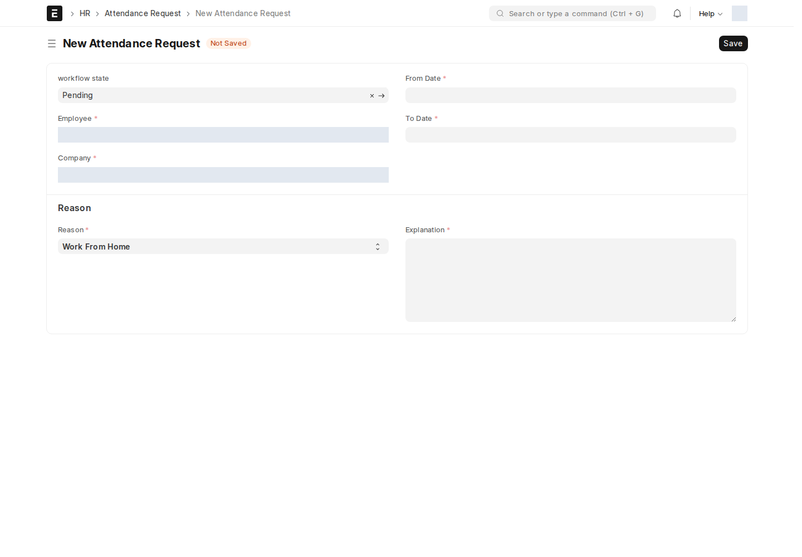
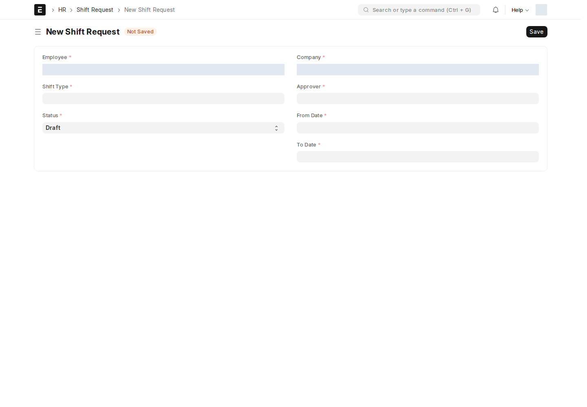
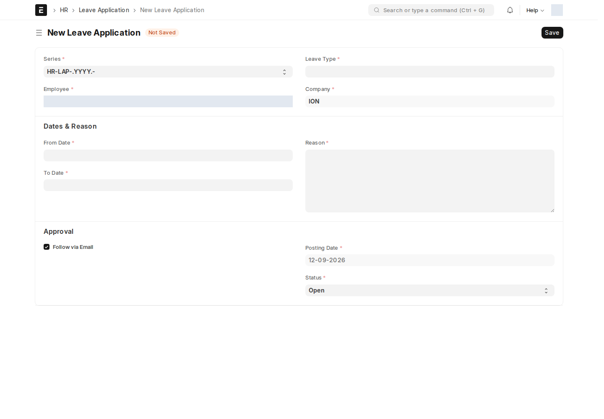
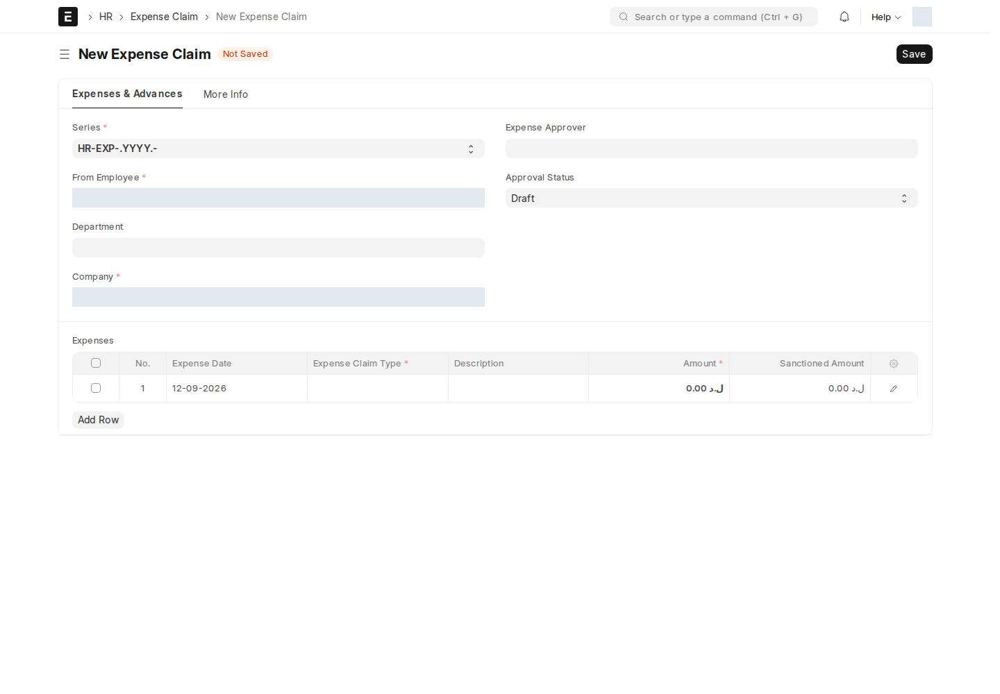

هذه الشاشات قياسية في HRMS، لكن موقع ION يضيف إليها سكربتات أو Workflow؛ لذلك يجب اتباع الإجراء الحالي أدناه.

## Attendance Request — طلب حضور

الغرض تسجيل طلب تصحيح/تغطية حضور لفترة محددة، وليس تبرير دقائق التأخير. عند إنشاء الطلب، يملأ السكربت الموظف وقسمه من حساب الدخول ويقفل الحقول. اختر الفترة والسبب وأدخل التفسير ثم احفظ.

السبب **Late** مخفي بالسكربت؛ استخدم [Late Entry Request](/hr/attendance-lateness/) للتأخير. سير العمل **Pending → Accepted / Rejected** بدور **Department Manager**. إشعار الحفظ يذهب إلى **Custom Approver** المسجل؛ مستلم الإشعار ليس بالضرورة الوحيد الذي تسمح له شروط Workflow بالموافقة.

## Shift Request — طلب وردية

الغرض طلب وردية لفترة معينة. يحدد الموظف **Shift Type** والفترة و**Approver** ثم يحفظ.

صاحب الإجراء يحمل الدور المكتوب في النظام **Shift Request approv**، ويجب أن يكون مستخدمه هو **Approver** المحدد على الطلب. يمكنه Approve أو Reject من Pending، وCancel من Approved. إشعار الطلب الجديد يذهب إلى Approver، مع تنبيه نظام مفعّل.

**Shift Assignment** يوثق إسناد الوردية الفعلي إلى الموظف، و**Shift Schedule Assignment** يربطه بجدول ورديات. إنشاء الطلب وحده لا يثبت اكتمال الإسناد؛ راجع المستند الناتج. إشعار إنشاء Shift Schedule Assignment يستهدف مستخدم الموظف المسجل في Custom Employee User.

## Leave Application — طلب إجازة

الغرض توثيق غياب بإجازة مع النوع والفترة والمعتمد. يملأ الموظف طلبه، ويراجعه **Leave Approver** المحدد على المستند وفق الصلاحيات.

لا يوجد Workflow نشط لهذا DocType وقت المراجعة. السكربت **Restrict Edit Status** يقفل Status لغير المعتمد المحدد، مع استثناء Administrator. شرطه الحالي لا يمنع الموافقة الذاتية إذا كان مقدم الطلب هو المعتمد المختار؛ اتبع التفويض التنظيمي المعتمد عند المراجعة.

قاعدة البريد عند الحفظ تتضمن شرطاً على وجود عناوين مديري المشاريع، لذلك لا تتوقع إشعاراً لكل طلب بلا شرط. راجع جدول الإشعارات أدناه.

## Expense Claim — مطالبة مصروفات

الغرض طلب تعويض مصروفات عمل. السكربت **ex** يملأ الموظف والقسم وExpense Approver من سجل الموظف ويقفلها عند إنشاء الطلب. أضف المصروفات وتواريخها ومستنداتها ثم احفظ وأكمل إجراء المراجعة حسب حقوقك.

لا يوجد Workflow نشط لهذا DocType في الموقع وقت المراجعة؛ لا تخلط حقل المعتمد بمسار Workflow. إذا كان المعتمد أو القسم خطأ، راجع بيانات الموظف مع HR بدلاً من محاولة تجاوز الحقول المقفلة.

<!-- BEGIN VERIFIED SITE REFERENCE -->

## مرجع الأدوار وسير العمل والإشعارات

تمت المراجعة من إعدادات **testsite.local — 12 سبتمبر 2026**. مستوى 0 هو الحقوق الأساسية؛ المستويات الأعلى تخص مجموعات حقول محددة. علامة — تعني أن صف الدور لا يمنح الحق. لا تجمع الصور كل أدوار المستخدمين؛ الصور التقطت بحساب الإدارة.

**تنبيه البريد:** [سكربت موقع الاختبار يضع البريد في Sent دون إرساله](/users/active-scripts/). تابع المستند والتنبيهات المتاحة داخل النظام.

### Attendance Request

**الدور:** طلب إثبات/تصحيح حضور لفترة وسبب محددين.

**صلاحيات الأدوار الفعلية** (تظل قيود السجلات والحالة والشروط سارية):

| الدور/الأدوار | مستوى الحقول | قراءة | إنشاء | تعديل | اعتماد | إلغاء | القيد |
| --- | --- | --- | --- | --- | --- | --- | --- |
| HR User، System Manager، HR Manager | 0 | نعم | نعم | نعم | نعم | نعم | بحسب النطاق المسموح |
| Employee، Employee Self Service | 0 | نعم | نعم | نعم | — | — | بحسب النطاق المسموح |

**سير العمل النشط:** `Attendance Request`. استخدم قائمة الإجراءات؛ لا تعدل حقل الحالة يدوياً. دور الانتقال لا يمنح حقوق القراءة/الكتابة/الاعتماد الناقصة.

| من الحالة | الإجراء | إلى الحالة | الدور المنفّذ | الشرط | حالة المستند بعده |
| --- | --- | --- | --- | --- | --- |
| Pending | Approve | Accepted | Department Manager | لا شرط إضافي في الانتقال | معتمد (1) |
| Pending | Reject | Rejected | Department Manager | لا شرط إضافي في الانتقال | مسودة (0) |

من يحرر المستند في كل حالة؟

الدور أدناه هو Allow Edit في إعداد الحالة، ويضاف إلى حقوق الحقول ونطاق السجل.

| الحالة | دور تحرير الحالة | حالة المستند |
| --- | --- | --- |
| Pending | All | مسودة (0) |
| Accepted | Department Manager | معتمد (1) |
| Rejected | Department Manager | مسودة (0) |

بريد Workflow القياسي **غير مفعّل** لهذا السير. يمكن أن تعمل قواعد Notification ومعالجات التطبيق بشكل مستقل عنه.

**قواعد الإشعارات المفعّلة:** البريد يخضع لقيد الإرسال التجريبي المذكور أعلاه؛ تنبيه الجرس مبين منفصلاً.

| القاعدة | متى؟ | الشرط/حدود الاستخدام | المستلم | القناة |
| --- | --- | --- | --- | --- |
| Attendance Request | الحفظ | دون شرط عام إضافي | approver | Email فقط |

### Shift Request

**الدور:** طلب إسناد وردية واعتماده من المستخدم المعين.

**صلاحيات الأدوار الفعلية** (تظل قيود السجلات والحالة والشروط سارية):

| الدور/الأدوار | مستوى الحقول | قراءة | إنشاء | تعديل | اعتماد | إلغاء | القيد |
| --- | --- | --- | --- | --- | --- | --- | --- |
| HR Manager، Employee Self Service | 0 | نعم | نعم | نعم | نعم | نعم | بحسب النطاق المسموح |
| Employee | 0 | نعم | نعم | نعم | — | — | بحسب النطاق المسموح |
| HR User | 0 | نعم | نعم | نعم | نعم | — | بحسب النطاق المسموح |
| Accounts Manager | 1 | نعم | — | — | — | — | بحسب النطاق المسموح |
| Shift Request approv | 0 | نعم | — | — | — | — | بحسب النطاق المسموح |
| Shift Request approv | 1 | نعم | — | نعم | — | — | بحسب النطاق المسموح |

**سير العمل النشط:** `Shift Request WF01`. استخدم قائمة الإجراءات؛ لا تعدل حقل الحالة يدوياً. دور الانتقال لا يمنح حقوق القراءة/الكتابة/الاعتماد الناقصة.

| من الحالة | الإجراء | إلى الحالة | الدور المنفّذ | الشرط | حالة المستند بعده |
| --- | --- | --- | --- | --- | --- |
| Pending | Approve | Approved | Shift Request approv | المستخدم هو Approver المحدد على الطلب | معتمد (1) |
| Pending | Reject | Rejected | Shift Request approv | المستخدم هو Approver المحدد على الطلب | مسودة (0) |
| Approved | Cancel | Cancelled | Shift Request approv | المستخدم هو Approver المحدد على الطلب | ملغى (2) |

من يحرر المستند في كل حالة؟

الدور أدناه هو Allow Edit في إعداد الحالة، ويضاف إلى حقوق الحقول ونطاق السجل.

| الحالة | دور تحرير الحالة | حالة المستند |
| --- | --- | --- |
| Pending | Employee | مسودة (0) |
| Approved | Shift Request approv | معتمد (1) |
| Rejected | Shift Request approv | مسودة (0) |
| Cancelled | Shift Request approv | ملغى (2) |

بريد Workflow القياسي **غير مفعّل** لهذا السير. يمكن أن تعمل قواعد Notification ومعالجات التطبيق بشكل مستقل عنه.

**قواعد الإشعارات المفعّلة:** البريد يخضع لقيد الإرسال التجريبي المذكور أعلاه؛ تنبيه الجرس مبين منفصلاً.

| القاعدة | متى؟ | الشرط/حدود الاستخدام | المستلم | القناة |
| --- | --- | --- | --- | --- |
| Shift Request Notify | الإنشاء | دون شرط عام إضافي | Approver | Email + جرس النظام |

### Shift Assignment

**الدور:** تسجيل إسناد وردية فعلي لموظف.

**صلاحيات الأدوار الفعلية** (تظل قيود السجلات والحالة والشروط سارية):

| الدور/الأدوار | مستوى الحقول | قراءة | إنشاء | تعديل | اعتماد | إلغاء | القيد |
| --- | --- | --- | --- | --- | --- | --- | --- |
| Employee | 0 | نعم | — | — | — | — | بحسب النطاق المسموح |
| HR Manager | 0 | نعم | نعم | نعم | نعم | نعم | بحسب النطاق المسموح |
| HR User | 0 | نعم | نعم | نعم | نعم | — | بحسب النطاق المسموح |

**سير العمل:** لا يوجد Workflow نشط لهذا النوع وقت المراجعة. المستند قابل للاعتماد القياسي؛ Save ثم Submit حسب الصلاحية والتحقق، وأي حقل Status وصفي لا يعرّف سلسلة موافقات بالأدوار.

**الإشعارات:** لا توجد قاعدة Notification مستقلة مفعلة لهذا النوع في لقطة المراجعة. قد تنطبق معالجات التطبيق المذكورة في الشرح أو معالج ION العام عند وجود workflow_state؛ غياب القاعدة ليس دليلاً على غياب كل تنبيه.

### Shift Schedule Assignment

**الدور:** ربط الموظف بجدول ورديات.

**صلاحيات الأدوار الفعلية** (تظل قيود السجلات والحالة والشروط سارية):

| الدور/الأدوار | مستوى الحقول | قراءة | إنشاء | تعديل | اعتماد | إلغاء | القيد |
| --- | --- | --- | --- | --- | --- | --- | --- |
| Employee | 0 | نعم | — | — | — | — | بحسب النطاق المسموح |
| HR User، HR Manager | 0 | نعم | نعم | نعم | — | — | بحسب النطاق المسموح |

**سير العمل:** لا يوجد Workflow نشط لهذا النوع وقت المراجعة. المستند يُحفظ دون Submit؛ حقل الحالة إن وجد لا يعني Workflow مستقلاً.

**قواعد الإشعارات المفعّلة:** البريد يخضع لقيد الإرسال التجريبي المذكور أعلاه؛ تنبيه الجرس مبين منفصلاً.

| القاعدة | متى؟ | الشرط/حدود الاستخدام | المستلم | القناة |
| --- | --- | --- | --- | --- |
| Shift Schedule Assignment Notify | الإنشاء | دون شرط عام إضافي | مستخدم الموظف | Email + جرس النظام |

### Leave Application

**الدور:** تسجيل إجازة الموظف ونوعها وفترتها ومعتمدها.

**صلاحيات الأدوار الفعلية** (تظل قيود السجلات والحالة والشروط سارية):

| الدور/الأدوار | مستوى الحقول | قراءة | إنشاء | تعديل | اعتماد | إلغاء | القيد |
| --- | --- | --- | --- | --- | --- | --- | --- |
| Leave Approver، HR Manager، HR User | 1 | نعم | — | نعم | — | — | بحسب النطاق المسموح |
| HR User | 0 | نعم | نعم | نعم | نعم | نعم | سجلات يملكها المستخدم فقط |
| Leave Approver | 0 | نعم | — | نعم | نعم | نعم | بحسب النطاق المسموح |
| All | 1 | نعم | — | — | — | — | بحسب النطاق المسموح |
| HR Manager | 0 | نعم | نعم | نعم | نعم | نعم | بحسب النطاق المسموح |
| Employee، Employee Self Service | 0 | نعم | نعم | نعم | — | — | بحسب النطاق المسموح |
| Leave Approver | 0 | نعم | — | نعم | نعم | — | بحسب النطاق المسموح |

**سير العمل:** لا يوجد Workflow نشط لهذا النوع وقت المراجعة. المستند قابل للاعتماد القياسي؛ Save ثم Submit حسب الصلاحية والتحقق، وأي حقل Status وصفي لا يعرّف سلسلة موافقات بالأدوار.

**قواعد الإشعارات المفعّلة:** البريد يخضع لقيد الإرسال التجريبي المذكور أعلاه؛ تنبيه الجرس مبين منفصلاً.

| القاعدة | متى؟ | الشرط/حدود الاستخدام | المستلم | القناة |
| --- | --- | --- | --- | --- |
| leave application notfication | الحفظ | عند الحفظ؛ مستلم Leave Approver مشروط بوجود عناوين مديري المشاريع | Leave Approver | Email فقط |

### Expense Claim

**الدور:** مطالبة بتعويض مصروفات العمل ومراجعتها.

**صلاحيات الأدوار الفعلية** (تظل قيود السجلات والحالة والشروط سارية):

| الدور/الأدوار | مستوى الحقول | قراءة | إنشاء | تعديل | اعتماد | إلغاء | القيد |
| --- | --- | --- | --- | --- | --- | --- | --- |
| All | 1 | نعم | — | — | — | — | بحسب النطاق المسموح |
| HR Manager، HR User، Expense Approver | 1 | نعم | — | نعم | — | — | بحسب النطاق المسموح |
| Employee، Employee Self Service | 0 | نعم | نعم | نعم | — | — | بحسب النطاق المسموح |
| HR User، Expense Approver، HR Manager | 0 | نعم | نعم | نعم | نعم | نعم | بحسب النطاق المسموح |

**سير العمل:** لا يوجد Workflow نشط لهذا النوع وقت المراجعة. المستند قابل للاعتماد القياسي؛ Save ثم Submit حسب الصلاحية والتحقق، وأي حقل Status وصفي لا يعرّف سلسلة موافقات بالأدوار.

**الإشعارات:** لا توجد قاعدة Notification مستقلة مفعلة لهذا النوع في لقطة المراجعة. قد تنطبق معالجات التطبيق المذكورة في الشرح أو معالج ION العام عند وجود workflow_state؛ غياب القاعدة ليس دليلاً على غياب كل تنبيه.

<!-- END VERIFIED SITE REFERENCE -->
