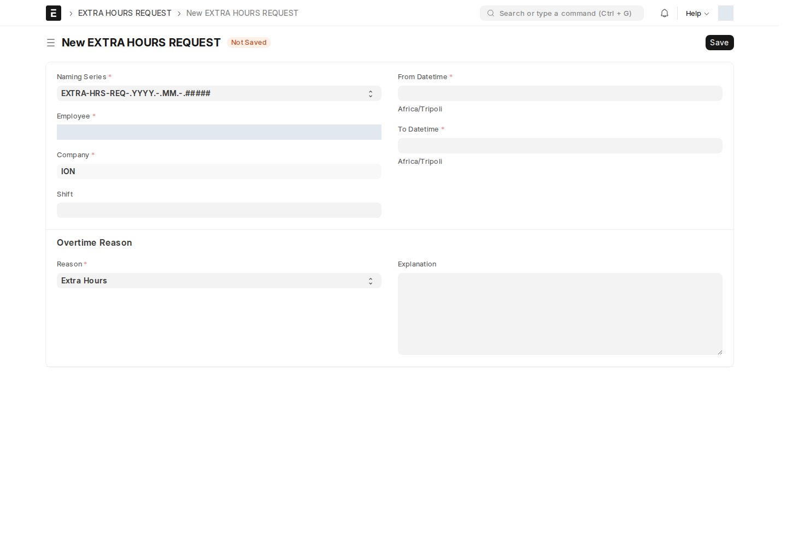

## طلب الساعات الإضافية (EXTRA HOURS REQUEST)

يقدّمه الموظف أو مديره لتسجيل وقت عمل زائد يستحق احتسابه.

أين أجده؟ القائمة الجانبية ← **Employee services** ← **طلب الساعات الاضافية**

| الحقل | إجباري | ماذا تكتب |
| --- | :---: | --- |
| **الموظف، القسم، الشركة** | ✅ | |
| **الوردية** | — | |
| **From/To datetime** | ✅ | فترة العمل الإضافي |
| **سبب** | ✅ | Extra Hours أو Surplus |
| **explanation** | — | |
| **reports_to** | — | المستخدم الذي سيراجع الطلب |

**الموافقة:** يستخدم السير دور Employee بشرط أن يكون المستخدم هو المدير المباشر لموظف الطلب. قد تمنع حقوق السجل الوصول حتى مع تحقق الشرط؛ راجع الجدول أدناه. الاسم الفعلي للنوع هو `EXTRA HOURS REQUEST` بحروف كبيرة.

## سجل الساعات الإضافية التلقائي (Extra Hours)

مثل [ساعات التأخير](/hr/attendance-lateness/)، **يتولّد تلقائياً** لكل موظف من بصمات الحضور — لا يُنشأ يدوياً. يعرض إجمالي الدقائق/الساعات الإضافية المحتسَبة لكل فترة، وجدول **Extra Hours Detail** اليومي (مع تمييز خاص لساعات العمل في **أيام العطل** عبر حقل `is_holiday`).

:::tip[الساعات الإضافية تدخل في راتب الشهر]
حقول `total_extra_minutes` و`total_extra_holiday_minutes` تُضاف على **Salary Slip** مباشرة، بحيث تنعكس الساعات الإضافية المعتمَدة تلقائياً في راتب الموظف دون إدخال يدوي في مسير الرواتب.
:::

## الانصراف التلقائي (Employee Auto Logout Config)

بعض الموظفين (خاصة في المناوبات) قد ينسون تسجيل انصرافهم. هذا الإعداد يحلّ المشكلة تلقائياً.

اكتب في شريط البحث: `Employee Auto Logout Config` (مدير النظام / مدير موارد بشرية فقط)

سجل إعداد واحد يحتوي جدول **Auto Checkout Assignment**: صف لكل موظف، يربطه بـ **نوع تحوّل (Shift Type)** محدَّد.

:::note[وظيفة مجدولة كل ساعة]
كل ساعة، يفحص النظام تلقائياً الموظفين المسجَّلين في هذا الجدول، ويُسجّل **انصرافاً تلقائياً** لمن نسي تسجيل خروجه بعد انتهاء وقت وردية العمل الخاصة به. هذه معالجة للانصراف المفقود وتعتمد على نجاح المهمة والوردية؛ تحقّق من البصمة الناتجة ولا تفترض أن مجرد إدراج الموظف يثبت انصرافه.
:::

<!-- BEGIN VERIFIED SITE REFERENCE -->

## مرجع الأدوار وسير العمل والإشعارات

تمت المراجعة من إعدادات **testsite.local — 12 سبتمبر 2026**. مستوى 0 هو الحقوق الأساسية؛ المستويات الأعلى تخص مجموعات حقول محددة. علامة — تعني أن صف الدور لا يمنح الحق. لا تجمع الصور كل أدوار المستخدمين؛ الصور التقطت بحساب الإدارة.

**تنبيه البريد:** [سكربت موقع الاختبار يضع البريد في Sent دون إرساله](/users/active-scripts/). تابع المستند والتنبيهات المتاحة داخل النظام.

### EXTRA HOURS REQUEST

**الدور:** طلب موافقة على وقت عمل إضافي أو فائض.

**صلاحيات الأدوار الفعلية** (تظل قيود السجلات والحالة والشروط سارية):

| الدور/الأدوار | مستوى الحقول | قراءة | إنشاء | تعديل | اعتماد | إلغاء | القيد |
| --- | --- | --- | --- | --- | --- | --- | --- |
| System Manager | 0 | نعم | نعم | نعم | نعم | — | بحسب النطاق المسموح |
| Employee | 0 | نعم | نعم | نعم | — | — | سجلات يملكها المستخدم فقط |

**سير العمل النشط:** `EXTRA HOURS REQ WF`. استخدم قائمة الإجراءات؛ لا تعدل حقل الحالة يدوياً. دور الانتقال لا يمنح حقوق القراءة/الكتابة/الاعتماد الناقصة.

| من الحالة | الإجراء | إلى الحالة | الدور المنفّذ | الشرط | حالة المستند بعده |
| --- | --- | --- | --- | --- | --- |
| Pending | Approve | Approved | Employee | المستخدم هو المدير المباشر المرتبط بموظف الطلب (Reports To → User ID) | معتمد (1) |
| Pending | Reject | Rejected | Employee | المستخدم هو المدير المباشر المرتبط بموظف الطلب (Reports To → User ID) | مسودة (0) |
| Approved | Cancel | Canceled | Employee | المستخدم هو المدير المباشر المرتبط بموظف الطلب (Reports To → User ID) | ملغى (2) |

من يحرر المستند في كل حالة؟

الدور أدناه هو Allow Edit في إعداد الحالة، ويضاف إلى حقوق الحقول ونطاق السجل.

| الحالة | دور تحرير الحالة | حالة المستند |
| --- | --- | --- |
| Pending | Employee | مسودة (0) |
| Approved | Employee | معتمد (1) |
| Rejected | Employee | مسودة (0) |
| Canceled | Employee | ملغى (2) |

بريد Workflow القياسي **غير مفعّل** لهذا السير. يمكن أن تعمل قواعد Notification ومعالجات التطبيق بشكل مستقل عنه.

**الإشعارات:** لا توجد قاعدة Notification مستقلة مفعلة لهذا النوع في لقطة المراجعة. قد تنطبق معالجات التطبيق المذكورة في الشرح أو معالج ION العام عند وجود workflow_state؛ غياب القاعدة ليس دليلاً على غياب كل تنبيه.

### Extra Hours

**الدور:** تجميع الساعات الإضافية المحتسبة وبيانات أيامها.

**صلاحيات الأدوار الفعلية** (تظل قيود السجلات والحالة والشروط سارية):

| الدور/الأدوار | مستوى الحقول | قراءة | إنشاء | تعديل | اعتماد | إلغاء | القيد |
| --- | --- | --- | --- | --- | --- | --- | --- |
| Employee | 0 | نعم | نعم | نعم | — | — | سجلات يملكها المستخدم فقط |
| System Manager | 0 | نعم | نعم | نعم | — | — | بحسب النطاق المسموح |

**سير العمل:** لا يوجد Workflow نشط لهذا النوع وقت المراجعة. المستند يُحفظ دون Submit؛ حقل الحالة إن وجد لا يعني Workflow مستقلاً.

**الإشعارات:** لا توجد قاعدة Notification مستقلة مفعلة لهذا النوع في لقطة المراجعة. قد تنطبق معالجات التطبيق المذكورة في الشرح أو معالج ION العام عند وجود workflow_state؛ غياب القاعدة ليس دليلاً على غياب كل تنبيه.

### Employee Auto Logout Config

**الدور:** تحديد الموظفين والورديات الذين يشملهم الانصراف التلقائي.

**صلاحيات الأدوار الفعلية** (تظل قيود السجلات والحالة والشروط سارية):

| الدور/الأدوار | مستوى الحقول | قراءة | إنشاء | تعديل | اعتماد | إلغاء | القيد |
| --- | --- | --- | --- | --- | --- | --- | --- |
| System Manager، HR Manager | 0 | نعم | نعم | نعم | — | — | بحسب النطاق المسموح |

**سير العمل:** لا يوجد Workflow نشط لهذا النوع وقت المراجعة. هذه شاشة إعداد واحدة تحفظ إعداداتها؛ لا تمر بمراحل Submit/Cancel.

**الإشعارات:** لا توجد قاعدة Notification مستقلة مفعلة لهذا النوع في لقطة المراجعة. قد تنطبق معالجات التطبيق المذكورة في الشرح أو معالج ION العام عند وجود workflow_state؛ غياب القاعدة ليس دليلاً على غياب كل تنبيه.

<!-- END VERIFIED SITE REFERENCE -->
