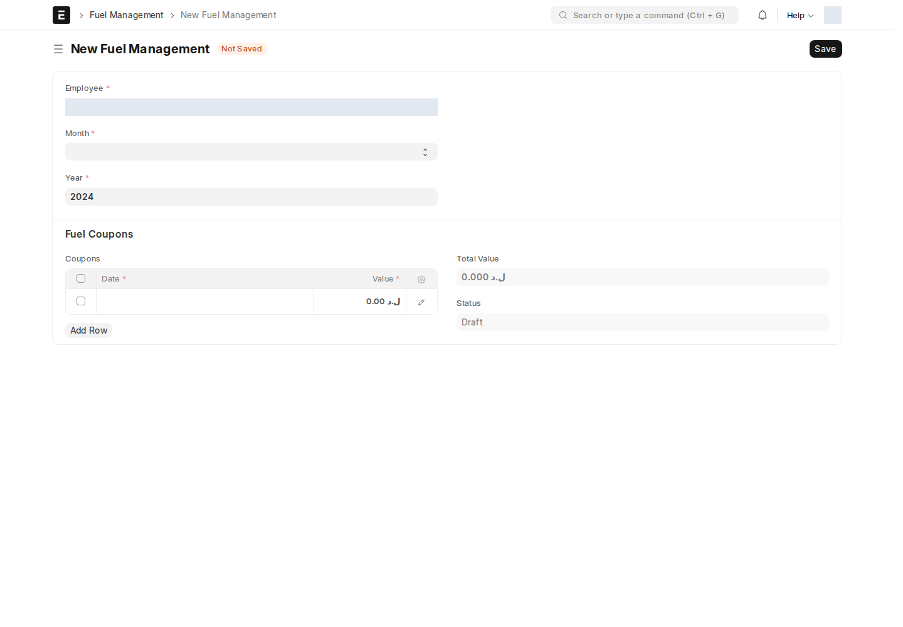

## Fuel Management — التخصيص الشهري

سجل قابل للاعتماد يخصّص **كوبونات وقود** لموظف واحد عن شهر محدَّد.

أين أجده؟ اكتب في شريط البحث: `Fuel Management`

| الحقل | إجباري | ملاحظة |
| --- | :---: | --- |
| **الموظف** | ✅ | |
| **شهر / عام** | ✅ | الفترة المستهدَفة بالتخصيص |
| **Fuel Coupons** (جدول) | ✅ | صف لكل كوبون: تاريخ + قيمة |
| **Total Value** | — | مجموع قيم الكوبونات، محسوَب تلقائياً |

## الربط بعقود الدوام الجزئي

عقد **الدوام الجزئي** ([راجع صفحة عقود الدوام الجزئي](/hr/transfers-contracts/)) يحمل حقوله الخاصة بالوقود:

| الحقل | ماذا يفعل |
| --- | --- |
| **Does Job Require Fuel Coupons?** | يحدّد إن كانت هذه الوظيفة تستحق كوبونات وقود أصلاً |
| **Notify HR for Fuel Coupons** | حقل توثيقي لطلب إخطار HR؛ لم يظهر معالج/Notification مفعّل يثبت الإرسال من هذا الحقل، فلا تعتمد عليه كتنبيه تلقائي |
| **number_of_coupons** / **coupon_value** / **total_coupon_value** | القيم الافتراضية المتّفق عليها في العقد |

:::tip[لماذا يوجد الحقل في مكانين؟]
عقد الدوام الجزئي يحدّد **الاستحقاق التعاقدي** (هل هذا الموظف يستحق كوبونات أصلاً، وكم)، بينما **Fuel Management** هو **التنفيذ الفعلي الشهري** — سجل منفصل تُنشئه الموارد البشرية كل شهر بناءً على ما ينص عليه العقد.
:::

## إنشاء تخصيص من Contract

على **Contract** محفوظ ومفعّل فيه **Requires Fuel Coupons**، يضيف التطبيق **Fuel Management → Create Fuel Coupon** لفتح مسودة تخصيص، و**View Fuel Records** لعرض السجلات المرتبطة. راجع أن طرف العقد موظف وأن القيم المنسوخة صحيحة قبل الحفظ. هذا الزر على Contract القياسي، فلا تفترض وجوده على عقد الدوام الجزئي.

<!-- BEGIN VERIFIED SITE REFERENCE -->

## مرجع الأدوار وسير العمل والإشعارات

تمت المراجعة من إعدادات **testsite.local — 12 سبتمبر 2026**. مستوى 0 هو الحقوق الأساسية؛ المستويات الأعلى تخص مجموعات حقول محددة. علامة — تعني أن صف الدور لا يمنح الحق. لا تجمع الصور كل أدوار المستخدمين؛ الصور التقطت بحساب الإدارة.

**تنبيه البريد:** [سكربت موقع الاختبار يضع البريد في Sent دون إرساله](/users/active-scripts/). تابع المستند والتنبيهات المتاحة داخل النظام.

### Fuel Management

**الدور:** تسجيل تخصيص كوبونات الوقود لموظف وفترة.

*الشاشة متاحة في الإعداد، لكن لم توجد لها سجلات محفوظة وقت المراجعة؛ لا يُفترض أنها خطوة يومية مستخدمة أو مطلوبة لمجرد وجودها.*

**صلاحيات الأدوار الفعلية** (تظل قيود السجلات والحالة والشروط سارية):

| الدور/الأدوار | مستوى الحقول | قراءة | إنشاء | تعديل | اعتماد | إلغاء | القيد |
| --- | --- | --- | --- | --- | --- | --- | --- |
| System Manager، HR Manager | 0 | نعم | نعم | نعم | نعم | — | بحسب النطاق المسموح |

**سير العمل:** لا يوجد Workflow نشط لهذا النوع وقت المراجعة. المستند قابل للاعتماد القياسي؛ Save ثم Submit حسب الصلاحية والتحقق، وأي حقل Status وصفي لا يعرّف سلسلة موافقات بالأدوار.

**الإشعارات:** لا توجد قاعدة Notification مستقلة مفعلة لهذا النوع في لقطة المراجعة. قد تنطبق معالجات التطبيق المذكورة في الشرح أو معالج ION العام عند وجود workflow_state؛ غياب القاعدة ليس دليلاً على غياب كل تنبيه.

<!-- END VERIFIED SITE REFERENCE -->
