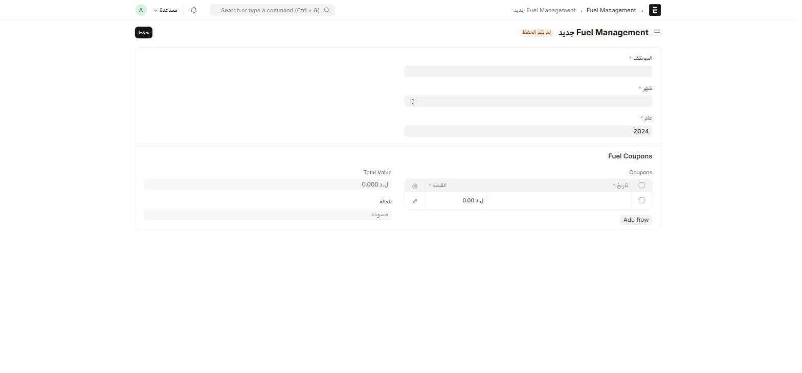

## Fuel Management — التخصيص الشهري

سجل قابل للاعتماد يخصّص **كوبونات وقود** لموظف واحد عن شهر محدَّد.

أين أجده؟ اكتب في شريط البحث: `Fuel Management`

| الحقل | إجباري | ملاحظة |
| --- | :---: | --- |
| **الموظف** | ✅ | |
| **شهر / عام** | ✅ | الفترة المستهدَفة بالتخصيص |
| **Fuel Coupons** (جدول) | ✅ | صف لكل كوبون: تاريخ + قيمة |
| **Total Value** | — | مجموع قيم الكوبونات، محسوَب تلقائياً |

## الربط بعقود الدوام الجزئي

عقد **الدوام الجزئي** ([راجع صفحة عقود الدوام الجزئي](/hr/transfers-contracts/#عقد-الدوام-الجزئي)) يحمل حقوله الخاصة بالوقود:

| الحقل | ماذا يفعل |
| --- | --- |
| **Does Job Require Fuel Coupons?** | يحدّد إن كانت هذه الوظيفة تستحق كوبونات وقود أصلاً |
| **Notify HR for Fuel Coupons** | يفعّل إشعاراً تلقائياً للموارد البشرية لإنشاء تخصيص Fuel Management لهذا الموظف |
| **number_of_coupons** / **coupon_value** / **total_coupon_value** | القيم الافتراضية المتّفق عليها في العقد |

:::tip[لماذا يوجد الحقل في مكانين؟]
عقد الدوام الجزئي يحدّد **الاستحقاق التعاقدي** (هل هذا الموظف يستحق كوبونات أصلاً، وكم)، بينما **Fuel Management** هو **التنفيذ الفعلي الشهري** — سجل منفصل تُنشئه الموارد البشرية كل شهر بناءً على ما ينص عليه العقد.
:::
