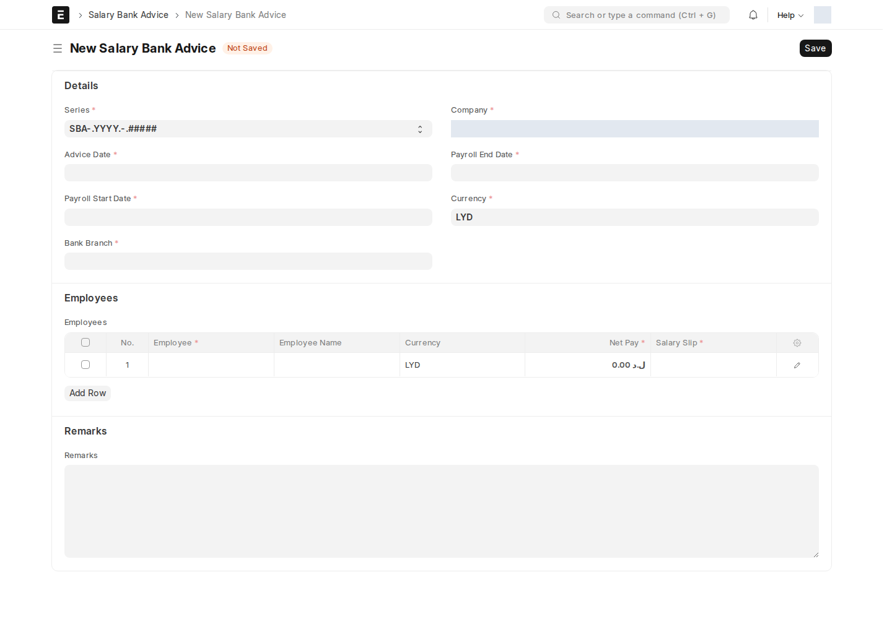

بعد اعتماد قسائم الرواتب الفردية، تُجمَّع دفعات التحويل البنكي في مستند واحد يُرسَل للبنك.

## فرع البنك (Bank Branch)

قائمة مساعدة بسيطة تُعرَّف مرة: **البنك** (Link → Bank)، **كود الفرع**، **اسم الفرع**، **العنوان**، ومربّع **معطَّل** لتعطيل فرع لم يعد مستخدَماً. اسم السجل يتكوّن تلقائياً من `{اسم الفرع}-{البنك}`.

## كشف تحويل الرواتب (Salary Bank Advice)

مستند قابل للاعتماد يجمّع **صافي راتب مجموعة موظفين** في كشف واحد جاهز للتسليم للبنك.

| الحقل | إجباري | ماذا يعني |
| --- | :---: | --- |
| **advice_date** | — | تاريخ إعداد الكشف |
| **payroll_start_date / payroll_end_date** | ✅ | فترة الرواتب المشمولة |
| **bank_branch** | ✅ | الفرع البنكي المرسَل إليه — يجلب تلقائياً اسم الفرع/البنك/الكود/العنوان |
| **company** | ✅ | |
| **currency** | ✅ | |
| **employees** (جدول Salary Bank Advice Employee) | ✅ | صف لكل موظف: صافي الراتب، رقم الحساب البنكي، الآيبان، وربط **قسيمة الراتب** المصدر |
| **total_net_pay** | — | إجمالي الكشف، محسوَب تلقائياً من مجموع صفوف الموظفين |

:::tip[استخدام عملي]
أنشئ كشفاً واحداً لكل فترة راتب ولكل فرع بنكي تتعامل معه الشركة — إذا كان لديك موظفون في بنوك مختلفة، ستحتاج كشفاً منفصلاً لكل بنك/فرع.
:::

<!-- BEGIN VERIFIED SITE REFERENCE -->

## مرجع الأدوار وسير العمل والإشعارات

تمت المراجعة من إعدادات **testsite.local — 12 سبتمبر 2026**. مستوى 0 هو الحقوق الأساسية؛ المستويات الأعلى تخص مجموعات حقول محددة. علامة — تعني أن صف الدور لا يمنح الحق. لا تجمع الصور كل أدوار المستخدمين؛ الصور التقطت بحساب الإدارة.

**تنبيه البريد:** [سكربت موقع الاختبار يضع البريد في Sent دون إرساله](/users/active-scripts/). تابع المستند والتنبيهات المتاحة داخل النظام.

### Bank Branch

**الدور:** تعريف فرع البنك المستخدم في كشف التحويل.

*الشاشة متاحة في الإعداد، لكن لم توجد لها سجلات محفوظة وقت المراجعة؛ لا يُفترض أنها خطوة يومية مستخدمة أو مطلوبة لمجرد وجودها.*

**صلاحيات الأدوار الفعلية** (تظل قيود السجلات والحالة والشروط سارية):

| الدور/الأدوار | مستوى الحقول | قراءة | إنشاء | تعديل | اعتماد | إلغاء | القيد |
| --- | --- | --- | --- | --- | --- | --- | --- |
| System Manager، HR Manager | 0 | نعم | نعم | نعم | — | — | بحسب النطاق المسموح |
| Employee | 0 | نعم | — | — | — | — | بحسب النطاق المسموح |

**سير العمل:** لا يوجد Workflow نشط لهذا النوع وقت المراجعة. المستند يُحفظ دون Submit؛ حقل الحالة إن وجد لا يعني Workflow مستقلاً.

**الإشعارات:** لا توجد قاعدة Notification مستقلة مفعلة لهذا النوع في لقطة المراجعة. قد تنطبق معالجات التطبيق المذكورة في الشرح أو معالج ION العام عند وجود workflow_state؛ غياب القاعدة ليس دليلاً على غياب كل تنبيه.

### Salary Bank Advice

**الدور:** تجميع صافي رواتب الموظفين في كشف تحويل بنكي.

*الشاشة متاحة في الإعداد، لكن لم توجد لها سجلات محفوظة وقت المراجعة؛ لا يُفترض أنها خطوة يومية مستخدمة أو مطلوبة لمجرد وجودها.*

**صلاحيات الأدوار الفعلية** (تظل قيود السجلات والحالة والشروط سارية):

| الدور/الأدوار | مستوى الحقول | قراءة | إنشاء | تعديل | اعتماد | إلغاء | القيد |
| --- | --- | --- | --- | --- | --- | --- | --- |
| System Manager | 0 | نعم | نعم | نعم | نعم | — | بحسب النطاق المسموح |

**سير العمل:** لا يوجد Workflow نشط لهذا النوع وقت المراجعة. المستند قابل للاعتماد القياسي؛ Save ثم Submit حسب الصلاحية والتحقق، وأي حقل Status وصفي لا يعرّف سلسلة موافقات بالأدوار.

**الإشعارات:** لا توجد قاعدة Notification مستقلة مفعلة لهذا النوع في لقطة المراجعة. قد تنطبق معالجات التطبيق المذكورة في الشرح أو معالج ION العام عند وجود workflow_state؛ غياب القاعدة ليس دليلاً على غياب كل تنبيه.

<!-- END VERIFIED SITE REFERENCE -->
