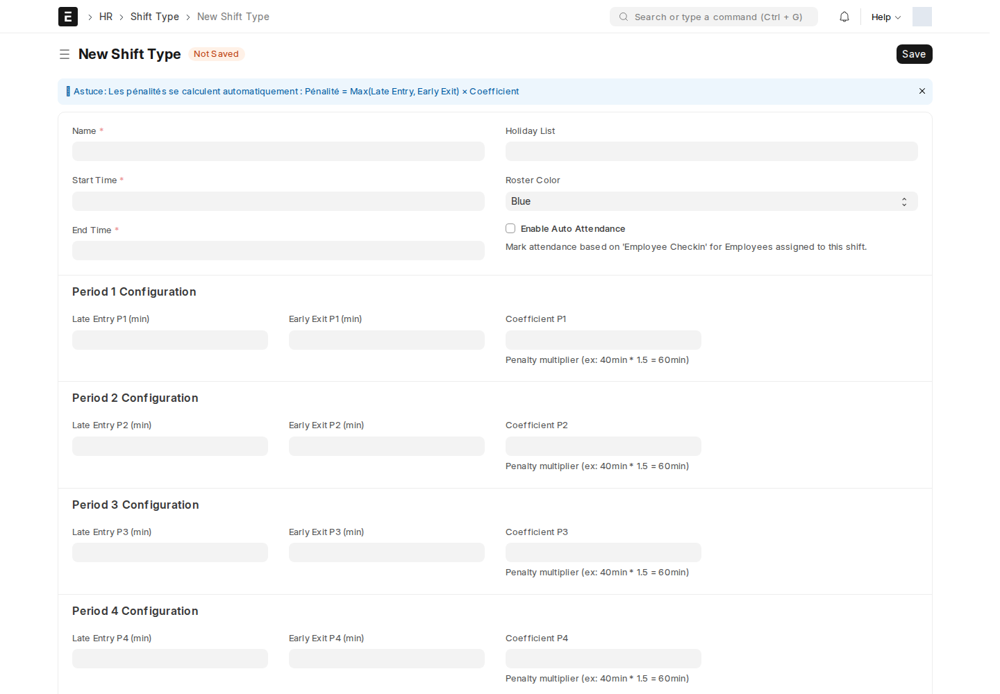

مرجع سريع بكل شاشات الإعداد في aion_custom_hr، مجموعة في مكان واحد. كل شاشة هنا **إعداد لمرة واحدة** (أو تُراجَع دورياً)، وليست عملاً يومياً.

## شرائح جزاء التأخير على نوع التحوّل

الإعداد الأهم في هذا الفصل — يحدّد **كيف يتحوّل التأخير بالدقائق إلى جزاء فعلي**، لكل **نوع تحوّل (Shift Type)** على حدة.

أين أجده؟ افتح أي **نوع تحوّل** (اكتب في شريط البحث `Shift Type` أو `نوع التحول`) وابحث عن قسم **Late Entry & Early Exit Settings for Auto Attendance**.

| الحقل | ماذا يضبط |
| --- | --- |
| **Enable Late Entry Marking** / **Enable Early Exit Marking** | تفعيل احتساب التأخير/الخروج المبكر لهذا التحوّل أصلاً |
| **Late Entry Assume as Absent (minutes)** / **Early Exit Assume as Absent (minutes)** | إذا تجاوز التأخير هذا الحد، يُعتبر اليوم **غياباً كاملاً** لا مجرد تأخير |
| **Period 1–4 Configuration** | حتى 4 شرائح متدرّجة، كل شريحة لها: حد دقائق التأخير (Late Entry Pn)، حد الخروج المبكر (Early Exit Pn)، ومُعامل الجزاء (Coefficient Pn) |
| **Penalty Pn (min)** | يُحتسَب **تلقائياً** = دقائق التأخير × المُعامل (مثال حسابي توضيحي: 40 دقيقة × 1.5 = 60 دقيقة جزاء) |

مثال حسابي لقراءة الشرائح، **وليس تأكيداً لقيم وردية حالية**؛ راجع القيم المحفوظة على Shift Type المستخدم:

| الشريحة | حد دقائق التأخير | المُعامل | الجزاء الناتج |
| :---: | :---: | :---: | :---: |
| P1 | 40 | 1.5 | 60 دقيقة |
| P2 | 80 | 1.5 | 120 دقيقة |
| P3 | 135 | 1.333 | 180 دقيقة |

:::tip[كيف تقرأ هذا الجدول عملياً]
كل شريحة تمثّل "حتى كم دقيقة تأخير". موظف تأخّر 90 دقيقة يقع في نطاق **P3** (لأنه تجاوز حد P2 البالغ 80)، فيُطبَّق عليه مُعامل P3. راجع [التأخير والخروج المبكر](/hr/attendance-lateness/) و[إدارة الجزاءات](/hr/penalties/) لكيفية وصول هذا الرقم لراتب الموظف فعلياً.
:::

## Late Hours Settings

إعداد عام واحد (مدير النظام فقط): هل يُحتسَب التأخير من **بصمة الحضور مباشرة** أم فقط بعد **اعتماد كشف الحضور**. راجع [التأخير والخروج المبكر](/hr/attendance-lateness/#من-أين-يبدأ-الاحتساب) للتفصيل.

## Score Percentage Settings

إعداد عام واحد يحوّل **درجة التقييم** إلى **نسبة من مبلغ المكافأة السنوية** — جدول شرائح (من % إلى % ← نسبة المكافأة). راجع [التقييمات السنوية والمكافآت](/hr/appraisals/#من-التقييم-إلى-مكافأة-الراتب).

## Employee Auto Logout Config

يحدّد أي الموظفين مسجَّلون في **الانصراف التلقائي** الساعي. راجع [الساعات الإضافية والانصراف التلقائي](/hr/extra-hours/#الانصراف-التلقائي-employee-auto-logout-config).

## Bank Branch، Company Document Type، Personal Documents template

قوائم مساعدة بسيطة (اسم + وصف غالباً) تُنشأ مرة عند التجهيز الأول، تُستخدَم لاحقاً كخيارات جاهزة في [كشف تحويل الرواتب](/hr/salary-bank-advice/) و[وثائق الشركة](/hr/employee-documents/).

<!-- BEGIN VERIFIED SITE REFERENCE -->

## مرجع الأدوار وسير العمل والإشعارات

تمت المراجعة من إعدادات **testsite.local — 12 سبتمبر 2026**. مستوى 0 هو الحقوق الأساسية؛ المستويات الأعلى تخص مجموعات حقول محددة. علامة — تعني أن صف الدور لا يمنح الحق. لا تجمع الصور كل أدوار المستخدمين؛ الصور التقطت بحساب الإدارة.

**تنبيه البريد:** [سكربت موقع الاختبار يضع البريد في Sent دون إرساله](/users/active-scripts/). تابع المستند والتنبيهات المتاحة داخل النظام.

### Shift Type

**الدور:** تعريف الوردية وأوقاتها وشرائح التأخير ومعالجة الحضور.

**صلاحيات الأدوار الفعلية** (تظل قيود السجلات والحالة والشروط سارية):

| الدور/الأدوار | مستوى الحقول | قراءة | إنشاء | تعديل | اعتماد | إلغاء | القيد |
| --- | --- | --- | --- | --- | --- | --- | --- |
| HR Manager، HR User | 0 | نعم | نعم | نعم | — | — | بحسب النطاق المسموح |
| Employee | 0 | نعم | — | — | — | — | بحسب النطاق المسموح |
| Employee Self Service | 0 | — | — | — | — | — | بحسب النطاق المسموح |

**سير العمل:** لا يوجد Workflow نشط لهذا النوع وقت المراجعة. المستند يُحفظ دون Submit؛ حقل الحالة إن وجد لا يعني Workflow مستقلاً.

**الإشعارات:** لا توجد قاعدة Notification مستقلة مفعلة لهذا النوع في لقطة المراجعة. قد تنطبق معالجات التطبيق المذكورة في الشرح أو معالج ION العام عند وجود workflow_state؛ غياب القاعدة ليس دليلاً على غياب كل تنبيه.

### Late Hours Settings

**الدور:** اختيار مصدر حساب التأخير وإعداداته العامة.

**صلاحيات الأدوار الفعلية** (تظل قيود السجلات والحالة والشروط سارية):

| الدور/الأدوار | مستوى الحقول | قراءة | إنشاء | تعديل | اعتماد | إلغاء | القيد |
| --- | --- | --- | --- | --- | --- | --- | --- |
| System Manager | 0 | نعم | نعم | نعم | — | — | بحسب النطاق المسموح |

**سير العمل:** لا يوجد Workflow نشط لهذا النوع وقت المراجعة. هذه شاشة إعداد واحدة تحفظ إعداداتها؛ لا تمر بمراحل Submit/Cancel.

**الإشعارات:** لا توجد قاعدة Notification مستقلة مفعلة لهذا النوع في لقطة المراجعة. قد تنطبق معالجات التطبيق المذكورة في الشرح أو معالج ION العام عند وجود workflow_state؛ غياب القاعدة ليس دليلاً على غياب كل تنبيه.

### Score Percentage Settings

**الدور:** تعريف شرائح الدرجة ونسب المكافأة.

**صلاحيات الأدوار الفعلية** (تظل قيود السجلات والحالة والشروط سارية):

| الدور/الأدوار | مستوى الحقول | قراءة | إنشاء | تعديل | اعتماد | إلغاء | القيد |
| --- | --- | --- | --- | --- | --- | --- | --- |
| System Manager | 0 | نعم | نعم | نعم | — | — | بحسب النطاق المسموح |

**سير العمل:** لا يوجد Workflow نشط لهذا النوع وقت المراجعة. هذه شاشة إعداد واحدة تحفظ إعداداتها؛ لا تمر بمراحل Submit/Cancel.

**الإشعارات:** لا توجد قاعدة Notification مستقلة مفعلة لهذا النوع في لقطة المراجعة. قد تنطبق معالجات التطبيق المذكورة في الشرح أو معالج ION العام عند وجود workflow_state؛ غياب القاعدة ليس دليلاً على غياب كل تنبيه.

<!-- END VERIFIED SITE REFERENCE -->
