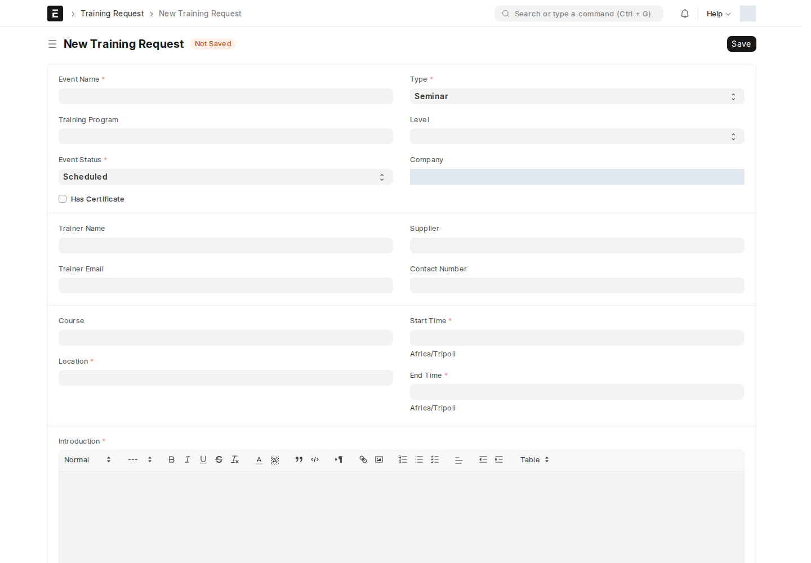

## Task manger HR

نوع مستند شبيه بـ **Task** القياسي في Frappe، لكنه مخصَّص لسياق الموارد البشرية والمشاريع الداخلية — يحمل نفس بنية Task تقريباً (الموضوع، المشروع، النوع، الحالة بما فيها **Overdue** و**Template**، الأولوية، التواريخ، نسبة الإنجاز، والتكلفة عبر الجداول الزمنية).

:::note[لماذا نوع مستند منفصل عن Task؟]
اسم الشاشة محفوظ بهذه التهجئة في المصدر (`Task manger HR` بدل Manager) — هكذا يظهر في شريط البحث. الغرض منه توفير قائمة مهام مرتبطة بسياق الموارد البشرية ومحدودة الوصول (دور Projects User)، منفصلة عن مهام المشاريع العامة.
:::

جدول **Task HR View** المرافق (يظهر عادة على شاشة أخرى، مثل الموظف أو القسم) يعرض ملخّصاً لهذه المهام لكل مسؤول، مع حقل موافقة خاص (**approved_**: قيد الانتظار / معتمَد / مرفوض) ومسؤول اعتماد التكليف (work_assignment_approver).

## طلب تدريب (Training Request)

يسجّل فعالية تدريبية واحدة (ورشة، مؤتمر، امتحان، ...) والموظفين المشاركين فيها.

| الحقل | إجباري | ماذا يعني |
| --- | :---: | --- |
| **event_name** | ✅ | اسم الفعالية — واسم السجل نفسه |
| **training_program** | — | البرنامج التدريبي المرتبط |
| **event_status** | ✅ | Scheduled / Completed / Cancelled |
| **type** | ✅ | Seminar / Theory / Workshop / Conference / Exam / Internet / Self-Study |
| **has_certificate** | — | هل تمنح الفعالية شهادة |
| **trainer_name / trainer_email / supplier / contact_number** | — | بيانات المدرِّب أو الجهة المزوِّدة |
| **location** | ✅ | |
| **start_time / end_time** | ✅ | |
| **introduction** | ✅ | مقدّمة/وصف الفعالية |
| **employees** (جدول) | — | الموظفون المشاركون |

هذه الشاشة مقصورة على دور **HR Manager**.

## ترشيح موظف داخلي لوظيفة أخرى (Job Applicant Internal)

منفصل تماماً عن [أسئلة فرز المرشحين الخارجيين](/career/job-question-sets/) — يُستخدَم عندما يُرشَّح **موظف حالي بالشركة** لوظيفة داخلية أخرى، بدل تقديم خارجي عبر صفحة التوظيف العامة.

| الحقل | ماذا يعني |
| --- | --- |
| **applicant_name، email_id، phone_number** | بيانات المرشّح الداخلي |
| **job_title** (Link → Job Opening) | الوظيفة الداخلية المرشَّح لها |
| **status** | Open / Replied / Rejected / Hold / Accepted |
| **source_name** | الموظف الذي رشّحه (Employee Referral) |
| **lower_range / upper_range** | نطاق الراتب المتوقَّع |

هذه الشاشة مقصورة على دور **HR User**.

<!-- BEGIN VERIFIED SITE REFERENCE -->

## مرجع الأدوار وسير العمل والإشعارات

تمت المراجعة من إعدادات **testsite.local — 12 سبتمبر 2026**. مستوى 0 هو الحقوق الأساسية؛ المستويات الأعلى تخص مجموعات حقول محددة. علامة — تعني أن صف الدور لا يمنح الحق. لا تجمع الصور كل أدوار المستخدمين؛ الصور التقطت بحساب الإدارة.

**تنبيه البريد:** [سكربت موقع الاختبار يضع البريد في Sent دون إرساله](/users/active-scripts/). تابع المستند والتنبيهات المتاحة داخل النظام.

### Task manger HR

**الدور:** إدارة تكليف أو مهمة عمل مرتبطة بسياق الموارد البشرية.

**صلاحيات الأدوار الفعلية** (تظل قيود السجلات والحالة والشروط سارية):

| الدور/الأدوار | مستوى الحقول | قراءة | إنشاء | تعديل | اعتماد | إلغاء | القيد |
| --- | --- | --- | --- | --- | --- | --- | --- |
| Projects User | 0 | نعم | نعم | نعم | — | — | بحسب النطاق المسموح |

**سير العمل:** لا يوجد Workflow نشط لهذا النوع وقت المراجعة. المستند يُحفظ دون Submit؛ حقل الحالة إن وجد لا يعني Workflow مستقلاً.

**الإشعارات:** لا توجد قاعدة Notification مستقلة مفعلة لهذا النوع في لقطة المراجعة. قد تنطبق معالجات التطبيق المذكورة في الشرح أو معالج ION العام عند وجود workflow_state؛ غياب القاعدة ليس دليلاً على غياب كل تنبيه.

### Training Request

**الدور:** تسجيل احتياج تدريب ومتابعته.

*الشاشة متاحة في الإعداد، لكن لم توجد لها سجلات محفوظة وقت المراجعة؛ لا يُفترض أنها خطوة يومية مستخدمة أو مطلوبة لمجرد وجودها.*

**صلاحيات الأدوار الفعلية** (تظل قيود السجلات والحالة والشروط سارية):

| الدور/الأدوار | مستوى الحقول | قراءة | إنشاء | تعديل | اعتماد | إلغاء | القيد |
| --- | --- | --- | --- | --- | --- | --- | --- |
| HR Manager | 0 | نعم | نعم | نعم | نعم | نعم | بحسب النطاق المسموح |

**سير العمل:** لا يوجد Workflow نشط لهذا النوع وقت المراجعة. المستند قابل للاعتماد القياسي؛ Save ثم Submit حسب الصلاحية والتحقق، وأي حقل Status وصفي لا يعرّف سلسلة موافقات بالأدوار.

**الإشعارات:** لا توجد قاعدة Notification مستقلة مفعلة لهذا النوع في لقطة المراجعة. قد تنطبق معالجات التطبيق المذكورة في الشرح أو معالج ION العام عند وجود workflow_state؛ غياب القاعدة ليس دليلاً على غياب كل تنبيه.

### Job Applicant Internal

**الدور:** ترشيح موظف حالي لشاغر آخر داخل المؤسسة.

*الشاشة متاحة في الإعداد، لكن لم توجد لها سجلات محفوظة وقت المراجعة؛ لا يُفترض أنها خطوة يومية مستخدمة أو مطلوبة لمجرد وجودها.*

**صلاحيات الأدوار الفعلية** (تظل قيود السجلات والحالة والشروط سارية):

| الدور/الأدوار | مستوى الحقول | قراءة | إنشاء | تعديل | اعتماد | إلغاء | القيد |
| --- | --- | --- | --- | --- | --- | --- | --- |
| HR User | 0 | نعم | نعم | نعم | — | — | بحسب النطاق المسموح |

**سير العمل:** لا يوجد Workflow نشط لهذا النوع وقت المراجعة. المستند يُحفظ دون Submit؛ حقل الحالة إن وجد لا يعني Workflow مستقلاً.

**الإشعارات:** لا توجد قاعدة Notification مستقلة مفعلة لهذا النوع في لقطة المراجعة. قد تنطبق معالجات التطبيق المذكورة في الشرح أو معالج ION العام عند وجود workflow_state؛ غياب القاعدة ليس دليلاً على غياب كل تنبيه.

<!-- END VERIFIED SITE REFERENCE -->
