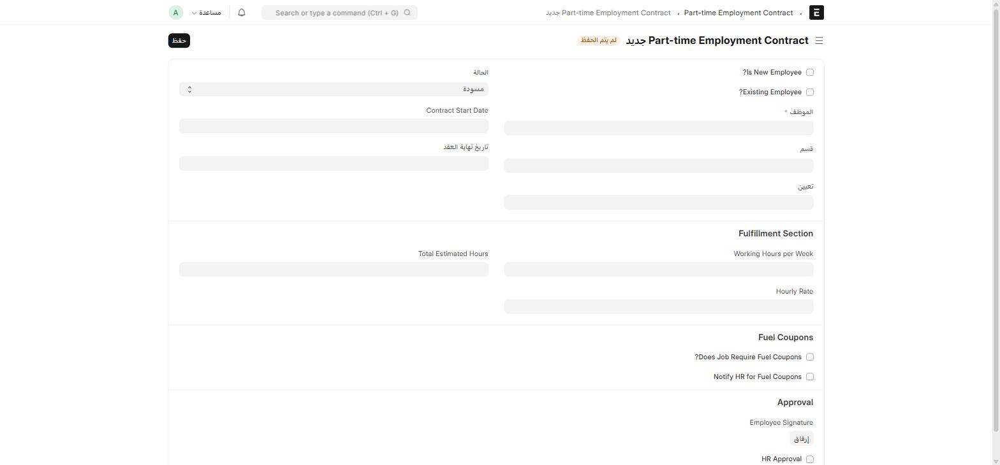

## طلب نقل موظف (Employee Transfer Requests)

يقدّمه **قسم** يحتاج موظفاً، لترشيح موظف أو أكثر للنقل إليه.

| الحقل | ماذا يعني |
| --- | --- |
| **request_date** / **requested_date_in** | تاريخ الطلب وتاريخ النقل المطلوب |
| **departement** | القسم الطالب (Link → Department) |
| **skills** | جدول مهارات مطلوبة (Employee Skill القياسي) |
| **reason** | سبب طلب النقل |
| **Nominated Employees** (جدول) | قائمة الموظفين المرشَّحين للنقل |

كل صف في جدول المرشّحين يحمل حقل **management_approval** خاصاً به: فارغ / **Accepted** / **Rejected** — بحيث يوافَق على كل مرشَّح بشكل مستقل عن البقية، لا على الطلب ككل.

## عقد الدوام الجزئي (Part Time Employment Contract)

عقد لموظف دوام جزئي، يمرّ بموافقة **مزدوجة** (HR ثم الإدارة العامة) بدل سير عمل تلقائي.

| الحقل | ماذا يعني |
| --- | --- |
| **Is New Employee? / Existing Employee?** | يحدّد إن كان العقد لموظف جديد أم حالي |
| **الموظف** ✅، **قسم**، **تعيين** | |
| **Contract Start/End Date** | |
| **Fulfillment Section**: Total Estimated Hours، Working Hours per Week، Hourly Rate | تفاصيل الأجر بالساعة |
| **Fuel Coupons**: Does Job Require Fuel Coupons?، Notify HR for Fuel Coupons | راجع [كوبونات الوقود](/hr/fuel-management/) |
| **Employee Signature** | مرفق توقيع الموظف |
| **HR Approval** / **GM Approval** | مربّعا موافقة منفصلان |

الحالة تتقدّم يدوياً عبر حقل **status**: **Draft** → **Signed by Employee** → **Approved by HR** → **Approved by GM** → **Active** — بدل زر اعتماد واحد، كل خطوة توثَّق بمربّع الموافقة المناظر لها.

:::caution[لا تُفعِّل العقد قبل اكتمال التوقيعين]
النظام لا يمنع تفعيل عقد بدون **HR Approval** و**GM Approval**، لكن الحالة **Active** بدون الموافقتين تعني أن العقد غير موثَّق بشكل كامل. تحقّق من كلا المربّعين قبل تغيير الحالة إلى Active.
:::
