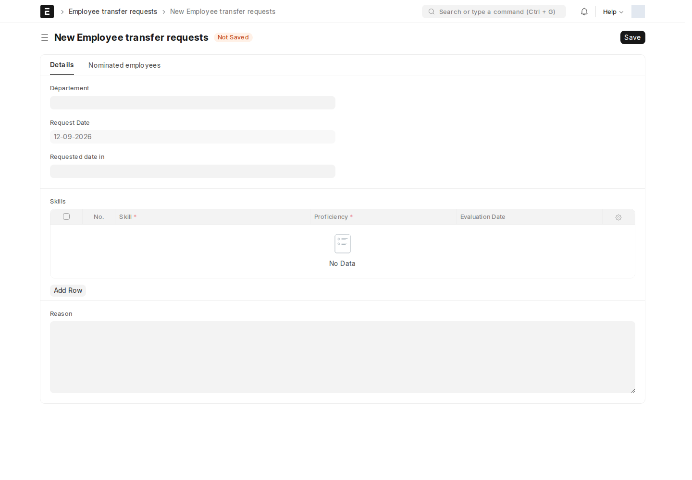
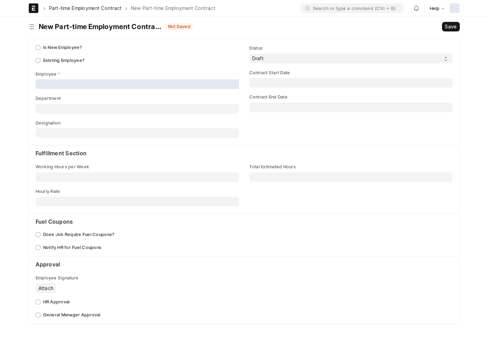

## طلب نقل موظف (Employee transfer requests)

يقدّمه **قسم** يحتاج موظفاً، لترشيح موظف أو أكثر للنقل إليه.

| الحقل | ماذا يعني |
| --- | --- |
| **request_date** / **requested_date_in** | تاريخ الطلب وتاريخ النقل المطلوب |
| **departement** | القسم الطالب (Link → Department) |
| **skills** | جدول مهارات مطلوبة (Employee Skill القياسي) |
| **reason** | سبب طلب النقل |
| **Nominated Employees** (جدول) | قائمة الموظفين المرشَّحين للنقل |

كل صف في جدول المرشّحين يحمل حقل **management_approval** خاصاً به: فارغ / **Accepted** / **Rejected** — بحيث يوافَق على كل مرشَّح بشكل مستقل عن البقية، لا على الطلب ككل.

## عقد الدوام الجزئي (Part-time Employment Contract)

عقد لموظف دوام جزئي يدوّن توقيع الموظف وموافقتي HR والإدارة العامة في حقول منفصلة. هذه بيانات توثيقية؛ لا يوجد Workflow نشط يفرض أدواراً متعاقبة لهذه الموافقات. صلاحياته الحالية لـ System Manager وHR Manager.

| الحقل | ماذا يعني |
| --- | --- |
| **Is New Employee? / Existing Employee?** | يحدّد إن كان العقد لموظف جديد أم حالي |
| **الموظف** ✅، **قسم**، **تعيين** | |
| **Contract Start/End Date** | |
| **Fulfillment Section**: Total Estimated Hours، Working Hours per Week، Hourly Rate | تفاصيل الأجر بالساعة |
| **Fuel Coupons**: Does Job Require Fuel Coupons?، Notify HR for Fuel Coupons | راجع [كوبونات الوقود](/hr/fuel-management/) |
| **Employee Signature** | مرفق توقيع الموظف |
| **HR Approval** / **GM Approval** | مربّعا موافقة منفصلان |

الحالة تتقدّم يدوياً عبر حقل **status**: **Draft** → **Signed by Employee** → **Approved by HR** → **Approved by GM** → **Active** — بدل زر اعتماد واحد، كل خطوة توثَّق بمربّع الموافقة المناظر لها.

:::caution[لا تُفعِّل العقد قبل اكتمال التوقيعين]
النظام لا يمنع تفعيل عقد بدون **HR Approval** و**GM Approval**، لكن الحالة **Active** بدون الموافقتين تعني أن العقد غير موثَّق بشكل كامل. تحقّق من كلا المربّعين قبل تغيير الحالة إلى Active.
:::

<!-- BEGIN VERIFIED SITE REFERENCE -->

## مرجع الأدوار وسير العمل والإشعارات

تمت المراجعة من إعدادات **testsite.local — 12 سبتمبر 2026**. مستوى 0 هو الحقوق الأساسية؛ المستويات الأعلى تخص مجموعات حقول محددة. علامة — تعني أن صف الدور لا يمنح الحق. لا تجمع الصور كل أدوار المستخدمين؛ الصور التقطت بحساب الإدارة.

**تنبيه البريد:** [سكربت موقع الاختبار يضع البريد في Sent دون إرساله](/users/active-scripts/). تابع المستند والتنبيهات المتاحة داخل النظام.

### Employee transfer requests

**الدور:** طلب ترشيح موظفين للنقل إلى قسم وتسجيل نتيجة مراجعتهم.

**صلاحيات الأدوار الفعلية** (تظل قيود السجلات والحالة والشروط سارية):

| الدور/الأدوار | مستوى الحقول | قراءة | إنشاء | تعديل | اعتماد | إلغاء | القيد |
| --- | --- | --- | --- | --- | --- | --- | --- |
| System Manager | 0 | نعم | نعم | نعم | — | — | بحسب النطاق المسموح |

**سير العمل:** لا يوجد Workflow نشط لهذا النوع وقت المراجعة. المستند يُحفظ دون Submit؛ حقل الحالة إن وجد لا يعني Workflow مستقلاً.

**قواعد الإشعارات المفعّلة:** البريد يخضع لقيد الإرسال التجريبي المذكور أعلاه؛ تنبيه الجرس مبين منفصلاً.

| القاعدة | متى؟ | الشرط/حدود الاستخدام | المستلم | القناة |
| --- | --- | --- | --- | --- |
| Employee transfer requests Notfication | الحفظ | دون شرط عام إضافي | HR Manager؛ HR User | جرس النظام |

### Part-time Employment Contract

**الدور:** توثيق مدة وأجر وتوقيع وموافقات عقد الدوام الجزئي.

*الشاشة متاحة في الإعداد، لكن لم توجد لها سجلات محفوظة وقت المراجعة؛ لا يُفترض أنها خطوة يومية مستخدمة أو مطلوبة لمجرد وجودها.*

**صلاحيات الأدوار الفعلية** (تظل قيود السجلات والحالة والشروط سارية):

| الدور/الأدوار | مستوى الحقول | قراءة | إنشاء | تعديل | اعتماد | إلغاء | القيد |
| --- | --- | --- | --- | --- | --- | --- | --- |
| System Manager، HR Manager | 0 | نعم | نعم | نعم | — | — | بحسب النطاق المسموح |

**سير العمل:** لا يوجد Workflow نشط لهذا النوع وقت المراجعة. المستند يُحفظ دون Submit؛ حقل الحالة إن وجد لا يعني Workflow مستقلاً.

**الإشعارات:** لا توجد قاعدة Notification مستقلة مفعلة لهذا النوع في لقطة المراجعة. قد تنطبق معالجات التطبيق المذكورة في الشرح أو معالج ION العام عند وجود workflow_state؛ غياب القاعدة ليس دليلاً على غياب كل تنبيه.

### Employee Transfer

**الدور:** تسجيل النقل الوظيفي الفعلي وتغييرات بيانات الموظف.

*الشاشة متاحة في الإعداد، لكن لم توجد لها سجلات محفوظة وقت المراجعة؛ لا يُفترض أنها خطوة يومية مستخدمة أو مطلوبة لمجرد وجودها.*

**صلاحيات الأدوار الفعلية** (تظل قيود السجلات والحالة والشروط سارية):

| الدور/الأدوار | مستوى الحقول | قراءة | إنشاء | تعديل | اعتماد | إلغاء | القيد |
| --- | --- | --- | --- | --- | --- | --- | --- |
| Employee | 0 | نعم | — | — | — | — | بحسب النطاق المسموح |
| HR User | 0 | نعم | نعم | نعم | نعم | — | بحسب النطاق المسموح |
| HR Manager | 0 | نعم | نعم | نعم | نعم | نعم | بحسب النطاق المسموح |

**سير العمل:** لا يوجد Workflow نشط لهذا النوع وقت المراجعة. المستند قابل للاعتماد القياسي؛ Save ثم Submit حسب الصلاحية والتحقق، وأي حقل Status وصفي لا يعرّف سلسلة موافقات بالأدوار.

**الإشعارات:** لا توجد قاعدة Notification مستقلة مفعلة لهذا النوع في لقطة المراجعة. قد تنطبق معالجات التطبيق المذكورة في الشرح أو معالج ION العام عند وجود workflow_state؛ غياب القاعدة ليس دليلاً على غياب كل تنبيه.

### Employee Promotion

**الدور:** تسجيل ترقية الموظف وتغييرات بياناته.

**صلاحيات الأدوار الفعلية** (تظل قيود السجلات والحالة والشروط سارية):

| الدور/الأدوار | مستوى الحقول | قراءة | إنشاء | تعديل | اعتماد | إلغاء | القيد |
| --- | --- | --- | --- | --- | --- | --- | --- |
| Employee | 0 | نعم | — | — | — | — | بحسب النطاق المسموح |
| HR User | 0 | نعم | نعم | نعم | نعم | — | بحسب النطاق المسموح |
| HR Manager | 0 | نعم | نعم | نعم | نعم | نعم | بحسب النطاق المسموح |

**سير العمل:** لا يوجد Workflow نشط لهذا النوع وقت المراجعة. المستند قابل للاعتماد القياسي؛ Save ثم Submit حسب الصلاحية والتحقق، وأي حقل Status وصفي لا يعرّف سلسلة موافقات بالأدوار.

**الإشعارات:** لا توجد قاعدة Notification مستقلة مفعلة لهذا النوع في لقطة المراجعة. قد تنطبق معالجات التطبيق المذكورة في الشرح أو معالج ION العام عند وجود workflow_state؛ غياب القاعدة ليس دليلاً على غياب كل تنبيه.

<!-- END VERIFIED SITE REFERENCE -->
