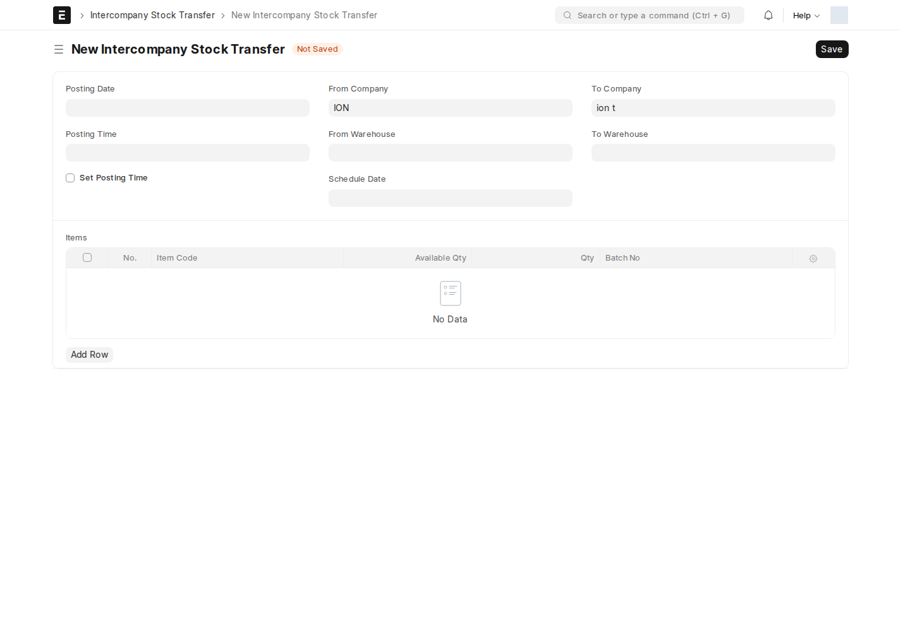

**Intercompany Stock Transfer** ينفذ حركة مخزون بين شركتين في الموقع نفسه. يُعد مسؤول المخزون الطلب ويراجع الأصناف والكميات والمخازن، وتتحقق المحاسبة من حسابات التسوية والقيمة الناتجة.

## قبل البدء

تحتاج إلى شركتين مختلفتين، ومخزن مصدر يتبع الشركة المرسلة ومخزن وجهة يتبع الشركة المستلمة. يجب إعداد **Intercompany Account** و**Intercompany Stock Adjustment Account** في كل شركة بواسطة المسؤول المالي.

## الإنشاء والاعتماد

1. افتح `Intercompany Stock Transfer` وأنشئ مستنداً جديداً.
2. اختر **Issue Company** و**Issue Source Warehouse**، ثم **Receipt Company** و**Receipt Target Warehouse**.
3. راجع تاريخ ووقت الترحيل، ثم أضف الأصناف والكميات والوحدات والأرقام التسلسلية/الدفعات عند الحاجة.
4. راجع **Available Qty**. يحسبه Client Script من رصيد الصنف في المخزن أثناء المسودة فقط؛ لا يُحدّث بعد الاعتماد أو الإلغاء.
5. احفظ، وراجع البيانات، ثم استخدم **Submit** إذا كانت لديك صلاحية الاعتماد.

لا يوجد Workflow نشط لهذا المستند وقت المراجعة؛ الاعتماد قياسي. تملك أدوار **System Manager** و**Stock User** و**Stock Manager** صلاحيات المستند وفق المصفوفة أدناه. إنشاء القيود المحاسبية تلقائياً قد يتطلب أيضاً صلاحياتها واجتياز تحققها؛ لا تفترض أن دور المخزون وحده يتجاوز كل تحقق مالي.

## ما الذي ينشأ تلقائياً؟

الـ Server Script الفعّال **Intercompany Transfer** يعمل بعد الاعتماد:

| الناتج | وظيفته |
| --- | --- |
| Stock Entry من نوع Material Issue | صرف المخزون من الشركة المرسلة |
| Stock Entry من نوع Material Receipt | استلامه بالشركة المستلمة، بسعر مشتق من قيمة حركة الصرف الفعلية |
| Journal Entry للمرسل | تسوية حساب التعامل بين الشركات مقابل حساب تسوية المخزون |
| Journal Entry للمستلم | القيد المقابل لدى الشركة المستلمة |

تُنشأ قيود اليومية عندما تكون قيمة التحويل أكبر من صفر. عند القيمة الصفرية يعرض السكربت رسالة بأن المخزون نُقل دون قيود يومية. في هذه الحالة، حفظ روابط المستندات يقع داخل فرع القيمة الموجبة في السكربت الحالي؛ **افحص حركات Stock Entry حتى لو بقيت الروابط فارغة**.

لا تنشئ قيود صرف واستلام إضافية يدوياً بعد اعتماد التحويل الناجح، حتى لا يتكرر الأثر. افتح الروابط وراجع الكميات والقيمة وحالة كل مستند.

## الإلغاء

السكربت **Cancel Intercompany Transfer** يحاول إلغاء المستندات المعتمدة المرتبطة بهذا الترتيب: الاستلام، الصرف، قيد المستلم، قيد المرسل. يحتفظ بالروابط للمراجعة. إذا تعذّر إلغاء أي مستند، يعرض خطأ ويمنع إتمام العملية؛ راجع حركة المخزون والفترة المالية مع المسؤول.

هذه رسالة داخل الشاشة وليست ضماناً لوصول بريد. لم تظهر قاعدة Notification مفعلة لهذا DocType في المراجعة.

## أخطاء الإعداد الشائعة

- **Issue Company and Receipt Company must be different.** اختر شركتين مختلفتين.
- **Intercompany accounts are missing...** اطلب استكمال حسابات الشركة المعنية.
- **Warehouse ... does not belong to ...** صحّح الشركة أو المخزن.
- **Could not cancel ...** راجع المستند المرتبط وسبب منعه قبل إعادة المحاولة.

<!-- BEGIN VERIFIED SITE REFERENCE -->

## مرجع الأدوار وسير العمل والإشعارات

تمت المراجعة من إعدادات **testsite.local — 12 سبتمبر 2026**. مستوى 0 هو الحقوق الأساسية؛ المستويات الأعلى تخص مجموعات حقول محددة. علامة — تعني أن صف الدور لا يمنح الحق. لا تجمع الصور كل أدوار المستخدمين؛ الصور التقطت بحساب الإدارة.

**تنبيه البريد:** [سكربت موقع الاختبار يضع البريد في Sent دون إرساله](/users/active-scripts/). تابع المستند والتنبيهات المتاحة داخل النظام.

### Intercompany Stock Transfer

**الدور:** تنفيذ صرف واستلام بين شركتين وتسويات مالية بواسطة السكربتات النشطة.

**صلاحيات الأدوار الفعلية** (تظل قيود السجلات والحالة والشروط سارية):

| الدور/الأدوار | مستوى الحقول | قراءة | إنشاء | تعديل | اعتماد | إلغاء | القيد |
| --- | --- | --- | --- | --- | --- | --- | --- |
| System Manager، Stock User، Stock Manager | 0 | نعم | نعم | نعم | نعم | — | بحسب النطاق المسموح |

**سير العمل:** لا يوجد Workflow نشط لهذا النوع وقت المراجعة. المستند قابل للاعتماد القياسي؛ Save ثم Submit حسب الصلاحية والتحقق، وأي حقل Status وصفي لا يعرّف سلسلة موافقات بالأدوار.

**الإشعارات:** لا توجد قاعدة Notification مستقلة مفعلة لهذا النوع في لقطة المراجعة. قد تنطبق معالجات التطبيق المذكورة في الشرح أو معالج ION العام عند وجود workflow_state؛ غياب القاعدة ليس دليلاً على غياب كل تنبيه.

<!-- END VERIFIED SITE REFERENCE -->
