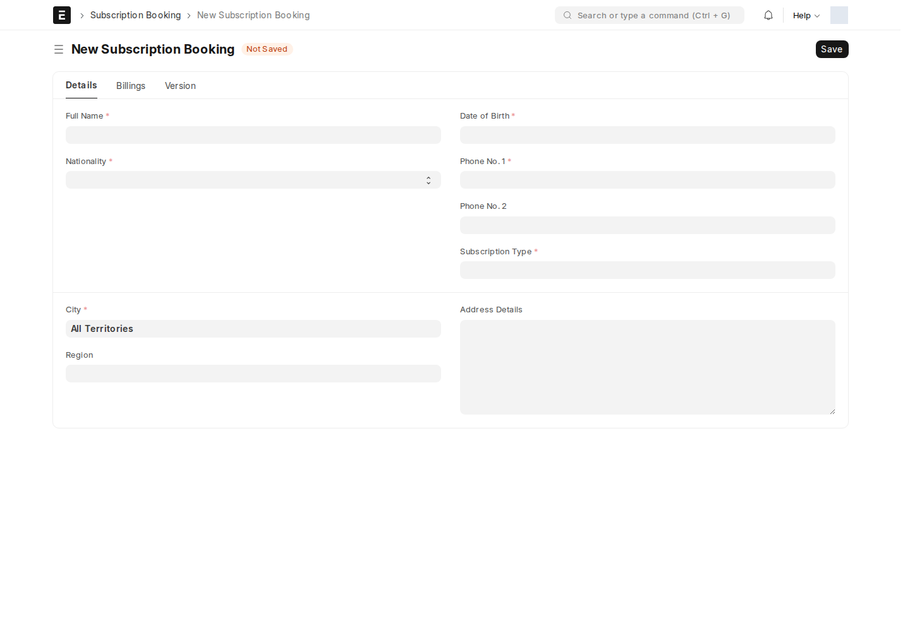
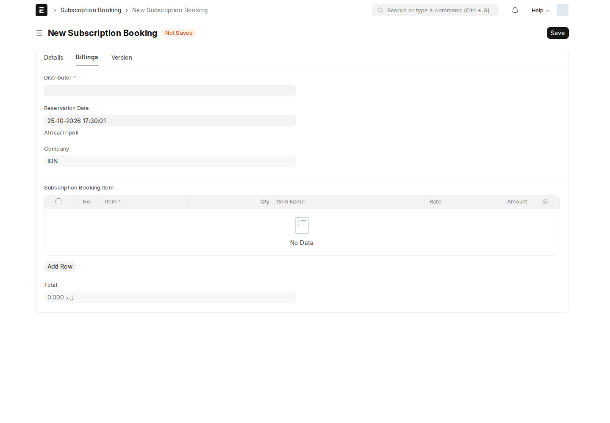
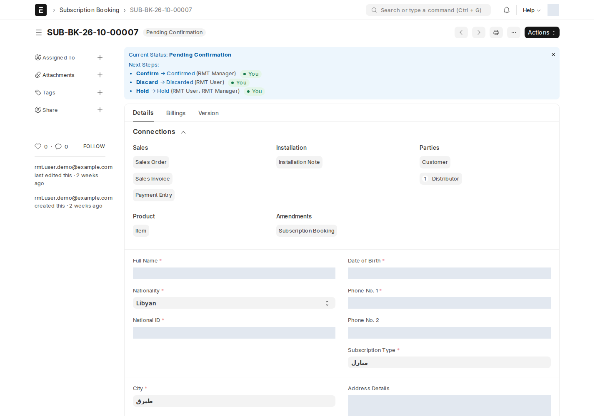

**Subscription Booking** يسجّل طلب اشتراك لمشترك واحد عبر موزّع. يُنشئه موظف الموزّع (RMT User) ويؤكّده RMT Manager.

أين أجده؟ مساحة العمل **RMT → New Booking**، أو اكتب في شريط البحث: `Subscription Booking`

اسم كل حجز يتبع الصيغة `SUB-BK-{السنة}-{الشهر}-{تسلسل}`، مثل `SUB-BK-26-10-00017`.

## التبويب Details: بيانات المشترك

| الحقل | ماذا يعني |
| --- | --- |
| **Full Name** * | اسم المشترك الكامل؛ يُنشأ العميل بهذا الاسم عند التأكيد |
| **Nationality** * | **Libyan** يُظهر **National ID** ويجعله إلزامياً؛ **Foreign** يُظهر **Passport No.** و**ID Number** |
| **National ID** | 12 رقماً — انظر القواعد أدناه |
| **Date of Birth** * | يجب أن يطابق سنة الميلاد في الرقم الوطني |
| **Phone No. 1** * / **Phone No. 2** | الهاتف الأول يُنسخ إلى العميل وإشعار التركيب |
| **Subscription Type** * | **اختره أولاً**: يحدد الأصناف المتاحة في تبويب Billings |
| **City** * | المدينة؛ يجب أن يغطيها الموزّع |
| **Region** | منطقة داخل المدينة (اختياري)؛ القائمة تعرض مناطق المدينة المختارة فقط، واختيار منطقة يملأ مدينتها تلقائياً. قد تغيّر المنطقة السعر عبر قواعد التسعير |
| **Address Details** | عنوان التركيب؛ يُنسخ إلى إشعار التركيب |

### قواعد الرقم الوطني

تُفحص عند **الحفظ** فقط (وليس أثناء الكتابة)، وللجنسية الليبية فقط:

- تُحوَّل الأرقام العربية (٠–٩) تلقائياً إلى أرقام عادية، وتُحذف المسافات والشرطات.
- يجب أن يكون **12 رقماً** بالضبط.
- الأرقام من الثاني إلى الخامس هي **سنة الميلاد**، ويجب أن تطابق سنة **Date of Birth**.

إذا خالف الرقم إحدى القاعدتين يتوقف الحفظ وتظهر الرسالة؛ صحّحه واحفظ مرة أخرى. الخادم يكرر الفحص نفسه، فلا يمر رقم خاطئ عبر الاستيراد أو الواجهة البرمجية.

## التبويب Billings: الموزّع والأصناف والإجمالي

| الحقل | ماذا يعني |
| --- | --- |
| **Distributor** * | يُملأ تلقائياً لموظف الموزّع ولا يستطيع تغييره؛ RMT Manager يختاره |
| **Reservation Date** | وقت الحجز، يُملأ تلقائياً |
| **Subscription Booking Item** (جدول) | الأصناف: **Item** و**Qty** (تبدأ بـ 1 ويمكن تغييرها)؛ **Item Name** و**Rate** و**Amount** تُملأ تلقائياً |
| **Total** | مجموع **Amount** لكل الأصناف، وهو المبلغ الذي يجب أن تساويه المدفوعات عند التأكيد |

عند إضافة صف، لا تعرض قائمة **Item** إلا أصناف **Subscription Type** المختار. إذا غيّرت النوع، تُحذف الصفوف التي أصنافها ليست في النوع الجديد مع تنبيه بعددها. السعر يُعرض فوراً للمعاينة ويُعاد حسابه من الخادم عند كل حفظ.

بعد التأكيد تظهر في هذا التبويب حقول للقراءة فقط: **Customer**، **Sales Order**، **Sales Invoice**، **Installation Note**، **Sale Amount**، **Contract No**، **RMT Synced On**، **Reservation Status**.

## سير العمل والحالات

بعد الحفظ الأول يصبح الحجز **Pending Confirmation**. يعرض شريط أزرق أعلى الحجز الحالة الحالية والخطوات التالية الممكنة ومن يملكها، مع علامة **You** على ما تستطيع تنفيذه أنت. الإجراءات في زر **Actions**.

| من الحالة | الإجراء | إلى الحالة | من؟ | Reservation Status |
| --- | --- | --- | --- | --- |
| Pending Confirmation | **Confirm** | Confirmed | RMT Manager | Confirmed |
| Pending Confirmation | **Hold** | Hold | RMT User، RMT Manager | Reserved |
| Pending Confirmation | **Discard** | Discarded | RMT User | Cancelled |
| Hold | **Confirm** | Confirmed | RMT Manager | Confirmed |
| Hold | **Discard** | Discarded | RMT User | Cancelled |
| Confirmed | **Cancel** | Canceled | RMT Manager | Cancelled |

- **Hold**: الحجز ينتظر (مستندات ناقصة، دفعة لم تصل…) ويبقى قابلاً للتعديل.
- **Discard**: استبعاد حجز لن يكتمل؛ يبقى مسودة للسجل ولا يُحذف.
- **Confirm**: لا يحدث مباشرة، بل يفتح **نافذة التأكيد** — انظر [التأكيد وما بعده](/rmt/confirm/).
- **Cancel**: لحجز مؤكَّد؛ له شروط — انظر [إلغاء حجز مؤكَّد](/rmt/confirm/#إلغاء-حجز-مؤكد).

**Reservation Status** حقل داخلي يتبع الحالة تلقائياً، ويصبح **Sold** عند اعتماد فاتورة المبيعات.

:::note[الاستبعاد متاح لـ RMT User فقط]
إجراء **Discard** مسموح لدور **RMT User** وحده. إذا احتاج مدير لا يملك هذا الدور إلى الاستبعاد، يُمنح الدور أو يقوم به موظف الموزّع.
:::

## التبويب Version: سجل التغييرات

يظهر لـ **RMT Manager** فقط. يعرض كل ما حدث للحجز من الأحدث إلى الأقدم: الإنشاء، كل تعديل (الحقل والقيمة القديمة والجديدة، بما فيها صفوف الجداول)، الاعتماد والإلغاء، التعليقات والمرفقات، ومن قام بكل خطوة ومتى.

<!-- BEGIN VERIFIED SITE REFERENCE -->

## مرجع الأدوار وسير العمل والإشعارات

تمت المراجعة من إعدادات **testsite.local — 25 أكتوبر 2026**. مستوى 0 هو الحقوق الأساسية؛ المستويات الأعلى تخص مجموعات حقول محددة. علامة — تعني أن صف الدور لا يمنح الحق. لا تجمع الصور كل أدوار المستخدمين؛ الصور التقطت بحساب الإدارة.

**تنبيه البريد:** [سكربت موقع الاختبار يضع البريد في Sent دون إرساله](/users/active-scripts/). تابع المستند والتنبيهات المتاحة داخل النظام.

### Subscription Booking

**الدور:** تسجيل طلب اشتراك لمشترك عبر موزّع، وتأكيده ومتابعته حتى البيع.

**صلاحيات الأدوار الفعلية** (تظل قيود السجلات والحالة والشروط سارية):

| الدور/الأدوار | مستوى الحقول | قراءة | إنشاء | تعديل | اعتماد | إلغاء | القيد |
| --- | --- | --- | --- | --- | --- | --- | --- |
| System Manager | 0 | نعم | نعم | نعم | نعم | — | بحسب النطاق المسموح |
| RMT User | 0 | نعم | نعم | نعم | — | — | بحسب النطاق المسموح |
| RMT Manager | 0 | نعم | نعم | نعم | نعم | نعم | بحسب النطاق المسموح |

**سير العمل النشط:** `Subscription Booking Lifecycle`. استخدم قائمة الإجراءات؛ لا تعدل حقل الحالة يدوياً. دور الانتقال لا يمنح حقوق القراءة/الكتابة/الاعتماد الناقصة.

| من الحالة | الإجراء | إلى الحالة | الدور المنفّذ | الشرط | حالة المستند بعده |
| --- | --- | --- | --- | --- | --- |
| Pending Confirmation | Confirm | Confirmed | RMT Manager | لا شرط إضافي في الانتقال | معتمد (1) |
| Pending Confirmation | Discard | Discarded | RMT User | لا شرط إضافي في الانتقال | مسودة (0) |
| Pending Confirmation | Hold | Hold | RMT User | لا شرط إضافي في الانتقال | مسودة (0) |
| Pending Confirmation | Hold | Hold | RMT Manager | لا شرط إضافي في الانتقال | مسودة (0) |
| Confirmed | Cancel | Canceled | RMT Manager | لا شرط إضافي في الانتقال | ملغى (2) |
| Hold | Discard | Discarded | RMT User | لا شرط إضافي في الانتقال | مسودة (0) |
| Hold | Confirm | Confirmed | RMT Manager | لا شرط إضافي في الانتقال | معتمد (1) |

من يحرر المستند في كل حالة؟

الدور أدناه هو Allow Edit في إعداد الحالة، ويضاف إلى حقوق الحقول ونطاق السجل.

| الحالة | دور تحرير الحالة | حالة المستند |
| --- | --- | --- |
| Pending Confirmation | RMT User | مسودة (0) |
| Canceled | RMT Manager | ملغى (2) |
| Hold | RMT User | مسودة (0) |
| Confirmed | RMT Manager | معتمد (1) |
| Discarded | RMT User | مسودة (0) |

بريد Workflow القياسي **غير مفعّل** لهذا السير. يمكن أن تعمل قواعد Notification ومعالجات التطبيق بشكل مستقل عنه.

**الإشعارات:** لا توجد قاعدة Notification مستقلة مفعلة لهذا النوع في لقطة المراجعة. قد تنطبق معالجات التطبيق المذكورة في الشرح أو معالج ION العام عند وجود workflow_state؛ غياب القاعدة ليس دليلاً على غياب كل تنبيه.

<!-- END VERIFIED SITE REFERENCE -->
