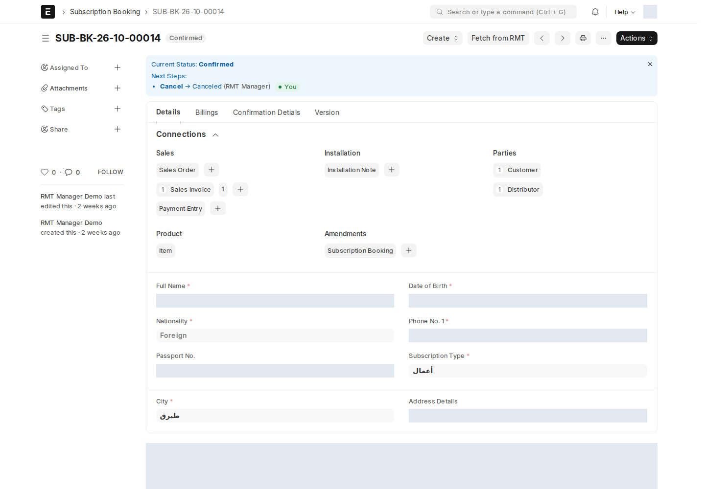

التأكيد هو الخطوة التي يتحول فيها الحجز إلى بيع فعلي. يقوم بها **RMT Manager** من **Actions → Confirm** على حجز في **Pending Confirmation** أو **Hold**.

## نافذة «تأكيد الحجز»

لا يُطبَّق Confirm مباشرة؛ تفتح نافذة بعنوان **تأكيد الحجز** فيها:

| الجزء | ماذا تُدخل |
| --- | --- |
| **شريط المبلغ** | **Amount Due** (إجمالي الحجز) و**Entered** (ما أدخلته)؛ يصبح أخضر عند التطابق |
| **حقل لكل طريقة دفع للموزّع** | المبلغ المستلم بهذه الطريقة. إذا كان للموزّع طريقة واحدة، يُملأ الإجمالي تلقائياً. يمكن تقسيم المبلغ، مثلاً Cash 300 + Cheque 400 |
| **مستند الطريقة** | يظهر ويصبح إلزامياً لطريقة عليها **Requires Attachment?** عندما يكون مبلغها أكبر من صفر (مثل صورة الصك) |
| **الملفات الشخصية** | أربعة ملفات **إلزامية**: **الصورة**، **الرقم الوطني**، **الهوية**، **رقم الإيصال** |

اضغط **تأكيد**. إذا لم يساوِ مجموع المبالغ الإجمالي تماماً تظهر «Payments must add up to …» ولا يحدث شيء.

:::note[أين تذهب المدفوعات والملفات؟]
تُحفظ المدفوعات في تبويب **Confirmation Detials** للحجز (Mode of Payment، Amount، Attachment، Payment Entry) للقراءة فقط. مستندات الدفع والملفات الشخصية تُرفق بالحجز في **Attachments** على الجانب، ويبدأ اسم كل ملف بوصفه، مثل «الهوية - …» أو «Cheque - …»، وتظهر في سجل التغييرات.
:::

### ما يُفحص قبل التأكيد

يتحقق النظام من كل ما يلي **قبل** تغيير الحالة، حتى لا يبقى حجز مؤكَّد بلا مستنداته:

- الحجز له سعر: كل صنف له سعر على قائمة أسعار الموزّع، والإجمالي أكبر من صفر.
- للموزّع **Company** و**Selling Price List**، وطريقة دفع واحدة على الأقل.
- المدفوعات تساوي الإجمالي، والمرفقات الإلزامية موجودة، والملفات الشخصية الأربعة مرفوعة.
- مع **Submitted Sales Invoice** و**Create Payment Entry**: لكل طريقة دفع حساب افتراضي للشركة، ولديك صلاحية اعتماد Payment Entry.

## ما يُنشأ عند التأكيد

بعد نجاح الفحوص، بالترتيب:

1. يصبح الحجز **Confirmed** (معتمد، docstatus 1).
2. **العميل (Customer)**: إن لم يكن للحجز عميل، يُنشأ عميل فردي باسم المشترك، بمجموعة العملاء من الموزّع، والمنطقة من الحجز، وهاتفه.
3. **مستندات البيع** حسب **On Confirm** للموزّع — انظر [الجدول في تجهيز RMT](/rmt/setup/#on-confirm). تحمل كل الأصناف بكمياتها، وقائمة الأسعار والمنطقة وSales Partner والضرائب ومركز التكلفة والمستودع من الموزّع، ورابطاً للحجز.
4. **إشعار تركيب مسودة** — دائماً، مهما كان On Confirm. انظر [إشعار التركيب](/rmt/installation/).
5. **محاولة جلب عقد RMT** في الخلفية (إذا كان الاتصال مضبوطاً).

## بعد التأكيد: أزرار الحجز

| الزر | يظهر عندما | ماذا يفعل |
| --- | --- | --- |
| **Create → Sales Order** | لا يوجد أمر بيع ولا فاتورة | أمر بيع **مسودة**؛ يعتمده المستخدم بنفسه |
| **Create → Sales Invoice** | لا توجد فاتورة | فاتورة **مسودة**: من أمر البيع إن وُجد (يجب أن يكون **معتمداً**)، وإلا من الحجز مباشرة |
| **Create → Installation Note** | لا يوجد إشعار تركيب | إشعار تركيب **مسودة** — مثلاً لحجز أُكّد قبل إضافة التركيب، أو بعد إلغاء إشعار سابق |
| **Fetch from RMT** | دائماً لحجز مؤكَّد | يحاول جلب عقد RMT الآن |
| **Show Contract Password** | يوجد رقم عقد، ولـ RMT Manager فقط | يعرض كلمة مرور العقد |

قسم **Connections** أعلى الحجز يعرض كل المستندات المرتبطة: أوامر البيع، الفواتير، قيود الدفع، إشعارات التركيب، العميل، الموزّع، والأصناف.

## متى يصبح الحجز Sold؟

عند **اعتماد فاتورة المبيعات** المرتبطة بالحجز — سواء أُنشئت عند التأكيد أو من الزر أو من أمر البيع:

- **Reservation Status** = **Sold**، و**Sale Amount** = إجمالي الفاتورة.
- إذا كان **Create Payment Entry** مفعّلاً للموزّع والفاتورة غير مسددة: يُنشأ **قيد دفع معتمد لكل صف دفع** في الحجز، بطريقة دفعه ومبلغه وحسابها، ورقم مرجعه هو اسم الحجز. يُحفظ اسم القيد في صف الدفع.

فاتورة المرتجع (Return) لا تغيّر الحجز.

## عقد RMT

بعد التأكيد يحتاج المشترك **رقم عقد** و**كلمة مرور** من نظام ION RMT الخارجي:

- يحاول النظام جلبهما **مرة واحدة في الخلفية** بعد التأكيد، ثم عند كل ضغطة على **Fetch from RMT**.
- عند النجاح تُملأ **Contract No** و**RMT Synced On** في تبويب Billings، وتُحفظ كلمة المرور مشفّرة؛ يعرضها **Show Contract Password** لـ RMT Manager فقط.
- إذا لم يكن لدى RMT عقد بعد، يظهر تنبيه برتقالي «RMT has no contract for this booking yet»؛ أعد المحاولة لاحقاً.

**الوضع وقت المراجعة:** الاتصال بـ ION RMT غير مضبوط بعد — انظر [إعداد الاتصال](/rmt/setup/#إعداد-الاتصال-بنظام-ion-rmt-لمسؤول-النظام). تقرير [Contract Status](/rmt/reports/#contract-status) يعرض الحجوزات التي ما زالت بلا عقد.

## التراجع والإلغاء

| ما تلغيه أو تحذفه | أثره على الحجز |
| --- | --- |
| إلغاء **فاتورة المبيعات** | يعود الحجز **Confirmed**، ويُفرَّغ رابط الفاتورة و**Sale Amount** |
| حذف فاتورة مسودة | يُفرَّغ رابط الفاتورة |
| إلغاء أو حذف **أمر البيع** | يُفرَّغ رابط أمر البيع |
| إلغاء **قيد دفع** | يُفك ربطه من صف الدفع، فيُنشأ قيد جديد لهذا الصف عند اعتماد الفاتورة التالية |
| إلغاء أو حذف **إشعار التركيب** | يُفرَّغ رابط الإشعار، ويعود زر **Create → Installation Note** |

### إلغاء حجز مؤكد

من **Actions → Cancel** (RMT Manager) بالترتيب التالي:

1. ألغِ قيود الدفع ثم **فاتورة المبيعات المعتمدة** إن وُجدت — وإلا: «Cancel Sales Invoice … before cancelling this booking».
2. ألغِ **إشعار التركيب المعتمد** إن وُجد — وإلا: «Cancel Installation Note … before cancelling this booking».
3. ألغِ الحجز. إشعار التركيب **المسودة** يُحذف تلقائياً، والإشعار الملغى يبقى للسجل.

يصبح الحجز **Canceled** و Reservation Status = **Cancelled**.

:::caution[المستخدم الذي يملك أدوار مدير الحسابات]
عند إنشاء أمر بيع لحجز، تطبّق قواعد العمولات في النظام فحصاً على المستخدمين الذين لديهم أحد أدوار **Account Manager** (ISP، Tenders، Hotels، SM، Dedicated): يجب تعبئة **Service Category** و**BA Transaction Type**. إذا كان مؤكِّد الحجز يملك أحد هذه الأدوار مع RMT Manager، قد يفشل إنشاء أمر البيع بهذه الرسالة. استخدم حساباً بدور RMT Manager دون أدوار مدير الحسابات.
:::
