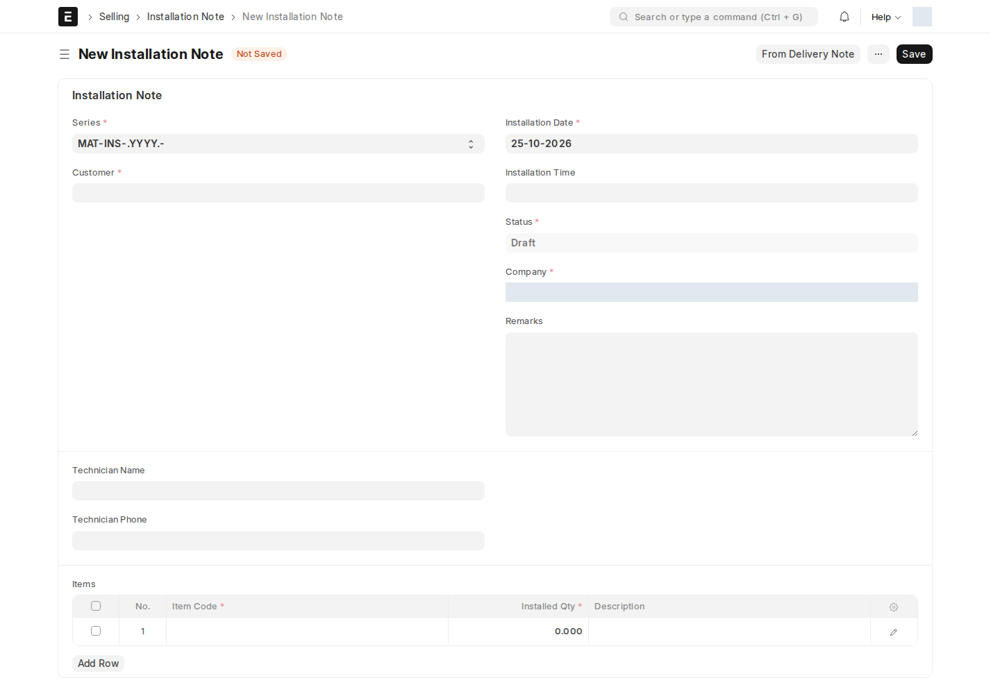

**Installation Note** (إشعار تركيب) هو مستند ERPNext القياسي لتسجيل تركيب الأصناف لدى العميل. في مسار RMT يُنشأ **تلقائياً كمسودة عند تأكيد كل حجز**، ويكمله فنّي الموزّع بعد التركيب.

أين أجده؟ مساحة العمل **RMT → Installation Notes**، أو من قسم **Connections** في الحجز، أو اكتب في شريط البحث: `Installation Note`

## ماذا يحتوي الإشعار المُنشأ من الحجز؟

| الحقل | من أين يأتي |
| --- | --- |
| **Customer** | عميل الحجز، أي **المشترك** نفسه (يُنشأ عند التأكيد إن لم يوجد) |
| **Company** | شركة الموزّع |
| **Territory** | منطقة الحجز، وإلا مدينته |
| **Installation Date** | تاريخ التأكيد — **عدّله إلى تاريخ التركيب الفعلي** |
| **Items** | كل أصناف الحجز بكمياتها، والوصف اسم الصنف |
| **Subscription Booking** | رابط الحجز (للقراءة فقط) |
| **Distributor** | موزّع الحجز، أي الجهة المسؤولة عن التركيب (للقراءة فقط) |
| **Technician Name** / **Technician Phone** | من بيانات فنّي الموزّع؛ **قابلة للتعديل** إذا ركّب فنّي آخر |
| **Subscriber Phone** / **Subscriber Address** | هاتف المشترك الأول وعنوان التركيب من الحجز (للقراءة فقط) |

الصورة لنموذج جديد غير محفوظ؛ الحقول المرتبطة بالحجز للقراءة فقط، لذلك لا تظهر إلا عندما تكون معبأة في إشعار أُنشئ من حجز.

## إكمال التركيب

1. افتح الإشعار (من الحجز أو القائمة أو تقرير [Pending Installations](/rmt/reports/#pending-installations)).
2. اضبط **Installation Date** (و**Installation Time** إن رغبت) على موعد التركيب الفعلي.
3. صحّح الفنّي إن لزم.
4. للأصناف ذات **الأرقام التسلسلية** (مثل الراوتر): افتح الصف وأدخل **Serial No** لكل قطعة مركّبة. ERPNext يرفض الاعتماد بدونها: «Serial No is mandatory for Item …». إذا لم يُركَّب صنف ما، احذف صفه قبل الاعتماد.
5. **Save** ثم **Submit**. الإشعار المعتمد يعني: **تم التركيب**.

| حالة الإشعار | المعنى في التقارير |
| --- | --- |
| مسودة (Draft) | **Pending** — بانتظار التركيب |
| معتمد (Submitted) | **Installed** |
| ملغى (Cancelled) | **Cancelled** |

## الإلغاء وإعادة الإنشاء

- إلغاء إشعار معتمد أو حذف مسودة يُفرّغ رابطه في الحجز، فيعود زر **Create → Installation Note** لإنشاء إشعار جديد.
- لا يُلغى حجز له إشعار تركيب **معتمد** قبل إلغاء الإشعار.
- عند إلغاء الحجز يُحذف إشعاره **المسودة** تلقائياً.

:::note[من يستطيع ماذا؟]
وقت المراجعة: **RMT Manager** يقرأ وينشئ ويعدّل ويعتمد ويلغي. **RMT User** يقرأ ويعدّل ويعتمد (ليكمل الفنّي التركيب)، لكنه لا ينشئ إشعاراً يدوياً ولا يلغيه. الإنشاء التلقائي عند التأكيد لا يحتاج صلاحية إنشاء من المستخدم.
:::

<!-- BEGIN VERIFIED SITE REFERENCE -->

## مرجع الأدوار وسير العمل والإشعارات

تمت المراجعة من إعدادات **testsite.local — 25 أكتوبر 2026**. مستوى 0 هو الحقوق الأساسية؛ المستويات الأعلى تخص مجموعات حقول محددة. علامة — تعني أن صف الدور لا يمنح الحق. لا تجمع الصور كل أدوار المستخدمين؛ الصور التقطت بحساب الإدارة.

**تنبيه البريد:** [سكربت موقع الاختبار يضع البريد في Sent دون إرساله](/users/active-scripts/). تابع المستند والتنبيهات المتاحة داخل النظام.

### Installation Note

**الدور:** تسجيل تركيب أصناف الحجز لدى المشترك واعتماده بعد التركيب.

*لا توجد سجلات محفوظة وقت المراجعة؛ هذه المستندات ينشئها التطبيق تلقائياً عند الخطوة الموضحة في الشرح.*

**صلاحيات الأدوار الفعلية** (تظل قيود السجلات والحالة والشروط سارية):

| الدور/الأدوار | مستوى الحقول | قراءة | إنشاء | تعديل | اعتماد | إلغاء | القيد |
| --- | --- | --- | --- | --- | --- | --- | --- |
| Sales User، RMT Manager | 0 | نعم | نعم | نعم | نعم | نعم | بحسب النطاق المسموح |
| Sales User | 1 | نعم | — | — | — | — | بحسب النطاق المسموح |
| RMT User | 0 | نعم | — | نعم | نعم | — | بحسب النطاق المسموح |

**سير العمل:** لا يوجد Workflow نشط لهذا النوع وقت المراجعة. المستند قابل للاعتماد القياسي؛ Save ثم Submit حسب الصلاحية والتحقق، وأي حقل Status وصفي لا يعرّف سلسلة موافقات بالأدوار.

**الإشعارات:** لا توجد قاعدة Notification مستقلة مفعلة لهذا النوع في لقطة المراجعة. قد تنطبق معالجات التطبيق المذكورة في الشرح أو معالج ION العام عند وجود workflow_state؛ غياب القاعدة ليس دليلاً على غياب كل تنبيه.

<!-- END VERIFIED SITE REFERENCE -->
