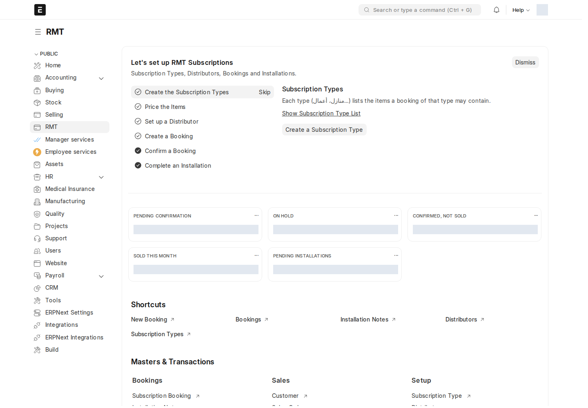

**حجوزات الاشتراكات (RMT)** مسار لبيع اشتراكات الإنترنت عبر **الموزّعين**: يحجز موظف الموزّع اشتراكاً لمشترك، ويؤكّده مدير RMT بعد استلام المبلغ والمستندات، فينشئ النظام العميل ومستندات البيع وإشعار التركيب تلقائياً، ثم يُكمل فنّي الموزّع التركيب.

أين أجده؟ مساحة العمل **RMT** في الشريط الجانبي (بعد Selling)، أو اكتب في شريط البحث: `Subscription Booking`

:::caution[ليس هو «الحجز (Booking)» القديم]
يوجد في النظام نوع أقدم اسمه **Booking** (أسماؤه `RMT-{التاريخ}-…`) موثّق في [الموزّعون والحجوزات](/sales-crm/distributors/). المسار في هذا الفصل يستخدم نوعاً **مختلفاً** هو **Subscription Booking** وأسماؤه `SUB-BK-{السنة}-{الشهر}-{تسلسل}`. لا تخلط بينهما.
:::

## الدورة كاملة

| # | الخطوة | من يقوم بها؟ | ماذا يحدث؟ | الصفحة |
| --- | --- | --- | --- | --- |
| 1 | تجهيز الأنواع والأسعار والموزّع | مدير RMT / مدير النظام | أنواع الاشتراك وأصنافها، أسعار الأصناف، إعدادات الموزّع | [تجهيز RMT](/rmt/setup/) |
| 2 | إنشاء الحجز | RMT User (موظف الموزّع) | بيانات المشترك، نوع الاشتراك والأصناف؛ يُحسب الإجمالي من قائمة أسعار الموزّع | [إنشاء حجز](/rmt/booking/) |
| 3 | تعليق أو استبعاد (اختياري) | RMT User / RMT Manager | **Hold** للانتظار، **Discard** لاستبعاد حجز لن يكتمل | [إنشاء حجز](/rmt/booking/#سير-العمل-والحالات) |
| 4 | التأكيد | RMT Manager | المدفوعات والملفات الشخصية، ثم: العميل، مستندات البيع حسب إعداد الموزّع، وإشعار تركيب مسودة | [التأكيد وما بعده](/rmt/confirm/) |
| 5 | البيع | تلقائي أو المحاسب | عند اعتماد فاتورة المبيعات يصبح الحجز **Sold**، وقد تُنشأ قيود الدفع | [التأكيد وما بعده](/rmt/confirm/#متى-يصبح-الحجز-sold) |
| 6 | التركيب | فنّي الموزّع (RMT User) | يضبط تاريخ التركيب والأرقام التسلسلية ثم يعتمد إشعار التركيب | [إشعار التركيب](/rmt/installation/) |
| 7 | المتابعة | RMT Manager | التقارير الستة وبطاقات الأرقام في مساحة العمل | [تقارير RMT](/rmt/reports/) |

## الأدوار

| الدور | ماذا يفعل في هذا المسار |
| --- | --- |
| **RMT User** | موظف الموزّع: ينشئ الحجوزات ويعدّلها، يعلّقها (Hold) أو يستبعدها (Discard)، ويُكمل إشعار التركيب ويعتمده. يرى حجوزات **موزّعه فقط**. |
| **RMT Manager** | يؤكّد الحجوزات ويلغيها، يرى سجل التغييرات وكلمة مرور عقد RMT، ويفتح كل التقارير. |
| **System Manager** | الإعداد: الأنواع، الموزّعون، الصلاحيات. |

:::note[كيف يرى موظف الموزّع حجوزات موزّعه فقط؟]
عند حفظ موزّع، ينشئ النظام لكل مستخدم في جدول **Users** صلاحية مستخدم (User Permission) على هذا الموزّع، وتكون **افتراضية**. لذلك يُملأ حقل **Distributor** تلقائياً في الحجوزات الجديدة ويصبح للقراءة فقط لغير RMT Manager، ولا يرى المستخدم في القوائم والتقارير إلا حجوزات موزّعه. التفاصيل في [تجهيز RMT](/rmt/setup/#المستخدمون).
:::

## مساحة عمل RMT

| الجزء | ماذا يحتوي |
| --- | --- |
| **Let's set up RMT Subscriptions** | قائمة تجهيز من 6 خطوات (أنواع الاشتراك، الأسعار، الموزّع، أول حجز، التأكيد، التركيب). خطوات النوع والموزّع والحجز تفتح النموذج مع **جولة إرشادية** تشرح الحقول واحداً واحداً. تظهر لـ RMT Manager وSystem Manager فقط. |
| **بطاقات الأرقام** | Pending Confirmation · On Hold · Confirmed, Not Sold · Sold This Month (فواتير مبيعات معتمدة مرتبطة بحجز، بتاريخ الشهر الحالي) · Pending Installations (إشعارات تركيب مسودة) |
| **Shortcuts** | New Booking · Bookings · Installation Notes · Distributors · Subscription Types |
| **Masters & Transactions** | Bookings، Sales، Setup، وبطاقة **Reports** بالتقارير الستة |

:::tip[تقدّم قائمة التجهيز مشترك]
علامة الإكمال على خطوات قائمة التجهيز **عامة للموقع** وليست لكل مستخدم: إذا ضغط أحدهم خطوة «Go to Page» تُعلَّم مكتملة للجميع. استخدم **Skip** أو **Dismiss** لإخفائها عند الانتهاء.
:::

ما يظهر في مساحة العمل يتبع صلاحياتك: RMT User لا يرى قائمة التجهيز ولا بطاقة «Sold This Month» ولا بطاقة روابط المبيعات.
