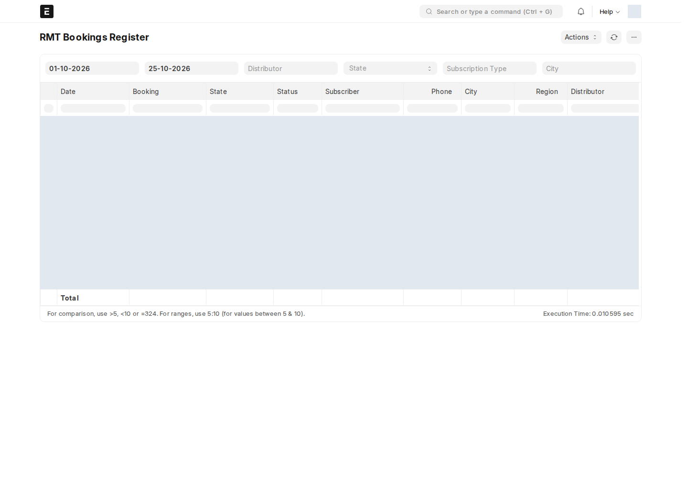
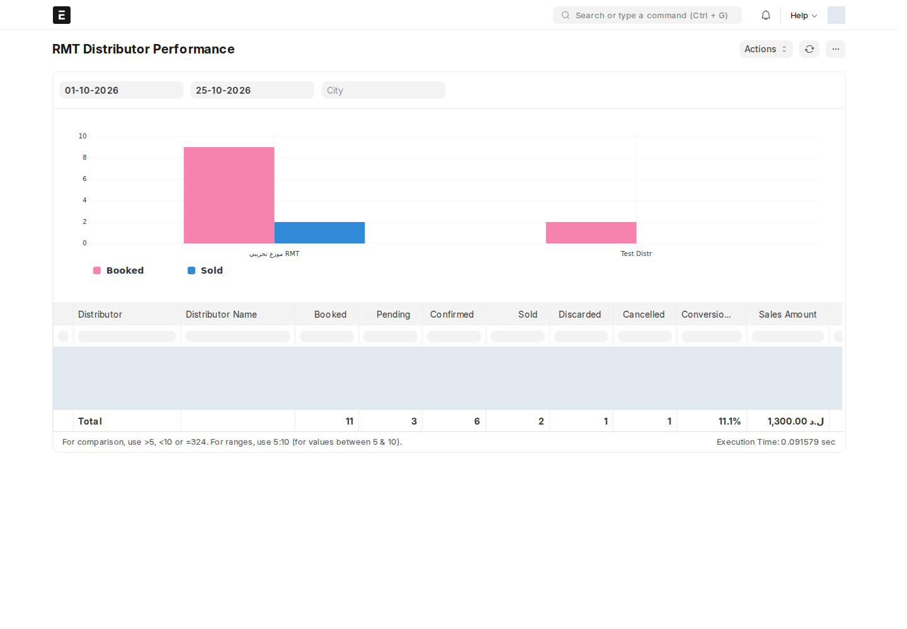
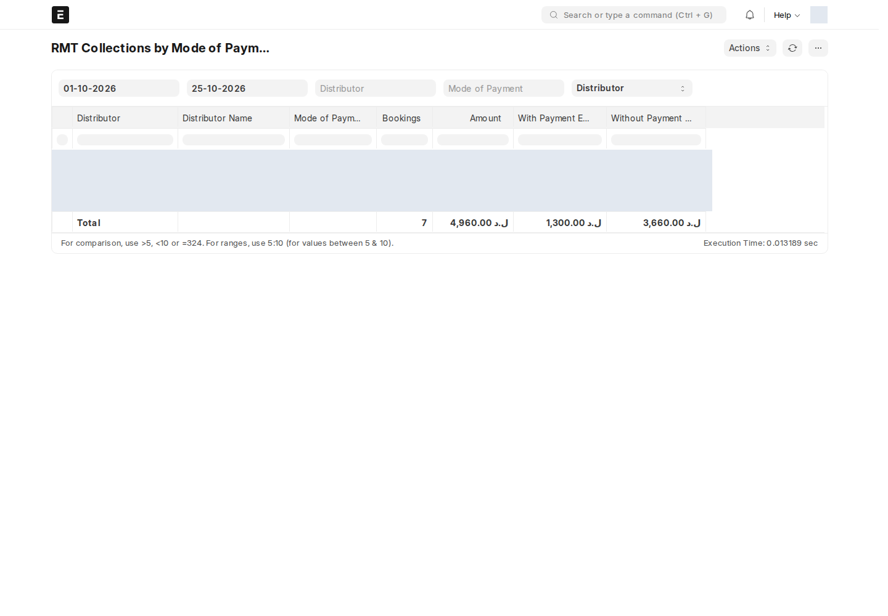
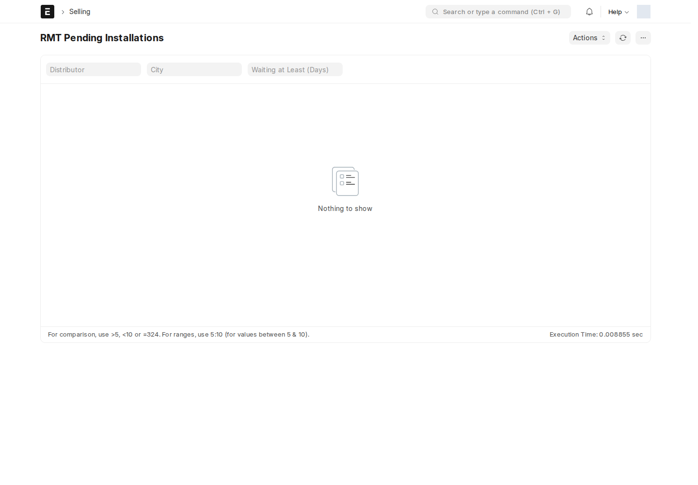
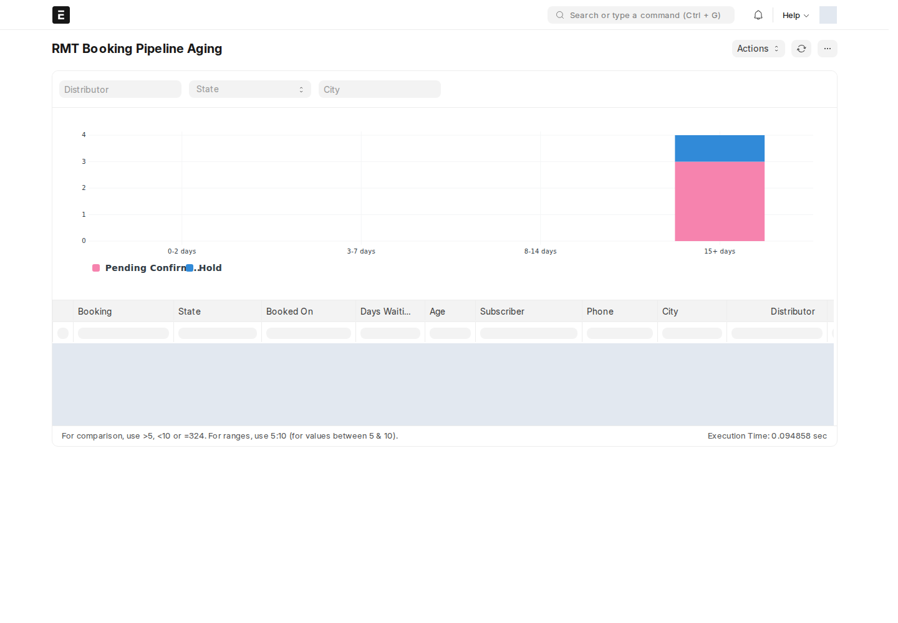
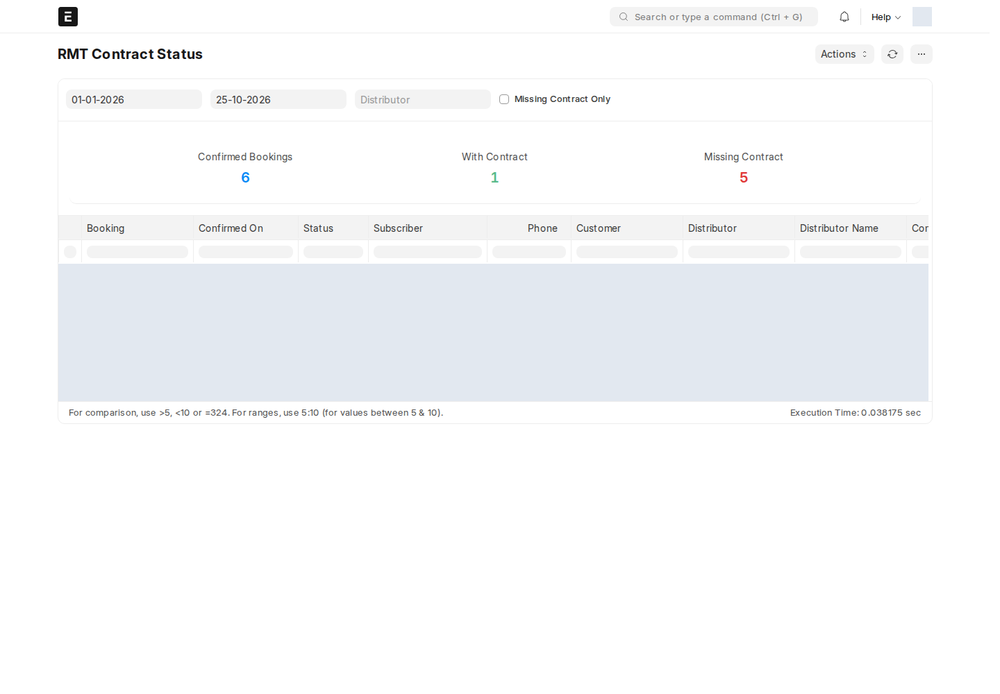

ستة تقارير في مساحة العمل **RMT → Reports**، أو من شريط البحث باسم التقرير.

:::note[ما يراه موظف الموزّع]
التقارير تقرأ الحجوزات بصلاحيات المستخدم، فموظف الموزّع (RMT User) يرى **حجوزات موزّعه فقط**. الأعمدة التي تربط بنوع لا يملك قراءته (مثل Customer أو Sales Invoice) تظهر له نصاً عادياً بدل رابط.
:::

| التقرير | لمن؟ | السؤال الذي يجيب عنه |
| --- | --- | --- |
| [Bookings Register](#bookings-register) | RMT Manager، RMT User | ما هي الحجوزات في الفترة وأين وصل كل منها؟ |
| [Distributor Performance](#distributor-performance) | RMT Manager | كم حجز وباع كل موزّع، وما نسبة التحويل؟ |
| [Collections by Mode of Payment](#collections-by-mode-of-payment) | RMT Manager، Accounts User | كم حُصّل بكل طريقة دفع، وكم منه له قيد دفع؟ |
| [Pending Installations](#pending-installations) | RMT Manager، RMT User | ما الذي لم يُركَّب بعد ومنذ متى؟ |
| [Booking Pipeline Aging](#booking-pipeline-aging) | RMT Manager | ما الحجوزات العالقة بلا قرار ومنذ متى؟ |
| [Contract Status](#contract-status) | RMT Manager | أي حجوزات مؤكَّدة ما زالت بلا عقد RMT؟ |

**تاريخ التأكيد** في التقارير يُقرأ من سجل الحجز (لحظة اعتماده)، فيعمل أيضاً للحجوزات القديمة.

## Bookings Register

**RMT Bookings Register** — صف لكل حجز.

- **الفلاتر:** From Date / To Date (تاريخ الحجز؛ افتراضياً بداية الشهر حتى اليوم)، Distributor، State، Subscription Type، City.
- **الأعمدة:** التاريخ، الحجز، الحالة، Reservation Status، المشترك، الهاتف، المدينة، المنطقة، الموزّع، النوع، الأصناف (`الصنف × الكمية`)، الإجمالي، العميل، أمر البيع، الفاتورة، Sale Amount، إشعار التركيب وحالته (Pending برتقالي، Installed أخضر، Cancelled أحمر)، رقم العقد.
- صف **Total** يجمع الإجمالي وSale Amount.

## Distributor Performance

**RMT Distributor Performance** — صف لكل موزّع مع رسم بياني (Booked مقابل Sold).

- **الفلاتر:** From Date / To Date (تاريخ الحجز)، City.
- **الأعمدة:** Booked (الكل)، Pending (Pending Confirmation + Hold)، Confirmed (المؤكَّدة غير الملغاة، ومنها المباعة)، Sold، Discarded، Cancelled، **Conversion %** = Sold ÷ Booked، Sales Amount (لحجوزات Sold)، Installed (إشعار تركيب معتمد).
- الترتيب: الأعلى مبيعاً أولاً.

## Collections by Mode of Payment

**RMT Collections by Mode of Payment** — المبالغ المستلمة في نافذة التأكيد للحجوزات **المؤكَّدة في الفترة** (حسب تاريخ التأكيد، لا تاريخ الحجز).

- **الفلاتر:** From Date / To Date، Distributor، Mode of Payment، **Group By**: Distributor أو Day.
- **الأعمدة:** الموزّع (أو يوم التأكيد)، طريقة الدفع، عدد الحجوزات، Amount، **With Payment Entry** (ما له قيد دفع)، **Without Payment Entry** (ما لم يُسجَّل محاسبياً بعد).
- الحجوزات الملغاة لا تدخل.

## Pending Installations

**RMT Pending Installations** — إشعارات التركيب **المسودة** المرتبطة بحجوزات، الأقدم أولاً.

- **الفلاتر:** Distributor، City، Waiting at Least (Days).
- **الأعمدة:** الإشعار، الحجز، Confirmed On، **Days Waiting** (برتقالي من 3 أيام، أحمر من 7)، المشترك، الهاتف، المدينة، المنطقة، العنوان، الموزّع، الفنّي وهاتفه، الأصناف.

:::caution[صلاحية Report مطلوبة لـ RMT User]
وقت المراجعة لا يملك **RMT User** صلاحية **Report** على Installation Note، فيظهر له «You don't have permission to get a report on: Installation Note». يمنحها مدير النظام من **Role Permissions Manager → Installation Note → RMT User → Report**.
:::

## Booking Pipeline Aging

**RMT Booking Pipeline Aging** — الحجوزات في **Pending Confirmation** أو **Hold**، الأطول انتظاراً أولاً، مع رسم بياني مكدّس حسب الفئة والحالة.

- **الفلاتر:** Distributor، State (Pending Confirmation أو Hold)، City.
- **الأعمدة:** الحجز، الحالة، تاريخ الحجز، Days Waiting، **Age** (0-2 أخضر، 3-7 برتقالي، 8-14 و15+ أحمر)، المشترك، الهاتف، المدينة، الموزّع، الإجمالي، آخر تعديل ومن قام به.

## Contract Status

**RMT Contract Status** — الحجوزات المؤكَّدة وعقد RMT لكل منها، مع بطاقات ملخّص: Confirmed Bookings، With Contract، Missing Contract.

- **الفلاتر:** From Date / To Date (تاريخ الحجز؛ افتراضياً بداية السنة)، Distributor، **Missing Contract Only**.
- **الأعمدة:** الحجز، Confirmed On، Reservation Status، المشترك، الهاتف، العميل، الموزّع، **Contract** (Received أخضر / Missing أحمر)، رقم العقد، وقت الجلب، **Days Without Contract**.

انظر [عقد RMT](/rmt/confirm/#عقد-rmt) لكيفية جلب العقد.
