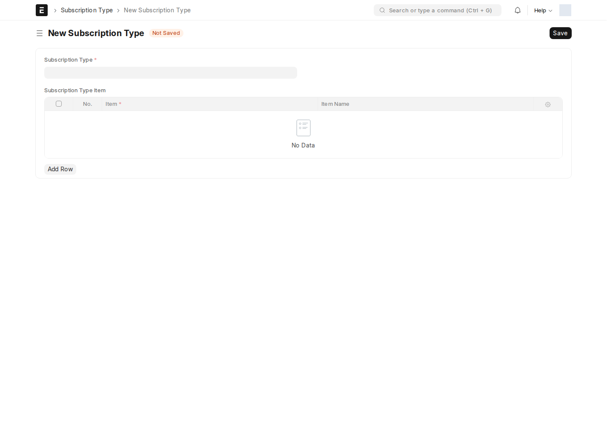
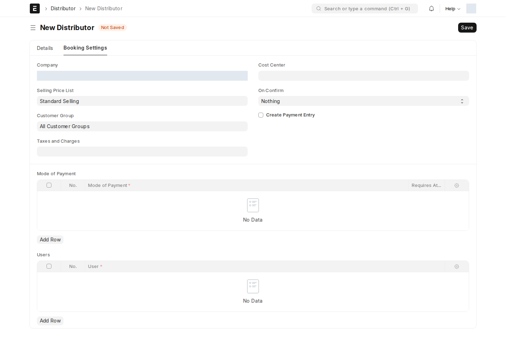

قبل أول حجز يجب تجهيز ثلاثة أشياء بهذا الترتيب: **أنواع الاشتراك** وأصنافها، **أسعار** هذه الأصناف، ثم **الموزّع**. قائمة التجهيز في [مساحة عمل RMT](/rmt/overview/#مساحة-عمل-rmt) تأخذك عبرها بالترتيب.

## نوع الاشتراك (Subscription Type)

يعرّف كل نوع (مثل **منازل** و**أعمال**) **الأصناف المسموح بها** في حجز من هذا النوع: الباقات، الأجهزة (راوتر، كابل…)، والرسوم.

أين أجده؟ اكتب في شريط البحث: `Subscription Type`

| الحقل | ماذا يعني |
| --- | --- |
| **Subscription Type** | اسم النوع، وهو نفسه اسم السجل |
| **Subscription Type Item** (جدول) | الأصناف المسموحة: **Item** واسمه يُجلب تلقائياً |

في الحجز، لا تعرض قائمة اختيار الصنف إلا أصناف النوع المختار، ويرفض النظام حفظ حجز فيه صنف من خارج النوع. نوع بلا أصناف لا يمكن الحجز عليه.

:::tip[صنف يصلح لنوعين]
يمكن إضافة الصنف نفسه (مثل الراوتر أو رسوم التركيب) إلى أكثر من نوع.
:::

## أسعار الأصناف وقواعد التسعير

سعر كل صنف في الحجز يُحسب من **قائمة أسعار البيع للموزّع** (Selling Price List على الموزّع)، ثم تُطبَّق **قواعد التسعير** (Pricing Rule) إن وجدت.

1. لكل صنف من أصناف الأنواع، أنشئ **Item Price** على قائمة أسعار الموزّع.
2. اختياري: **Pricing Rule** لخصم أو سعر خاص. يمكن ربطها بـ **Sales Partner** الموزّع (يُنشأ تلقائياً مع الموزّع) و/أو بشرط على المنطقة، مثلاً `territory == "بنغازي"`.

المنطقة المستخدمة في التسعير هي **Region** في الحجز إن وُجدت، وإلا **City**.

:::caution[صنف بلا سعر = حجز لا يمكن تأكيده]
إذا لم يجد النظام سعراً لصنف، يبقى سعره 0. يُحفظ الحجز، لكن عند **Confirm** تظهر رسالة «No price for … on Price List …». أضف Item Price ثم احفظ الحجز مرة أخرى ليُعاد الحساب.
:::

## الموزّع: تبويب Booking Settings

الموزّع يعمل مثل «ملف نقطة البيع»: منه تأتي الشركة وقائمة الأسعار والضرائب ومركز التكلفة وطرق الدفع وما يُنشأ عند التأكيد. البيانات الأساسية للموزّع (الاسم، الكود، Sales Partner…) موثّقة في [الموزّعون والحجوزات](/sales-crm/distributors/).

| الحقل | ماذا يعني | مطلوب للتأكيد؟ |
| --- | --- | --- |
| **Company** | شركة أوامر البيع والفواتير وإشعارات التركيب | نعم |
| **Selling Price List** | قائمة الأسعار التي تُسعَّر منها أصناف الحجز | نعم |
| **Customer Group** | مجموعة العميل الذي يُنشأ للمشترك (وإلا الافتراضي من Selling Settings) | — |
| **Taxes and Charges** | قالب ضرائب المبيعات المطبّق على مستندات البيع | — |
| **Cost Center** | مركز التكلفة لمستندات البيع | — |
| **On Confirm** | ماذا يُنشأ عند التأكيد — انظر الجدول التالي | — |
| **Create Payment Entry** | مع الفاتورة المعتمدة: قيد دفع (Payment Entry) لكل دفعة | — |
| **Mode of Payment** (جدول) | طرق الدفع المتاحة في نافذة التأكيد؛ **Requires Attachment?** يجعل إرفاق مستند (مثل صورة الصك) إلزامياً لتلك الطريقة | نعم، طريقة واحدة على الأقل |
| **Users** (جدول) | موظفو الموزّع (RMT User) | — |

### On Confirm

| القيمة | ما يُنشأ عند التأكيد |
| --- | --- |
| **Nothing** | لا مستندات بيع؛ تُنشأ لاحقاً من أزرار **Create** في الحجز |
| **Draft Sales Order** | العميل + أمر بيع **مسودة** |
| **Draft Sales Invoice** | العميل + فاتورة مبيعات **مسودة** |
| **Submitted Sales Invoice** | العميل + فاتورة مبيعات **معتمدة** فيصبح الحجز **Sold** مباشرة، ومع **Create Payment Entry** قيد دفع معتمد لكل دفعة |

في كل الحالات يُنشأ أيضاً **إشعار تركيب مسودة** — انظر [إشعار التركيب](/rmt/installation/).

:::caution[قيود الدفع تحتاج حساباً لكل طريقة دفع]
مع **Create Payment Entry**، يجب أن يكون لكل طريقة دفع حساب افتراضي للشركة في **Mode of Payment → Accounts**، وأن يملك من يعتمد الفاتورة صلاحية **Submit** على Payment Entry. مع **Submitted Sales Invoice** يتحقق النظام من ذلك **قبل** التأكيد ويرفض إن نقص شيء؛ ومع الإعدادات الأخرى يُتحقق عند اعتماد الفاتورة.
:::

### التغطية الجغرافية

في تبويب **Details** للموزّع: **City** و**Region**. إذا حُدّدت المنطقة يقتصر الموزّع عليها، وإلا على المدينة. الحجز في مكان خارج التغطية يُرفض برسالة «covers … only». يجب أن تكون المنطقة داخل المدينة، وحقل **Status** يجب أن يكون **Active** ليقبل الموزّع حجوزات.

### المستخدمون

لكل مستخدم في جدول **Users** ينشئ النظام عند الحفظ صلاحية مستخدم **افتراضية** على هذا الموزّع، ويحذفها عند إزالته من الجدول أو حذف الموزّع. النتيجة:

- يُملأ **Distributor** تلقائياً في حجوزات هذا المستخدم الجديدة، ولا يمكنه تغييره (إلا RMT Manager).
- لا يرى المستخدم إلا حجوزات موزّعه في القوائم والتقارير.
- المستخدم الواحد لا يمكن أن ينتمي لأكثر من موزّع.

### الفنّي وحساب RMT

- **Technician Name** و**Technician Phone Number** (تبويب Details) يُنسخان إلى كل إشعار تركيب لهذا الموزّع.
- **RMT Username** يُرسل إلى نظام ION RMT الخارجي عند جلب رقم العقد — انظر [عقد RMT](/rmt/confirm/#عقد-rmt).

## إعداد الاتصال بنظام ION RMT (لمسؤول النظام)

جلب رقم عقد المشترك وكلمة مروره من نظام ION RMT الخارجي يحتاج مفتاحين في `site_config.json` للموقع:

| المفتاح | القيمة |
| --- | --- |
| `rmt_api_url` | عنوان واجهة ION RMT |
| `rmt_api_key` | مفتاح الوصول |

**الوضع وقت المراجعة:** المفتاحان غير مضبوطين على testsite.local، وصيغة الطلب في الكود مؤقتة إلى حين توفّر مواصفات واجهة ION RMT. لذلك يظهر عند **Fetch from RMT** خطأ «RMT API is not configured».

<!-- BEGIN VERIFIED SITE REFERENCE -->

## مرجع الأدوار وسير العمل والإشعارات

تمت المراجعة من إعدادات **testsite.local — 25 أكتوبر 2026**. مستوى 0 هو الحقوق الأساسية؛ المستويات الأعلى تخص مجموعات حقول محددة. علامة — تعني أن صف الدور لا يمنح الحق. لا تجمع الصور كل أدوار المستخدمين؛ الصور التقطت بحساب الإدارة.

**تنبيه البريد:** [سكربت موقع الاختبار يضع البريد في Sent دون إرساله](/users/active-scripts/). تابع المستند والتنبيهات المتاحة داخل النظام.

### Subscription Type

**الدور:** تحديد الأصناف المسموحة في حجوزات كل نوع اشتراك.

**صلاحيات الأدوار الفعلية** (تظل قيود السجلات والحالة والشروط سارية):

| الدور/الأدوار | مستوى الحقول | قراءة | إنشاء | تعديل | اعتماد | إلغاء | القيد |
| --- | --- | --- | --- | --- | --- | --- | --- |
| System Manager، RMT Manager، RMT User | 0 | نعم | نعم | نعم | — | — | بحسب النطاق المسموح |

**سير العمل:** لا يوجد Workflow نشط لهذا النوع وقت المراجعة. المستند يُحفظ دون Submit؛ حقل الحالة إن وجد لا يعني Workflow مستقلاً.

**الإشعارات:** لا توجد قاعدة Notification مستقلة مفعلة لهذا النوع في لقطة المراجعة. قد تنطبق معالجات التطبيق المذكورة في الشرح أو معالج ION العام عند وجود workflow_state؛ غياب القاعدة ليس دليلاً على غياب كل تنبيه.

<!-- END VERIFIED SITE REFERENCE -->
