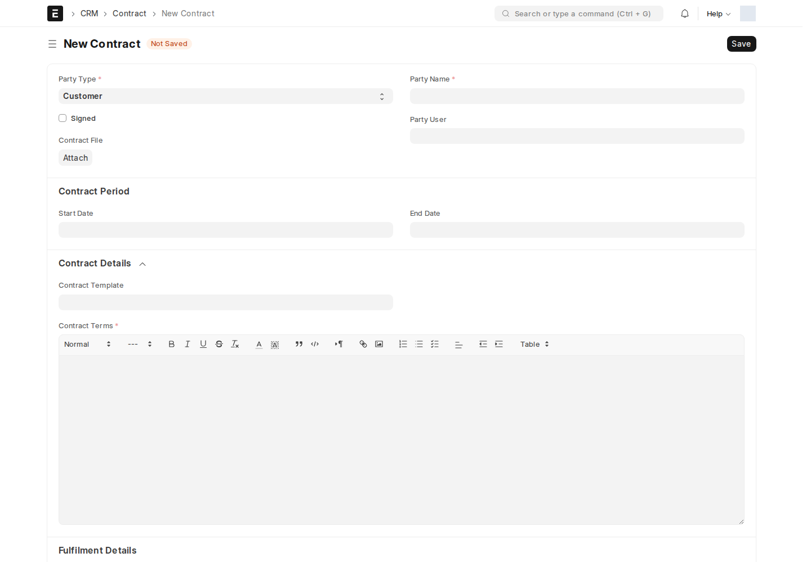
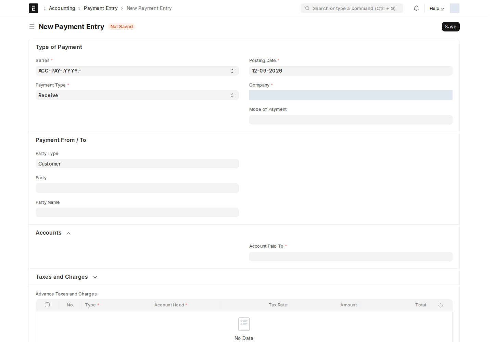
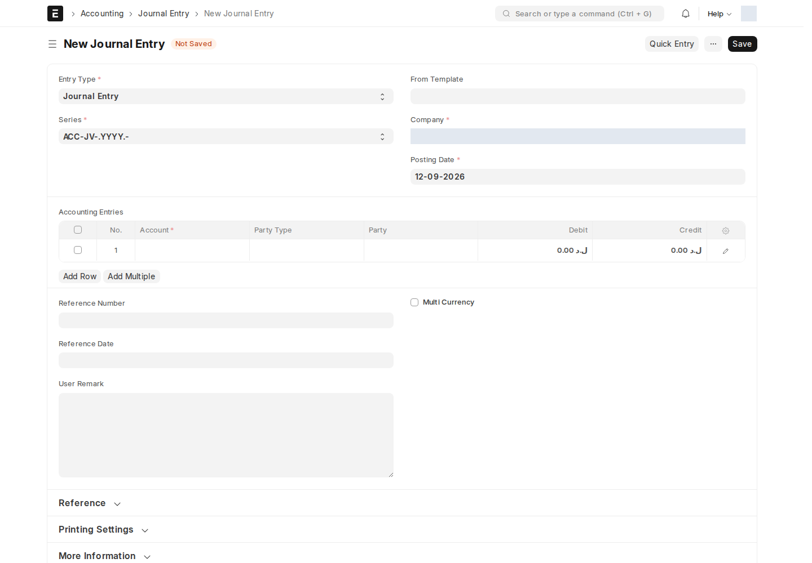

## Contract — العقد

Contract يوثق الاتفاق مع الطرف ومدته وشروطه وتوقيعه. يجهز مسؤول العقد البيانات والمرفق والتوقيع، ويتولى **Head of Department** المراجعة الإدارية إذا كان لديه وصول للمستند.

سير **Contract WF** يبدأ من Pending. الإجراء **Approve → Approved by Management** يشترط **Is Signed**، و**Reject → Rejected by Management** لا يشترطه. وجود العقد أو رفع ملف لا يساوي اكتمال حالة التوقيع. تختلف هذه الشاشة عن **Part-time Employment Contract** الذي يستخدم حقول حالة وموافقات مستقلة.

في سلسلة البيع المرتبطة بفرصة، يتطلب منطق الفوترة رابط Contract على أمر البيع وأن تكون حالة العقد **Active**. شرط Is Signed يخص موافقة Workflow على العقد، وهو تحقق مختلف عن شرط الحالة عند الفوترة. افتح العقد المرتبط وراجع بياناته قبل إصدار الفاتورة.

## Payment Entry — قيد دفع/قبض

Payment Entry يسجل قبضاً أو دفعاً وربطه بالفواتير. يجهزه **Accounts User** أو **Accounts Manager** بحسب الحقوق، ويعتمد **Accounts Manager** الانتقال من Pending إلى Approved أو يرفضه إلى Rejected.

راجع نوع العملية والطرف والحسابات والمبلغ والمراجع. عند **Payment Type = Receive** يحول Server Script مبالغ جدول **Deductions** الموجبة إلى سالبة قبل التحقق؛ راجع الإجمالي بعد الحفظ. اعتماد أو إلغاء الدفعة قد يعيد تحديث كشوف العمولات المرتبطة.

## Journal Entry — قيد يومية

Journal Entry يوثق قيود التسوية والاستحقاق وغيرها. يعده المحاسب ويراجع الحسابات والمدين والدائن والأبعاد، ثم يعتمد **Accounts Manager** من Pending إلى Approved أو يرفض إلى Rejected في سير **JL**.

قد ينشأ القيد من ترحيل العمولة أو التحويل بين الشركات. افتح رابط القيد وتحقق من حالته ومبلغه؛ وجود رقم قيد لا يكفي لإثبات اعتماده. لا يوجد إشعار Notification مستقل مفعّل للعقد أو Payment Entry أو Journal Entry في لقطة المراجعة، لكن معالج ION العام قد يحاول إخطار أصحاب الإجراءات وفق الحالة. تنطبق [محدودية البريد الحالية](/users/active-scripts/).

<!-- BEGIN VERIFIED SITE REFERENCE -->

## مرجع الأدوار وسير العمل والإشعارات

تمت المراجعة من إعدادات **testsite.local — 12 سبتمبر 2026**. مستوى 0 هو الحقوق الأساسية؛ المستويات الأعلى تخص مجموعات حقول محددة. علامة — تعني أن صف الدور لا يمنح الحق. لا تجمع الصور كل أدوار المستخدمين؛ الصور التقطت بحساب الإدارة.

**تنبيه البريد:** [سكربت موقع الاختبار يضع البريد في Sent دون إرساله](/users/active-scripts/). تابع المستند والتنبيهات المتاحة داخل النظام.

### Contract

**الدور:** توثيق الاتفاق والتوقيع وحالته ومراجعته الإدارية.

**صلاحيات الأدوار الفعلية** (تظل قيود السجلات والحالة والشروط سارية):

| الدور/الأدوار | مستوى الحقول | قراءة | إنشاء | تعديل | اعتماد | إلغاء | القيد |
| --- | --- | --- | --- | --- | --- | --- | --- |
| HR Manager، System Manager، Sales Manager، Purchase Manager | 0 | نعم | نعم | نعم | نعم | نعم | بحسب النطاق المسموح |
| Dedicated Account Manager | 0 | نعم | — | — | — | — | بحسب النطاق المسموح |

**سير العمل النشط:** `Contract WF`. استخدم قائمة الإجراءات؛ لا تعدل حقل الحالة يدوياً. دور الانتقال لا يمنح حقوق القراءة/الكتابة/الاعتماد الناقصة.

| من الحالة | الإجراء | إلى الحالة | الدور المنفّذ | الشرط | حالة المستند بعده |
| --- | --- | --- | --- | --- | --- |
| Pending | Approve | Approved by Management | Head of Department | Is Signed مفعّل | معتمد (1) |
| Pending | Reject | Rejected by Management | Head of Department | لا شرط إضافي في الانتقال | مسودة (0) |

من يحرر المستند في كل حالة؟

الدور أدناه هو Allow Edit في إعداد الحالة، ويضاف إلى حقوق الحقول ونطاق السجل.

| الحالة | دور تحرير الحالة | حالة المستند |
| --- | --- | --- |
| Pending | Employee | مسودة (0) |
| Approved by Management | Head of Department | معتمد (1) |
| Rejected by Management | Head of Department | مسودة (0) |

بريد Workflow القياسي **غير مفعّل** لهذا السير. يمكن أن تعمل قواعد Notification ومعالجات التطبيق بشكل مستقل عنه.

**الإشعارات:** لا توجد قاعدة Notification مستقلة مفعلة لهذا النوع في لقطة المراجعة. قد تنطبق معالجات التطبيق المذكورة في الشرح أو معالج ION العام عند وجود workflow_state؛ غياب القاعدة ليس دليلاً على غياب كل تنبيه.

### Payment Entry

**الدور:** تسجيل قبض أو دفع وربطه بالمراجع المحاسبية.

**صلاحيات الأدوار الفعلية** (تظل قيود السجلات والحالة والشروط سارية):

| الدور/الأدوار | مستوى الحقول | قراءة | إنشاء | تعديل | اعتماد | إلغاء | القيد |
| --- | --- | --- | --- | --- | --- | --- | --- |
| Accounts User، Accounts Manager | 0 | نعم | نعم | نعم | نعم | نعم | بحسب النطاق المسموح |

**سير العمل النشط:** `Payment Entry`. استخدم قائمة الإجراءات؛ لا تعدل حقل الحالة يدوياً. دور الانتقال لا يمنح حقوق القراءة/الكتابة/الاعتماد الناقصة.

| من الحالة | الإجراء | إلى الحالة | الدور المنفّذ | الشرط | حالة المستند بعده |
| --- | --- | --- | --- | --- | --- |
| Pending | Approve | Approved | Accounts Manager | لا شرط إضافي في الانتقال | معتمد (1) |
| Pending | Reject | Rejected | Accounts Manager | لا شرط إضافي في الانتقال | مسودة (0) |

من يحرر المستند في كل حالة؟

الدور أدناه هو Allow Edit في إعداد الحالة، ويضاف إلى حقوق الحقول ونطاق السجل.

| الحالة | دور تحرير الحالة | حالة المستند |
| --- | --- | --- |
| Pending | Accounts User | مسودة (0) |
| Approved | Accounts Manager | معتمد (1) |
| Rejected | Accounts Manager | مسودة (0) |

بريد Workflow القياسي **غير مفعّل** لهذا السير. يمكن أن تعمل قواعد Notification ومعالجات التطبيق بشكل مستقل عنه.

**الإشعارات:** لا توجد قاعدة Notification مستقلة مفعلة لهذا النوع في لقطة المراجعة. قد تنطبق معالجات التطبيق المذكورة في الشرح أو معالج ION العام عند وجود workflow_state؛ غياب القاعدة ليس دليلاً على غياب كل تنبيه.

### Journal Entry

**الدور:** تسجيل قيد محاسبي ومراجعته واعتماده.

**صلاحيات الأدوار الفعلية** (تظل قيود السجلات والحالة والشروط سارية):

| الدور/الأدوار | مستوى الحقول | قراءة | إنشاء | تعديل | اعتماد | إلغاء | القيد |
| --- | --- | --- | --- | --- | --- | --- | --- |
| Auditor | 0 | نعم | — | — | — | — | بحسب النطاق المسموح |
| Accounts Manager، Accounts User | 0 | نعم | نعم | نعم | نعم | نعم | بحسب النطاق المسموح |
| Employee Self Service | 0 | — | — | — | — | — | بحسب النطاق المسموح |

**سير العمل النشط:** `JL`. استخدم قائمة الإجراءات؛ لا تعدل حقل الحالة يدوياً. دور الانتقال لا يمنح حقوق القراءة/الكتابة/الاعتماد الناقصة.

| من الحالة | الإجراء | إلى الحالة | الدور المنفّذ | الشرط | حالة المستند بعده |
| --- | --- | --- | --- | --- | --- |
| Pending | Approve | Approved | Accounts Manager | لا شرط إضافي في الانتقال | معتمد (1) |
| Pending | Reject | Rejected | Accounts Manager | لا شرط إضافي في الانتقال | مسودة (0) |

من يحرر المستند في كل حالة؟

الدور أدناه هو Allow Edit في إعداد الحالة، ويضاف إلى حقوق الحقول ونطاق السجل.

| الحالة | دور تحرير الحالة | حالة المستند |
| --- | --- | --- |
| Pending | Accounts User | مسودة (0) |
| Approved | Accounts Manager | معتمد (1) |
| Rejected | Accounts Manager | مسودة (0) |

بريد Workflow القياسي **غير مفعّل** لهذا السير. يمكن أن تعمل قواعد Notification ومعالجات التطبيق بشكل مستقل عنه.

**الإشعارات:** لا توجد قاعدة Notification مستقلة مفعلة لهذا النوع في لقطة المراجعة. قد تنطبق معالجات التطبيق المذكورة في الشرح أو معالج ION العام عند وجود workflow_state؛ غياب القاعدة ليس دليلاً على غياب كل تنبيه.

<!-- END VERIFIED SITE REFERENCE -->
