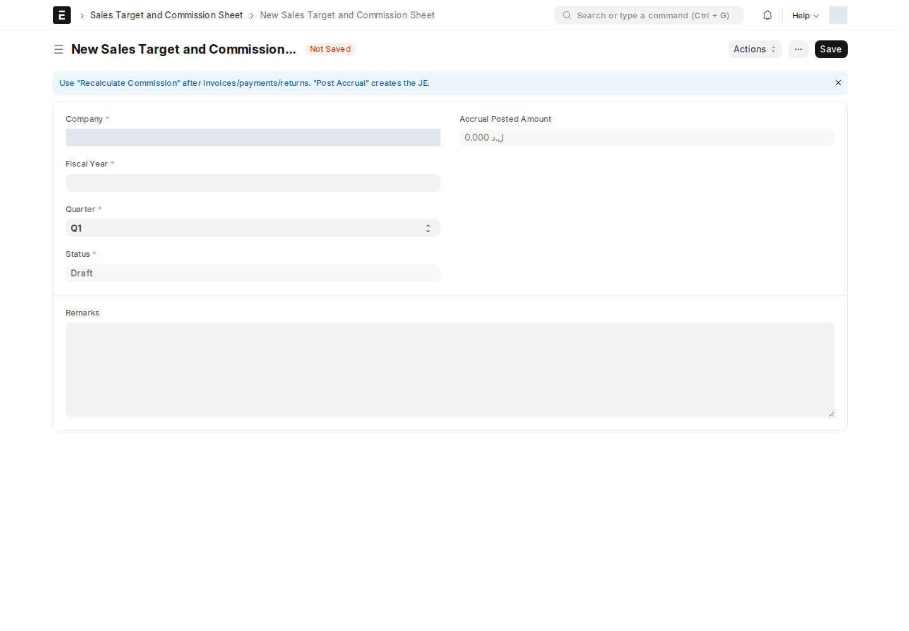

العمولات تربط المبيعات والتحصيل بالأهداف ونوع الخدمة وسيناريو الصفقة. **System Manager** هو الدور صاحب حقوق إعدادات العمولات وكشوفها وسجلاتها في مصفوفة الموقع الحالية؛ يراجع المسؤول التجاري بيانات الصفقة، ويطابق المحاسب الاستحقاق والصرف.

## إعداد السياسة — Commission Policy Settings

هذا DocType إعداد واحد يحدد حساب المصروف وحساب المستحقات وخيارات التوزيع على فريق المبيعات ومعالجة المرتجعات والضرائب/الشحن. يجب مراجعة الحسابات مع المحاسبة قبل الترحيل. وجود خيار بالإعداد لا يعني أنه يطبق بالطريقة نفسها على كل قطاع؛ راجع ناتج الكشف والمعاملة.

## إعداد المعدلات — Commission Rate Settings

هذا DocType إعداد واحد لمعدلات القطاعات وتقسيم حصص المستفيدين والإضافات وفترات السماح. راجع القيم **المحفوظة حالياً** في الإعداد؛ نسب الأمثلة القديمة والصور السابقة ليست سياسة ثابتة.

| المجموعة | ما الذي يراجعه المسؤول؟ |
| --- | --- |
| Sales | مجموعة الصنف والمعدل العادي ومعدل تجاوز الهدف وحصة المدير والفريق |
| Business Accounts | القطاع ونوع الصفقة: Old Accounts / New Lead / Upsell، ومعدل تجاوز الهدف |
| ION Solutions | مراحل جلب العميل وفريق العرض والتنفيذ |
| Add-ons and Bonuses | إضافة السنة الأولى ومكافأة اكتساب المشروع وشروط استحقاقهما |
| Penalty Plans | خطة الدفع وأيام السماح ودورية الجزاء |

## كشف الهدف والعمولة — Sales Target and Commission Sheet

يوثق هدف **Sales Person** وعمولته للشركة والسنة المالية والربع المحدد. استخدم هذا الاسم بالضبط في البحث.

ينشئ التطبيق الكشوف المرتبطة بمندوبي الفواتير المؤهلة تلقائياً. **Sales Person** حقل للقراءة فقط في الإعداد الحالي وقد لا يظهر إذا كان فارغاً في نموذج جديد؛ ابدأ من الكشف المرتبط بالمعاملة بدلاً من إنشاء كشف ناقص يدوياً.

1. تحقق من الشركة وSales Person والسنة والربع والهدف.
2. راجع فواتير **Sales Invoice History** وفئة الخدمة ونوع صفقة BA.
3. استخدم **Recalculate Commission** عندما تحتاج مطابقة الكشف مع أحدث الفواتير والمدفوعات والمرتجعات.
4. راجع المدفوع وغير المدفوع و**Transaction Sync Status** قبل الموافقة أو الترحيل.
5. بعد ترحيل الاستحقاق، افتح **Accrual JE** وطابق **Accrual Posted Amount** مع القيد.

إعادة الاحتساب وترحيل الاستحقاق عمليتان مختلفتان؛ **Post Accrual** ينشئ الأثر المحاسبي بحسب تحقق العملية، ولا تعني إعادة الاحتساب صرف مبلغ للمندوب.

## التحديث التلقائي

تستدعي معالجات التطبيق تحديث الكشوف عند اعتماد/إلغاء Sales Invoice، وتعديلها بعد الاعتماد، واعتماد/إلغاء Payment Entry. لا يوجد في hooks المقروءة حدث تعديل Payment Entry بعد الاعتماد مماثل؛ لا تعمم سلوك الفاتورة عليه.

قد يكون تحديث الحساب في الخلفية؛ إذا لم يتطابق الكشف مع مصدره، تحقق من الفواتير والدفعات والمندوب والفترة ثم من نتيجة إعادة الاحتساب مع مسؤول النظام.

## سير الموافقة والصلاحيات

السير النشط **Commission Sheet Workflow** يحتوي:

**Draft → Submit → Submitted → Approve → Approved → Post → Posted**

هذه أسماء حالات وإجراءات Workflow، وليست مرادفات تلقائية للحفظ أو صرف العمولة. توجد انتقالات Cancel من Submitted وApproved وPosted. دور الانتقالات هو **All**، لكن حقوق DocType متاحة لـ **System Manager** فقط؛ لا تعني All أن كل موظف يستطيع فتح الكشف أو اعتماده. كذلك لا يتضمن صف System Manager الحالي حق Cancel، لذلك قد يُمنع الإلغاء رغم وجوده في السير.

## السجلات المرتبطة

| DocType | دوره | مسؤولية المستخدم |
| --- | --- | --- |
| Sales Person | تعريف مندوب المبيعات وربطه بالموظف والأهداف | مسؤول المبيعات يراجع الربط والمندوب الفعلي |
| Commission Transaction | تفاصيل معاملة العمولة ومصدرها وحالتها وتصحيحاتها | المسؤول المخول يطابقها مع الفاتورة والكشف؛ لا يصحح الإجمالي بتعديل عشوائي للسجل |
| Commission Payment | توثيق مبلغ الصرف والمستفيدين المرتبطين بمعاملة العمولة | المحاسب يطابق المبلغ والمستفيدين ودليل الدفع قبل التسجيل |
| Journal Entry | القيد المحاسبي للاستحقاق أو التسوية | Accounts Manager يراجع ويعتمد وفق سير القيد |
| Payment Entry | القبض/الدفع المرتبط بالفواتير | Accounts Manager يراجع ويعتمد وفق سير الدفعة |

لا توجد قواعد Notification مفعلة مستقلة لهذه DocTypes الخاصة بالعمولة وقت المراجعة. قد ينطبق معالج سير العمل العام على الكشف، مع [قيد البريد في الموقع](/users/active-scripts/).

<!-- BEGIN VERIFIED SITE REFERENCE -->

## مرجع الأدوار وسير العمل والإشعارات

تمت المراجعة من إعدادات **testsite.local — 12 سبتمبر 2026**. مستوى 0 هو الحقوق الأساسية؛ المستويات الأعلى تخص مجموعات حقول محددة. علامة — تعني أن صف الدور لا يمنح الحق. لا تجمع الصور كل أدوار المستخدمين؛ الصور التقطت بحساب الإدارة.

**تنبيه البريد:** [سكربت موقع الاختبار يضع البريد في Sent دون إرساله](/users/active-scripts/). تابع المستند والتنبيهات المتاحة داخل النظام.

### Commission Policy Settings

**الدور:** إعداد حسابات وقواعد سياسة العمولة.

**صلاحيات الأدوار الفعلية** (تظل قيود السجلات والحالة والشروط سارية):

| الدور/الأدوار | مستوى الحقول | قراءة | إنشاء | تعديل | اعتماد | إلغاء | القيد |
| --- | --- | --- | --- | --- | --- | --- | --- |
| System Manager | 0 | نعم | نعم | نعم | — | — | بحسب النطاق المسموح |

**سير العمل:** لا يوجد Workflow نشط لهذا النوع وقت المراجعة. هذه شاشة إعداد واحدة تحفظ إعداداتها؛ لا تمر بمراحل Submit/Cancel.

**الإشعارات:** لا توجد قاعدة Notification مستقلة مفعلة لهذا النوع في لقطة المراجعة. قد تنطبق معالجات التطبيق المذكورة في الشرح أو معالج ION العام عند وجود workflow_state؛ غياب القاعدة ليس دليلاً على غياب كل تنبيه.

### Commission Rate Settings

**الدور:** إعداد معدلات القطاعات والإضافات وتقسيم الحصص.

**صلاحيات الأدوار الفعلية** (تظل قيود السجلات والحالة والشروط سارية):

| الدور/الأدوار | مستوى الحقول | قراءة | إنشاء | تعديل | اعتماد | إلغاء | القيد |
| --- | --- | --- | --- | --- | --- | --- | --- |
| System Manager | 0 | نعم | نعم | نعم | — | — | بحسب النطاق المسموح |

**سير العمل:** لا يوجد Workflow نشط لهذا النوع وقت المراجعة. هذه شاشة إعداد واحدة تحفظ إعداداتها؛ لا تمر بمراحل Submit/Cancel.

**الإشعارات:** لا توجد قاعدة Notification مستقلة مفعلة لهذا النوع في لقطة المراجعة. قد تنطبق معالجات التطبيق المذكورة في الشرح أو معالج ION العام عند وجود workflow_state؛ غياب القاعدة ليس دليلاً على غياب كل تنبيه.

### Sales Target and Commission Sheet

**الدور:** مراجعة هدف وعمولة مندوب للشركة والسنة والربع وإدارة موافقته.

**صلاحيات الأدوار الفعلية** (تظل قيود السجلات والحالة والشروط سارية):

| الدور/الأدوار | مستوى الحقول | قراءة | إنشاء | تعديل | اعتماد | إلغاء | القيد |
| --- | --- | --- | --- | --- | --- | --- | --- |
| System Manager | 0 | نعم | نعم | نعم | نعم | — | بحسب النطاق المسموح |

**سير العمل النشط:** `Commission Sheet Workflow`. استخدم قائمة الإجراءات؛ لا تعدل حقل الحالة يدوياً. دور الانتقال لا يمنح حقوق القراءة/الكتابة/الاعتماد الناقصة.

| من الحالة | الإجراء | إلى الحالة | الدور المنفّذ | الشرط | حالة المستند بعده |
| --- | --- | --- | --- | --- | --- |
| Draft | Submit | Submitted | All | لا شرط إضافي في الانتقال | معتمد (1) |
| Submitted | Approve | Approved | All | لا شرط إضافي في الانتقال | معتمد (1) |
| Approved | Post | Posted | All | لا شرط إضافي في الانتقال | معتمد (1) |
| Posted | Cancel | Cancelled | All | لا شرط إضافي في الانتقال | ملغى (2) |
| Submitted | Cancel | Cancelled | All | لا شرط إضافي في الانتقال | ملغى (2) |
| Approved | Cancel | Cancelled | All | لا شرط إضافي في الانتقال | ملغى (2) |

من يحرر المستند في كل حالة؟

الدور أدناه هو Allow Edit في إعداد الحالة، ويضاف إلى حقوق الحقول ونطاق السجل.

| الحالة | دور تحرير الحالة | حالة المستند |
| --- | --- | --- |
| Draft | All | مسودة (0) |
| Submitted | All | معتمد (1) |
| Approved | All | معتمد (1) |
| Posted | All | معتمد (1) |
| Cancelled | All | ملغى (2) |

بريد Workflow القياسي **غير مفعّل** لهذا السير. يمكن أن تعمل قواعد Notification ومعالجات التطبيق بشكل مستقل عنه.

**الإشعارات:** لا توجد قاعدة Notification مستقلة مفعلة لهذا النوع في لقطة المراجعة. قد تنطبق معالجات التطبيق المذكورة في الشرح أو معالج ION العام عند وجود workflow_state؛ غياب القاعدة ليس دليلاً على غياب كل تنبيه.

### Commission Transaction

**الدور:** تتبع معاملة العمولة ومصدرها وتصحيحاتها.

**صلاحيات الأدوار الفعلية** (تظل قيود السجلات والحالة والشروط سارية):

| الدور/الأدوار | مستوى الحقول | قراءة | إنشاء | تعديل | اعتماد | إلغاء | القيد |
| --- | --- | --- | --- | --- | --- | --- | --- |
| System Manager | 0 | نعم | نعم | نعم | — | — | بحسب النطاق المسموح |

**سير العمل:** لا يوجد Workflow نشط لهذا النوع وقت المراجعة. المستند يُحفظ دون Submit؛ حقل الحالة إن وجد لا يعني Workflow مستقلاً.

**الإشعارات:** لا توجد قاعدة Notification مستقلة مفعلة لهذا النوع في لقطة المراجعة. قد تنطبق معالجات التطبيق المذكورة في الشرح أو معالج ION العام عند وجود workflow_state؛ غياب القاعدة ليس دليلاً على غياب كل تنبيه.

### Commission Payment

**الدور:** توثيق صرف العمولة ومستفيديها.

**صلاحيات الأدوار الفعلية** (تظل قيود السجلات والحالة والشروط سارية):

| الدور/الأدوار | مستوى الحقول | قراءة | إنشاء | تعديل | اعتماد | إلغاء | القيد |
| --- | --- | --- | --- | --- | --- | --- | --- |
| System Manager | 0 | نعم | نعم | نعم | — | — | بحسب النطاق المسموح |

**سير العمل:** لا يوجد Workflow نشط لهذا النوع وقت المراجعة. المستند يُحفظ دون Submit؛ حقل الحالة إن وجد لا يعني Workflow مستقلاً.

**الإشعارات:** لا توجد قاعدة Notification مستقلة مفعلة لهذا النوع في لقطة المراجعة. قد تنطبق معالجات التطبيق المذكورة في الشرح أو معالج ION العام عند وجود workflow_state؛ غياب القاعدة ليس دليلاً على غياب كل تنبيه.

### Sales Person

**الدور:** تعريف مندوب المبيعات الذي تنسب إليه الأهداف والمبيعات.

**صلاحيات الأدوار الفعلية** (تظل قيود السجلات والحالة والشروط سارية):

| الدور/الأدوار | مستوى الحقول | قراءة | إنشاء | تعديل | اعتماد | إلغاء | القيد |
| --- | --- | --- | --- | --- | --- | --- | --- |
| Sales Master Manager | 0 | نعم | نعم | نعم | — | — | بحسب النطاق المسموح |
| Sales Manager، Sales User، Dedicated Account Manager | 0 | نعم | — | — | — | — | بحسب النطاق المسموح |

**سير العمل:** لا يوجد Workflow نشط لهذا النوع وقت المراجعة. المستند يُحفظ دون Submit؛ حقل الحالة إن وجد لا يعني Workflow مستقلاً.

**الإشعارات:** لا توجد قاعدة Notification مستقلة مفعلة لهذا النوع في لقطة المراجعة. قد تنطبق معالجات التطبيق المذكورة في الشرح أو معالج ION العام عند وجود workflow_state؛ غياب القاعدة ليس دليلاً على غياب كل تنبيه.

<!-- END VERIFIED SITE REFERENCE -->
