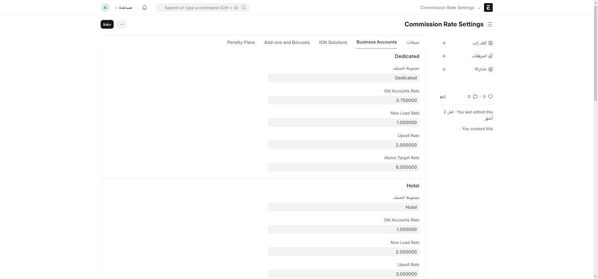
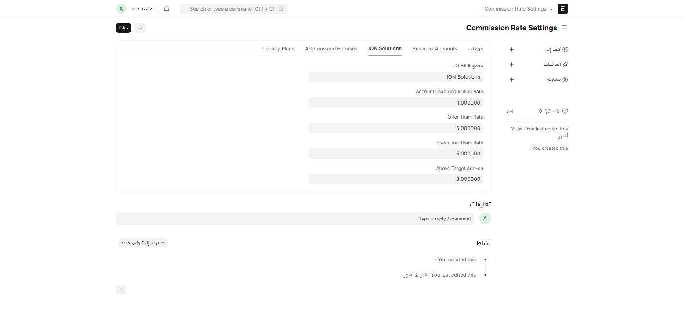
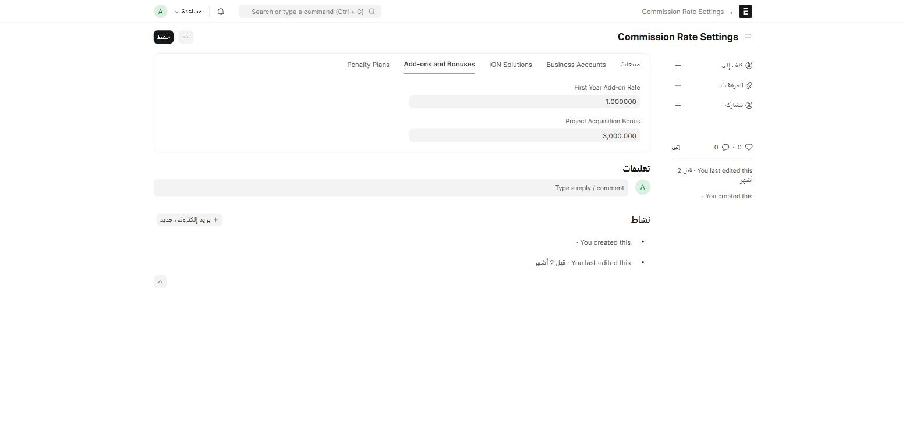
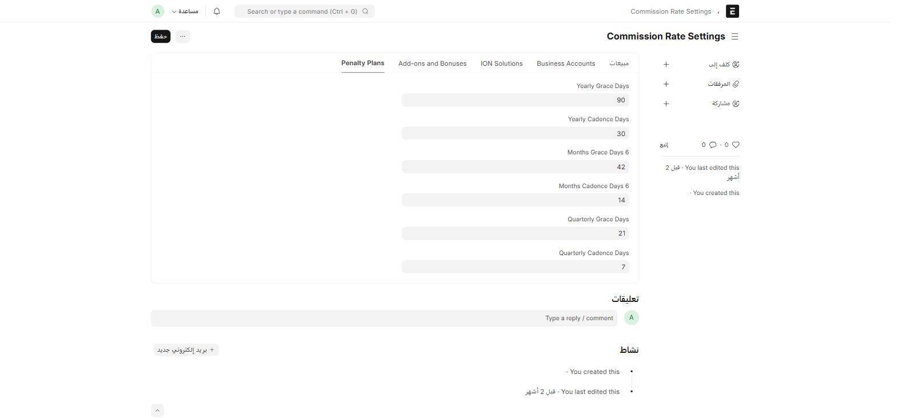
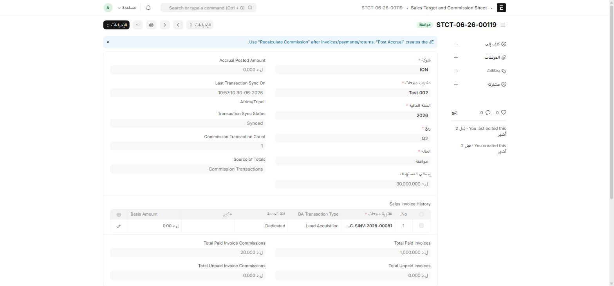

نظام العمولات في ION يعمل بثلاث طبقات: **إعدادات عامة** (مرة واحدة) → **معدلات لكل مجموعة صنف/قطاع** (تُضبَط وتُراجَع دورياً) → **كشوف واحتساب تلقائي** لكل مندوب مبيعات في كل فترة.

:::caution[لا تُحسَب العمولة يدوياً]
الاحتساب **تلقائي بالكامل**: كل مرة تُعتمَد فيها **فاتورة مبيعات** أو **دفعة (Payment Entry)** — أو تُلغى، أو تُعدَّل بعد الاعتماد — يعيد ION احتساب **كشف الهدف والعمولة (Sales Target and Commission Sheet)** المرتبط تلقائياً. لا يوجد زر "احسب العمولة" تضغطه يدوياً في السير العادي؛ إن احتجت لإعادة احتساب يدوية استخدم زر **Recalculate Commission** الظاهر على الكشف نفسه.
:::

## الطبقة 1: Commission Policy Settings (إعداد لمرة واحدة)

اكتب في شريط البحث: `Commission Policy Settings`

سجل إعدادات عام واحد للنظام كله:

| الحقل | ماذا يضبط |
| --- | --- |
| **حساب المصروفات** (Expense Account) | الحساب الذي تُقيَّد فيه العمولات كمصروف |
| **حساب مستحقات الدفع** (Payable Account) | الحساب الذي تُقيَّد فيه العمولات كمستحقة |
| **Apportion by Sales Team** | توزيع العمولة حسب نسب فريق المبيعات على الفاتورة، بدل مندوب واحد |
| **Include Returns** | هل تُخصَم المرتجعات من أساس احتساب العمولة |
| **Exclude Taxes/Shipping** | هل تُستبعَد الضرائب والشحن من أساس الاحتساب |

## الطبقة 2: Commission Rate Settings (المعدلات — راجعها دورياً)

اكتب في شريط البحث: `Commission Rate Settings`. هذا سجل إعدادات واحد أيضاً، مقسَّم لخمسة تبويبات:

### تبويب مبيعات (حسب مجموعة الصنف)

لكل **مجموعة صنف** (مثل Home، Hotspot - Sales): معدل عادي (Normal Rate) ومعدل تجاوز الهدف (Above Target Rate)، وتقسيم العمولة بين المدير والفريق لكل حالة — مثال فعلي من هذا النظام لمجموعة **Home**:

| | المعدل العادي | معدل تجاوز الهدف |
| --- | :---: | :---: |
| **النسبة** | 5% | 30% |
| **حصة المدير** | 30% | 30% |
| **حصة الفريق** | 70% | 70% |

### تبويب Business Accounts (حسب القطاع)

هنا المعدلات مقسَّمة حسب **سيناريو الصفقة**، لكل قطاع من قطاعات حسابات الأعمال (Dedicated، Hotel، Ultra Malls) — أربعة معدلات لكل قطاع:

| القطاع | Old Accounts (حساب قديم) | New Lead (عميل جديد) | Upsell (بيع إضافي) | Above Target |
| --- | :---: | :---: | :---: | :---: |
| **Dedicated** | 0.75% | 1% | 2% | 6% |
| **Hotel** | 1% | 2% | 3% | 6% |
| **Ultra Malls** | 0.5% | 2% | 3% | 2% |

هذا يعني أن **نفس الفاتورة** يمكن أن تُحتسَب بمعدل مختلف تماماً حسب: هل العميل **حساب قديم** يُجدَّد، أم **عميل جديد بالكامل (New Lead)**، أم **بيع إضافي (Upsell)** على عقد قائم.

### تبويب ION Solutions

قطاع مستقل بمعدلات خاصة موزَّعة على مراحل الصفقة بدل نوع الحساب:

| المرحلة | المعدل |
| --- | :---: |
| Account Lead Acquisition (جلب العميل) | 1% |
| Offer Team (فريق العرض) | 5% |
| Execution Team (فريق التنفيذ) | 5% |
| Above Target Add-on | 3% |

### تبويب Add-ons and Bonuses

- **First Year Add-on Rate**: 100% — إضافة كاملة على عمولة السنة الأولى من عقد جديد.
- **Project Acquisition Bonus**: 3,000 (مبلغ ثابت) — يُمنَح عند اكتساب مشروع جديد، بصرف النظر عن قيمته.

### تبويب Penalty Plans (نوافذ السماح وإيقاع الاستحقاق)

تحدّد هذه القيم **متى تُعتبر العمولة مستحقة الدفع** ومتى **تخضع لجزاء تأخير**، لكل دورة صرف:

| الدورة | أيام السماح (Grace) | أيام الإيقاع (Cadence) |
| --- | :---: | :---: |
| سنوية | 90 | 30 |
| كل 6 أشهر | 42 | 14 |
| ربع سنوية | 21 | 7 |

## الطبقة 3: كشف الهدف والعمولة (Sales Target and Commission Sheet)

المستند **الوحيد القابل للاعتماد** في منظومة العمولات — كشف واحد لكل **مندوب مبيعات** لكل **سنة مالية/ربع سنة**.

أين أجده؟ اكتب في شريط البحث: `Sales Target and Commission Sheet`

:::note[تعليمات ظاهرة أعلى الكشف مباشرة]
يعرض النظام رسالة إرشادية ثابتة أعلى كل كشف:
**"Use 'Recalculate Commission' after invoices/payments/returns. 'Post Accrual' creates the JE."**
بالعربية: استخدم زر **إعادة احتساب العمولة** بعد أي فاتورة أو دفعة أو مرتجع يدوي استثنائي، واستخدم **ترحيل الاستحقاق (Post Accrual)** لإنشاء قيد اليومية (Journal Entry) الفعلي في الحسابات.
:::

| الحقل | ماذا يعرض |
| --- | --- |
| **إجمالي المستهدف** | هدف المبيعات لهذا المندوب في هذه الفترة |
| **Sales Invoice History** | جدول بكل فاتورة ساهمت في الحساب — رقمها، فئة الخدمة، نوع صفقة الحساب (BA Transaction Type)، والمبلغ الأساسي |
| **Total Paid/Unpaid Invoice Commissions** | إجمالي العمولة المحتسَبة من الفواتير المسدَّدة مقابل غير المسدَّدة |
| **Accrual Posted Amount** + **Accrual JE** | المبلغ المرحَّل فعلياً للمحاسبة، ورابط قيد اليومية الناتج |
| **Transaction Sync Status** | هل الكشف متزامن مع آخر معاملة عمولة |

حالات الكشف: **مسودة** → **مسجلة/تم النشر** → **موافقة**.

## سجلّ العمولة والصرف (للمراجعة والتدقيق فقط)

طبقة إضافية تحت الكشف، **لا تتدخّل فيها يدوياً** عادة — سجلّ تدقيق ثابت:

| المستند | ماذا يمثّل |
| --- | --- |
| **Commission Transaction** | قيد عمولة واحد غير قابل للتعديل، بنوع (New Lead / Upsell / Old / Renewal) وحالة (Draft / Posted / Reversed / Superseded) — كل تصحيح يُنشئ معاملة **عكسية (Reversal)** جديدة بدل تعديل القديمة |
| **Commission Payment** | تسجيل صرف فعلي مقابل معاملة عمولة، مع جدول المستفيدين (Beneficiaries) ونصيب كل واحد |

:::tip[لماذا هذا التصميم مهم لك]
إذا لاحظت اختلافاً في عمولة مندوب مقارنةً بشهر سابق، افتح **Commission Transaction** المرتبطة بفاتورته وابحث عن صفوف **Reversal** أو **Correction** — هي التي تشرح سبب التغيير، لا تعديل مباشر على الرقم القديم.
:::

## تقارير جاهزة

من القائمة الجانبية أو شريط البحث:

| التقرير | يعرض |
| --- | --- |
| **Target vs Actual** | مقارنة الهدف بالفعلي لكل مندوب |
| **Accrued Commission Payable** | ما هو مستحق الدفع حتى الآن |
| **Commission to Revenue Ratio** | نسبة العمولة إلى الإيراد — مؤشر ربحية |
| **Commission Expense Summary** | ملخّص القيود المحاسبية للعمولات |
| **Commission Report** | تقرير تفصيلي على مستوى كل معاملة عمولة |
