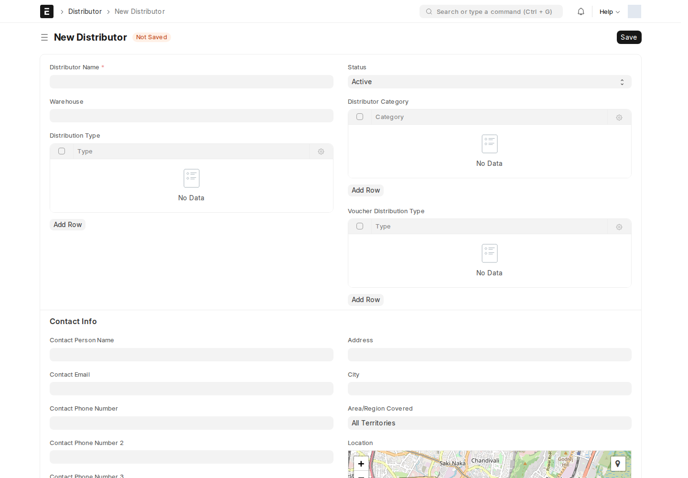
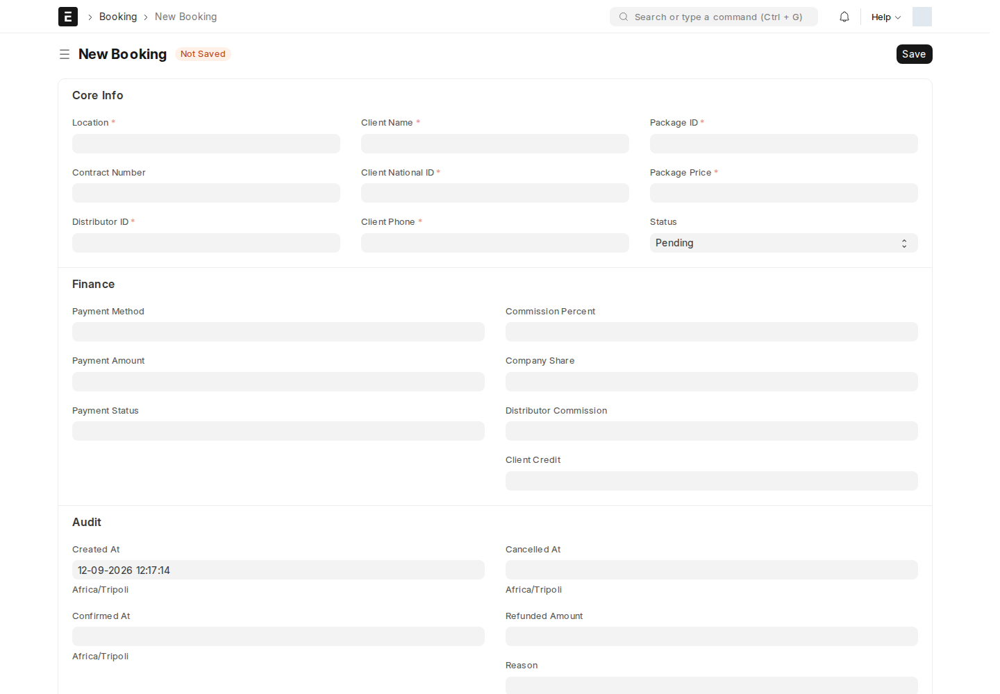

## الموزّع (Distributor)

سجل رئيسي لكل **موزّع أو وكيل** يبيع باقات/فاوتشرات الشركة.

أين أجده؟ اكتب في شريط البحث: `موزع` أو `Distributor`

| الحقل | ماذا يعني |
| --- | --- |
| **Distributor Name** | الاسم التجاري للموزّع |
| **Distributor Code/ID** | كود فريد يُنشأ **تلقائياً** عند إنشاء السجل — لا تُدخله يدوياً |
| **Distributor Category** | جدول: Agent / Home Cards Wholesale / Hotspot Cards Wholesale / E-Payment Company / POS |
| **Distribution Type** | جدول: Home Vouchers / Hotspot Vouchers / Equipment\Devices / اشتراك |
| **Voucher Distribution Type** | جدول: Paper (ورقي) / Electronic (إلكتروني) |
| **شريك المبيعات** (Sales Partner) | يُنشأ ويُربَط **تلقائياً** عند إنشاء الموزّع |
| **المستودعات، الترخيص وصلاحيته** | بيانات تشغيلية وقانونية |

:::note[كود الموزّع وشريك المبيعات يُنشآن تلقائياً]
عند حفظ موزّع جديد لأول مرة، ينشئ ION تلقائياً **كوداً فريداً** له ويربطه بسجلّ **شريك مبيعات (Sales Partner)** مطابق. لا تحتاج لإنشاء شريك المبيعات يدوياً بشكل منفصل.
:::

## فرع العميل (Branch Customer)

سجل بسيط يسمّي **فرع أو موقع عميل** — يُستخدم اسم الفرع نفسه كاسم السجل. راجعه عند الحاجة لتمييز فروع عميل واحد له أكثر من موقع.

## الحجز (Booking)

مستند نقطة بيع (POS-style) يسجّل **بيعاً واحداً لباقة أو فاوتشر** عبر موزّع محدَّد.

أين أجده؟ اكتب في شريط البحث: `Booking`

| القسم | الحقول |
| --- | --- |
| **Core Info** | Package ID*، Client Name*، الموقع*، Package Price*، Client National ID*، Contract Number، الحالة، Client Phone*، Distributor ID* |
| **المالية** | Commission Percent، Company Share، Distributor Commission، Client Credit، طريقة الدفع أو السداد، دفع مبلغ، Payment Status |
| **Audit** | Created At، Confirmed At، Cancelled At، Refunded Amount — تواريخ تُسجَّل تلقائياً مع المنطقة الزمنية (Africa/Tripoli) |

**Invoice References** (جدول فرعي) يربط الحجز بفاتورة أو أكثر من فواتير المبيعات الصادرة عنه، مع تاريخ الإضافة.

الحالات الممكنة: **Pending** (معلّق) → **Confirmed** (مؤكَّد) / **Cancelled** (ملغى) / **Failed** (فاشل).

:::tip[سلسلة الترقيم]
اسم كل حجز يتبع الصيغة `RMT-{السنة}{الشهر}{اليوم}-{تسلسل}` — مما يسهّل معرفة تاريخ الحجز مباشرة من اسمه دون فتحه.
:::

<!-- BEGIN VERIFIED SITE REFERENCE -->

## مرجع الأدوار وسير العمل والإشعارات

تمت المراجعة من إعدادات **testsite.local — 12 سبتمبر 2026**. مستوى 0 هو الحقوق الأساسية؛ المستويات الأعلى تخص مجموعات حقول محددة. علامة — تعني أن صف الدور لا يمنح الحق. لا تجمع الصور كل أدوار المستخدمين؛ الصور التقطت بحساب الإدارة.

**تنبيه البريد:** [سكربت موقع الاختبار يضع البريد في Sent دون إرساله](/users/active-scripts/). تابع المستند والتنبيهات المتاحة داخل النظام.

### Distributor

**الدور:** تعريف الموزع وقنوات توزيعه وربطه بشريك المبيعات.

**صلاحيات الأدوار الفعلية** (تظل قيود السجلات والحالة والشروط سارية):

| الدور/الأدوار | مستوى الحقول | قراءة | إنشاء | تعديل | اعتماد | إلغاء | القيد |
| --- | --- | --- | --- | --- | --- | --- | --- |
| System Manager | 0 | نعم | نعم | نعم | — | — | بحسب النطاق المسموح |

**سير العمل:** لا يوجد Workflow نشط لهذا النوع وقت المراجعة. المستند يُحفظ دون Submit؛ حقل الحالة إن وجد لا يعني Workflow مستقلاً.

**الإشعارات:** لا توجد قاعدة Notification مستقلة مفعلة لهذا النوع في لقطة المراجعة. قد تنطبق معالجات التطبيق المذكورة في الشرح أو معالج ION العام عند وجود workflow_state؛ غياب القاعدة ليس دليلاً على غياب كل تنبيه.

### Branch Customer

**الدور:** تمييز فرع أو موقع العميل في العمليات المرتبطة.

**صلاحيات الأدوار الفعلية** (تظل قيود السجلات والحالة والشروط سارية):

| الدور/الأدوار | مستوى الحقول | قراءة | إنشاء | تعديل | اعتماد | إلغاء | القيد |
| --- | --- | --- | --- | --- | --- | --- | --- |
| System Manager | 0 | نعم | نعم | نعم | — | — | بحسب النطاق المسموح |

**سير العمل:** لا يوجد Workflow نشط لهذا النوع وقت المراجعة. المستند يُحفظ دون Submit؛ حقل الحالة إن وجد لا يعني Workflow مستقلاً.

**الإشعارات:** لا توجد قاعدة Notification مستقلة مفعلة لهذا النوع في لقطة المراجعة. قد تنطبق معالجات التطبيق المذكورة في الشرح أو معالج ION العام عند وجود workflow_state؛ غياب القاعدة ليس دليلاً على غياب كل تنبيه.

### Booking

**الدور:** توثيق حجز باقة/فاوتشر ومبالغه وحالته ومراجع فواتيره.

**صلاحيات الأدوار الفعلية** (تظل قيود السجلات والحالة والشروط سارية):

| الدور/الأدوار | مستوى الحقول | قراءة | إنشاء | تعديل | اعتماد | إلغاء | القيد |
| --- | --- | --- | --- | --- | --- | --- | --- |
| System Manager | 0 | نعم | نعم | نعم | — | — | بحسب النطاق المسموح |

**سير العمل:** لا يوجد Workflow نشط لهذا النوع وقت المراجعة. المستند يُحفظ دون Submit؛ حقل الحالة إن وجد لا يعني Workflow مستقلاً.

**الإشعارات:** لا توجد قاعدة Notification مستقلة مفعلة لهذا النوع في لقطة المراجعة. قد تنطبق معالجات التطبيق المذكورة في الشرح أو معالج ION العام عند وجود workflow_state؛ غياب القاعدة ليس دليلاً على غياب كل تنبيه.

### Sales Partner

**الدور:** تعريف شريك البيع المرتبط بالتوزيع.

**صلاحيات الأدوار الفعلية** (تظل قيود السجلات والحالة والشروط سارية):

| الدور/الأدوار | مستوى الحقول | قراءة | إنشاء | تعديل | اعتماد | إلغاء | القيد |
| --- | --- | --- | --- | --- | --- | --- | --- |
| Sales User، Sales Manager، Dedicated Account Manager | 0 | نعم | — | — | — | — | بحسب النطاق المسموح |
| Sales Master Manager | 0 | نعم | نعم | نعم | — | — | بحسب النطاق المسموح |

**سير العمل:** لا يوجد Workflow نشط لهذا النوع وقت المراجعة. المستند يُحفظ دون Submit؛ حقل الحالة إن وجد لا يعني Workflow مستقلاً.

**الإشعارات:** لا توجد قاعدة Notification مستقلة مفعلة لهذا النوع في لقطة المراجعة. قد تنطبق معالجات التطبيق المذكورة في الشرح أو معالج ION العام عند وجود workflow_state؛ غياب القاعدة ليس دليلاً على غياب كل تنبيه.

<!-- END VERIFIED SITE REFERENCE -->
