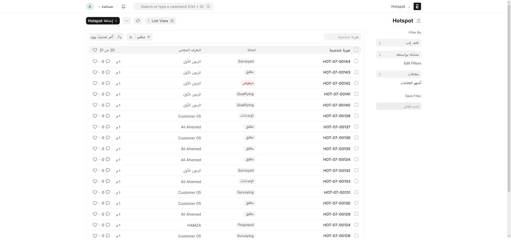
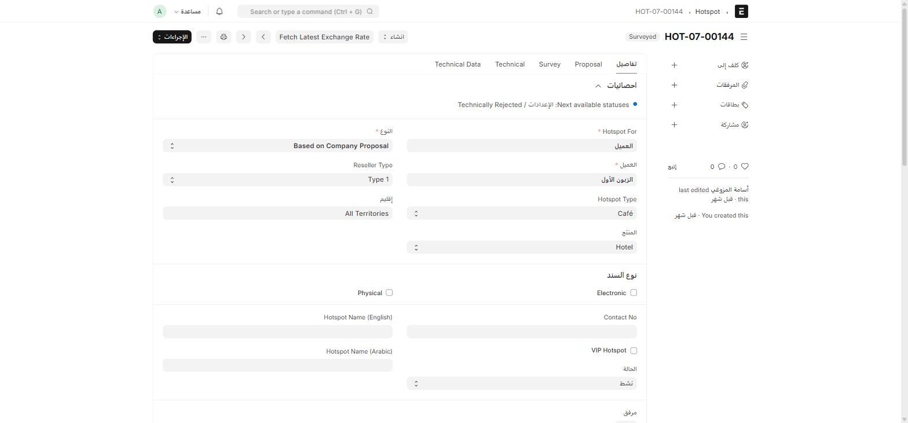

**Hotspot** مسار منفصل عن عائلة الفرص — يغطّي دورة حياة **شبكة هوت-سبوت** كاملة: من عرض الخدمة على العميل، مروراً بالمسح الفني وتركيب المعدات، وصولاً للتشغيل والصيانة الدورية.

## أين أجده؟

اكتب في شريط البحث: `Hotspot`



## الحقول الأساسية

| الحقل | إجباري | ماذا يعني |
| --- | :---: | --- |
| **النوع** | ✅ | Based on Company Proposal (عرض من الشركة) أو Based on Customer Request (طلب من العميل) |
| **Hotspot For** | ✅ | الطرف المعني (رابط ديناميكي) |
| **Pre-Sales** | ✅ | المستخدم المسؤول عن ما قبل البيع |
| **Hotspot Type** | — | Café / Restaurant / Resort / School / Hospital / ... |
| **المنتج** | — | Hotel / Hotspot / Street Wifi / Mall |
| Access Controller، Access Point IP، SSID Name، CPE IP، VLAN، Tower/Sector، Wireless MAC | — | إعدادات الشبكة بعد التركيب |

## سير العمل والحالة التالية المقترَحة



مثل عائلة الفرص، لا يُعتمَد (Submit) مستند Hotspot، بل ينتقل بسير عمل بالأدوار. الميزة هنا أن النظام **يعرض لك مباشرة أعلى النموذج** الحالات التالية الممكنة من حالتك الحالية (`Next available statuses`)، فلا حاجة لتخمينها.

التسلسل العام:

```
التأهيل (Qualifying) → مقترح (Proposed) → المسح الفني (Surveying)
    → تم المسح (Surveyed) → جمع المتطلبات (Requirements Gathering)
    → الإعدادات (Setup) → نشط (Active) → مغلق (Closed)
```

مع مسارات **رفض فني** أو **رفض تجاري** ممكنة عند أي مرحلة، تعيد السجل لحالة **مرفوض** ليُعاد النظر فيه.

## الأصول والصيانة

بعد وصول الهوت-سبوت لحالة **نشط**، يستخدم فريق الصيانة جدولين:

| الجدول | ماذا يسجّل |
| --- | --- |
| **Hotspot Asset** | معدّات مركّبة في الموقع (نوع CPE: Indoor/Outdoor AP، Switch، Cabinet، Router، PDU) وقيمتها |
| **Maintenance Log** | زيارات الصيانة — جدول الصيانة المرتبط، تاريخ الزيارة، والفني المسؤول (Agent) |

استخدم **Maintenance Log** لتوثيق كل زيارة صيانة ميدانية، ليبقى تاريخ الموقع كاملاً حتى لو تغيّر الفني المسؤول.

## من العرض إلى التركيب

عند اعتماد عرض هوت-سبوت (من نوع Based on Company Proposal)، تُضاف الأصناف والمواد المطلوبة في جدولي **Items** و**Material** (المرتبط بـ Material Request Item) — ما يتيح لك تحويل الاحتياج مباشرة إلى **طلب مواد** أو **قيد مخزون (Stock Entry)** دون إعادة الكتابة يدوياً.
