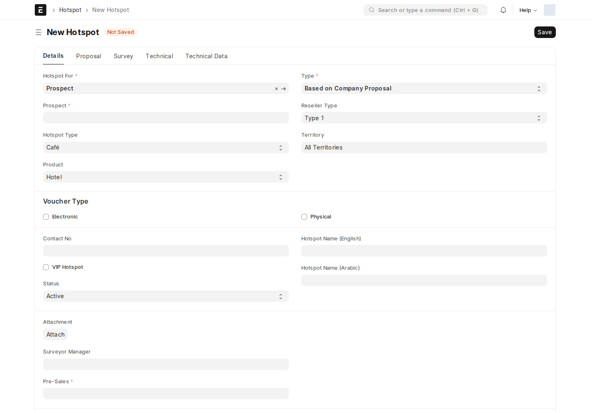

**Hotspot** يتابع تأهيل موقع شبكة هوت-سبوت، والعرض التجاري، والمسح، والإعداد، ثم التشغيل والإغلاق. افتحه بالبحث عن `Hotspot`.

## البيانات والمسؤولون

حدد **Type**: عرض من الشركة أو طلب من العميل، ثم **Hotspot For** والطرف في **Party** و**Pre-Sales**. دوّن نوع الموقع والمنتج، وأضف المعدات وبيانات الشبكة عندما يحين وقتها.

**Hotspot Sales** يدير التأهيل والعرض والإعداد والإغلاق. **Surveyor Manager** يدير مرحلة المسح، و**Pre-Sales** يوافق على نتيجة المسح أو يرفضها فنياً.

:::caution[دور الانتقال لا يضمن الوصول]
صلاحيات DocType الحالية تمنح القراءة والإنشاء والتعديل لـ System Manager وDedicated QA. قد يحتاج من يحمل دور انتقال إلى حقوق وصول إضافية؛ راجع المسؤول عند غياب السجل أو زر الإجراء.
:::

## المسار الحالي

Draft → Qualifying، ثم **Accept → Surveying** أو **Propose → Proposed → Accept → Surveying**. بعد المسح: Surveyed → Setup → Active → Closed.

من Proposed يمكن **Revise → Under Revision** ثم إعادة Propose. الرفض التجاري متاح من Qualifying أو Proposed، والفني من Surveyed. لا توجد مرحلة Requirements Gathering ضمن هذا Workflow النشط، ولا يتيح الرفض من كل مرحلة.

## التنفيذ والصيانة

بعد اكتمال المسح، راجع المعدات والأصناف ومعلومات الشبكة قبل Setup. استخدم جداول الأصول والصيانة الظاهرة لتوثيق التجهيزات والزيارات والمسؤول عنها. هذه جداول تابعة للموقع، وليست موافقات مستقلة.

إضافة مسّاح إلى جدول التعيين تشغل منطق أسئلة المسح وإشعاره؛ يجب إكمال الإجابات قبل الانتقال إلى Surveyed. لا توجد قاعدة Notification مستقلة مفعلة باسم هذا DocType في المراجعة، لكن توجد معالجات تطبيق للمسح وسير العمل. تابع الحالة داخل النظام بسبب [قيد البريد الحالي](/users/active-scripts/).

<!-- BEGIN VERIFIED SITE REFERENCE -->

## مرجع الأدوار وسير العمل والإشعارات

تمت المراجعة من إعدادات **testsite.local — 12 سبتمبر 2026**. مستوى 0 هو الحقوق الأساسية؛ المستويات الأعلى تخص مجموعات حقول محددة. علامة — تعني أن صف الدور لا يمنح الحق. لا تجمع الصور كل أدوار المستخدمين؛ الصور التقطت بحساب الإدارة.

**تنبيه البريد:** [سكربت موقع الاختبار يضع البريد في Sent دون إرساله](/users/active-scripts/). تابع المستند والتنبيهات المتاحة داخل النظام.

### Hotspot

**الدور:** متابعة تأهيل وتركيب وتشغيل وإغلاق موقع هوت-سبوت.

**صلاحيات الأدوار الفعلية** (تظل قيود السجلات والحالة والشروط سارية):

| الدور/الأدوار | مستوى الحقول | قراءة | إنشاء | تعديل | اعتماد | إلغاء | القيد |
| --- | --- | --- | --- | --- | --- | --- | --- |
| System Manager، Dedicated QA | 0 | نعم | نعم | نعم | — | — | بحسب النطاق المسموح |

**سير العمل النشط:** `Hotspot`. استخدم قائمة الإجراءات؛ لا تعدل حقل الحالة يدوياً. دور الانتقال لا يمنح حقوق القراءة/الكتابة/الاعتماد الناقصة.

| من الحالة | الإجراء | إلى الحالة | الدور المنفّذ | الشرط | حالة المستند بعده |
| --- | --- | --- | --- | --- | --- |
| Draft | Qualify | Qualifying | Hotspot Sales | لا شرط إضافي في الانتقال | — |
| Draft | Reject | Rejected | Hotspot Sales | لا شرط إضافي في الانتقال | مسودة (0) |
| Qualifying | Accept | Surveying | Hotspot Sales | لا شرط إضافي في الانتقال | — |
| Qualifying | Propose | Proposed | Hotspot Sales | لا شرط إضافي في الانتقال | مسودة (0) |
| Qualifying | Reject | Commercially Rejected | Hotspot Sales | لا شرط إضافي في الانتقال | — |
| Proposed | Accept | Surveying | Hotspot Sales | لا شرط إضافي في الانتقال | — |
| Proposed | Revise | Under Revision | Hotspot Sales | لا شرط إضافي في الانتقال | — |
| Proposed | Reject | Commercially Rejected | Hotspot Sales | لا شرط إضافي في الانتقال | — |
| Surveying | Survey | Surveyed | Surveyor Manager | لا شرط إضافي في الانتقال | — |
| Surveyed | Approve | Setup | Pre-Sales | لا شرط إضافي في الانتقال | مسودة (0) |
| Surveyed | Reject | Technically Rejected | Pre-Sales | لا شرط إضافي في الانتقال | — |
| Under Revision | Propose | Proposed | Hotspot Sales | لا شرط إضافي في الانتقال | مسودة (0) |
| Setup | Setup | Active | Hotspot Sales | لا شرط إضافي في الانتقال | مسودة (0) |
| Active | Close | Closed | Hotspot Sales | لا شرط إضافي في الانتقال | — |

من يحرر المستند في كل حالة؟

الدور أدناه هو Allow Edit في إعداد الحالة، ويضاف إلى حقوق الحقول ونطاق السجل.

| الحالة | دور تحرير الحالة | حالة المستند |
| --- | --- | --- |
| Draft | Hotspot Sales | مسودة (0) |
| Qualifying | Hotspot Sales | — |
| Under Revision | Hotspot Sales | — |
| Commercially Rejected | All | — |
| Surveying | Surveyor | — |
| Surveyed | Pre-Sales | — |
| Technically Rejected | All | — |
| Requirements Gathering | Hotspot Sales | — |
| Closed | Hotspot Sales | — |
| Proposed | Hotspot Sales | مسودة (0) |
| Setup | Hotspot Sales | مسودة (0) |
| Active | Hotspot Sales | مسودة (0) |
| Rejected | Hotspot Sales | مسودة (0) |

بريد Workflow القياسي **غير مفعّل** لهذا السير. يمكن أن تعمل قواعد Notification ومعالجات التطبيق بشكل مستقل عنه.

**الإشعارات:** لا توجد قاعدة Notification مستقلة مفعلة لهذا النوع في لقطة المراجعة. قد تنطبق معالجات التطبيق المذكورة في الشرح أو معالج ION العام عند وجود workflow_state؛ غياب القاعدة ليس دليلاً على غياب كل تنبيه.

<!-- END VERIFIED SITE REFERENCE -->
