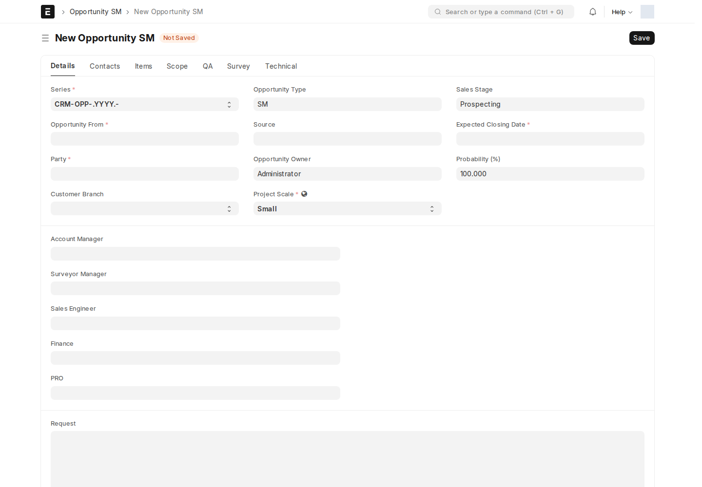

الفرص تجمع طلب العميل ونطاق الخدمة والتأهيل والمسح والتسعير قبل إصدار عرض السعر. توجد خمسة أنواع مستقلة للمسارات الرئيسية:

| DocType | الغرض | مدير الحساب المسؤول |
| --- | --- | --- |
| Opportunity | الربط المؤسسي Dedicated | Dedicated Account Manager |
| Opportunity SM | المشروعات الصغيرة والمتوسطة | SM Account Manager |
| Opportunity Hotels | الفنادق | Hotels Account Manager |
| Opportunity ISP | مزوّدو الإنترنت | ISP Account Manager |
| Opportunity Tenders | المناقصات | Tenders Account Manager |

## من يفعل ماذا؟

**مدير الحساب الخاص بالمسار** يجمع الطلب والمتطلبات، يؤهّل الفرصة، يراجع نتيجة المسح، ويستخدم **Quote** بعد الموافقة. **Sales Engineer** يحدد النطاق. **Surveyor Manager** ينظم المسح وينقله إلى Surveyed بعد إكمال الإجابات، ويُسند التنفيذ إلى المسّاحين.

هذه هي أدوار الانتقالات الفعلية. لا يلزم تعيين أدوار RG/Scope/QA القديمة لتشغيل هذه المسارات. حجم مشروع SM بيانات وصفية؛ لا توجد في السير النشط شروط توجيه منفصلة إلى فرق Small/Medium.

## سير العمل

المسار المشترك يبدأ من **Draft**، ثم:

**Requirements Gathering → Scoping → Qualifying → Surveying → Surveyed → Approved → Accepted**

المناقصات تبدأ **Draft → Scoping → Surveying**، ثم تكمل إلى Surveyed وApproved وAccepted.

راجع [تفاصيل المسارات](/sales-crm/opportunity-streams/) لجداول جميع الانتقالات والأدوار. الرفض متاح من حالات محددة فقط. في الفنادق، **Reject من Surveyed يعيد إلى Surveying** لإعادة المسح. وفي Dedicated وISP يوجد **Convert to S&M** من Scoping.

## خطوات المستخدم

1. أنشئ النوع الموافق لقطاع العميل، وحدد الطرف والشركة والمسؤولين والبيانات المطلوبة.
2. أدخل الطلب والمتطلبات، ثم يتولى مهندس المبيعات وصف النطاق والمخرجات.
3. بعد التأهيل، عيّن مدير المسح والمسّاحين والقوالب. أكمل جميع إجابات المسح قبل Surveyed.
4. يراجع مدير الحساب الأصناف والأسعار ونتيجة المسح ثم يعتمد تجارياً.
5. استخدم **Quote** من Approved. يجب وجود صنف واحد على الأقل.

عند انتقال الفرصة إلى **Accepted** ينشئ التطبيق **Quotation مسودة**، أو يستخدم عرضاً موجوداً غير ملغى بدلاً من تكراره. قبول الفرصة لا يعني اعتماد عرض السعر أو إنشاء فاتورة.

:::note[تأثير السكربتات أثناء الحفظ]
في SM والفنادق، تحاول السكربتات التقدم من جمع المتطلبات إلى Scoping ومنه إلى Qualifying عند تعبئة الحقول المعنية. وفي المناقصات تحاول التقدم إلى Surveying عند وجود وصف النطاق وفريق CXO وقائده. تبقى تحققات السير على الخادم مؤثرة؛ راجع الحالة بعد الحفظ ولا تغيّر workflow_state يدوياً.
:::

## لماذا قد لا تظهر فرصة أو إجراء؟

بالإضافة إلى حقوق DocType، يرى مدير الحساب سجلاته أو السجلات غير المسندة إلى مدير حساب. يرى مهندس المبيعات ومدير المسح السجلات المسندة إليهما. وفي Opportunity الأساسي، يُقيّد دور Surveyor أيضاً بعضوية جدول المسّاحين. عند اجتماع أكثر من دور مقيّد، تتجمع النطاقات المسموح بها.

System Manager وCommercial Department Manager مستثنيان من مرشح الرؤية المخصص، لكن ذلك لا يغني عن حقوق DocType المناسبة. لا تستخدم صورة حساب Administrator لإثبات صلاحية مستخدم عادي.

## سجلّ التدقيق (Audit Log)

يسجّل التطبيق تغييرات الحالة والمخرجات وإنشاء عرض السعر داخل الفرصة. راجع اسم المنفذ والتوقيت والحالة، ثم افتح المستند الناتج للتحقق من اكتماله.

## الإشعارات

قواعد الإشعار تتبع الحالة والمستلمين المحددين في كل مسار؛ ليست رسالة إلى كل أعضاء الدور تلقائياً. توجد كذلك رسالة للمسّاح عند **إضافة صف تعيين جديد**، وليس فقط عند اكتمال المسح.

راجع جدول الإشعارات تحت كل مسار، مع الانتباه إلى [تعطيل الإرسال الفعلي بالبريد في موقع الاختبار](/users/active-scripts/).
