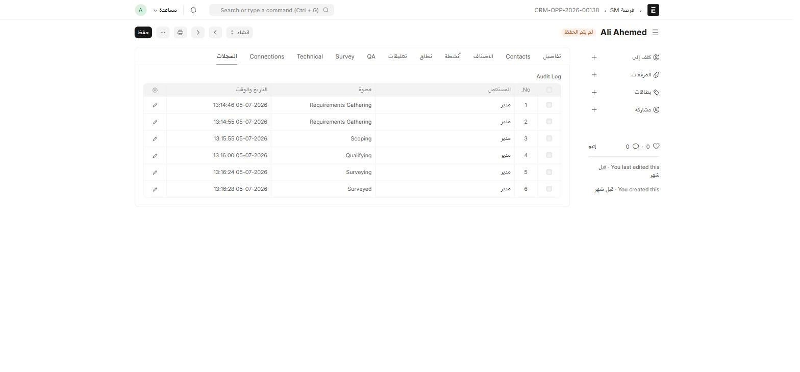
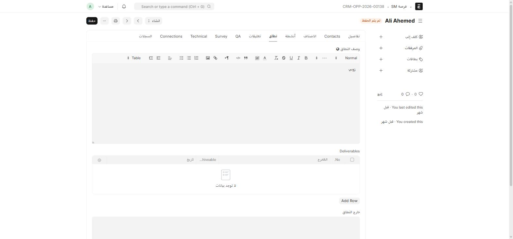

في هذا النظام، **الفرصة (Opportunity) ليست نوع مستند واحداً**، بل **خمسة أنواع مستندات منفصلة**، كل واحد يمثّل مسار بيع مختلفاً بفريق أدوار مختلف:

| نوع المستند | مسار البيع |
| --- | --- |
| **فرصة** (Opportunity) | Dedicated — عملاء الربط المؤسسي المخصّص |
| **SM فرصة** (Opportunity SM) | Small & Medium — مشاريع صغيرة/متوسطة |
| **فرصة فنادق** (Opportunity Hotels) | قطاع الفنادق |
| **فرصة ISP** (Opportunity ISP) | مزوّدي خدمة الإنترنت |
| **فرصة مناقصات** (Opportunity Tenders) | فرص تُطرح كمناقصة رسمية (RFP) |

بالإضافة إلى **Hotspot**، وهو مسار تشغيلي منفصل (تركيب وصيانة شبكات هوت-سبوت) وليس أحد أنواع الفرص — راجع [الهوت-سبوت](/sales-crm/hotspot/).

كل الأنواع الخمسة تشترك في نفس سلسلة الترقيم `CRM-OPP-.YYYY.-` وفي نفس الطريقة العامة: **لا اعتماد (Submit)**، بل **سير عمل بالأدوار (Workflow)** ينقل المستند من حالة إلى أخرى.

## أين أجدها؟

اكتب في شريط البحث اسم النوع بالضبط (`فرصة`، `SM فرصة`، `فرصة فنادق`، `فرصة ISP`، `فرصة مناقصات`) أو أنشئها من داخل **إدارة علاقات الزبائن**.


## سير العمل: من الفكرة إلى القبول

جميع الأنواع الخمسة تمر بتسلسل حالات متشابه، لكن بأسماء أدوار مختلفة لكل مسار. النمط العام:

```
جمع المتطلبات (Requirements Gathering)
        ↓
تحديد النطاق (Scoping)
        ↓
التأهيل (Qualifying)
        ↓
المسح الفني (Surveying)
        ↓
تم المسح (Surveyed)
        ↓
الموافقة (Approved)
        ↓
القبول (Accepted) ← ينشئ عرض أسعار تلقائياً
```

مع نقاط **رفض** (Rejected) ممكنة عند أي مرحلة تقنية أو تجارية، تُعيد الفرصة لحالة `مرفوض` وتضع الحالة العامة (Status) على `Lost`.

:::note[الفروق الحقيقية بين المسارات]
- **مناقصات (Tenders)**: يتخطّى مرحلتي جمع المتطلبات والتأهيل — يبدأ مباشرة من تحديد النطاق، لأن المتطلبات موجودة في وثيقة RFP المرفقة.
- **SM**: يتفرّع حسب **حجم المشروع** (صغير/متوسط) — كل حجم له فريق تحديد نطاق وتأهيل مختلف.
- **ISP** و**فنادق** و**Dedicated**: نفس التسلسل تقريباً، بأدوار مختلفة لكل قطاع.
:::

## الأدوار المسؤولة عن كل مسار

نمط تسمية الأدوار: **`<المسار> RG`** (جمع متطلبات) · **`<المسار> Scope`** (تحديد نطاق) · **`<المسار> QA`** (تأهيل) · **`<المسار> Surveyor`** (مسح فني) · **`<المسار> Sales`** (مبيعات) · **`<المسار> TA`** (حساب فني/تقني).

مثال: مسار **Dedicated** يستخدم الأدوار `Dedicated RG`، `Dedicated Scope`، `Dedicated QA`، `Dedicated Surveyor`، `Dedicated Sales`، `Dedicated TA`. مسار **SM** يستخدم أدواراً مطابقة مع بادئة `S&M` (وتتفرّع أيضاً إلى `S&M Scope Small`/`S&M Scope Medium` و`S&M QA Small`/`S&M QA Medium` حسب حجم المشروع). راجع [نظرة عامة على المسارات الخمسة](/sales-crm/opportunity-streams/) لجدول كامل بكل حقول كل مسار.

:::caution[لماذا لا أرى زر انتقال معيّن؟]
تماماً كما في [طلب المواد](/buying/material-request/)، الانتقالات المتاحة في زر **الإجراءات** تعتمد على **دورك الحالي**. إذا كان الانتقال التالي يتطلّب دور `Dedicated Surveyor` ولا تملكه، فلن يظهر لك.
:::

## سجلّ التدقيق (Audit Log)

كل فرصة تحتفظ بتبويب **السجلات** (Audit Log) — سجلّ كامل بكل انتقال حالة، من نفّذه، ومتى:



:::note[إشعارات المسح الفني]
عند اكتمال قسم المسح الفني على أي فرصة، يُرسل النظام إشعاراً تلقائياً للمسؤولين المعنيين. لا حاجة لإخبارهم يدوياً بأن المسح جاهز للمراجعة.
:::

## من القبول إلى عرض السعر

عند وصول الفرصة لحالة **القبول (Accepted)**، ينشئ النظام **عرض سعر (Quotation)** تلقائياً — بشرط وجود **صنف واحد على الأقل** في جدول الأصناف. إذا رُفضت الفرصة بدلاً من ذلك، تتحوّل **الحالة العامة (Status)** إلى `Lost` تلقائياً.

راجع [سلسلة مستندات البيع](/sales-crm/sales-document-chain/) لما يحدث بعد ذلك — من عرض السعر إلى فاتورة المبيعات.

## نطاق العمل والمُسلَّمات

تبويب **نطاق** (Scope) في كل فرصة يحتوي جدول **Deliverables** — قائمة بما يجب تسليمه للعميل، وحالة كل بند (منجَز أم لا) وتاريخه:



استخدم هذا الجدول لتتبّع تنفيذ الاتفاق بعد قبول الفرصة، لا لتحديد نطاقها فقط وقت البيع.
