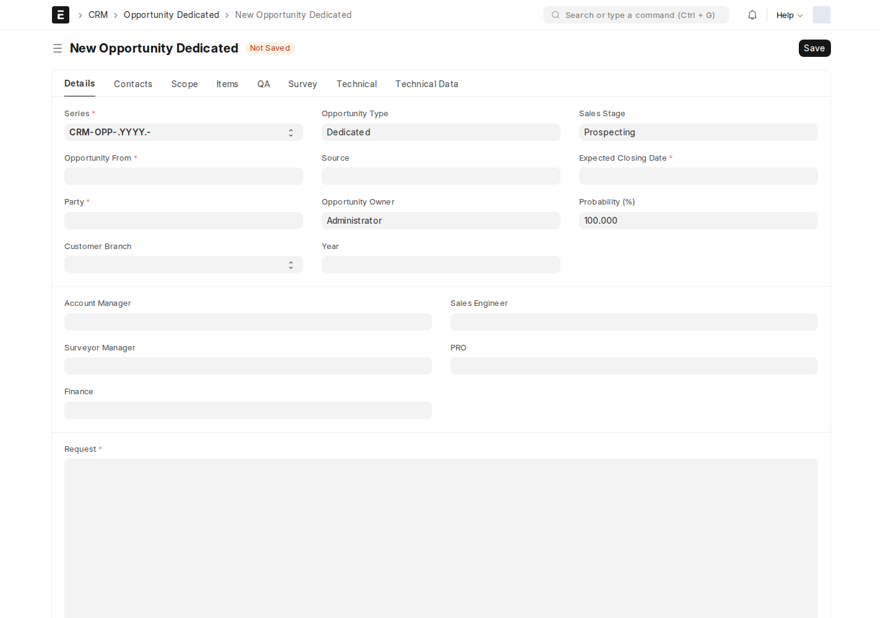
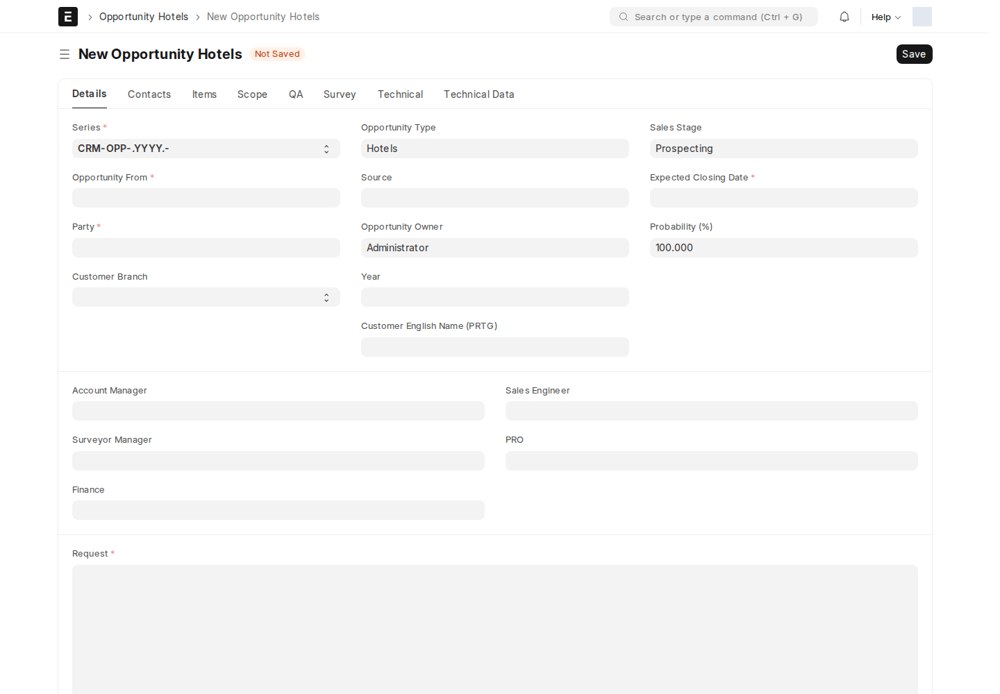
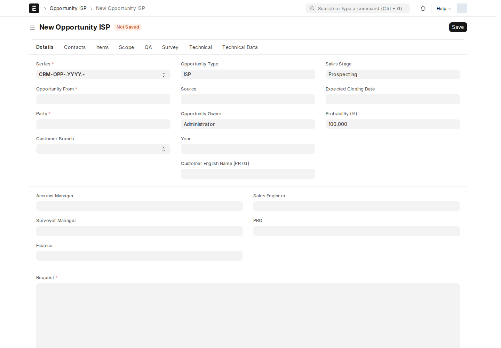
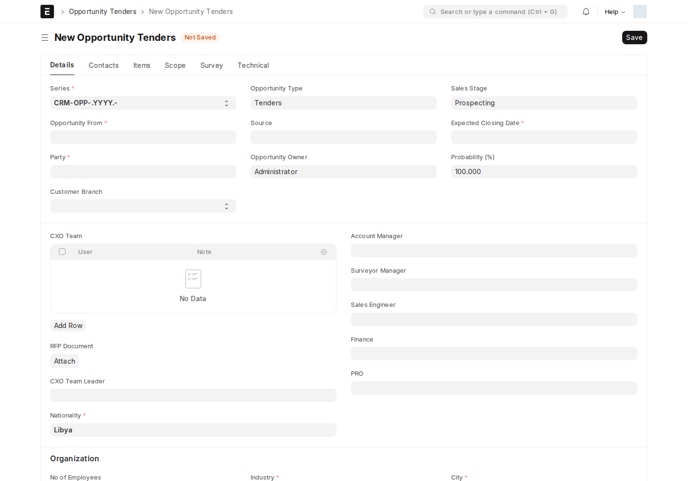

ابدأ من [نظرة عامة على الفرص](/sales-crm/opportunities-overview/). الجداول أدناه تنقل مسارات الموافقة الفعّالة من الموقع؛ أدوار المراجعة تختلف عن صلاحيات رؤية كل حقل.

## Dedicated — Opportunity

يوثق احتياج عميل الربط المؤسسي. مدير الحساب **Dedicated Account Manager** مسؤول عن المتطلبات والتأهيل والموافقة التجارية، و**Sales Engineer** عن النطاق، و**Surveyor Manager** عن إنجاز المسح.

ابدأ ببيانات الطرف والشركة والمستخدمين المسؤولين، ثم الطلب والمتطلبات والنطاق والأصناف. من **Scoping** يمكن استخدام **Convert to S&M** إذا كان المسار الأنسب للفرصة هو المشاريع الصغيرة والمتوسطة؛ راجع السجل الناتج وروابطه قبل المتابعة.

## SM — Opportunity SM

يوثق احتياج مشروع صغير أو متوسط. المسؤول التجاري هو **SM Account Manager**، وتحديد النطاق لـ **Sales Engineer**، وإتمام المسح لـ **Surveyor Manager**. **Project Size** لا يغير أدوار الانتقالات في السير الحالي.

قد يغير Client Script الحالة عند حفظ المتطلبات أو وصف النطاق والمخرجات؛ راجع الحالة الفعلية بعد الحفظ.

## الفنادق — Opportunity Hotels

مسار خدمة الفنادق، ومسؤوله التجاري **Hotels Account Manager** مع **Sales Engineer** و**Surveyor Manager**.

الفرق العملي: رفض نتيجة **Surveyed** يعيدها إلى **Surveying** لإعادة المسح؛ لا يضعها تلقائياً في الحالة النهائية Rejected.

## ISP — Opportunity ISP

يوثق الفرص الخاصة بمزوّدي الإنترنت، تحت مسؤولية **ISP Account Manager**. تحديد النطاق والمسح يستخدمان Sales Engineer وSurveyor Manager، ويوجد تحويل إلى S&M من Scoping.

## المناقصات — Opportunity Tenders

يوثق عرضاً مبنياً على مناقصة، ومسؤوله التجاري **Tenders Account Manager**. يبدأ من Draft ثم **Start Scoping**؛ لا يمر بجمع المتطلبات والتأهيل كمرحلتين مستقلتين.

أرفق وثيقة **RFP Document**، وراجع وصف النطاق وفريق **CXO** وقائده عند استخدام هذه الحقول. السكربت النشط يحاول الانتقال إلى Surveying عند استكمال وصف النطاق وفريق CXO وقائده؛ هذا لا يحوّل أعضاء CXO إلى أدوار اعتماد في Workflow.

## قراءة جداول الصلاحيات والإشعارات

كل نوع أدناه له جدول مستقل. وجود اسم دور في نموذج أو قائمة قديمة لا يعني أنه صاحب الانتقال. إشعارات الحالة تذهب إلى المستخدمين المسجلين في حقول المستند أو الدور المحدد في قاعدة Notification؛ و[البريد في موقع الاختبار لا يثبت التسليم](/users/active-scripts/).

<!-- BEGIN VERIFIED SITE REFERENCE -->

## مرجع الأدوار وسير العمل والإشعارات

تمت المراجعة من إعدادات **testsite.local — 12 سبتمبر 2026**. مستوى 0 هو الحقوق الأساسية؛ المستويات الأعلى تخص مجموعات حقول محددة. علامة — تعني أن صف الدور لا يمنح الحق. لا تجمع الصور كل أدوار المستخدمين؛ الصور التقطت بحساب الإدارة.

**تنبيه البريد:** [سكربت موقع الاختبار يضع البريد في Sent دون إرساله](/users/active-scripts/). تابع المستند والتنبيهات المتاحة داخل النظام.

### Opportunity

**الدور:** إدارة فرصة الربط المؤسسي Dedicated حتى عرض السعر.

**صلاحيات الأدوار الفعلية** (تظل قيود السجلات والحالة والشروط سارية):

| الدور/الأدوار | مستوى الحقول | قراءة | إنشاء | تعديل | اعتماد | إلغاء | القيد |
| --- | --- | --- | --- | --- | --- | --- | --- |
| System Manager، Dedicated Account Manager | 0 | نعم | نعم | نعم | — | — | بحسب النطاق المسموح |
| System Manager، Dedicated Account Manager، Sales Engineer | 1 | نعم | — | نعم | — | — | بحسب النطاق المسموح |
| System Manager، Dedicated Account Manager، Surveyor Manager | 2 | نعم | — | نعم | — | — | بحسب النطاق المسموح |
| System Manager، Dedicated Account Manager، Surveyor | 3 | نعم | — | نعم | — | — | بحسب النطاق المسموح |
| Surveyor Manager، Surveyor | 1 | نعم | — | — | — | — | بحسب النطاق المسموح |
| Surveyor Manager، Sales Engineer | 3 | نعم | — | — | — | — | بحسب النطاق المسموح |
| Sales Engineer، Surveyor | 2 | نعم | — | — | — | — | بحسب النطاق المسموح |
| Surveyor Manager، Sales Engineer، Surveyor | 0 | نعم | — | نعم | — | — | بحسب النطاق المسموح |
| System Manager، Dedicated Account Manager | 4 | نعم | — | نعم | — | — | بحسب النطاق المسموح |
| Surveyor Manager، Sales Engineer، Surveyor | 4 | نعم | — | — | — | — | بحسب النطاق المسموح |
| Hotels Account Manager، SM Account Manager، ISP Account Manager، Tenders Account Manager | 0 | نعم | — | — | — | — | بحسب النطاق المسموح |

**سير العمل النشط:** `Dedicated`. استخدم قائمة الإجراءات؛ لا تعدل حقل الحالة يدوياً. دور الانتقال لا يمنح حقوق القراءة/الكتابة/الاعتماد الناقصة.

| من الحالة | الإجراء | إلى الحالة | الدور المنفّذ | الشرط | حالة المستند بعده |
| --- | --- | --- | --- | --- | --- |
| Draft | Requirement | Requirements Gathering | Dedicated Account Manager | لا شرط إضافي في الانتقال | مسودة (0) |
| Draft | Reject | Rejected | Dedicated Account Manager | لا شرط إضافي في الانتقال | مسودة (0) |
| Requirements Gathering | Gather | Scoping | Dedicated Account Manager | لا شرط إضافي في الانتقال | مسودة (0) |
| Scoping | Convert to S&M | Converted | Sales Engineer | لا شرط إضافي في الانتقال | مسودة (0) |
| Scoping | Scope | Qualifying | Sales Engineer | لا شرط إضافي في الانتقال | مسودة (0) |
| Qualifying | Qualify | Surveying | Dedicated Account Manager | لا شرط إضافي في الانتقال | مسودة (0) |
| Qualifying | Reject | Rejected | Dedicated Account Manager | لا شرط إضافي في الانتقال | مسودة (0) |
| Surveying | Survey | Surveyed | Surveyor Manager | لا شرط إضافي في الانتقال | مسودة (0) |
| Surveyed | Approve | Approved | Dedicated Account Manager | لا شرط إضافي في الانتقال | مسودة (0) |
| Surveyed | Reject | Rejected | Dedicated Account Manager | لا شرط إضافي في الانتقال | مسودة (0) |
| Approved | Quote | Accepted | Dedicated Account Manager | لا شرط إضافي في الانتقال | مسودة (0) |

من يحرر المستند في كل حالة؟

الدور أدناه هو Allow Edit في إعداد الحالة، ويضاف إلى حقوق الحقول ونطاق السجل.

| الحالة | دور تحرير الحالة | حالة المستند |
| --- | --- | --- |
| Draft | Dedicated Account Manager | مسودة (0) |
| Requirements Gathering | Dedicated Account Manager | مسودة (0) |
| Scoping | Sales Engineer | مسودة (0) |
| Converted | Dedicated Account Manager | مسودة (0) |
| Surveying | Surveyor Manager | مسودة (0) |
| Surveyed | Dedicated Account Manager | مسودة (0) |
| Qualifying | Dedicated Account Manager | مسودة (0) |
| Approved | Dedicated Account Manager | مسودة (0) |
| Accepted | Dedicated Account Manager | مسودة (0) |
| Rejected | Dedicated Account Manager | مسودة (0) |

بريد Workflow القياسي **غير مفعّل** لهذا السير. يمكن أن تعمل قواعد Notification ومعالجات التطبيق بشكل مستقل عنه.

**قواعد الإشعارات المفعّلة:** البريد يخضع لقيد الإرسال التجريبي المذكور أعلاه؛ تنبيه الجرس مبين منفصلاً.

| القاعدة | متى؟ | الشرط/حدود الاستخدام | المستلم | القناة |
| --- | --- | --- | --- | --- |
| Dedicated Opportunity Scoping | تغير Workflow State | Workflow State = Scoping | منشئ المستند؛ Opportunity Owner؛ Sales Engineer | Email + جرس النظام |
| Opportunity Accepted | تغير Workflow State | Workflow State = Accepted | منشئ المستند؛ Opportunity Owner | Email + جرس النظام |
| Approved Opportunity | تغير Workflow State | Workflow State = Approved | منشئ المستند؛ Opportunity Owner | Email + جرس النظام |
| Surveyed Opportunity | تغير Workflow State | Workflow State = Surveyed | منشئ المستند؛ Opportunity Owner | Email + جرس النظام |
| Survey Opportunity | تغير Workflow State | Workflow State = Surveying | منشئ المستند؛ Opportunity Owner | Email + جرس النظام |
| Qualify Opportunity | تغير Workflow State | Workflow State = Qualifying | منشئ المستند؛ Opportunity Owner | Email + جرس النظام |

### Opportunity SM

**الدور:** إدارة فرصة المشاريع الصغيرة والمتوسطة.

**صلاحيات الأدوار الفعلية** (تظل قيود السجلات والحالة والشروط سارية):

| الدور/الأدوار | مستوى الحقول | قراءة | إنشاء | تعديل | اعتماد | إلغاء | القيد |
| --- | --- | --- | --- | --- | --- | --- | --- |
| Sales Manager، SM Account Manager | 0 | نعم | نعم | نعم | — | — | بحسب النطاق المسموح |
| Surveyor، Sales Engineer، Surveyor Manager | 0 | نعم | — | نعم | — | — | بحسب النطاق المسموح |
| Sales Engineer، System Manager، SM Account Manager، Sales Manager، Surveyor | 1 | نعم | — | نعم | — | — | بحسب النطاق المسموح |
| Surveyor Manager، System Manager، SM Account Manager، Sales Manager، Surveyor | 2 | نعم | — | نعم | — | — | بحسب النطاق المسموح |
| System Manager، SM Account Manager، Sales Manager، Surveyor | 3 | نعم | — | نعم | — | — | بحسب النطاق المسموح |
| System Manager، SM Account Manager، Sales Manager، Surveyor | 4 | نعم | — | نعم | — | — | بحسب النطاق المسموح |
| Sales Engineer | 2 | نعم | — | — | — | — | بحسب النطاق المسموح |
| Sales Engineer، Surveyor Manager | 3 | نعم | — | — | — | — | بحسب النطاق المسموح |
| Sales Engineer، Surveyor Manager | 4 | نعم | — | — | — | — | بحسب النطاق المسموح |
| Surveyor Manager | 1 | نعم | — | — | — | — | بحسب النطاق المسموح |

**سير العمل النشط:** `SM`. استخدم قائمة الإجراءات؛ لا تعدل حقل الحالة يدوياً. دور الانتقال لا يمنح حقوق القراءة/الكتابة/الاعتماد الناقصة.

| من الحالة | الإجراء | إلى الحالة | الدور المنفّذ | الشرط | حالة المستند بعده |
| --- | --- | --- | --- | --- | --- |
| Draft | Requirement | Requirements Gathering | SM Account Manager | لا شرط إضافي في الانتقال | مسودة (0) |
| Draft | Reject | Rejected | SM Account Manager | لا شرط إضافي في الانتقال | مسودة (0) |
| Requirements Gathering | Gather | Scoping | SM Account Manager | لا شرط إضافي في الانتقال | مسودة (0) |
| Scoping | Scope | Qualifying | Sales Engineer | لا شرط إضافي في الانتقال | مسودة (0) |
| Qualifying | Qualify | Surveying | SM Account Manager | لا شرط إضافي في الانتقال | مسودة (0) |
| Qualifying | Reject | Rejected | SM Account Manager | لا شرط إضافي في الانتقال | مسودة (0) |
| Surveying | Survey | Surveyed | Surveyor Manager | لا شرط إضافي في الانتقال | مسودة (0) |
| Surveyed | Approve | Approved | SM Account Manager | لا شرط إضافي في الانتقال | مسودة (0) |
| Surveyed | Reject | Rejected | SM Account Manager | لا شرط إضافي في الانتقال | مسودة (0) |
| Approved | Quote | Accepted | SM Account Manager | لا شرط إضافي في الانتقال | مسودة (0) |

من يحرر المستند في كل حالة؟

الدور أدناه هو Allow Edit في إعداد الحالة، ويضاف إلى حقوق الحقول ونطاق السجل.

| الحالة | دور تحرير الحالة | حالة المستند |
| --- | --- | --- |
| Draft | SM Account Manager | مسودة (0) |
| Requirements Gathering | SM Account Manager | مسودة (0) |
| Scoping | Sales Engineer | مسودة (0) |
| Surveying | Surveyor Manager | مسودة (0) |
| Approved | SM Account Manager | مسودة (0) |
| Qualifying | SM Account Manager | مسودة (0) |
| Accepted | SM Account Manager | مسودة (0) |
| Rejected | SM Account Manager | مسودة (0) |
| Surveyed | SM Account Manager | مسودة (0) |
| Scoping | Sales Engineer | مسودة (0) |
| Qualifying | SM Account Manager | مسودة (0) |

بريد Workflow القياسي **غير مفعّل** لهذا السير. يمكن أن تعمل قواعد Notification ومعالجات التطبيق بشكل مستقل عنه.

**قواعد الإشعارات المفعّلة:** البريد يخضع لقيد الإرسال التجريبي المذكور أعلاه؛ تنبيه الجرس مبين منفصلاً.

| القاعدة | متى؟ | الشرط/حدود الاستخدام | المستلم | القناة |
| --- | --- | --- | --- | --- |
| Opportunity SM Accepted | تغير Workflow State | Workflow State = Accepted | منشئ المستند؛ Opportunity Owner | Email + جرس النظام |
| Opportunity SM Approved | تغير Workflow State | Workflow State = Approved | منشئ المستند؛ Opportunity Owner | Email + جرس النظام |
| Opportunity SM Surveyed | تغير Workflow State | Workflow State = Surveyed | منشئ المستند؛ Opportunity Owner | Email + جرس النظام |
| Opportunity SM Surveying | تغير Workflow State | Workflow State = Surveying | منشئ المستند؛ Opportunity Owner | Email + جرس النظام |
| Opportunity SM Qualifying | تغير Workflow State | Workflow State = Qualifying | منشئ المستند؛ Opportunity Owner | Email + جرس النظام |
| Opportunity SM Scoping | تغير Workflow State | Workflow State = Scoping | منشئ المستند؛ Opportunity Owner | Email + جرس النظام |

### Opportunity Hotels

**الدور:** إدارة فرصة خدمة قطاع الفنادق.

**صلاحيات الأدوار الفعلية** (تظل قيود السجلات والحالة والشروط سارية):

| الدور/الأدوار | مستوى الحقول | قراءة | إنشاء | تعديل | اعتماد | إلغاء | القيد |
| --- | --- | --- | --- | --- | --- | --- | --- |
| Sales Manager، Hotels Account Manager | 0 | نعم | نعم | نعم | — | — | بحسب النطاق المسموح |
| Surveyor، Sales Engineer، Surveyor Manager، System Manager | 0 | نعم | — | نعم | — | — | بحسب النطاق المسموح |
| Sales Engineer، System Manager، Hotels Account Manager، Sales Manager، Surveyor | 1 | نعم | — | نعم | — | — | بحسب النطاق المسموح |
| Surveyor Manager، System Manager، Hotels Account Manager، Sales Manager، Surveyor | 2 | نعم | — | نعم | — | — | بحسب النطاق المسموح |
| System Manager، Hotels Account Manager، Sales Manager، Surveyor | 3 | نعم | — | نعم | — | — | بحسب النطاق المسموح |
| System Manager، Hotels Account Manager، Sales Manager، Surveyor | 4 | نعم | — | نعم | — | — | بحسب النطاق المسموح |
| Sales Engineer | 2 | نعم | — | — | — | — | بحسب النطاق المسموح |
| Sales Engineer، Surveyor Manager | 3 | نعم | — | — | — | — | بحسب النطاق المسموح |
| Sales Engineer، Surveyor Manager | 4 | نعم | — | — | — | — | بحسب النطاق المسموح |
| Surveyor Manager | 1 | نعم | — | — | — | — | بحسب النطاق المسموح |

**سير العمل النشط:** `Hotels`. استخدم قائمة الإجراءات؛ لا تعدل حقل الحالة يدوياً. دور الانتقال لا يمنح حقوق القراءة/الكتابة/الاعتماد الناقصة.

| من الحالة | الإجراء | إلى الحالة | الدور المنفّذ | الشرط | حالة المستند بعده |
| --- | --- | --- | --- | --- | --- |
| Draft | Requirement | Requirements Gathering | Hotels Account Manager | لا شرط إضافي في الانتقال | مسودة (0) |
| Draft | Reject | Rejected | Hotels Account Manager | لا شرط إضافي في الانتقال | مسودة (0) |
| Requirements Gathering | Gather | Scoping | Hotels Account Manager | لا شرط إضافي في الانتقال | مسودة (0) |
| Scoping | Scope | Qualifying | Sales Engineer | لا شرط إضافي في الانتقال | مسودة (0) |
| Qualifying | Qualify | Surveying | Hotels Account Manager | لا شرط إضافي في الانتقال | مسودة (0) |
| Qualifying | Reject | Rejected | Hotels Account Manager | لا شرط إضافي في الانتقال | مسودة (0) |
| Surveying | Survey | Surveyed | Surveyor Manager | لا شرط إضافي في الانتقال | مسودة (0) |
| Surveyed | Approve | Approved | Hotels Account Manager | لا شرط إضافي في الانتقال | مسودة (0) |
| Surveyed | Reject | Surveying | Hotels Account Manager | لا شرط إضافي في الانتقال | مسودة (0) |
| Approved | Quote | Accepted | Hotels Account Manager | لا شرط إضافي في الانتقال | مسودة (0) |

من يحرر المستند في كل حالة؟

الدور أدناه هو Allow Edit في إعداد الحالة، ويضاف إلى حقوق الحقول ونطاق السجل.

| الحالة | دور تحرير الحالة | حالة المستند |
| --- | --- | --- |
| Draft | Hotels Account Manager | مسودة (0) |
| Requirements Gathering | Hotels Account Manager | مسودة (0) |
| Surveying | Surveyor Manager | مسودة (0) |
| Approved | Hotels Account Manager | مسودة (0) |
| Qualifying | Hotels Account Manager | مسودة (0) |
| Accepted | Hotels Account Manager | مسودة (0) |
| Rejected | Hotels Account Manager | مسودة (0) |
| Surveyed | Hotels Account Manager | مسودة (0) |
| Scoping | Sales Engineer | مسودة (0) |
| Rejected | Hotels Account Manager | مسودة (0) |

بريد Workflow القياسي **غير مفعّل** لهذا السير. يمكن أن تعمل قواعد Notification ومعالجات التطبيق بشكل مستقل عنه.

**قواعد الإشعارات المفعّلة:** البريد يخضع لقيد الإرسال التجريبي المذكور أعلاه؛ تنبيه الجرس مبين منفصلاً.

| القاعدة | متى؟ | الشرط/حدود الاستخدام | المستلم | القناة |
| --- | --- | --- | --- | --- |
| Opportunity Hotels Approved | تغير Workflow State | Workflow State = Approved | منشئ المستند؛ Opportunity Owner؛ Account Manager | Email + جرس النظام |
| Opportunity Hotels Surveyed | تغير Workflow State | Workflow State = Surveyed | منشئ المستند؛ Opportunity Owner؛ Account Manager | Email + جرس النظام |
| Opportunity Hotels Surveying | تغير Workflow State | Workflow State = Surveying | منشئ المستند؛ Opportunity Owner؛ Account Manager | Email + جرس النظام |
| Opportunity Hotels Qualifying | تغير Workflow State | Workflow State = Qualifying | منشئ المستند؛ Opportunity Owner؛ Account Manager | Email + جرس النظام |
| Opportunity Hotels Accepted | تغير Workflow State | Workflow State = Accepted | منشئ المستند؛ Opportunity Owner؛ Account Manager | Email + جرس النظام |
| New Opportunity Ready for Requirement Gathering | الإنشاء | دون شرط عام إضافي | منشئ المستند؛ Opportunity Owner؛ Account Manager | Email + جرس النظام |
| Opportunity Hotels Scoping | تغير Workflow State | Workflow State = Scoping | منشئ المستند؛ Opportunity Owner؛ Account Manager | Email + جرس النظام |

### Opportunity ISP

**الدور:** إدارة فرصة خدمة مزوّد الإنترنت.

**صلاحيات الأدوار الفعلية** (تظل قيود السجلات والحالة والشروط سارية):

| الدور/الأدوار | مستوى الحقول | قراءة | إنشاء | تعديل | اعتماد | إلغاء | القيد |
| --- | --- | --- | --- | --- | --- | --- | --- |
| System Manager، ISP Account Manager | 0 | نعم | نعم | نعم | — | — | بحسب النطاق المسموح |
| Sales Engineer، Surveyor Manager | 0 | نعم | — | نعم | — | — | بحسب النطاق المسموح |
| System Manager، Sales Engineer، ISP Account Manager | 1 | نعم | — | نعم | — | — | بحسب النطاق المسموح |
| System Manager، Surveyor Manager، ISP Account Manager | 2 | نعم | — | نعم | — | — | بحسب النطاق المسموح |
| System Manager، ISP Account Manager | 3 | نعم | — | نعم | — | — | بحسب النطاق المسموح |
| System Manager، ISP Account Manager | 4 | نعم | — | نعم | — | — | بحسب النطاق المسموح |
| Sales Engineer | 2 | نعم | — | — | — | — | بحسب النطاق المسموح |
| Sales Engineer، Surveyor Manager | 3 | نعم | — | — | — | — | بحسب النطاق المسموح |
| Sales Engineer، Surveyor Manager | 4 | نعم | — | — | — | — | بحسب النطاق المسموح |
| Surveyor Manager | 1 | نعم | — | — | — | — | بحسب النطاق المسموح |

**سير العمل النشط:** `ISP Opportunity Fixed`. استخدم قائمة الإجراءات؛ لا تعدل حقل الحالة يدوياً. دور الانتقال لا يمنح حقوق القراءة/الكتابة/الاعتماد الناقصة.

| من الحالة | الإجراء | إلى الحالة | الدور المنفّذ | الشرط | حالة المستند بعده |
| --- | --- | --- | --- | --- | --- |
| Draft | Requirement | Requirements Gathering | ISP Account Manager | لا شرط إضافي في الانتقال | مسودة (0) |
| Draft | Reject | Rejected | ISP Account Manager | لا شرط إضافي في الانتقال | مسودة (0) |
| Requirements Gathering | Gather | Scoping | ISP Account Manager | لا شرط إضافي في الانتقال | مسودة (0) |
| Scoping | Convert to S&M | Converted | Sales Engineer | لا شرط إضافي في الانتقال | مسودة (0) |
| Scoping | Scope | Qualifying | Sales Engineer | لا شرط إضافي في الانتقال | مسودة (0) |
| Qualifying | Qualify | Surveying | ISP Account Manager | لا شرط إضافي في الانتقال | مسودة (0) |
| Qualifying | Reject | Rejected | ISP Account Manager | لا شرط إضافي في الانتقال | مسودة (0) |
| Surveying | Survey | Surveyed | Surveyor Manager | لا شرط إضافي في الانتقال | مسودة (0) |
| Surveyed | Approve | Approved | ISP Account Manager | لا شرط إضافي في الانتقال | مسودة (0) |
| Surveyed | Reject | Rejected | ISP Account Manager | لا شرط إضافي في الانتقال | مسودة (0) |
| Approved | Quote | Accepted | ISP Account Manager | لا شرط إضافي في الانتقال | مسودة (0) |

من يحرر المستند في كل حالة؟

الدور أدناه هو Allow Edit في إعداد الحالة، ويضاف إلى حقوق الحقول ونطاق السجل.

| الحالة | دور تحرير الحالة | حالة المستند |
| --- | --- | --- |
| Draft | ISP Account Manager | مسودة (0) |
| Requirements Gathering | ISP Account Manager | مسودة (0) |
| Scoping | Sales Engineer | مسودة (0) |
| Converted | ISP Account Manager | مسودة (0) |
| Surveying | Surveyor Manager | مسودة (0) |
| Surveyed | ISP Account Manager | مسودة (0) |
| Qualifying | ISP Account Manager | مسودة (0) |
| Approved | ISP Account Manager | مسودة (0) |
| Accepted | ISP Account Manager | مسودة (0) |
| Rejected | ISP Account Manager | مسودة (0) |

بريد Workflow القياسي **غير مفعّل** لهذا السير. يمكن أن تعمل قواعد Notification ومعالجات التطبيق بشكل مستقل عنه.

**قواعد الإشعارات المفعّلة:** البريد يخضع لقيد الإرسال التجريبي المذكور أعلاه؛ تنبيه الجرس مبين منفصلاً.

| القاعدة | متى؟ | الشرط/حدود الاستخدام | المستلم | القناة |
| --- | --- | --- | --- | --- |
| Opportunity ISP Accepted | تغير Workflow State | Workflow State = Accepted | منشئ المستند؛ Opportunity Owner | Email + جرس النظام |
| Opportunity ISP Approved | تغير Workflow State | Workflow State = Approved | منشئ المستند؛ Opportunity Owner | Email + جرس النظام |
| Opportunity ISP Surveyed | تغير Workflow State | Workflow State = Surveyed | منشئ المستند؛ Opportunity Owner | Email + جرس النظام |
| Opportunity ISP Surveying | تغير Workflow State | Workflow State = Surveying | منشئ المستند؛ Opportunity Owner | Email + جرس النظام |
| Opportunity ISP Qualifying | تغير Workflow State | Workflow State = Qualifying | منشئ المستند؛ Opportunity Owner | Email + جرس النظام |
| Opportunity ISP Scoping | تغير Workflow State | Workflow State = Scoping | منشئ المستند؛ Opportunity Owner | Email + جرس النظام |

### Opportunity Tenders

**الدور:** إدارة فرصة مناقصة ونطاقها ومسحها وعرضها.

**صلاحيات الأدوار الفعلية** (تظل قيود السجلات والحالة والشروط سارية):

| الدور/الأدوار | مستوى الحقول | قراءة | إنشاء | تعديل | اعتماد | إلغاء | القيد |
| --- | --- | --- | --- | --- | --- | --- | --- |
| Sales Manager، Tenders Account Manager | 0 | نعم | نعم | نعم | — | — | بحسب النطاق المسموح |
| Surveyor، Sales Engineer، Surveyor Manager، System Manager | 0 | نعم | — | نعم | — | — | بحسب النطاق المسموح |
| Sales Engineer، System Manager، Tenders Account Manager، Sales Manager، Surveyor | 1 | نعم | — | نعم | — | — | بحسب النطاق المسموح |
| Surveyor Manager، System Manager، Tenders Account Manager، Sales Manager، Surveyor | 2 | نعم | — | نعم | — | — | بحسب النطاق المسموح |
| System Manager، Tenders Account Manager، Sales Manager، Surveyor | 3 | نعم | — | نعم | — | — | بحسب النطاق المسموح |
| System Manager، Tenders Account Manager، Sales Manager، Surveyor | 4 | نعم | — | نعم | — | — | بحسب النطاق المسموح |
| Sales Engineer | 2 | نعم | — | — | — | — | بحسب النطاق المسموح |
| Sales Engineer، Surveyor Manager | 3 | نعم | — | — | — | — | بحسب النطاق المسموح |
| Sales Engineer، Surveyor Manager | 4 | نعم | — | — | — | — | بحسب النطاق المسموح |
| Surveyor Manager | 1 | نعم | — | — | — | — | بحسب النطاق المسموح |

**سير العمل النشط:** `Tenders`. استخدم قائمة الإجراءات؛ لا تعدل حقل الحالة يدوياً. دور الانتقال لا يمنح حقوق القراءة/الكتابة/الاعتماد الناقصة.

| من الحالة | الإجراء | إلى الحالة | الدور المنفّذ | الشرط | حالة المستند بعده |
| --- | --- | --- | --- | --- | --- |
| Draft | Start Scoping | Scoping | Tenders Account Manager | لا شرط إضافي في الانتقال | مسودة (0) |
| Draft | Reject | Rejected | Tenders Account Manager | لا شرط إضافي في الانتقال | مسودة (0) |
| Scoping | Scope | Surveying | Sales Engineer | لا شرط إضافي في الانتقال | مسودة (0) |
| Surveying | Survey | Surveyed | Surveyor Manager | لا شرط إضافي في الانتقال | مسودة (0) |
| Surveyed | Approve | Approved | Tenders Account Manager | لا شرط إضافي في الانتقال | مسودة (0) |
| Surveyed | Reject | Rejected | Tenders Account Manager | لا شرط إضافي في الانتقال | مسودة (0) |
| Approved | Quote | Accepted | Tenders Account Manager | لا شرط إضافي في الانتقال | مسودة (0) |

من يحرر المستند في كل حالة؟

الدور أدناه هو Allow Edit في إعداد الحالة، ويضاف إلى حقوق الحقول ونطاق السجل.

| الحالة | دور تحرير الحالة | حالة المستند |
| --- | --- | --- |
| Draft | Tenders Account Manager | مسودة (0) |
| Rejected | Tenders Account Manager | مسودة (0) |
| Scoping | Sales Engineer | مسودة (0) |
| Surveying | Surveyor Manager | مسودة (0) |
| Surveyed | Tenders Account Manager | مسودة (0) |
| Approved | Tenders Account Manager | مسودة (0) |
| Accepted | Tenders Account Manager | مسودة (0) |

بريد Workflow القياسي **غير مفعّل** لهذا السير. يمكن أن تعمل قواعد Notification ومعالجات التطبيق بشكل مستقل عنه.

**قواعد الإشعارات المفعّلة:** البريد يخضع لقيد الإرسال التجريبي المذكور أعلاه؛ تنبيه الجرس مبين منفصلاً.

| القاعدة | متى؟ | الشرط/حدود الاستخدام | المستلم | القناة |
| --- | --- | --- | --- | --- |
| Opportunity Tenders Scoping | تغير Workflow State | Workflow State = Scoping | منشئ المستند؛ Opportunity Owner؛ Account Manager | Email + جرس النظام |
| Opportunity Tenders Accepted | تغير Workflow State | Workflow State = Accepted | منشئ المستند؛ Opportunity Owner؛ Account Manager | Email + جرس النظام |
| Opportunity Tenders Approved | تغير Workflow State | Workflow State = Approved | منشئ المستند؛ Opportunity Owner؛ Account Manager | Email + جرس النظام |
| Opportunity Tenders Surveyed | تغير Workflow State | Workflow State = Surveyed | منشئ المستند؛ Opportunity Owner؛ Account Manager | Email + جرس النظام |
| Opportunity Tenders Surveying | تغير Workflow State | Workflow State = Surveying | منشئ المستند؛ Opportunity Owner؛ Account Manager | Email + جرس النظام |

<!-- END VERIFIED SITE REFERENCE -->
