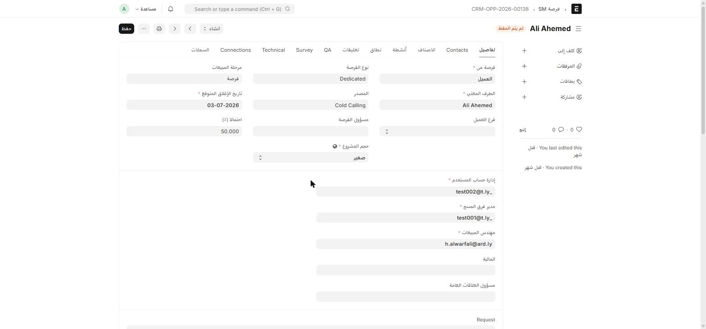

هذه الصفحة مرجع تفصيلي لكل مسار من مسارات الفرص الخمسة. راجع [نظرة عامة على الفرص](/sales-crm/opportunities-overview/) أولاً لفهم الفكرة العامة.

جميع المسارات تشترك في حقول أساسية: **الطرف المعني** (عبر رابط ديناميكي)، **الشركة**، **تاريخ الفرصة**، **تاريخ الإغلاق المتوقع المتوقع**، **الصناعة**، **قطاع السوق**، **المدينة**، **المنطقة**، **الأصناف**، **الإجمالي**، بالإضافة إلى سجلّ **Audit Log** لكل انتقال حالة.

## Dedicated (فرصة)

مسار **الربط المؤسسي المخصّص** — النوع الأساسي `Opportunity`.

| الحقل | إجباري | ملاحظة |
| --- | :---: | --- |
| **Request** | ✅ | طلب العميل الأصلي |
| **Surveyor Manager** | ✅ | مدير فريق المسح المسؤول |
| **المنطقة** (Territory) | ✅ | |
| السرعة/Mbps، Public IP، VLAN، SSID، اسم المستخدم/كلمة المرور | — | بيانات فنية للربط |
| تواريخ العقد (بداية/نهاية) | — | |

الأدوار: `Dedicated RG` · `Dedicated Scope` · `Dedicated QA` · `Dedicated Surveyor` · `Dedicated Sales` · `Dedicated TA` · `Sales Manager`.

## SM — مشاريع صغيرة ومتوسطة (SM فرصة)

مسار المشاريع الأصغر حجماً، يتفرّع حسب **حجم المشروع**:

| الحقل | إجباري | ملاحظة |
| --- | :---: | --- |
| **حجم المشروع** (Project Size) | ✅ | **صغير** أو **متوسط** — يحدّد أي فريق Scope/QA يعالج الفرصة |
| Request، Scope، Deliverables | — | |

الأدوار: `SM Account Manager` · `Sales Engineer` · `Surveyor Manager`، بالإضافة إلى فِرَق منفصلة لكل حجم: `S&M Scope Small` / `S&M Scope Medium`، و`S&M QA Small` / `S&M QA Medium`.

:::tip[لماذا حجم المشروع مهم؟]
اختيار **صغير** أو **متوسط** في بداية الفرصة يوجّهها تلقائياً لفريق تحديد النطاق والتأهيل المختص بهذا الحجم. اختيار خاطئ يعني أن الفرصة تنتظر مراجعة فريق لا يفترض أنه المسؤول عنها.
:::

## فنادق (Opportunity Hotels)

مسار **قطاع الفنادق** — حقول فنية مطابقة تقريباً لمسار Dedicated.

| الحقل | إجباري | ملاحظة |
| --- | :---: | --- |
| **Request** | ✅ | |
| **Surveyor Manager** | ✅ | |

الأدوار: `Hotels RG` · `Hotels Scope` · `Hotels QA` · `Hotels Surveyor` · `Hotels TA` · `Hotels Account Manager` · `Sales Manager`.

## ISP — مزوّدو خدمة الإنترنت (فرصة ISP)

شبه مطابق لمسار **فنادق** في الحقول، لكنه يستخدم أدوار مسار **Dedicated** نفسها، بالإضافة إلى تتبّع تغييرات (Change Tracking) مدمج.

الأدوار: `ISP Account Manager` · `Sales Engineer` · `Surveyor Manager` · `System Manager`.

## مناقصات (Opportunity Tenders)

المسار الوحيد الذي **يبدأ من تحديد النطاق مباشرة** — بلا جمع متطلبات أو تأهيل منفصلَين، لأن المتطلبات تصل جاهزة في وثيقة المناقصة.

| الحقل | إجباري | ملاحظة |
| --- | :---: | --- |
| **RFP Document** | ✅ | مرفق وثيقة المناقصة الرسمية |
| **CXO Team Leader** | — | قائد فريق الإدارة العليا المتابع للمناقصة |
| **CXO Team** | — | جدول أعضاء الفريق (مستخدم + ملاحظة) |
| **المدينة، الصناعة، قطاع السوق، الجنسية** | ✅ | |

:::note[لا يوجد "Request" أو "Surveyor Manager" هنا]
على عكس المسارات الأخرى، فرصة المناقصات **لا تحتوي** حقول Request أو Requirements أو Surveyor Manager أو تواريخ العقد — لأن هذه المعلومات كلها تصل ضمن وثيقة RFP نفسها.
:::

الأدوار: `Sales Engineer` · `Surveyor Manager` · `Tenders Account Manager` · `System Manager`.

## قوالب طباعة خاصة بكل مسار

يوفّر ION قوالب طباعة رسمية جاهزة (تُستخدم من زر **طباعة**) لكل مسار:

- **ION Formal Hotels Opportunity**
- **ION Formal ISP Opportunity**
- **ION Formal Tenders Opportunity**
- **ION Opportunity Brief** — ملخّص عام يصلح لأي مسار

استخدمها عند إرسال عرض رسمي للعميل بدل الطباعة الافتراضية.
