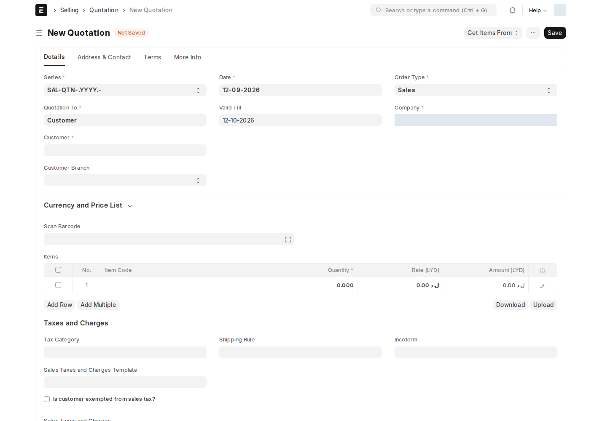
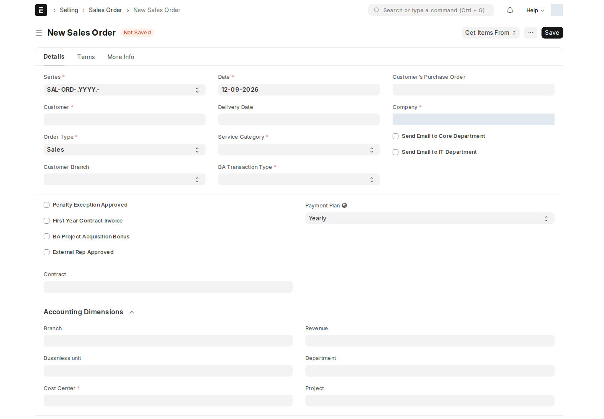
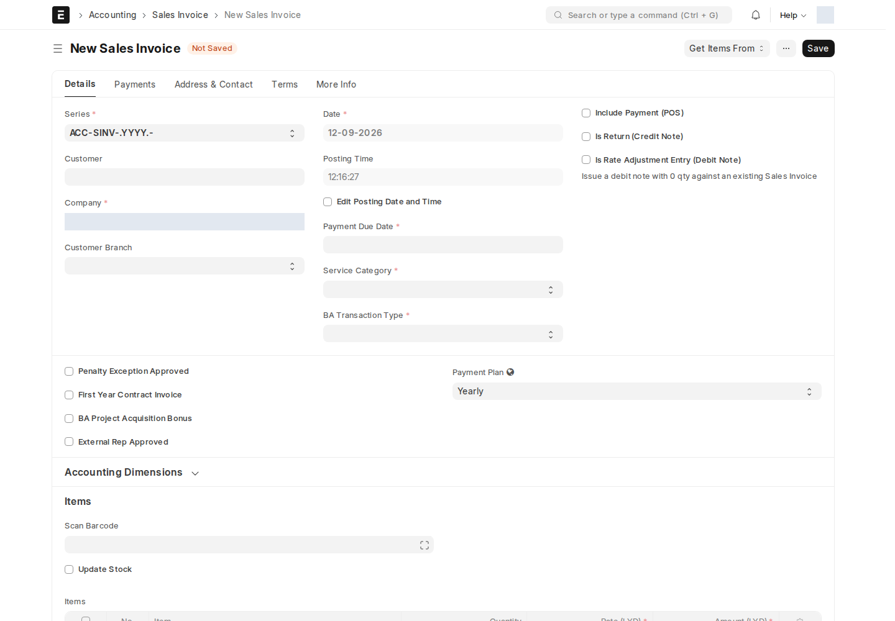

بعد قبول [فرصة](/sales-crm/opportunities-overview/) وإنشاء **عرض سعر (Quotation)** تلقائياً، يتابع المستند مساره القياسي في ERPNext: **عرض سعر → أمر بيع → فاتورة مبيعات**. يحرص ION على نقل حقوله المخصّصة عبر هذه السلسلة تلقائياً بدل إعادة تعبئتها في كل خطوة.

## عرض السعر (Quotation)

| الحقل المضاف | ماذا يفعل |
| --- | --- |
| **Opportunity From** | يحدّد أي مسار أنشأ هذا العرض (Dedicated/SM/فنادق/ISP/مناقصات) |
| **Opportunity Hotels/ISP/SM/Tenders** | رابط فعلي للفرصة المصدر — الحقل الصحيح يُملأ تلقائياً حسب المسار |
| **Is customer exempted from sales tax?** | إعفاء ضريبي خاص بهذا العميل |

## أمر البيع (Sales Order)

| الحقل المضاف | ماذا يفعل |
| --- | --- |
| **Send Email to Core Department** / **Send Email to IT Department** | مربّعا اختيار — فعّلهما لإشعار القسمين تلقائياً عند اعتماد الأمر |
| **Penalty Exception Approved** | استثناء هذا الأمر من جزاءات التأخير القياسية |
| **First Year Contract Invoice** | يعلّم أن هذه أول فاتورة على عقد جديد (يؤثر على [معدل الإضافة للسنة الأولى](/sales-crm/commissions/) في احتساب العمولة) |
| **BA Project Acquisition Bonus** | يفعّل مكافأة اكتساب مشروع لهذا الأمر |
| **External Rep Approved** | موافقة مندوب خارجي (لو كان البيع عبر طرف ثالث) |
| **عقد (Contract)** | ربط الأمر بعقد حالته Active — النظام يتحقّق من وجود هذا الرابط قبل السماح بفواتير لاحقة على عقود تتطلّب ذلك |
| **فئة الخدمة (Service Category)** | Dedicated / Hotel / ISPs / ION Solutions / Hotspot-Sales / Hotspot-BA / Ultra-Malls / Home — يحدّد **أي معدل عمولة** من [إعدادات معدل العمولة](/sales-crm/commissions/) ينطبق على هذا الأمر |
| **Branch**، **Bussniess unit**، **Department**، **Revenue** | أبعاد محاسبية إضافية من تطبيق ion الأساسي — راجع [الأصناف والأبعاد المحاسبية](/buying/masters/) |

مدير الحساب الخاص بالمسار مسؤول عن **Service Category** و**BA Transaction Type**؛ يطلب التطبيق تعبئتهما عند حفظ/اعتماد مستخدم بهذه الأدوار، ويمنع غير مدير الحساب من تغييرهما على أمر محفوظ. راجع **Sales Team** الذي يُستمد من مدير حساب الفرصة أو من مندوب المستخدم في الأمر المباشر المؤهل.

## فاتورة المبيعات (Sales Invoice)

نفس حقول أمر البيع تقريباً، بالإضافة إلى:

| الحقل المضاف | ماذا يفعل |
| --- | --- |
| **Delivery Status** | حالة تسليم مخصّصة تُعرض على الفاتورة مباشرة |
| **Payment Plan** | Yearly / 6 Months / Quarterly — يحدّد دورة الاستحقاق المستخدَمة في [Penalty Plans](/sales-crm/commissions/) |

:::caution[اعتماد الفاتورة يُحرّك العمولة تلقائياً]
اعتماد فاتورة مبيعات — أو إلغاؤها، أو تعديلها بعد الاعتماد — **يعيد احتساب** كشف الهدف والعمولة المرتبط بمندوب المبيعات تلقائياً. لا يوجد إجراء عمولة منفصل تتخذه على الفاتورة نفسها. راجع [العمولات](/sales-crm/commissions/) للتفاصيل الكاملة.
:::

إذا كان أمر البيع يحمل Opportunity From، يفرض التطبيق وجود Contract مرتبط حالته **Active** قبل الفوترة؛ التوقيع وحده لا يغني عن تحقق الحالة. راجع [العقود والدفعات والقيود](/sales-crm/accounting-approvals/).

## البُعد المحاسبي على الأصناف

حقول مثل **Branch** و**Bussniess unit** و**Department** و**Revenue** تُضاف أيضاً على مستوى **سطر الصنف** (Sales Order Item، Sales Invoice Item) و**سطر الضرائب** (Sales Taxes and Charges) — بحيث يمكن توزيع صفقة واحدة على أكثر من وحدة عمل أو قسم داخل نفس المستند.

## لوحات الاتصال (Connections) المخصّصة

فرص **Opportunity**، **Quotation**، و**Subscription** لها لوحة **Connections** (روابط المستندات ذات الصلة) **مخصَّصة** من ION — تعرض روابط أكثر ملاءمة لسير العمل الفعلي بدل اللوحة الافتراضية لـ ERPNext. إذا لاحظت روابط غير معتادة أعلى أحد هذه المستندات، فهذا هو السبب.

<!-- BEGIN VERIFIED SITE REFERENCE -->

## مرجع الأدوار وسير العمل والإشعارات

تمت المراجعة من إعدادات **testsite.local — 12 سبتمبر 2026**. مستوى 0 هو الحقوق الأساسية؛ المستويات الأعلى تخص مجموعات حقول محددة. علامة — تعني أن صف الدور لا يمنح الحق. لا تجمع الصور كل أدوار المستخدمين؛ الصور التقطت بحساب الإدارة.

**تنبيه البريد:** [سكربت موقع الاختبار يضع البريد في Sent دون إرساله](/users/active-scripts/). تابع المستند والتنبيهات المتاحة داخل النظام.

### Customer

**الدور:** تعريف العميل الذي تصدر له المعاملات.

**صلاحيات الأدوار الفعلية** (تظل قيود السجلات والحالة والشروط سارية):

| الدور/الأدوار | مستوى الحقول | قراءة | إنشاء | تعديل | اعتماد | إلغاء | القيد |
| --- | --- | --- | --- | --- | --- | --- | --- |
| Accounts Manager، Stock User، Stock Manager، Sales Manager، Accounts User، Dedicated Account Manager، Surveyor Manager، Sales Engineer، Surveyor | 0 | نعم | — | — | — | — | بحسب النطاق المسموح |
| Sales User، Sales Master Manager | 0 | نعم | نعم | نعم | — | — | بحسب النطاق المسموح |
| Sales User | 1 | نعم | — | — | — | — | بحسب النطاق المسموح |
| Sales Master Manager | 1 | نعم | — | نعم | — | — | بحسب النطاق المسموح |
| Employee Self Service | 0 | — | — | — | — | — | بحسب النطاق المسموح |

**سير العمل:** لا يوجد Workflow نشط لهذا النوع وقت المراجعة. المستند يُحفظ دون Submit؛ حقل الحالة إن وجد لا يعني Workflow مستقلاً.

**الإشعارات:** لا توجد قاعدة Notification مستقلة مفعلة لهذا النوع في لقطة المراجعة. قد تنطبق معالجات التطبيق المذكورة في الشرح أو معالج ION العام عند وجود workflow_state؛ غياب القاعدة ليس دليلاً على غياب كل تنبيه.

### Quotation

**الدور:** تسعير الأصناف والشروط للعميل قبل أمر البيع.

**صلاحيات الأدوار الفعلية** (تظل قيود السجلات والحالة والشروط سارية):

| الدور/الأدوار | مستوى الحقول | قراءة | إنشاء | تعديل | اعتماد | إلغاء | القيد |
| --- | --- | --- | --- | --- | --- | --- | --- |
| Sales Manager، Maintenance User، Sales User، Maintenance Manager، Dedicated Account Manager، Hotels Account Manager، SM Account Manager، ISP Account Manager، Tenders Account Manager | 0 | نعم | نعم | نعم | نعم | نعم | بحسب النطاق المسموح |
| Sales Manager، Hotels Account Manager، SM Account Manager، ISP Account Manager، Tenders Account Manager | 1 | نعم | — | نعم | — | — | بحسب النطاق المسموح |
| Maintenance User، Maintenance Manager، Sales User | 1 | نعم | — | — | — | — | بحسب النطاق المسموح |
| PRO | 0 | نعم | — | — | — | — | بحسب النطاق المسموح |

**سير العمل:** لا يوجد Workflow نشط لهذا النوع وقت المراجعة. المستند قابل للاعتماد القياسي؛ Save ثم Submit حسب الصلاحية والتحقق، وأي حقل Status وصفي لا يعرّف سلسلة موافقات بالأدوار.

**الإشعارات:** لا توجد قاعدة Notification مستقلة مفعلة لهذا النوع في لقطة المراجعة. قد تنطبق معالجات التطبيق المذكورة في الشرح أو معالج ION العام عند وجود workflow_state؛ غياب القاعدة ليس دليلاً على غياب كل تنبيه.

### Sales Order

**الدور:** توثيق طلب العميل والأصناف والأسعار والعقد وبيانات سيناريو العمولة.

**صلاحيات الأدوار الفعلية** (تظل قيود السجلات والحالة والشروط سارية):

| الدور/الأدوار | مستوى الحقول | قراءة | إنشاء | تعديل | اعتماد | إلغاء | القيد |
| --- | --- | --- | --- | --- | --- | --- | --- |
| Accounts User، Stock User | 0 | نعم | — | — | — | — | بحسب النطاق المسموح |
| Sales Manager، Sales User، Maintenance User، Dedicated Account Manager، System Manager | 0 | نعم | نعم | نعم | نعم | نعم | بحسب النطاق المسموح |
| Sales Manager، Dedicated Account Manager، System Manager | 1 | نعم | — | نعم | — | — | بحسب النطاق المسموح |
| System Manager، Commission Penalty Manager | 2 | نعم | — | نعم | — | — | بحسب النطاق المسموح |

**سير العمل:** لا يوجد Workflow نشط لهذا النوع وقت المراجعة. المستند قابل للاعتماد القياسي؛ Save ثم Submit حسب الصلاحية والتحقق، وأي حقل Status وصفي لا يعرّف سلسلة موافقات بالأدوار.

**قواعد الإشعارات المفعّلة:** البريد يخضع لقيد الإرسال التجريبي المذكور أعلاه؛ تنبيه الجرس مبين منفصلاً.

| القاعدة | متى؟ | الشرط/حدود الاستخدام | المستلم | القناة |
| --- | --- | --- | --- | --- |
| Sales Order to Core Department | الاعتماد | Send Email to Core Department مفعّل | Core Department | Email + جرس النظام |
| Sales Order to IT Department | الاعتماد | Send Email to IT Department مفعّل | IT Department | Email + جرس النظام |

### Sales Invoice

**الدور:** إثبات المبالغ المفوترة وربطها بأوامر البيع والتحصيل.

**صلاحيات الأدوار الفعلية** (تظل قيود السجلات والحالة والشروط سارية):

| الدور/الأدوار | مستوى الحقول | قراءة | إنشاء | تعديل | اعتماد | إلغاء | القيد |
| --- | --- | --- | --- | --- | --- | --- | --- |
| Accounts Manager، Dedicated Account Manager، System Manager | 1 | نعم | — | نعم | — | — | بحسب النطاق المسموح |
| Accounts Manager، Dedicated Account Manager، System Manager | 0 | نعم | نعم | نعم | نعم | نعم | بحسب النطاق المسموح |
| Accounts User | 0 | نعم | نعم | نعم | نعم | — | بحسب النطاق المسموح |
| All | 1 | نعم | — | — | — | — | بحسب النطاق المسموح |
| Employee Self Service | 0 | — | — | — | — | — | بحسب النطاق المسموح |
| System Manager، Commission Penalty Manager | 2 | نعم | — | نعم | — | — | بحسب النطاق المسموح |

**سير العمل:** لا يوجد Workflow نشط لهذا النوع وقت المراجعة. المستند قابل للاعتماد القياسي؛ Save ثم Submit حسب الصلاحية والتحقق، وأي حقل Status وصفي لا يعرّف سلسلة موافقات بالأدوار.

**الإشعارات:** لا توجد قاعدة Notification مستقلة مفعلة لهذا النوع في لقطة المراجعة. قد تنطبق معالجات التطبيق المذكورة في الشرح أو معالج ION العام عند وجود workflow_state؛ غياب القاعدة ليس دليلاً على غياب كل تنبيه.

<!-- END VERIFIED SITE REFERENCE -->
