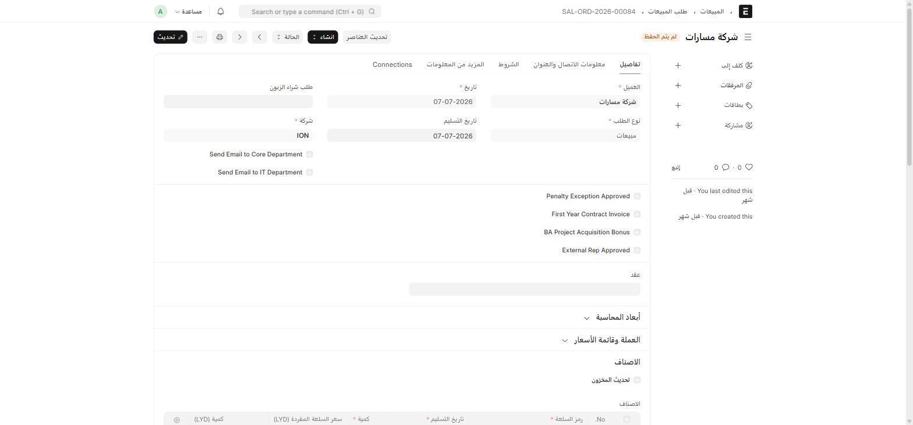

بعد قبول [فرصة](/sales-crm/opportunities-overview/) وإنشاء **عرض سعر (Quotation)** تلقائياً، يتابع المستند مساره القياسي في ERPNext: **عرض سعر → أمر بيع → فاتورة مبيعات**. يحرص ION على نقل حقوله المخصّصة عبر هذه السلسلة تلقائياً بدل إعادة تعبئتها في كل خطوة.

## عرض السعر (Quotation)

| الحقل المضاف | ماذا يفعل |
| --- | --- |
| **Opportunity From** | يحدّد أي مسار أنشأ هذا العرض (Dedicated/SM/فنادق/ISP/مناقصات) |
| **Opportunity Hotels/ISP/SM/Tenders** | رابط فعلي للفرصة المصدر — الحقل الصحيح يُملأ تلقائياً حسب المسار |
| **Is customer exempted from sales tax?** | إعفاء ضريبي خاص بهذا العميل |

## أمر البيع (Sales Order)

| الحقل المضاف | ماذا يفعل |
| --- | --- |
| **Send Email to Core Department** / **Send Email to IT Department** | مربّعا اختيار — فعّلهما لإشعار القسمين تلقائياً عند اعتماد الأمر |
| **Penalty Exception Approved** | استثناء هذا الأمر من جزاءات التأخير القياسية |
| **First Year Contract Invoice** | يعلّم أن هذه أول فاتورة على عقد جديد (يؤثر على [معدل الإضافة للسنة الأولى](/sales-crm/commissions/#تبويب-add-ons-and-bonuses) في احتساب العمولة) |
| **BA Project Acquisition Bonus** | يفعّل مكافأة اكتساب مشروع لهذا الأمر |
| **External Rep Approved** | موافقة مندوب خارجي (لو كان البيع عبر طرف ثالث) |
| **عقد (Contract)** | ربط الأمر بعقد موقَّع — النظام يتحقّق من وجود هذا الرابط قبل السماح بفواتير لاحقة على عقود تتطلّب ذلك |
| **فئة الخدمة (Service Category)** | Dedicated / Hotel / ISPs / ION Solutions / Hotspot-Sales / Hotspot-BA / Ultra-Malls / Home — يحدّد **أي معدل عمولة** من [إعدادات معدل العمولة](/sales-crm/commissions/) ينطبق على هذا الأمر |
| **Branch**، **Bussniess unit**، **Department**، **Revenue** | أبعاد محاسبية إضافية من تطبيق ion الأساسي — راجع [أنواع المواد والأقسام الفنية](/buying/masters/#الوحدة-التجارية-bussniess-unit-والإيرادات-revenue) |

## فاتورة المبيعات (Sales Invoice)

نفس حقول أمر البيع تقريباً، بالإضافة إلى:

| الحقل المضاف | ماذا يفعل |
| --- | --- |
| **Delivery Status** | حالة تسليم مخصّصة تُعرض على الفاتورة مباشرة |
| **Payment Plan** | Yearly / 6 Months / Quarterly — يحدّد دورة الاستحقاق المستخدَمة في [Penalty Plans](/sales-crm/commissions/#تبويب-penalty-plans-نوافذ-السماح-وإيقاع-الاستحقاق) |

:::caution[اعتماد الفاتورة يُحرّك العمولة تلقائياً]
اعتماد فاتورة مبيعات — أو إلغاؤها، أو تعديلها بعد الاعتماد — **يعيد احتساب** كشف الهدف والعمولة المرتبط بمندوب المبيعات تلقائياً. لا يوجد إجراء عمولة منفصل تتخذه على الفاتورة نفسها. راجع [العمولات](/sales-crm/commissions/) للتفاصيل الكاملة.
:::

## البُعد المحاسبي على الأصناف

حقول مثل **Branch** و**Bussniess unit** و**Department** و**Revenue** تُضاف أيضاً على مستوى **سطر الصنف** (Sales Order Item، Sales Invoice Item) و**سطر الضرائب** (Sales Taxes and Charges) — بحيث يمكن توزيع صفقة واحدة على أكثر من وحدة عمل أو قسم داخل نفس المستند.

## لوحات الاتصال (Connections) المخصّصة

فرص **Opportunity**، **Quotation**، و**Subscription** لها لوحة **Connections** (روابط المستندات ذات الصلة) **مخصَّصة** من ION — تعرض روابط أكثر ملاءمة لسير العمل الفعلي بدل اللوحة الافتراضية لـ ERPNext. إذا لاحظت روابط غير معتادة أعلى أحد هذه المستندات، فهذا هو السبب.
