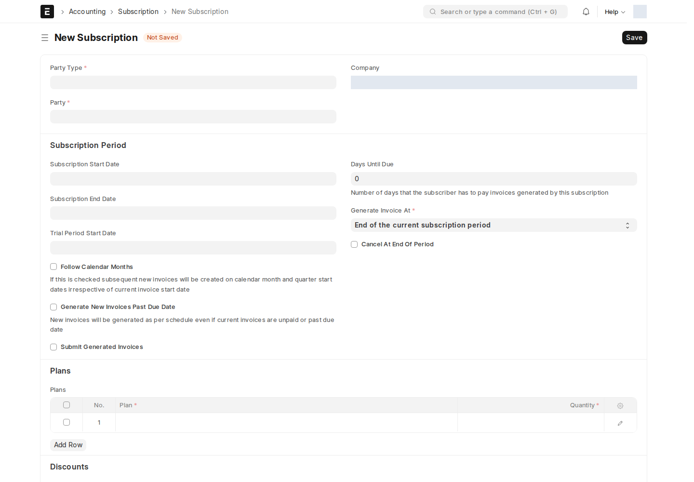
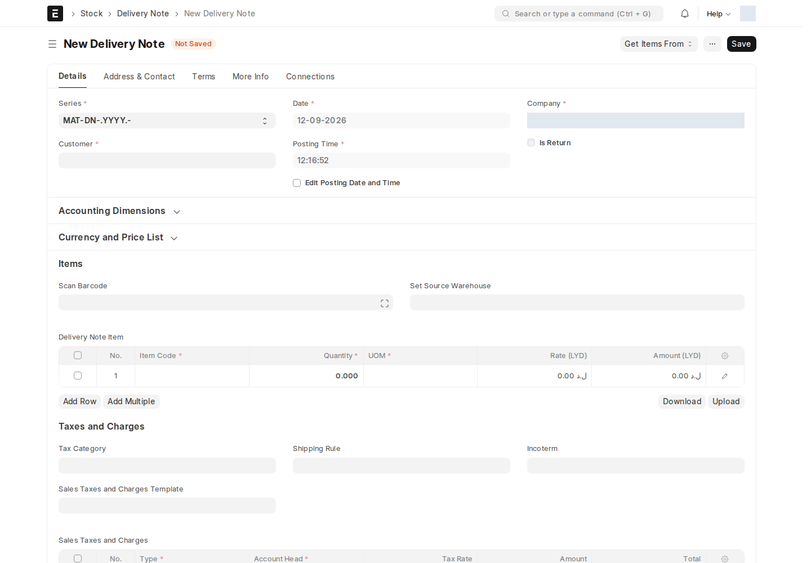

## Subscription — الاشتراك

Subscription يحدد العميل أو المورد والخطط والفترة وطريقة الفوترة المتكررة. يراجع المسؤول المالي الطرف والخطط والمبالغ قبل حفظه؛ فتح نموذج مسبق التعبئة لا ينشئ اشتراكاً محفوظاً.

من **Quotation معتمد**، قد يظهر **Create → Create Subscription** إذا تمكن السكربت من العثور على الفرصة المصدر. راجع الطرف، وأضف خطة واحدة على الأقل من **Subscription Plan**، وحدد الفترة ثم احفظ. السكربت الحالي يتعرف على Opportunity وSM وHotels وTenders عبر حقوله المحددة؛ لا يفحص رابط ISP، لذلك قد لا يعمل الزر لهذا المسار.

### التجديد

يظهر **Actions → Renew (Prefill)** عندما يتبقى 30 يوماً أو أقل على End Date، أو بعد انتهائه. يفتح نسخة جديدة غير محفوظة تبدأ في اليوم التالي لنهاية القديم وينسخ خططه وبعض الإعدادات. راجع الطرف والفترة والأسعار والخطط ثم احفظ. لا يجدد الاشتراك القديم تلقائياً بمجرد ظهور الزر.

**Subscription Plan** يعرّف الصنف والسعر ودورية الفوترة المستخدمة في جدول خطط الاشتراك. يعده المسؤول المخول مرة، ثم يختاره في الاشتراكات.

## Delivery Note — إذن تسليم

Delivery Note يسجل تسليم الأصناف للعميل. يراجع مسؤول المخزون المخزن والكميات والتسلسلات والدفعات قبل الاعتماد.

في مسودة Delivery Note، يضيف **DNfromSI** زر **Get Items From → Sales Invoice**. يسمح باختيار فواتير **معتمدة** و**Update Stock غير مفعل**؛ راجع الأصناف والكميات المسحوبة قبل الحفظ والاعتماد لتجنب تكرار حركة مخزون سبق تسجيلها بالفاتورة.

لا توجد Workflows نشطة لهذه الأنواع وقت المراجعة. راجع الصلاحيات أدناه، وحالة كل مستند محفوظ بعد التنفيذ.

<!-- BEGIN VERIFIED SITE REFERENCE -->

## مرجع الأدوار وسير العمل والإشعارات

تمت المراجعة من إعدادات **testsite.local — 12 سبتمبر 2026**. مستوى 0 هو الحقوق الأساسية؛ المستويات الأعلى تخص مجموعات حقول محددة. علامة — تعني أن صف الدور لا يمنح الحق. لا تجمع الصور كل أدوار المستخدمين؛ الصور التقطت بحساب الإدارة.

**تنبيه البريد:** [سكربت موقع الاختبار يضع البريد في Sent دون إرساله](/users/active-scripts/). تابع المستند والتنبيهات المتاحة داخل النظام.

### Subscription

**الدور:** تنظيم خطط خدمة دورية وفترتها وفوترتها.

**صلاحيات الأدوار الفعلية** (تظل قيود السجلات والحالة والشروط سارية):

| الدور/الأدوار | مستوى الحقول | قراءة | إنشاء | تعديل | اعتماد | إلغاء | القيد |
| --- | --- | --- | --- | --- | --- | --- | --- |
| System Manager، Accounts Manager، Accounts User | 0 | نعم | نعم | نعم | — | — | بحسب النطاق المسموح |
| Dedicated Account Manager | 0 | نعم | — | — | — | — | بحسب النطاق المسموح |

**سير العمل:** لا يوجد Workflow نشط لهذا النوع وقت المراجعة. المستند يُحفظ دون Submit؛ حقل الحالة إن وجد لا يعني Workflow مستقلاً.

**الإشعارات:** لا توجد قاعدة Notification مستقلة مفعلة لهذا النوع في لقطة المراجعة. قد تنطبق معالجات التطبيق المذكورة في الشرح أو معالج ION العام عند وجود workflow_state؛ غياب القاعدة ليس دليلاً على غياب كل تنبيه.

### Subscription Plan

**الدور:** تعريف الصنف والسعر ودورية الخطة المستخدمة في الاشتراك.

**صلاحيات الأدوار الفعلية** (تظل قيود السجلات والحالة والشروط سارية):

| الدور/الأدوار | مستوى الحقول | قراءة | إنشاء | تعديل | اعتماد | إلغاء | القيد |
| --- | --- | --- | --- | --- | --- | --- | --- |
| System Manager، Accounts Manager، Accounts User | 0 | نعم | نعم | نعم | — | — | بحسب النطاق المسموح |

**سير العمل:** لا يوجد Workflow نشط لهذا النوع وقت المراجعة. المستند يُحفظ دون Submit؛ حقل الحالة إن وجد لا يعني Workflow مستقلاً.

**الإشعارات:** لا توجد قاعدة Notification مستقلة مفعلة لهذا النوع في لقطة المراجعة. قد تنطبق معالجات التطبيق المذكورة في الشرح أو معالج ION العام عند وجود workflow_state؛ غياب القاعدة ليس دليلاً على غياب كل تنبيه.

### Delivery Note

**الدور:** تسجيل تسليم الأصناف للعميل.

**صلاحيات الأدوار الفعلية** (تظل قيود السجلات والحالة والشروط سارية):

| الدور/الأدوار | مستوى الحقول | قراءة | إنشاء | تعديل | اعتماد | إلغاء | القيد |
| --- | --- | --- | --- | --- | --- | --- | --- |
| Accounts User، Dedicated Account Manager | 0 | نعم | — | — | — | — | بحسب النطاق المسموح |
| Sales User، Stock User، Delivery Manager، Stock Manager، Delivery User | 0 | نعم | نعم | نعم | نعم | نعم | بحسب النطاق المسموح |
| Stock Manager | 1 | نعم | — | نعم | — | — | بحسب النطاق المسموح |
| HR User | 0 | نعم | نعم | نعم | — | — | بحسب النطاق المسموح |

**سير العمل:** لا يوجد Workflow نشط لهذا النوع وقت المراجعة. المستند قابل للاعتماد القياسي؛ Save ثم Submit حسب الصلاحية والتحقق، وأي حقل Status وصفي لا يعرّف سلسلة موافقات بالأدوار.

**الإشعارات:** لا توجد قاعدة Notification مستقلة مفعلة لهذا النوع في لقطة المراجعة. قد تنطبق معالجات التطبيق المذكورة في الشرح أو معالج ION العام عند وجود workflow_state؛ غياب القاعدة ليس دليلاً على غياب كل تنبيه.

<!-- END VERIFIED SITE REFERENCE -->
