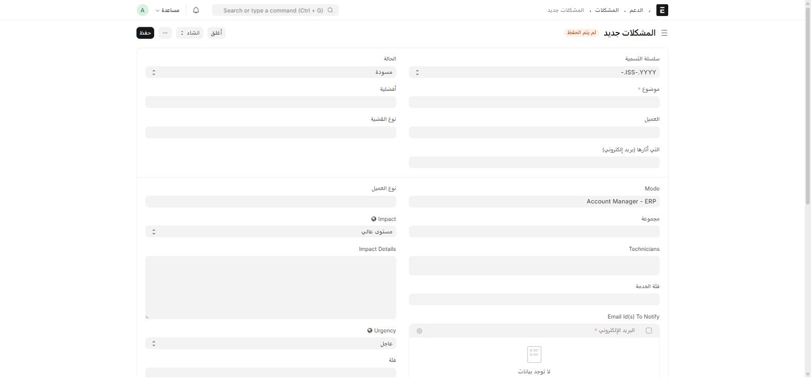

**المشكلات (Issue)** هو مستند Frappe/ERPNext القياسي لتتبّع تذاكر الدعم، وأضاف عليه ION قوائم تصنيف مخصّصة وآلية إشعار تلقائي بالبريد الإلكتروني.

## أين أجده؟

القائمة الجانبية ← **الدعم** ← **المشكلات**، أو اكتب في شريط البحث: `المشكلات` أو `Issue`

## إنشاء تذكرة

| الحقل | إجباري | من أين تُختار قيمته |
| --- | :---: | --- |
| **موضوع** | ✅ | نص حر |
| **العميل** | — | Link → Customer |
| **نوع القضية** | — | Link → **Issue Category** — تصنيف عام (مخصَّص من ION) |
| **فئة** | — | Link → **Issue Subcategory** — تصنيف فرعي، مرتبط بفئة عليا |
| **نوع العميل** | — | Link → **Customer Type** — تصنيف العميل لأغراض SLA |
| **Mode** | — | Link → **Issue Mode** — كيف وصلت التذكرة (مثال: Account Manager - ERP) |
| **مجموعة** | — | Link → **Issue Group** — فريق التوجيه المسؤول |
| **Technicians** | — | جدول (**Issue Technician**) — الفنيون المكلَّفون بحل التذكرة |
| **فئة الخدمة** | — | Link → **Issue Service Category** |
| **Email Id(s) To Notify** | — | جدول (**Issue Email Id**) — عناوين تصل لها الإشعارات التلقائية |

## قوائم التصنيف (Masters) — تُدار من قِبَل مدير النظام

هذه القوائم كلها بسيطة (اسم + وصف فقط)، تُنشأ وتُدار مرة عند الإعداد ثم تُختار من طلبات الدعم اليومية:

| القائمة | تصنّف |
| --- | --- |
| **Issue Category** | نوع المشكلة العام |
| **Issue Subcategory** | تفصيل فرعي لفئة معيّنة |
| **Issue Group** | فريق التوجيه |
| **Issue Mode** | قناة وصول التذكرة |
| **Issue Service Category** | خط الخدمة المتأثر |
| **Customer Type** | تصنيف العميل |

## الإشعار التلقائي بالبريد الإلكتروني

:::note[من الذي يصله البريد، ومتى؟]
كل عنوان تضيفه في جدول **Email Id(s) To Notify** على التذكرة يصله بريد تلقائي في حالتين:

1. **عند إنشاء التذكرة** (after_insert) — بريد "تذكرة جديدة".
2. **عند تغيير حالة (Status)** التذكرة لاحقاً (on_update) — بريد "تحديث الحالة".

لا داعٍ لإرسال بريد يدوي لإبلاغ الأطراف المعنية — فقط أضفهم لهذا الجدول عند إنشاء التذكرة، وسيصلهم كل تحديث تلقائياً.
:::

:::tip[إن لم تصل الإشعارات]
تأكّد أولاً أن **البريد الإلكتروني** مُضاف فعلاً في جدول Email Id(s) To Notify على تلك التذكرة تحديداً — الجدول فارغ افتراضياً في كل تذكرة جديدة، ويجب تعبئته يدوياً في كل مرة.
:::
