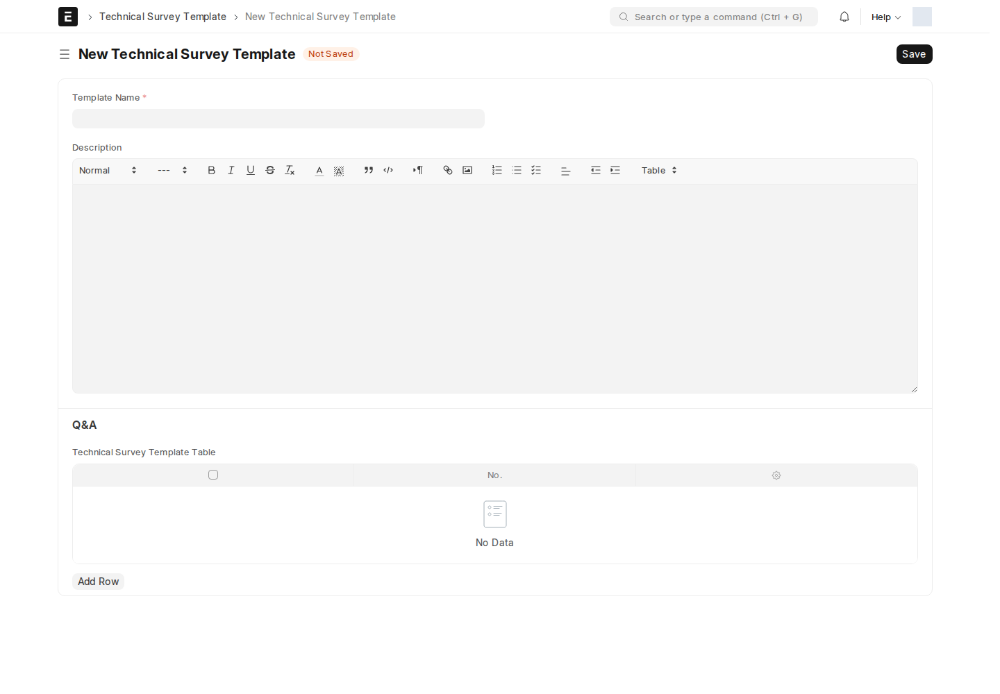
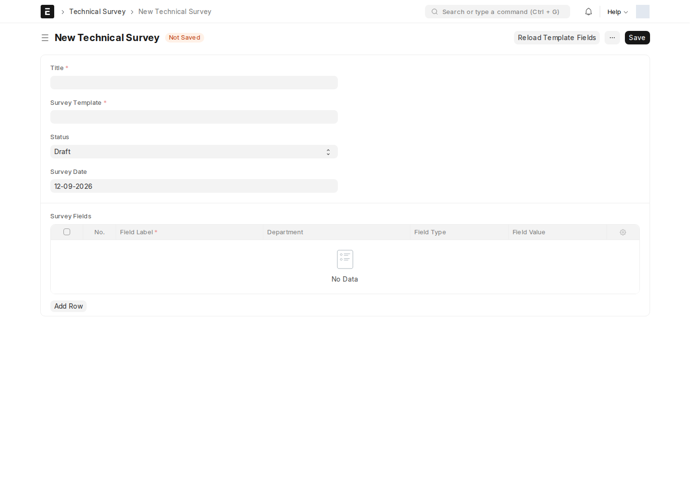

المسح الفني (Technical Survey) هو الأداة التي يستخدمها **فريق المسح** لجمع بيانات الموقع قبل تركيب أي خدمة — سواء ضمن [فرصة](/sales-crm/opportunities-overview/) أو [هوت-سبوت](/sales-crm/hotspot/).

## قالب المسح (Technical Survey Template)

القالب هو **الأسئلة الجاهزة** التي يُبنى عليها أي مسح لاحق. أين أجده؟ اكتب في شريط البحث: `Technical Survey Template`

| الحقل | ماذا يعني |
| --- | --- |
| **اسم القالب** | اسم فريد يُستخدم كاسم للسجل نفسه |
| **الوصف** | شرح عام للقالب |
| **Q&A** (جدول Technical Survey Template Table) | أسئلة القالب — كل سؤال له نص وحقل إجابة |

جدول أسئلة أكثر تفصيلاً (**Technical Survey Template Field**) يتيح لكل سؤال: **نوع الحقل** (Data / Long Text / Select / Rating / Question)، **إجباري أم لا**، **خيارات الاختيار** (Options)، وقيمة افتراضية.

## قسم فني (Technical Survey Department)

سجل بسيط يسمّي **الأقسام الفنية** المستخدمة لتوجيه أسئلة المسح — منفصل عن **الأقسام (Department)** القياسية في الموارد البشرية.

## المسح نفسه (Technical Survey)

سجل قابل للاعتماد — نسخة **مملوءة فعلياً** من قالب معيّن.

| الحقل | إجباري | ملاحظة |
| --- | :---: | --- |
| **العنوان** | ✅ | |
| **Survey Template** | ✅ | القالب المستخدَم |
| **تاريخ المسح** | — | |
| **الحالة** | — | Draft / In Progress / Completed / Cancelled |
| **Survey Fields** | — | إجابات الأسئلة، صف لكل سؤال |

يدير System Manager أو Surveyor Manager القوالب، وينفذ Surveyor المسح المستقل وفق صلاحياته. على الفرص وHotspot، تعيين صف مسّاح جديد يولد أسئلة القالب ويحاول إرسالها إلى المستخدم المعين. **يمنع الانتقال إلى Surveyed إذا بقيت إجابات ناقصة**؛ هذا تحقق منفصل عن مجرد تعيين المسّاح.

## تعيين المسّاح (Technical Surveyor)

جدول فرعي يُستخدَم **داخل** الفرصة أو الهوت-سبوت مباشرة (وليس شاشة مستقلة) — يربط **قسماً فنياً** بـ **مسّاح (مستخدم)** محدَّد، مع إمكانية تثبيت **قالب** معيّن لهذا القسم.

:::note[أين يظهر تبويب Survey؟]
كل فرصة (بجميع مساراتها الخمسة) وكل سجل هوت-سبوت يحتوي تبويب **Survey** خاصاً به — من هناك تُعيَّن المسّاحون ويُملأ المسح مباشرة دون مغادرة الفرصة نفسها.
:::

<!-- BEGIN VERIFIED SITE REFERENCE -->

## مرجع الأدوار وسير العمل والإشعارات

تمت المراجعة من إعدادات **testsite.local — 12 سبتمبر 2026**. مستوى 0 هو الحقوق الأساسية؛ المستويات الأعلى تخص مجموعات حقول محددة. علامة — تعني أن صف الدور لا يمنح الحق. لا تجمع الصور كل أدوار المستخدمين؛ الصور التقطت بحساب الإدارة.

**تنبيه البريد:** [سكربت موقع الاختبار يضع البريد في Sent دون إرساله](/users/active-scripts/). تابع المستند والتنبيهات المتاحة داخل النظام.

### Technical Survey Template

**الدور:** إعداد الأسئلة التي تُنسخ إلى المسح.

**صلاحيات الأدوار الفعلية** (تظل قيود السجلات والحالة والشروط سارية):

| الدور/الأدوار | مستوى الحقول | قراءة | إنشاء | تعديل | اعتماد | إلغاء | القيد |
| --- | --- | --- | --- | --- | --- | --- | --- |
| System Manager، Surveyor Manager | 0 | نعم | نعم | نعم | — | — | بحسب النطاق المسموح |
| Surveyor، Dedicated Account Manager، Sales Engineer، Hotels Account Manager، SM Account Manager، ISP Account Manager، Tenders Account Manager | 0 | نعم | — | — | — | — | بحسب النطاق المسموح |

**سير العمل:** لا يوجد Workflow نشط لهذا النوع وقت المراجعة. المستند يُحفظ دون Submit؛ حقل الحالة إن وجد لا يعني Workflow مستقلاً.

**الإشعارات:** لا توجد قاعدة Notification مستقلة مفعلة لهذا النوع في لقطة المراجعة. قد تنطبق معالجات التطبيق المذكورة في الشرح أو معالج ION العام عند وجود workflow_state؛ غياب القاعدة ليس دليلاً على غياب كل تنبيه.

### Technical Survey Department

**الدور:** تصنيف قسم المسح الفني؛ مستقل عن قسم الموظف.

*الشاشة متاحة في الإعداد، لكن لم توجد لها سجلات محفوظة وقت المراجعة؛ لا يُفترض أنها خطوة يومية مستخدمة أو مطلوبة لمجرد وجودها.*

**صلاحيات الأدوار الفعلية** (تظل قيود السجلات والحالة والشروط سارية):

| الدور/الأدوار | مستوى الحقول | قراءة | إنشاء | تعديل | اعتماد | إلغاء | القيد |
| --- | --- | --- | --- | --- | --- | --- | --- |
| System Manager | 0 | نعم | نعم | نعم | — | — | بحسب النطاق المسموح |

**سير العمل:** لا يوجد Workflow نشط لهذا النوع وقت المراجعة. المستند يُحفظ دون Submit؛ حقل الحالة إن وجد لا يعني Workflow مستقلاً.

**الإشعارات:** لا توجد قاعدة Notification مستقلة مفعلة لهذا النوع في لقطة المراجعة. قد تنطبق معالجات التطبيق المذكورة في الشرح أو معالج ION العام عند وجود workflow_state؛ غياب القاعدة ليس دليلاً على غياب كل تنبيه.

### Technical Survey

**الدور:** توثيق إجابات مسح مستقل قابل للاعتماد.

*الشاشة متاحة في الإعداد، لكن لم توجد لها سجلات محفوظة وقت المراجعة؛ لا يُفترض أنها خطوة يومية مستخدمة أو مطلوبة لمجرد وجودها.*

**صلاحيات الأدوار الفعلية** (تظل قيود السجلات والحالة والشروط سارية):

| الدور/الأدوار | مستوى الحقول | قراءة | إنشاء | تعديل | اعتماد | إلغاء | القيد |
| --- | --- | --- | --- | --- | --- | --- | --- |
| System Manager، Surveyor | 0 | نعم | نعم | نعم | نعم | — | بحسب النطاق المسموح |

**سير العمل:** لا يوجد Workflow نشط لهذا النوع وقت المراجعة. المستند قابل للاعتماد القياسي؛ Save ثم Submit حسب الصلاحية والتحقق، وأي حقل Status وصفي لا يعرّف سلسلة موافقات بالأدوار.

**الإشعارات:** لا توجد قاعدة Notification مستقلة مفعلة لهذا النوع في لقطة المراجعة. قد تنطبق معالجات التطبيق المذكورة في الشرح أو معالج ION العام عند وجود workflow_state؛ غياب القاعدة ليس دليلاً على غياب كل تنبيه.

<!-- END VERIFIED SITE REFERENCE -->
