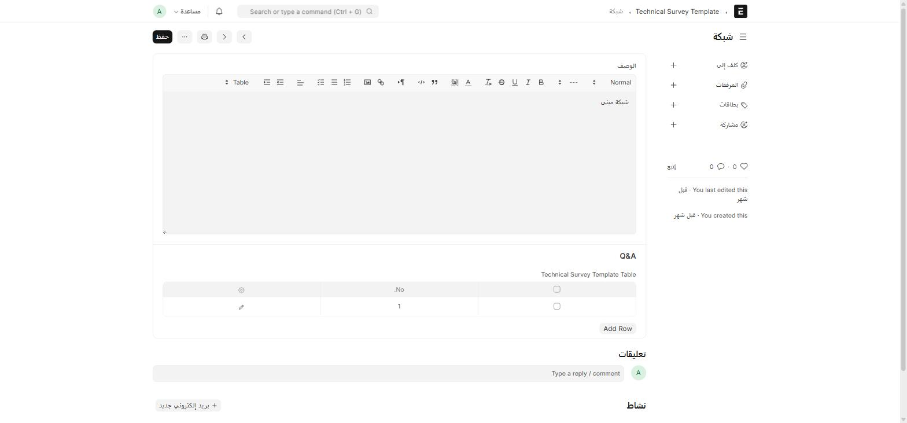

المسح الفني (Technical Survey) هو الأداة التي يستخدمها **فريق المسح** لجمع بيانات الموقع قبل تركيب أي خدمة — سواء ضمن [فرصة](/sales-crm/opportunities-overview/) أو [هوت-سبوت](/sales-crm/hotspot/).

## قالب المسح (Technical Survey Template)

القالب هو **الأسئلة الجاهزة** التي يُبنى عليها أي مسح لاحق. أين أجده؟ اكتب في شريط البحث: `Technical Survey Template`

| الحقل | ماذا يعني |
| --- | --- |
| **اسم القالب** | اسم فريد يُستخدم كاسم للسجل نفسه |
| **الوصف** | شرح عام للقالب |
| **Q&A** (جدول Technical Survey Template Table) | أسئلة القالب — كل سؤال له نص وحقل إجابة |

جدول أسئلة أكثر تفصيلاً (**Technical Survey Template Field**) يتيح لكل سؤال: **نوع الحقل** (Data / Long Text / Select / Rating / Question)، **إجباري أم لا**، **خيارات الاختيار** (Options)، وقيمة افتراضية.

## قسم فني (Technical Survey Department)

سجل بسيط يسمّي **الأقسام الفنية** المستخدمة لتوجيه أسئلة المسح — منفصل عن **الأقسام (Department)** القياسية في الموارد البشرية.

## المسح نفسه (Technical Survey)

سجل قابل للاعتماد — نسخة **مملوءة فعلياً** من قالب معيّن.

| الحقل | إجباري | ملاحظة |
| --- | :---: | --- |
| **العنوان** | ✅ | |
| **Survey Template** | ✅ | القالب المستخدَم |
| **تاريخ المسح** | — | |
| **الحالة** | — | Draft / In Progress / Completed / Cancelled |
| **Survey Fields** | — | إجابات الأسئلة، صف لكل سؤال |

## تعيين المسّاح (Technical Surveyor)

جدول فرعي يُستخدَم **داخل** الفرصة أو الهوت-سبوت مباشرة (وليس شاشة مستقلة) — يربط **قسماً فنياً** بـ **مسّاح (مستخدم)** محدَّد، مع إمكانية تثبيت **قالب** معيّن لهذا القسم.

:::note[أين يظهر تبويب Survey؟]
كل فرصة (بجميع مساراتها الخمسة) وكل سجل هوت-سبوت يحتوي تبويب **Survey** خاصاً به — من هناك تُعيَّن المسّاحون ويُملأ المسح مباشرة دون مغادرة الفرصة نفسها.
:::
