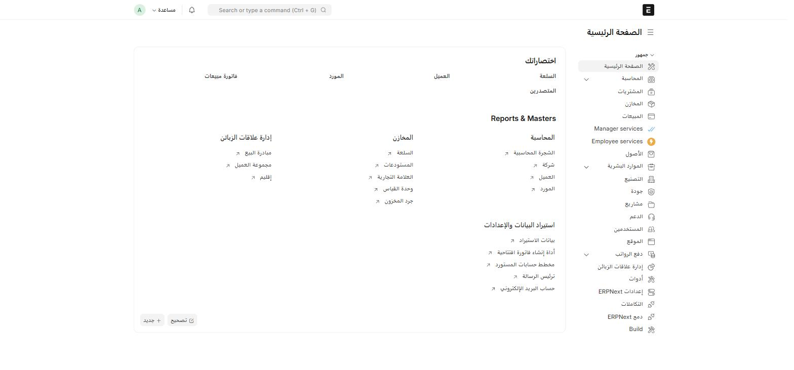
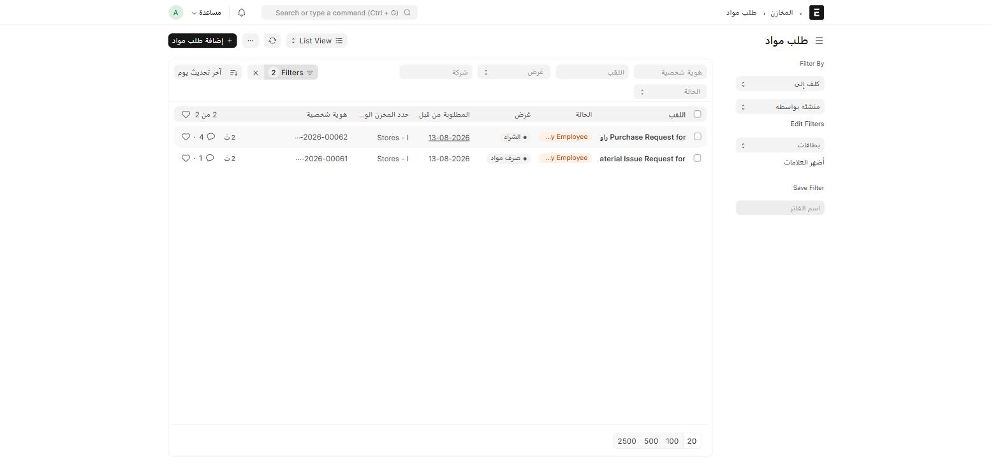
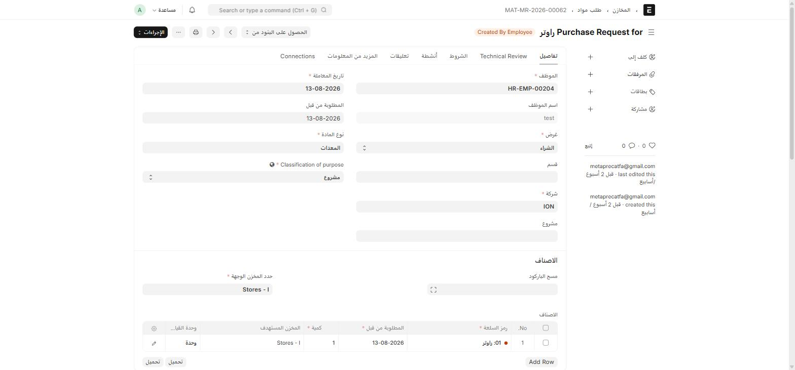

قبل أن تنفّذ أي مهمة، تعرّف على الشاشة. كل صفحات النظام تتكوّن من نفس الأجزاء، فإذا فهمت هذه الصفحة فهمت النظام كله.

## 1. القائمة الجانبية

على يمين الشاشة (لأن الواجهة RTL) قائمة بكل **مساحات العمل** (Workspaces) — كل مساحة تجمع شاشات متشابهة:

| مساحة العمل | ماذا بداخلها |
| --- | --- |
| **المحاسبة** | القيود، الفواتير، مراكز التكلفة، الوحدات التجارية والإيرادات (تخصيص ION) |
| **المشتريات** | طلب مواد، أمر الشراء، فاتورة الشراء — بمراجعة فنية إضافية من ION |
| **المخازن** | الأصناف، المستودعات، حركات المخزون |
| **المبيعات** | الفرص، عروض الأسعار، أوامر البيع — بتخصيصات فرص البيع الخمسة من ION |
| **Manager services** / **Employee services** | تخصيصات الموارد البشرية (aion_custom_hr) — الاسمان غير مترجَمَين |
| **الموارد البشرية** | الموظفون، الحضور، الرواتب |
| **إدارة علاقات الزبائن** | العملاء، جهات الاتصال، تذاكر الدعم |

:::tip[أسرع طريق دائماً]
لأي شاشة، اكتب اسمها في **شريط البحث** (Ctrl + G) بدل البحث عنها في القائمة الجانبية.
:::

## 2. شريط البحث العلوي

الشريط في أعلى الشاشة (`Search or type a command`) هو أسرع طريق لأي شيء في النظام.

- اضغط **Ctrl + G** لوضع المؤشر فيه مباشرة.
- اكتب اسم الشاشة بالعربية أو الإنجليزية، مثل `طلب مواد` أو `Material Request`، واختر من النتائج.
- اكتب رقم مستند (مثل `MAT-MR-2026-00062`) للوصول إلى ملفه فوراً.

## 3. القائمة (List) — عرض كل السجلات

عند فتح أي شاشة تصلك أولاً **القائمة**: جدول بكل السجلات المحفوظة من هذا النوع.

عناصر القائمة المهمة:

| العنصر | مكانه | وظيفته |
| --- | --- | --- |
| **+ إضافة …** | أعلى اليمين | إنشاء سجل جديد |
| **حقول التصفية** (شركة، غرض، اللقب، هوية شخصية) | الشريط أعلى الجدول | تصفية سريعة |
| **Filters** | أعلى يمين الجدول | تصفية متقدّمة بأي حقل وبأي شرط |
| **آخر تحديث يوم** | بجانب الفلتر | تغيير الترتيب |
| **List View** | أعلى الجدول | التبديل بين عرض القائمة، البطاقات، التقرير، الشجرة، ... |
| **مربّع الاختيار ☐** | يمين كل صف | تحديد عدة سجلات لتنفيذ عملية جماعية عليها |
| **⋯** | بجانب زر الإضافة | التصدير، الاستيراد، الطباعة، الحذف الجماعي |

:::caution[الحذر عند النقر داخل صف]
النقر على قيمة داخل عمود (مثل التاريخ أو الحالة) يضيف **فلتراً** بهذه القيمة بدل فتح السجل. لفتح السجل، انقر على **عنوانه** (العمود الأخير على اليمين، وهو رابط دائماً).
:::

## 4. النموذج (Form) — سجل واحد

اضغط على عنوان أي صف في القائمة ليفتح **النموذج**، وهو صفحة السجل الواحد التي تُدخل فيها البيانات.

في النموذج:

- **العنوان** في الأعلى، وبجانبه **حالة سير العمل** (Workflow State) للمستندات التي تمر بموافقات، مثل `Created By Employee` هنا.
- **علامات التبويب** (Tabs) أعلى النموذج تقسّم الحقول إلى مجموعات — هنا مثلاً **تفاصيل** و**Technical Review** (تخصيص ION) و**الشروط** و**أنشطة** و**تعليقات**.
- الحقل الذي يحمل **علامة حمراء (*)** هو حقل **إجباري**.
- **Ctrl + S** يحفظ المستند، وهو أسرع من البحث عن الزر.
- زر **الإجراءات** (Actions) أعلى يسار النموذج يظهر فقط للمستندات التي لها **سير عمل (Workflow)** — يعرض الانتقالات المتاحة من حالتك الحالية، مثل **وافق** أو **رفض**. راجع [المفاهيم الأساسية](/start/concepts/) لفهم سير العمل.

:::tip[نصيحة]
لا تخف من التجربة. أي مستند لم تضغط عليه **حفظ** لا يُخزَّن في النظام.
:::
