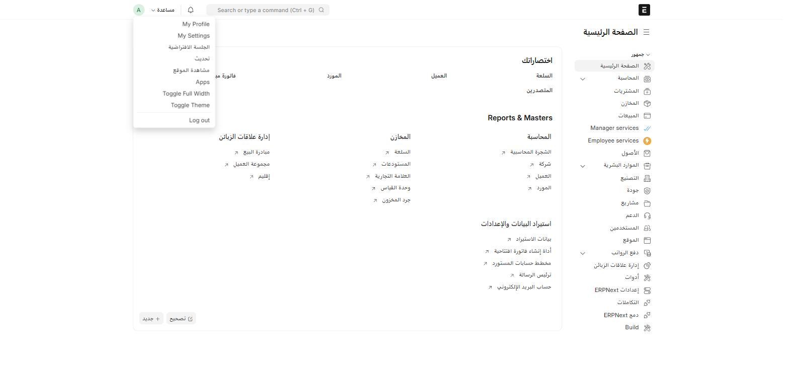

## الدخول إلى النظام

1. افتح المتصفّح (يُفضّل Google Chrome أو Microsoft Edge).
2. اكتب عنوان النظام الذي زوّدتك به الإدارة، ثم أضف `/login` في نهايته.
3. تظهر لك **صفحة تسجيل الدخول القياسية لـ Frappe**: حقل للبريد الإلكتروني أو اسم المستخدم، وحقل لكلمة المرور، وزر **Login**.
4. أدخل بياناتك واضغط **Login**. يفتح النظام مباشرة على لوحة العمل (`/app`).

:::note[زر ثانٍ في الصفحة]
زر **Login with Email Link** يرسل لك رابط دخول بدل كلمة المرور، ويعمل فقط إذا كان إرسال البريد مُعدّاً في النظام.
:::

## أين أجد نفسي بعد الدخول؟

تُفتح لك **الصفحة الرئيسية** (`/app/home`) — قائمة جانبية على اليمين فيها كل الوحدات (المحاسبة، المشتريات، المخازن، المبيعات، Manager services، Employee services، الأصول، الموارد البشرية، التصنيع، جودة، مشاريع، الدعم، المستخدمون، الموقع، دفع الرواتب، ...) ومنطقة رئيسية فيها اختصاراتك وتقارير.

:::note[Manager services و Employee services]
هذان الاسمان يظهران بالإنجليزية دائماً لأنهما **غير مترجَمَين** في النظام. هما مساحتا العمل (Workspace) الخاصتان بتخصيصات الموارد البشرية — راجع [تخصيصات الموارد البشرية](/hr/attendance-lateness/).
:::

## الخروج من النظام

1. اضغط على **الحرف الأول من اسمك** في أعلى يمين الشاشة (الأفاتار الدائري).
2. تفتح قائمة — أغلب عناصرها **بالإنجليزية** لأنها غير مترجَمة:

| العنصر | معناه |
| --- | --- |
| **My Profile** | ملفك الشخصي العام |
| **My Settings** | إعداداتك، وفيها حقل **اللغة** |
| **الجلسة الافتراضية** | Default Workspace عند الدخول |
| **تحديث** | إعادة تحميل بيانات الصفحة |
| **مشاهدة الموقع** | فتح الموقع العام (Website) إن وُجد |
| **Apps** | التبديل بين تطبيقات النظام المثبّتة |
| **Toggle Full Width** | توسعة الصفحة لتملأ الشاشة |
| **Toggle Theme** | التبديل بين الوضع الفاتح والداكن |
| **Log out** | تسجيل الخروج |

اختر **Log out** لإنهاء الجلسة.

:::caution[مهم على الأجهزة المشتركة]
إذا كنت تستخدم جهازاً يستعمله غيرك، سجّل الخروج دائماً بعد الانتهاء. ترك الجلسة مفتوحة يعني أن أي شخص يستطيع تعديل مستندات باسمك — بما في ذلك اعتماد أوامر شراء أو الموافقة على طلبات.
:::

## واجهة النظام لا تظهر بالعربية

لغة الواجهة مرتبطة **بحساب المستخدم** وليست بالجهاز:

1. اضغط على الأفاتار في أعلى الشاشة ← **My Settings**.
2. ابحث عن حقل **Language**.
3. اختر **العربية (ar)**.
4. اضغط **حفظ** ثم أعد تحميل الصفحة (F5).

:::note
بعض المسمّيات ستبقى بالإنجليزية حتى بعد اختيار العربية — كأسماء بعض مساحات العمل المخصّصة (`Manager services`، `Employee services`) وبعض عناوين الحقول في تخصيصات ION. الدليل ينبّه عليها في مكانها بدل ترجمتها، لأنها هكذا تظهر فعلياً على شاشتك.
:::
