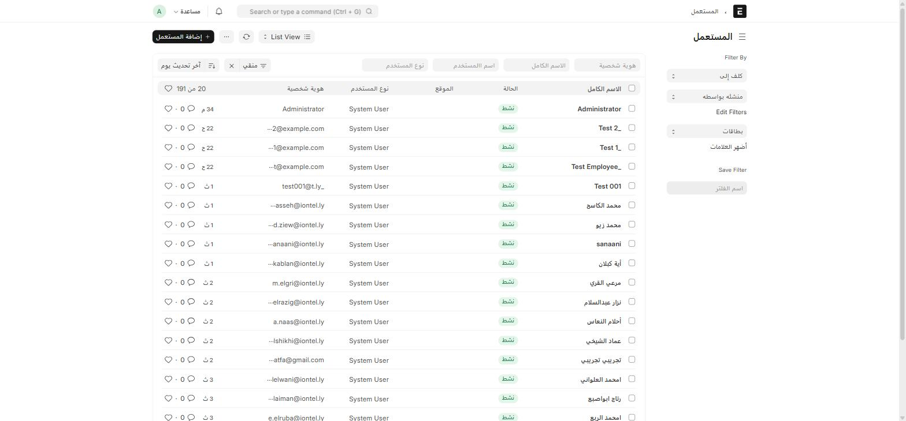
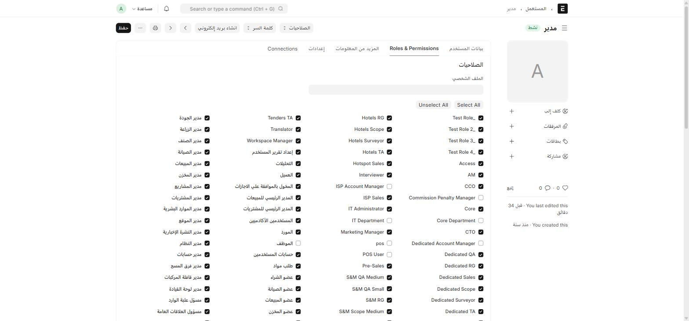

نظام الصلاحيات في Frappe قياسي: **مستخدم (User)** له واحد أو أكثر من **الأدوار (Role)**، وكل شاشة تحدّد أي الأدوار تملك حق القراءة/الكتابة/الإنشاء/الاعتماد عليها. ما يميّز هذا النظام هو **الكم الكبير من الأدوار المخصّصة** التي أضافتها تطبيقات ION — معظمها لتوجيه سير عمل الفرص في [المبيعات وإدارة العملاء](/sales-crm/opportunities-overview/).

## إنشاء مستخدم جديد

اكتب في شريط البحث: `المستعمل` أو `User`

1. اضغط **+ إضافة المستعمل**.
2. أدخل **البريد الإلكتروني**، **الاسم الأول**، (**اسم العائلة** اختياري).
3. احفظ، ثم افتح تبويب **Roles & Permissions** لتحديد أدواره.

## تعيين الأدوار

افتح تبويب **Roles & Permissions** على أي مستخدم لرؤية شبكة كاملة بكل الأدوار في النظام كمربّعات اختيار:

فعّل فقط الأدوار التي يحتاجها هذا المستخدم فعلياً. زر **Select All** يمنح **كل** الأدوار — لا تستخدمه إلا لحساب مدير نظام موثوق تماماً.

## لغة الواجهة تُضبَط من نفس الشاشة

راجع [تسجيل الدخول والخروج](/start/login/#واجهة-النظام-لا-تظهر-بالعربية) — حقل **اللغة** في تبويب **بيانات المستخدم** هو ما يتحكّم بلغة الواجهة لهذا المستخدم تحديداً.

## خريطة الأدوار المخصّصة حسب الفصل

الأدوار القياسية لـ ERPNext/HRMS (Sales User، Accounts Manager، HR Manager، ...) موجودة كالمعتاد. الجدول التالي يربط **الأدوار المخصّصة من ION** بالفصل الذي يشرح استخدامها:

| مجموعة الأدوار | أمثلة | الفصل المرجعي |
| --- | --- | --- |
| أدوار سير عمل الفرص (لكل مسار) | `Dedicated RG/Scope/QA/Surveyor/Sales/TA`، `Hotels ...`، `ISP ...`، `S&M ... Small/Medium`، `Tenders ...` | [نظرة عامة على الفرص الخمسة](/sales-crm/opportunities-overview/#الأدوار-المسؤولة-عن-كل-مسار) |
| أدوار الإدارة العليا | `CXO`، `CCO`، `CTO`، `GM` | [تفاصيل المسارات الخمسة](/sales-crm/opportunity-streams/) (فريق CXO في مسار المناقصات) |
| المسح الفني | `Surveyor`، `Surveyor Manager`، `Pre-Sales` | [المسوحات الفنية](/sales-crm/technical-surveys/) |
| المراجعة الفنية للمشتريات | `Technical Team`، `IT Administrator` | [طلب مواد والمراجعة الفنية](/buying/material-request/) |
| أخرى تنظيمية داخلية | `مدير اداره`، `PRO`، `Core`، `Access` | متفرّقة حسب السياق — تظهر كحقول Link على مستندات الفرص والمشتريات |

:::note[لماذا كل هذه الأدوار؟]
كل مسار بيع من مساراته الخمسة يحتاج فريقاً مختلفاً من الموافقين على كل مرحلة من مراحل سير العمل — فبدل دور "مبيعات" واحد عام، يملك كل مسار (Dedicated، SM، فنادق، ISP، مناقصات) مجموعة أدوار خاصة به لكل خطوة (جمع متطلبات، تحديد نطاق، تأهيل، مسح، مبيعات، الجانب التقني). هذا يمنع، مثلاً، موظف مبيعات فنادق من الموافقة على خطوة تخص مساراً مختلفاً كلياً.
:::

## مدير الصلاحيات (Permission Manager)

للتحكّم الدقيق بمستوى صف واحد (مثلاً: هذا المستخدم يرى فقط سجلات شركة معيّنة)، استخدم **Permission Manager** القياسي — اكتب في شريط البحث `Permission Manager`. هذا منفصل عن آلية [Custom User Permission](/buying/permissions/#custom-user-permission-—-صلاحية-تُنشأ-تلقائياً) التلقائية في تطبيق ion، والتي هي سجلّ تدقيق وليست أداة منح صلاحيات فعلية.
